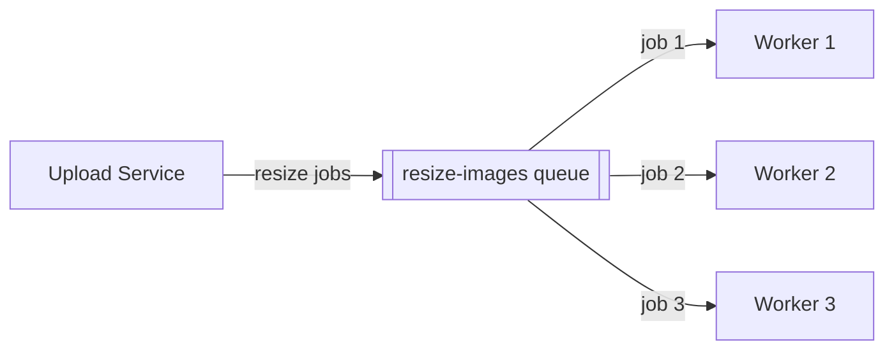
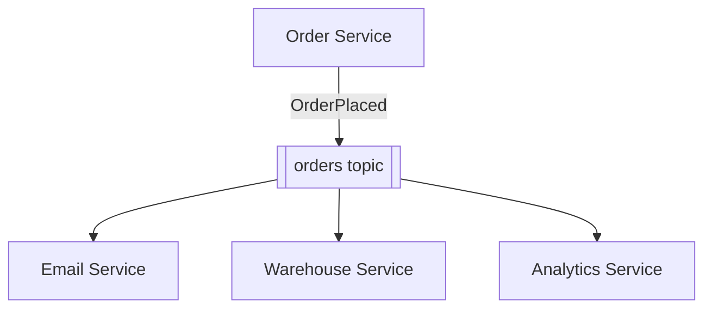
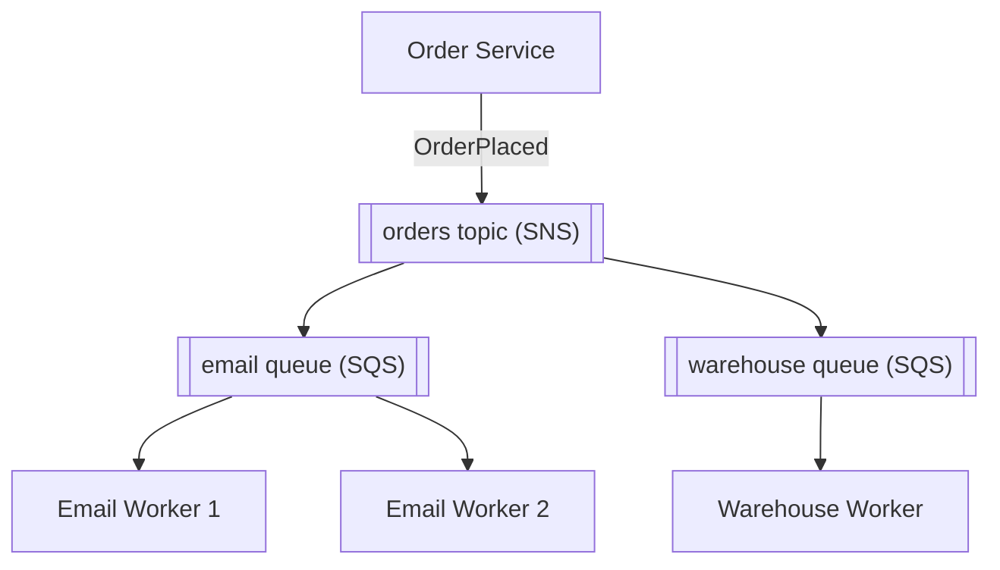

## The idea

Think of two ways to pass on information in an office.

- A **to-do tray**. People drop jobs into the tray. Whichever worker is free takes the next job and does it. Each job is done **once, by one person**. This is a **message queue**.
- A **notice board**. Someone pins up a notice. **Everyone** who reads the board sees it and acts on it in their own way. This is **publish-subscribe**, or **pub/sub** for short.

Both let one service hand work or news to another **without calling it directly**. This is the async style from [Sync vs Async](./sync-vs-async.mdx).

## Producers, consumers and the broker

- A **message** is a small piece of data, usually JSON, like `{"type": "OrderPlaced", "orderId": 42}`.
- The **producer** is the service that sends messages.
- The **consumer** is the service that reads and handles them.
- The **broker** is the system in the middle that stores messages until they are handled. Examples: RabbitMQ, Kafka, Amazon SQS.

The producer and the consumer never talk to each other. They only talk to the broker. This is called **decoupling**: each side can change, slow down or restart, and the other side doesn't notice.

When a consumer finishes a message, it sends an **ack** (acknowledgment) to the broker: "done, you can delete it". If the consumer crashes before the ack, the broker gives the message to a consumer again. So messages are not lost, but they can arrive twice. See [Delivery Guarantees](./delivery-guarantees.mdx).

## Point-to-point queues

In a **queue**, each message goes to **exactly one** consumer.

- The workers **share** the queue. Each job is done by one of them, not by all.
- Need to go faster? **Add more workers.** This is called **competing consumers**.
- Good for **jobs**, where one thing must be done once: resize this photo, send this email, make this PDF.

## Publish-subscribe

In **pub/sub**, the producer (here called the **publisher**) sends a message to a **topic**: a named channel, like `orders`. Every **subscriber** of the topic gets **its own copy**.

- The publisher doesn't know who is listening.
- Want a new feature, like loyalty points? The new service **just subscribes**. The Order Service doesn't change at all.
- Good for **events**, where several parts of the system care that something happened. See [Event-Driven Architecture](./event-driven-architecture.mdx).

## Both together

Real systems usually mix the two. A topic sends a copy of each message to **one queue per subscriber**, and each subscriber runs **many workers** that share its queue. On AWS this is called **fan-out**: an SNS topic (pub/sub) sends into several SQS queues.

Every subscriber gets every order, and inside each subscriber, the work is split between its workers. [Kafka](./kafka.mdx) does the same thing with **consumer groups**.

| | Queue | Pub/Sub |
| --- | --- | --- |
| **Who gets a message?** | One consumer | Every subscriber gets a copy |
| **Everyday picture** | To-do tray | Notice board |
| **Used for** | Jobs: "please do this" | Events: "this happened" |
| **Add more readers to...** | Do the work faster | Add new features |

## Why queues make systems stronger

**1. They soak up spikes.** On a sale day, 10 times more orders come in. Without a queue, the email service gets 10 times the traffic and may fall over. With a queue, the queue just gets **longer** for a while, and the workers keep a steady pace. This is called **load leveling**.

**2. They survive failures.** If the email service is down for 10 minutes, nothing is lost. Messages wait in the queue, and the service catches up when it is back.

**3. Each side scales alone.** The queue length tells you when you need more workers. Many teams **autoscale** (add or remove workers on their own) based on how long the queue is.

**4. Teams don't block each other.** A new subscriber doesn't need any change in the producer.

**5. Retries come for free.** If a worker fails, the message goes back into the queue for another try.

**The cost:** one more system to run and watch. Messages can arrive **twice** or **out of order**. Debugging is harder, because the work happens later and somewhere else. And if producers are faster than consumers for a long time, the queue grows without end. Watch two numbers: **queue length** and **age of the oldest message**. See [Backpressure](../reliability-security/backpressure.mdx).

## In the real world

**AWS fan-out.** AWS documents the SNS-to-SQS fan-out pattern: one SNS topic sends each message into several SQS queues, so that different services can each handle every message in their own time.

**Slack's job queue.** Slack's engineering blog ("Scaling Slack's Job Queue", 2020) describes a job queue that runs work too slow to do inside a web request, such as push notifications and link previews. After an incident where the queue's Redis ran out of memory, they put Kafka in front of it to store jobs safely on disk.

## In the interview

Use a queue whenever work can happen after the user gets an answer, or when traffic comes in bursts:

> "I'll put a queue between the upload service and the video workers. Uploads stay fast, a traffic spike just makes the queue longer, and I can add workers when the queue grows."

<Callout title="Remember this" type="success">
  - **Producer** sends, **consumer** handles, the **broker** stores messages in between.
  - **Queue** = each message to **one** consumer. Add workers to go faster.
  - **Pub/sub** = every subscriber gets a **copy**. Add subscribers to add features.
  - Real systems mix them: a topic **fans out** to one queue per service.
  - Queues **soak up spikes**, **survive failures** and let each side **scale alone**.
  - Watch **queue length** and **age of the oldest message**.
</Callout>
