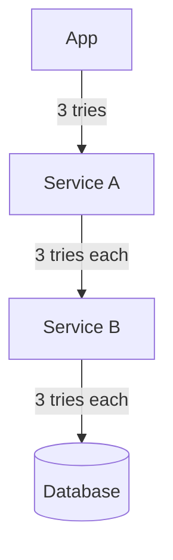

## What is it?

You call a friend and they don't pick up.

- You don't hold the phone for an hour. After a while, you hang up. That is a **timeout**.
- You try again later. That is a **retry**.
- If they still don't answer, you wait **longer** before each new try: 1 minute, then 2, then 4. That is **backoff**.

Now picture a shop that closes for 10 minutes. If 100 people all come back at **exactly** the same minute, the shop is packed again. It is much better if they come back at slightly **random** times. That randomness is called **jitter**.

## Why do we need it?

Every call over a network can fail in two ways: it gets an **error**, or it gets **no answer at all** (see [Why Distributed Systems Are Hard](../distributed-systems/why-distributed-is-hard.mdx)). Each tool fixes one problem:

**Why every call needs a timeout:** without a timeout, a call to a stuck service can wait forever. Each waiting request holds a **thread** (one of the server's workers) and a connection. Soon they are all used up, and your service stops answering too, even for requests that don't need the stuck service. One slow service drags down everything that calls it. This chain reaction is called a **cascading failure**.

**Why retry:** many failures are **short-lived**: a lost packet, a server restarting, a moment of overload. Trying again a moment later often works. Without retries, every tiny blip becomes an error the user sees.

**Why backoff and jitter:** retries add load at the worst moment, when a service is already struggling. Retrying at once, and all at the same time, can knock it over again. Waiting longer each time, at random, gives it room to recover.

## How it works inside

### Timeouts

A **timeout** is the longest time you will wait for an answer before you give up.

There are two kinds:

- **Connect timeout:** how long to wait to open a connection. Keep it short. If you can't even connect, the server is likely down.
- **Request timeout:** how long to wait for the full answer.

**How long?** Look at how long the service usually takes. A common choice is a bit above its **p99 latency**: the time that 99 out of 100 requests finish within (see [Latency Percentiles](../production/latency-percentiles.mdx)). Too short, and you give up on calls that would have worked. Too long, and you hold threads for nothing.

```js
// Give up after 2 seconds (2000 ms) instead of waiting forever
const response = await fetch("https://payments.internal/charge", {
    method: "POST",
    body: JSON.stringify(payment),
    signal: AbortSignal.timeout(2000),
});
```

**A timeout doesn't stop the server.** When the timer runs out, the client stops waiting and closes its side. But the server doesn't know you gave up, and may still finish the work. So after a timeout, the work **may or may not have happened**. That is why a retried call must be safe to repeat.

**Use one deadline for the whole request.** If the user's request has 2 seconds in total, and Service A has already used 1.5 seconds, then Service B gets only the 0.5 seconds left. There is no point in B working for 3 seconds on an answer nobody is waiting for. gRPC lets you pass a deadline along with each call for this.

### Retries

| Retry these | Don't retry these |
| --- | --- |
| Timeouts and dropped connections | `400`, `401`, `403`, `404`, `422`: the request itself is wrong |
| `500`, `502`, `503`, `504` | Any error after the deadline has passed |
| `429 Too Many Requests`, after the `Retry-After` time | A request that isn't safe to repeat and has no idempotency key |

The rules:

1. **Only retry what is safe to repeat.** A retried payment must not charge twice. Use an [idempotency key](./idempotency.mdx).
2. **Limit the tries.** For example, 3 tries in total. Then give up and report the error.
3. **Wait between tries**, longer each time (next section).
4. **Retry at one layer only.** If every layer retries, the number of calls multiplies:



If the database is struggling, one user action can turn into 3 × 3 × 3 = **27 calls** to it, exactly when it can least handle them. This is called a **retry storm**.

5. **Use a retry budget.** Allow retries only while they are a small share of all requests, like 10%. When things are badly broken, retries stop instead of piling on.

### Exponential backoff and jitter

- **Backoff** means waiting between retries.
- **Exponential** backoff **doubles** the wait each time: 100 ms, 200 ms, 400 ms, 800 ms...
- A **cap** stops the wait from growing forever, for example 10 seconds.

This gives the failing service room to recover, instead of hammering it.

**Why jitter?** Say a server restarts and 1,000 clients fail at the same moment. With plain backoff, they all retry at 100 ms, then all at 300 ms, then all at 700 ms: **in waves**. Each wave can knock the server over again. This is called a **thundering herd**. **Jitter** picks a **random** wait instead, so the retries spread out.

The most common version is **full jitter**: wait a random time between 0 and the exponential value.

**Step 1: How long to wait.** This works out the wait before retry number `attempt` (0, 1, 2, ...), in milliseconds.

```js
function backoffDelay(attempt, base = 100, cap = 10000) {
    // Double the wait each time: 100, 200, 400, ...
    // (2 ** attempt means 2 to the power of attempt)
    const doubled = base * 2 ** attempt;

    // Never wait longer than the cap
    const exponential = Math.min(cap, doubled);

    // Full jitter: a random wait anywhere from 0 up to exponential
    return Math.random() * exponential;
}
```

**Step 2: The retry loop.** It tries the call, and on a failure it waits, then tries again.

```js
// Wait for some milliseconds
function sleep(ms) {
    return new Promise((resolve) => {
        setTimeout(resolve, ms);
    });
}

async function callWithRetry(makeCall, maxTries = 3) {
    for (let attempt = 0; attempt < maxTries; attempt++) {
        try {
            return await makeCall();
        } catch (error) {
            const isLastTry = attempt + 1 >= maxTries;

            // isRetryable: true for timeouts, 5xx and 429 (see the table above)
            if (isLastTry || !isRetryable(error)) {
                throw error;
            }

            const waitMs = backoffDelay(attempt);
            await sleep(waitMs);
        }
    }
}
```

The wait times with `base = 100` ms and `cap = 10` seconds:

| `attempt` | Exponential wait | With full jitter, a random wait between |
| --- | --- | --- |
| 0 | 100 ms | 0 and 100 ms |
| 1 | 200 ms | 0 and 200 ms |
| 2 | 400 ms | 0 and 400 ms |
| 3 | 800 ms | 0 and 800 ms |
| 4 | 1.6 s | 0 and 1.6 s |
| 5 | 3.2 s | 0 and 3.2 s |
| 6 | 6.4 s | 0 and 6.4 s |
| 7 | 10 s (capped, it would be 12.8 s) | 0 and 10 s |

If the server sends a `Retry-After` header, wait **at least** that long.

## When to use it

- **Timeouts:** on **every** network call: databases, caches, HTTP and gRPC calls, other companies' APIs.
- **Retries:** for calls that are **safe to repeat** and fail for short-lived reasons, at **one** layer.
- **Backoff with jitter:** whenever you retry, and whenever many clients may reconnect at once, like phones after a server restart or queue consumers after an outage.

**When not to retry:**

- **Client errors** (`4xx`, except `408` and `429`). The same wrong request gives the same error.
- **Not safe to repeat**, and there is no idempotency key.
- **The deadline has passed.** The user has already given up.
- **The service keeps failing.** After many failures in a row, stop calling it for a while and fail fast. That is a [Circuit Breaker](../reliability-security/circuit-breaker.mdx).
- **At every layer.** Pick one layer: the one **just above** the service that is failing (the Google SRE book's advice), or the queue consumer.
- **Forever, in a queue consumer.** After a few failed tries, move the message to a [Dead-Letter Queue](./dead-letter-queues.mdx) so it can't block the others.

## Alternatives

Other ways to deal with a failing or slow call:

| Option | What it is | Pick it when |
| --- | --- | --- |
| **Circuit breaker** | After many failures, stop calling the service for a while and fail fast | The service is down, not just blipping. See [Circuit Breaker](../reliability-security/circuit-breaker.mdx) |
| **Hedged requests** | If the first call is slow, send a second copy to another server and use whichever answers first | Slow outliers hurt, and the call is safe to repeat, like a read |
| **Queue + dead-letter queue** | Put the work in a queue. The consumer retries later, and gives up into a DLQ | The caller doesn't need the answer now. See [Dead-Letter Queues](./dead-letter-queues.mdx) |
| **Fallback** | Return a cached, default or simpler answer instead of an error | A slightly worse answer beats no answer. See [Graceful Degradation](../reliability-security/graceful-degradation.mdx) |
| **Load shedding** | The busy server rejects extra work early, with `429` or `503`, so it stays up | You own the server. See [Backpressure](../reliability-security/backpressure.mdx) and [Rate Limiting](../reliability-security/rate-limiting.mdx) |

## In the real world

**AWS showed why jitter matters.** In the AWS Architecture Blog post "Exponential Backoff And Jitter" (2015), Marc Brooker simulated many clients competing for the same resource. Adding jitter to backoff cut both the total number of calls and the time to finish the work. AWS SDKs retry with exponential backoff and jitter by default.

**Amazon picks timeouts from percentiles.** The Amazon Builders' Library article "Timeouts, retries, and backoff with jitter" describes choosing a timeout from a high latency percentile of the service being called, like p99.9, so only a tiny share of good calls time out by mistake.

**Google uses retry budgets.** The Google SRE book (chapter "Handling Overload") describes limiting each request to a few tries, and allowing a client to retry only while retries are under about 10% of its requests. It also says to retry only at the layer immediately above the one that is rejecting requests, so retries don't multiply.

## In the interview

When a design calls another service or a third party, say the timeout, the retries and why they are safe:

> "Calls to the payment provider have a 2-second timeout and up to 3 tries with exponential backoff and jitter. Retries are safe because every request carries an idempotency key. If the provider keeps failing, a circuit breaker stops the calls for a while."

<Callout title="Remember this" type="success">
  - **Every** network call needs a **timeout**. A stuck call without one can take down the caller.
  - **Why:** calls fail with an error or with **no answer**. Timeouts stop the waiting, retries fix short blips, backoff and jitter keep retries from making it worse.
  - **Inside:** a timeout only stops the **client** waiting. The server may still finish the work, so retries must be **safe to repeat**.
  - Retry **timeouts, 5xx and 429**. Don't retry other **4xx**.
  - Only retry what is **safe to repeat**. Use an **idempotency key**.
  - **Exponential backoff:** 100 ms, 200, 400, 800... up to a **cap**.
  - **Jitter** = random waits, so clients don't retry in **waves**.
  - Retry at **one layer**, limit the tries, and use a **circuit breaker** when a service keeps failing.
  - **Alternatives:** circuit breaker, hedged requests, a queue with a DLQ, a fallback answer, load shedding.
</Callout>
