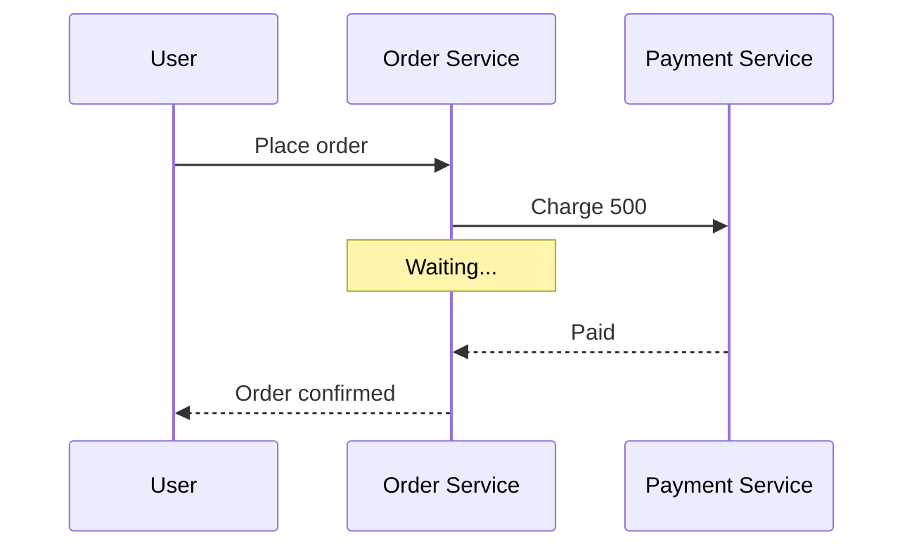
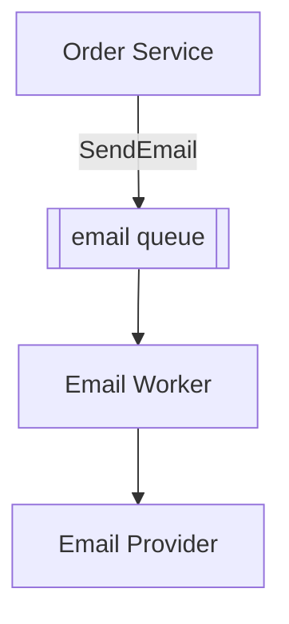
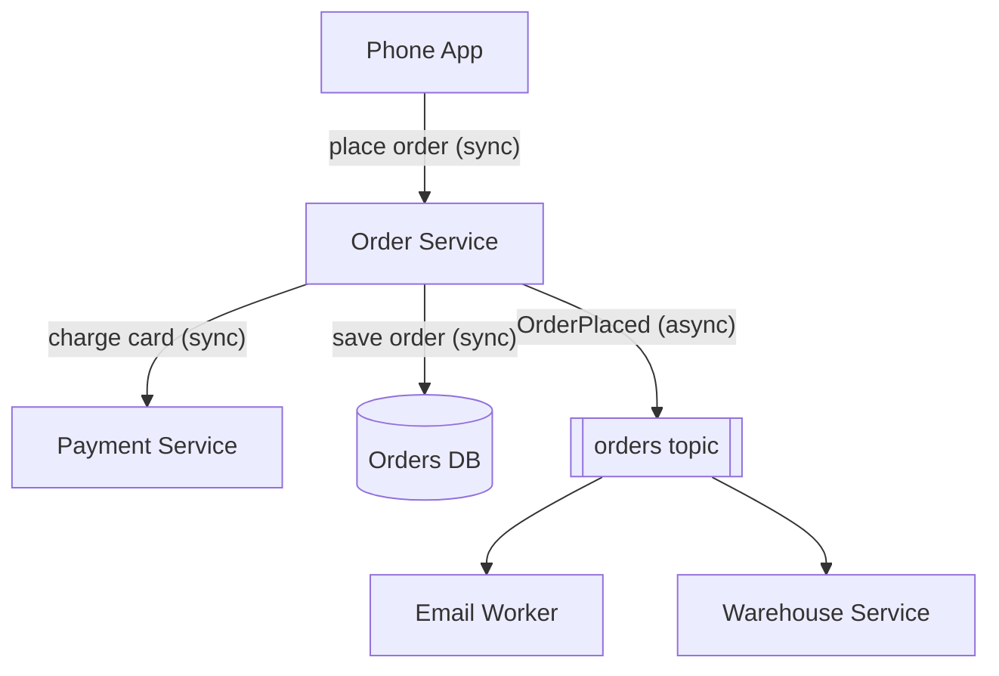

## The idea

When one service needs something from another, it can talk in two ways.

- **Synchronous (sync)** is like a **phone call**. You ask, and you stay on the line until you get the answer. You can't do anything else while you wait.
- **Asynchronous (async)** is like **leaving a voice message**. You say what you need and hang up. The other person deals with it when they can, and you get on with your day.

A restaurant shows both. At a coffee counter, you **stand and wait** until your coffee is ready: that is sync. At a busy burger place, you get an **order ticket with a number** and sit down. The kitchen works through the tickets one by one, and your number is called when the food is ready: that is async.

## Synchronous calls

In a sync call, the caller sends a request and **waits** for the reply before it does anything else. Most HTTP and gRPC calls between services work like this.



Sync is simple. You get the answer right away, and if something fails, the error comes straight back to you. But when calls are **chained** (A calls B, B calls C), two problems grow:

- **Delays add up.** If each of three services takes 100 ms, the user waits at least 300 ms.
- **Failures add up.** If any one service in the chain is down, the whole request fails. Three services that are each up 99.9% of the time are all up together only about 99.7% of the time.

A **slow** service is often worse than a dead one. Every caller sits waiting, and each waiting request holds a **thread** (one of the server's workers) and a connection. When they are all used up, the caller stops answering too. [Timeouts](./retries-backoff-timeouts.mdx) stop this from spreading.

## Asynchronous messages

In an async call, the caller puts a **message** into a **queue** and moves on at once. A queue is a waiting line for messages. It is kept by a separate system called a **message broker**, like RabbitMQ, Kafka or Amazon SQS. A **worker** (a program that does background work) takes messages from the queue and does the work later.



The Order Service doesn't care if the email worker is fast, slow, or down for a few minutes. The message waits safely in the queue until a worker is ready. See [Message Queues and Pub/Sub](./message-queues-pub-sub.mdx) for how queues work.

When a **client** starts slow work, the API often answers `202 Accepted`. It means "I got your request, and I will do it later". The reply usually says where to check on the work:

```http
POST /videos HTTP/1.1

HTTP/1.1 202 Accepted
Location: /videos/v81/status
```

The client then checks that address now and then, or the server tells it when the work is done (see [Polling, WebSockets and SSE](../foundations/polling-websockets-sse.mdx)).

## Good and bad sides

| | Sync | Async |
| --- | --- | --- |
| **Does the caller wait?** | Yes | No, it moves on right away |
| **When do you get the result?** | At once | Later, or never back to the caller |
| **If the other service is down** | The call fails | The message waits in the queue |
| **Traffic spikes** | Hit the other service directly | The queue soaks them up |
| **Easy to follow and debug?** | Yes: one request, one reply | Harder: the work happens later, somewhere else |
| **Is the data up to date?** | Yes, when the call returns | Other parts catch up a little later |
| **Extra parts to run** | None | A message broker |

Async brings its own problems. A message can arrive **twice** (see [Delivery Guarantees](./delivery-guarantees.mdx)). A message can fail again and again (see [Dead-Letter Queues](./dead-letter-queues.mdx)). And for a short time, different parts of the system can show different data (see [Eventual Consistency](./eventual-consistency-async.mdx)).

## Example: placing an order

A real checkout uses **both**. The simple rule:

- If the user **needs the answer before they can go on**, make it **sync**.
- If the work can **happen after** the user sees "Order placed", make it **async**.



One event, two readers that each need **their own copy**: that is a **topic** (pub/sub), not a single queue. In a plain queue, each message goes to only one reader. See [Message Queues and Pub/Sub](./message-queues-pub-sub.mdx).

| Step | Sync or async? | Why |
| --- | --- | --- |
| Check stock and charge the card | Sync | The user must know if the order worked |
| Save the order | Sync | It must be saved before we say "done" |
| Send the confirmation email | Async | Nobody waits on the screen for an email |
| Tell the warehouse to pack it | Async | Packing starts minutes or hours later anyway |
| Update analytics and recommendations | Async | Nobody is waiting for it at all |

## Example: sending an email

Sending an email is the classic async job:

- **Email providers can be slow or down.** If checkout waited for the email, a slow provider would make checkout slow.
- **Retries are easy.** If sending fails, the message goes back into the queue and a worker tries again later (see [Retries, Backoff and Timeouts](./retries-backoff-timeouts.mdx)).
- **Spikes are smooth.** On a sale day, 10 times more emails just make the queue longer for a while. The workers keep a steady pace.

The same goes for other slow work: making a PDF invoice, resizing an uploaded photo, processing a video. See [Background Jobs](../advanced-components/background-jobs.mdx).

## In the real world

**YouTube processes videos in the background.** When you upload a video, YouTube takes the file and answers quickly. The processing happens later. The page shows that the video is still being processed, and higher qualities like HD appear after lower ones.

**SendGrid answers 202.** Twilio SendGrid's Mail Send API answers `202 Accepted` when you ask it to send an email. It means "queued", not "delivered".

**Stripe tells you later with webhooks.** Some payments, like bank debits, take days to confirm. Stripe doesn't make your server wait. When the payment succeeds, it sends a `payment_intent.succeeded` event to your server. This is called a **webhook**: an HTTP call that another company's system makes to yours when something happens.

## In the interview

When you draw the design, mark which arrows are sync and which go through a queue, and say why:

> "Checking stock and charging the card are synchronous, because the user needs the answer. Everything after that, like the email, the warehouse and analytics, reacts to an OrderPlaced event on a topic, so a slow email provider can never slow down checkout."

<Callout title="Remember this" type="success">
  - **Sync** = phone call: wait for the answer. Simple, but delays and failures **add up** along a chain.
  - **Async** = voice message: put a message in a **queue** and move on. A worker does it later.
  - Async survives a **down** service and soaks up **spikes**, but it is harder to debug and data catches up **later**.
  - Rule: **sync** for what the user must know now, **async** for everything after.
  - Slow work (emails, videos, PDFs) is async. APIs answer `202 Accepted` for it.
</Callout>
