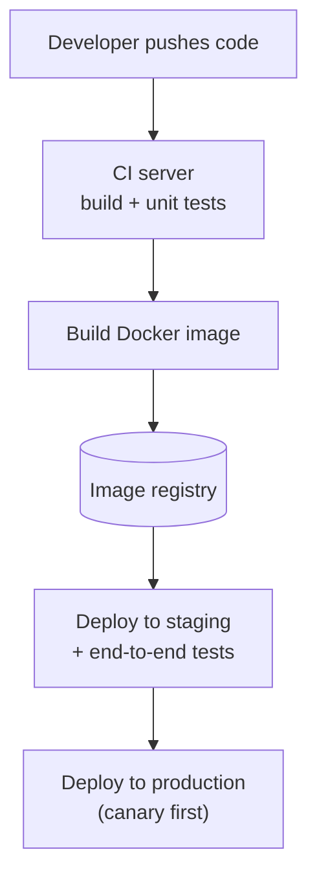
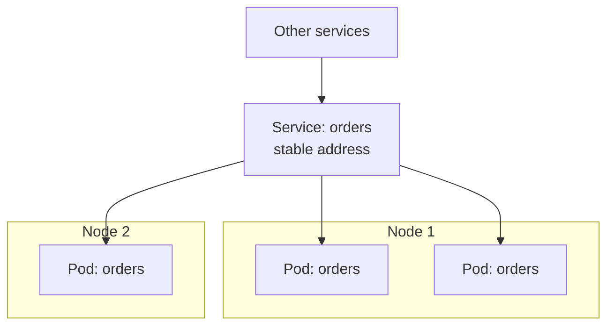

## What is it?

Three tools take code from a developer's laptop to thousands of servers:

- **CI/CD** is the **assembly line**: every change is built, tested and shipped by machines, the same way every time.
- **Docker** is the **shipping container**. Before standard containers, every cargo was packed differently and loading ships was slow. A standard box fits any ship, truck or crane. Docker packs your app and everything it needs into one standard box that runs the same on any machine. No more "but it works on my laptop".
- **Kubernetes** is the **port manager**. It decides which ship (server) each container goes on, keeps the right number running, and replaces any that fall overboard.

## Why do we need it?

Without these tools, shipping code is slow and full of surprises:

- **Manual steps.** A person builds the code, runs (or forgets) the tests, and copies files to each server. Steps differ each time, and one missed server can cause an outage (see Knight Capital in [Deployment Strategies](./deployment-strategies.mdx)).
- **"It works on my laptop."** The server has a different Node.js version or a missing library, so code that passed every test fails in production.
- **Too many machines to manage by hand.** With 200 containers on 30 servers, someone must pick a server with free room for each one, restart the ones that crash at 3 a.m., and add more when traffic grows.

CI/CD fixes the first problem, Docker the second, and Kubernetes the third.

## How it works inside

### CI/CD pipelines

- **CI (continuous integration):** every push is **built and tested automatically**, and developers merge small changes often.
- **CD (continuous delivery):** every change that passes is **ready to deploy** with one click.
- **CD (continuous deployment):** every change that passes is **deployed automatically**, with no click.



If any step fails, the pipeline stops, and the change never reaches users. The last step uses a safe strategy from [Deployment Strategies](./deployment-strategies.mdx). Common tools: GitHub Actions, GitLab CI, Jenkins.

### Docker containers

Two words to know:

- An **image** is the packed box: your code, the runtime (like Node.js), libraries and settings, saved as a file. It never changes once built.
- A **container** is a **running copy** of an image. One image can run as 50 containers on 50 servers. (Like a class and its objects, or a recipe and the dishes cooked from it.)

An image is described in a `Dockerfile`:

```dockerfile
# Dockerfile for a small Node.js service
# Start from a small image that already has Node.js
FROM node:26-alpine
WORKDIR /app
# Install libraries, then copy the app code
COPY package*.json ./
RUN npm ci --omit=dev
COPY . .
EXPOSE 3000
# What runs when the container starts
CMD ["node", "server.js"]
```

Containers share the host machine's operating system, so they are much lighter than full virtual machines: they start in seconds and use little memory.

**How a container is kept apart.** It is a normal process on the host, fenced in by two Linux kernel features. **Namespaces** give it its own view of processes, network and files, so it can't see other containers. **cgroups** limit how much CPU and memory it can use.

**Images are built in layers.** Each step in the Dockerfile adds a **layer**, and Docker reuses a layer when its step and inputs have not changed. That is why the Dockerfile above copies `package.json` and installs libraries **before** copying the code: a code change rebuilds only the last layers, not the slow install.

### Kubernetes basics

**Kubernetes** (often written **K8s**) runs containers across a group of machines, called a **cluster**. You tell it **what you want** ("3 copies of the orders service"), and it keeps making it true.

| Term | What it is |
| --- | --- |
| **Node** | One machine in the cluster |
| **Pod** | The smallest unit: one container (sometimes a few) running together on one node |
| **Deployment** | Keeps a set number of identical pods running, and replaces them during a rolling update |
| **Service** | A stable name and address for a group of pods, with load balancing across them. Pods come and go, the service stays |
| **HPA** (Horizontal Pod Autoscaler) | Adds or removes pods based on load, like CPU use |



**How it keeps things true.** You send the wanted state (usually a YAML file) to the **API server**, which saves it in a small database called **etcd**. The **scheduler** picks a node with free room for each new pod. On each node, an agent called the **kubelet** starts the containers and reports back. **Controllers** keep comparing "what is wanted" with "what is running", and fix any difference. This never-ending check is called the **control loop**.

**It heals itself.** If a pod crashes, the deployment starts a new one. If a whole node dies, its pods are started on other nodes. Pods that fail their health checks get no traffic.

**It scales.** One command tells Kubernetes to keep CPU around 70%, with 3 to 20 pods:

```bash
kubectl autoscale deployment orders --cpu=70% --min=3 --max=20
```

(Before kubectl 1.34, the flag was `--cpu-percent=70`.)

The 70% is a share of each pod's **CPU request**: the amount of CPU the pod asks for in its settings. So the HPA only works when the pods have CPU requests set.

## When to use it

- **CI:** any project with tests, or more than one developer. It is cheap to set up.
- **Docker:** almost any server app. The same image runs on a laptop, in CI and in production.
- **Kubernetes:** many services on many machines, with a team that can run it, or a managed service like EKS or GKE.

**Don't use it when:**

- **Kubernetes for one or two small services.** It has many moving parts. A simpler platform (below) is enough.
- **Continuous deployment without good tests and monitoring.** Bad changes then reach users automatically.

## Alternatives

| Option | What it is | Pick it when |
| --- | --- | --- |
| **Serverless functions** | AWS Lambda, Google Cloud Functions: upload code, the cloud runs it for each request | Small or spiky workloads, and you don't want to manage servers at all |
| **Managed container service** | AWS ECS with Fargate, Google Cloud Run: run containers without running a cluster | You want containers, not the work of Kubernetes |
| **Platform as a service** | Heroku, Render: push your code, they build and run it | Small teams and simple apps |
| **HashiCorp Nomad** | A simpler scheduler for containers and other programs | You want a cluster scheduler with fewer moving parts than Kubernetes |
| **Plain virtual machines** | Full machines with the app installed by scripts | Older apps, or software that needs a full operating system of its own |

## In the real world

**Kubernetes came from Google.** Google ran its own services for years on an internal system called **Borg**. Engineers used those lessons to build Kubernetes, which Google released as open source in 2014. It is now run by the Cloud Native Computing Foundation (CNCF) and offered by every big cloud, for example as Amazon EKS and Google GKE.

**Docker made containers easy.** Linux had the building blocks for containers for years, but **Docker** (released in 2013) gave developers a simple way to build, share and run them. That is why "Docker image" became the everyday name for a container image.

## In the interview

You rarely draw this, but one sentence shows you know how services run:

> "Each service is a Docker image, built and tested by the CI pipeline. It runs on Kubernetes as a deployment behind a service, with an autoscaler that adds pods when CPU goes above 70%."

<Callout title="Remember this" type="success">
  - **CI:** build and test every change automatically. **CD:** always ready to deploy, or deployed automatically.
  - **Why:** manual deploys go wrong, servers differ from laptops, and nobody can manage hundreds of containers by hand.
  - **Docker image** = the packed box. **Container** = a running copy of it.
  - Kubernetes: **pod** (running container), **deployment** (keeps N pods), **service** (stable address + load balancing).
  - **HPA** adds and removes pods with load. For CPU, the pods need **CPU requests** set. Crashed pods are **replaced automatically**.
  - **Inside:** containers are processes fenced by **namespaces** and **cgroups**. Kubernetes runs a **control loop**: wanted state vs running state.
  - **Alternatives:** serverless (Lambda), Cloud Run or ECS, Heroku-style platforms, Nomad, plain VMs.
</Callout>
