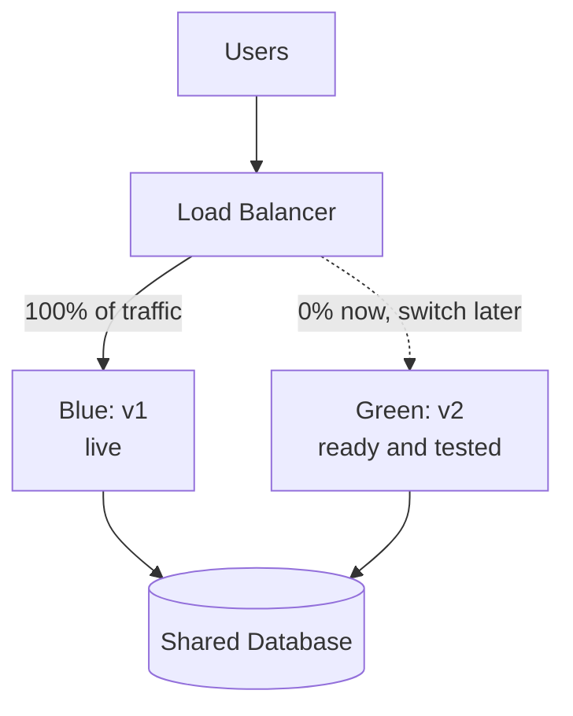
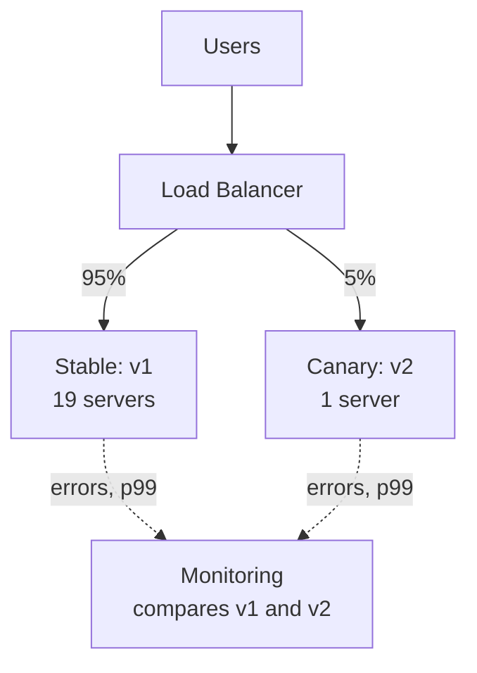
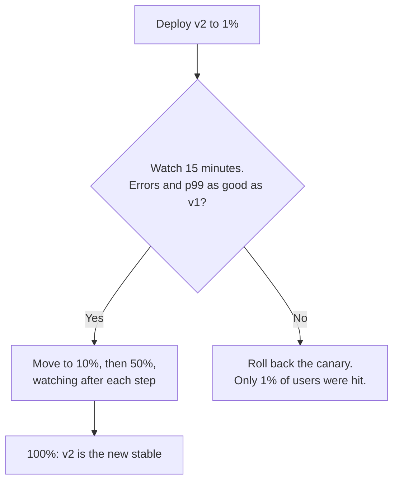

## The idea

A **deployment** is replacing the running version of your code with a new one. The risk is simple: the new version might have a bug, and every second it runs, real users feel it. A **deployment strategy** is a plan for switching versions **without downtime**, and for **going back fast** if something is wrong.

Think of a **restaurant changing its menu**:

- **Close for a day** and reopen with the new menu. Simple, but no customers that day. (**Recreate**.)
- **Change one table's menu at a time**, until every table has the new one. (**Rolling**.)
- **Set up a second dining room** with the new menu, check it, then send all guests there. If it goes badly, send them back. (**Blue-green**.)
- **Give the new dish to a few guests first** and watch their faces. If they like it, offer it to everyone. (**Canary**.)

The simplest, **recreate** (stop everything, start the new version), means downtime, so it is only used for small internal tools. The other three avoid downtime.

## Rolling deployment

Replace servers **a few at a time**. Each new server must pass its health check (see [Health Checks and Service Discovery](../hld-basics/health-checks-service-discovery.mdx)) before the next batch starts.

Four servers, one at a time:

| Step | Server 1 | Server 2 | Server 3 | Server 4 |
| --- | --- | --- | --- | --- |
| Start | v1 | v1 | v1 | v1 |
| 1 | **v2** | v1 | v1 | v1 |
| 2 | **v2** | **v2** | v1 | v1 |
| 3 | **v2** | **v2** | **v2** | v1 |
| Done | **v2** | **v2** | **v2** | **v2** |

**Good:** no extra servers needed. It is the default in Kubernetes.

**Watch out:**

- **Two versions run at the same time** during the rollout. Both must work with the same database and the same API. A request may hit v2 and the next one v1.
- **Rolling back is slow**: it is another rolling deploy, in reverse.
- During the rollout you have fewer servers serving traffic, so don't do it at peak time with no spare room.

## Blue-green deployment

Run **two full copies** of the system. **Blue** is live and serves all users. **Green** gets the new version, and you test it while no user sees it. Then the load balancer **switches all traffic** to green in one step.



**Good:**

- **Instant rollback:** if v2 misbehaves, switch the load balancer back to blue. Blue is still running.
- You can test the real production setup before any user sees it.

**Watch out:**

- **Double the servers** during the deploy (cloud makes this cheaper, because you only pay while both run).
- **The database is shared.** Both versions must work with the same schema, so a rollback doesn't meet a database that only v2 understands. See "Rolling back safely" below.
- All users move at once. If the bug only shows up under real traffic, **everyone** sees it until you switch back.

## Canary release

Send the new version to a **small share of users first**, like 1% or 5%, and **watch the metrics**. If the canary is healthy, increase the share step by step. If not, roll it back, and only that small share was affected.

The name comes from coal miners, who carried a **canary** into the mine. The bird felt bad air before the miners did, so it was an early warning.



A typical rollout plan:



**Good:** the **safest** strategy. Bugs that only appear with real users and real data hurt only a few of them.

**Watch out:** it needs good **metrics**, and automation to compare canary and stable. Like rolling, **two versions run at once**. And a canary at 1% may be too small to show a rare bug, which is why you keep watching as the share grows.

## Feature flags: deploy is not release

A **feature flag** is an on/off switch in your code, controlled from a config service, not from a deploy:

```js
if (flags.isEnabled('new-checkout', user)) {
  return newCheckout(cart);
}
return oldCheckout(cart);
```

Now **deploying** the code and **releasing** the feature are two separate steps. You deploy the code with the flag off, then turn it on for staff, then for 1% of users, then for everyone. If something breaks, you **turn the flag off** in seconds, with no new deploy. Many teams combine flags with canary deploys.

## Rolling back safely

A strategy is only as good as your ability to go back. Ways to make that easy:

- **Keep the old version ready.** Every build is saved (for example as a Docker image), so rolling back is one command, not a rebuild.
- **Roll back automatically.** If the error rate or p99 crosses a line during a rollout, the pipeline stops and goes back by itself.
- **Ship small changes often.** A deploy with one change is easy to judge and easy to undo. A deploy with 200 changes is not.
- **Make database changes work with old and new code.** This is the tricky one. Use **expand and contract**:

<Steps>
<Step>

**Expand:** add the new column (say, `full_name`), and keep the old one (`name`). Old code ignores the new column.

</Step>
<Step>

Deploy code that **writes to both** columns, and copy old data into the new column.

</Step>
<Step>

Deploy code that **reads from the new** column, and **still writes to both**. If it fails, roll back the code: the old column is still there and still up to date, because this code kept writing it.

</Step>
<Step>

**Contract:** weeks later, when you will never need to go back to code that reads `name`, deploy code that stops writing it. Then remove the column.

</Step>
</Steps>

Never deploy code together with a change that **deletes or renames** something the old code needs. Then a rollback has nowhere to go.

## Side by side

| | Rolling | Blue-green | Canary |
| --- | --- | --- | --- |
| **Downtime** | None | None | None |
| **Extra servers** | None or a few | Double, during the switch | A few |
| **Users hit by a bad version** | Grows with each batch | Everyone, until you switch back | Only the canary share |
| **Rollback speed** | Slow (deploy again) | **Instant** (switch back) | Fast (remove the canary) |
| **Two versions live at once?** | Yes | No (except during the switch) | Yes |
| **Needs** | Health checks | Two environments | Good metrics and automation |

## In the real world

**CrowdStrike, July 2024: everything at once.** On July 19, 2024, the security company CrowdStrike sent a faulty content update to its Falcon software on Windows computers. It went to all customers at the same time, and the bug crashed the computers. Microsoft estimated that about **8.5 million Windows devices** were affected, grounding flights and disrupting hospitals and banks. Afterwards, CrowdStrike said it would release such updates in stages, starting with a small canary group.

**Knight Capital, August 2012: one server missed the deploy.** The trading firm Knight Capital deployed new code by hand to eight servers, and one server was missed. A reused setting then switched on old, long-unused code on that one server, which started sending huge numbers of wrong orders. In about 45 minutes, the firm lost more than $400 million and nearly went out of business. Automated, checked deploys and removing dead code would have prevented it.

**Netflix automates canary checks.** Netflix and Google released **Kayenta**, an open-source tool for **automated canary analysis**, in 2018. It compares the metrics of the canary with the stable version and gives a pass or fail score, so a bad canary is rolled back without a human watching graphs.

## In the interview

Deployment is usually a short point near the end, or part of "how do you change this safely?":

> "We'd deploy with a canary: 1% of traffic first, compare error rate and p99 with the old version, and roll back automatically if they get worse. Database changes use expand and contract, so the old version still works if we roll back. Risky features also go behind a feature flag."

<Callout title="Remember this" type="success">
  - **Rolling:** replace servers a few at a time. No extra servers, slow rollback, two versions live.
  - **Blue-green:** two full copies, switch all traffic at once. **Instant rollback**, double the servers.
  - **Canary:** a small share of users first, watch metrics, then grow. **The safest.**
  - **Feature flags** separate deploying code from releasing a feature. Turn off in seconds.
  - Database changes: **expand and contract**, so old and new code both work.
  - Make rollback **one command, or automatic**.
</Callout>
