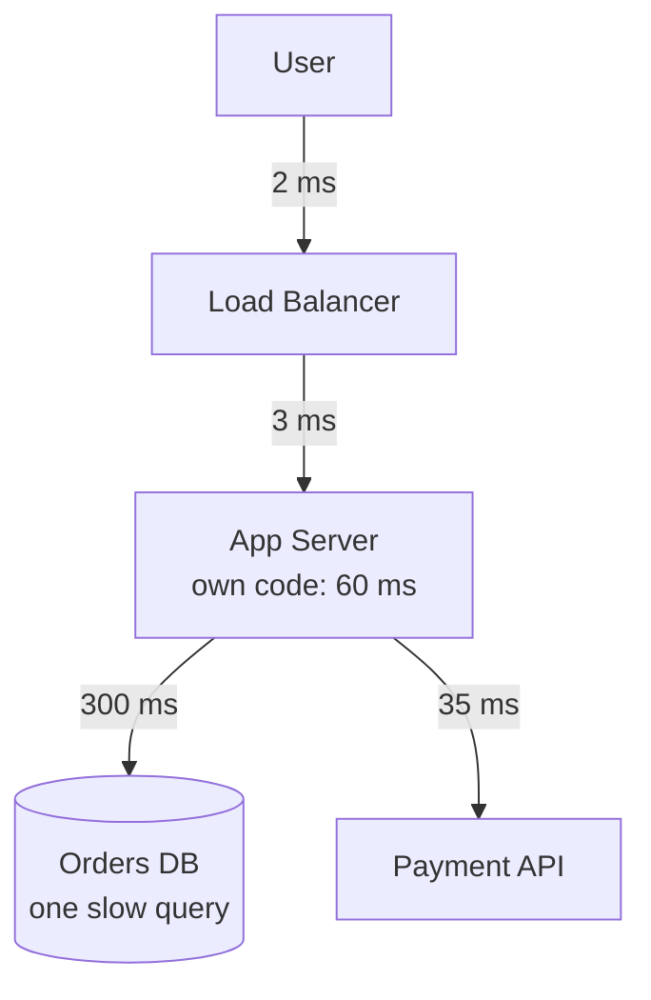

## The idea

A **bottleneck** is the one part of a system that limits everything else. The name comes from a bottle: no matter how big the bottle is, water can only pour out as fast as the narrow neck allows.

Think of a **highway with one narrow bridge**. Cars drive fast on four lanes, then crawl over the one-lane bridge. Adding more lanes to the highway does nothing. Only widening the bridge helps.

Systems work the same way. If the database is the slow part, adding more app servers does not help, and can make it worse (more servers sending queries to the same struggling database). So the first job is always to **find the bridge**, and only then fix it.

## Measure first, then fix

Guessing is the classic mistake: "it must be the code", followed by a week of tuning code that was never the problem.

Look at where the time actually goes in one slow request:



The request takes about 400 ms, and the database takes **300 ms** of it:

- Make the app code **twice as fast**: you save 30 ms. The request still takes about 370 ms.
- Fix the one slow query, from 300 ms down to 30 ms: you save **270 ms**. The request now takes about 130 ms.

**Fix the biggest part first.** A good way to work:

<Steps>
<Step>

**Find what is slow.** Use metrics: which endpoint has a bad p99 or error rate? See [Latency Percentiles](./latency-percentiles.mdx).

</Step>
<Step>

**Find where the time goes.** Open a **trace** of a slow request and look for the longest span. See [Observability](./observability.mdx).

</Step>
<Step>

**Check the resource behind it.** Is that part busy (CPU, disk), waiting (for a lock, a connection, another service), or failing?

</Step>
<Step>

**Change one thing.** If you change three things at once, you won't know which one helped.

</Step>
<Step>

**Measure again** under the same load. Did p99 really improve? Then the bottleneck moves somewhere else, and you start again.

</Step>
</Steps>

## Where bottlenecks hide

| Resource | Signs | How to check | Common fixes |
| --- | --- | --- | --- |
| **CPU** | CPU near 100%. Latency grows with traffic | CPU metrics. A **profiler** shows which functions use the CPU | Fix the hot code, cache results, add servers |
| **Memory** | Memory keeps growing, long garbage collection pauses, out-of-memory crashes | Memory metrics, heap snapshots | Fix memory leaks, keep less in memory, bigger machines |
| **Disk** | Slow reads and writes. The CPU sits idle "waiting for disk" | Disk metrics (`iostat` on Linux) | Faster disks (SSD), cache, fewer and bigger writes |
| **Network** | Bandwidth full, calls to other regions, very large responses | Network metrics, traces | Compress, use a CDN, keep services in the same region, fewer calls |
| **Database** | Slow queries, high database CPU, lock waits | Slow query log, `EXPLAIN` (below) | Indexes, better queries, cache, replicas |
| **Waiting on others** | Thread or connection pools full, a slow third-party API | Traces, pool metrics | Timeouts, async work, a circuit breaker |

A handy checklist for each resource is the **USE method**:

- **Utilization:** how busy is it? (CPU at 95%)
- **Saturation:** how much work is **waiting** for it? (40 requests in the queue)
- **Errors:** is it failing? (disk errors, dropped packets)

A resource that is busy **and** has a queue is your bottleneck.

## Slow query logs and EXPLAIN

The database is the most common bottleneck. Two tools find the bad queries.

### 1. The slow query log

Tell the database to write down every query slower than a limit:

```ini
# PostgreSQL (postgresql.conf): log queries slower than 200 ms
log_min_duration_statement = 200

# MySQL (my.cnf): the same, but the time is in seconds
slow_query_log = ON
long_query_time = 0.2
```

In PostgreSQL, the `pg_stat_statements` extension also shows which queries take the most **total** time. A 5 ms query that runs a million times an hour can matter more than one slow report.

### 2. EXPLAIN

`EXPLAIN` shows the database's **plan** for a query: how it will find the rows. `EXPLAIN ANALYZE` actually runs the query and shows the real times.

```sql
EXPLAIN ANALYZE SELECT * FROM orders WHERE user_id = 42;
```

```text
Seq Scan on orders  (cost=0.00..20834.00 rows=50 width=40) (actual time=0.030..92.104 rows=48 loops=1)
  Filter: (user_id = 42)
  Rows Removed by Filter: 999952
Planning Time: 0.081 ms
Execution Time: 92.312 ms
```

**Seq Scan** (sequential scan) means it read **every row** in the table, 1 million rows, to find 48. That is the warning sign. Add an index and look again:

```sql
CREATE INDEX idx_orders_user ON orders (user_id);
```

```text
Index Scan using idx_orders_user on orders  (cost=0.42..201.30 rows=50 width=40) (actual time=0.020..0.110 rows=48 loops=1)
  Index Cond: (user_id = 42)
Planning Time: 0.112 ms
Execution Time: 0.204 ms
```

From 92 ms to 0.2 ms. (These plans are in the PostgreSQL 17 format. PostgreSQL 18 and newer also print `Buffers` lines.)

More about how this works in [Indexes](../databases/indexes.mdx) and [How a Query Runs](../databases/how-a-query-runs.mdx).

## Common database fixes

| Problem | How you spot it | Fix |
| --- | --- | --- |
| **Missing index** | `Seq Scan` on a big table | Add an index on the columns you filter or sort by |
| **N+1 queries** | A trace shows hundreds of tiny queries for one request | Load everything in one query (a join, or `WHERE order_id = ANY(...)`) |
| **Fetching too much** | `SELECT *`, or thousands of rows when the page shows 20 | Select only the columns you need. Paginate |
| **Deep pages are slow** | `OFFSET 100000` reads and throws away 100,000 rows | Cursor pagination. See [API Pagination and Versioning](../advanced-components/api-pagination-versioning.mdx) |
| **Too many connections** | "Too many connections" errors, requests waiting for a connection | A connection pool. See [Connection Pooling](../databases/connection-pooling.mdx) |
| **The same reads again and again** | High database CPU from repeated simple queries | A cache, read replicas. See [Scaling Reads](../hld-basics/scaling-reads.mdx) |
| **Lock waits** | Queries waiting on each other, often on one busy row | Shorter transactions. See [Locks and Deadlocks](../databases/locking.mdx) |

The **N+1 problem** deserves a closer look, because it hides in friendly-looking code:

```js
// N+1: 1 query for the orders, then 1 more query PER order
const { rows: orders } = await db.query('SELECT * FROM orders WHERE user_id = $1', [userId]);
for (const order of orders) {
  const { rows } = await db.query('SELECT * FROM order_items WHERE order_id = $1', [order.id]);
  order.items = rows;
}
// 50 orders = 51 queries

// Fix: 2 queries in total, no matter how many orders
const ids = orders.map((o) => o.id);
const { rows: items } = await db.query('SELECT * FROM order_items WHERE order_id = ANY($1)', [ids]);
```

Each query may take only 2 ms, but 51 of them in a row is over 100 ms.

## In the real world

**Stack Overflow built MiniProfiler.** Stack Overflow's team built a small tool, **MiniProfiler**, that shows developers, in the corner of every page, how long the page took and how long **each SQL query** took. Slow queries and N+1 problems become visible during normal work, not weeks later. They released it as open source.

**Brendan Gregg's flame graphs and USE method.** Performance engineer Brendan Gregg created **flame graphs**, a picture of where a program spends its CPU time, where the widest bars are the hottest code. He also described the USE method above. Both are now used widely for performance work, including at Netflix, where he worked for many years.

## In the interview

You won't run `EXPLAIN` in a system design interview, but you will be asked "this is slow, what do you do?" or "where will this break first?" Show that you measure first:

> "First I'd check the metrics to find which endpoint is slow, then look at a trace to see which step takes the time. If it's the database, I'd check the slow query log and run EXPLAIN. Most of the time it's a missing index or an N+1 query, which is a cheap fix, before we think about caching or more machines."

<Callout title="Remember this" type="success">
  - A **bottleneck** is the narrow part that limits everything. Fixing anything else doesn't help.
  - **Measure first:** metrics → trace → resource. Fix the **biggest** part. Change **one** thing. Measure again.
  - Look at **CPU, memory, disk, network, the database, and waiting on others**.
  - **USE method:** Utilization, Saturation, Errors.
  - Database: **slow query log** finds the queries, **EXPLAIN** shows why. `Seq Scan` on a big table = missing index.
  - Classic fixes: **index, fix N+1, fetch less, pool connections, cache**.
</Callout>
