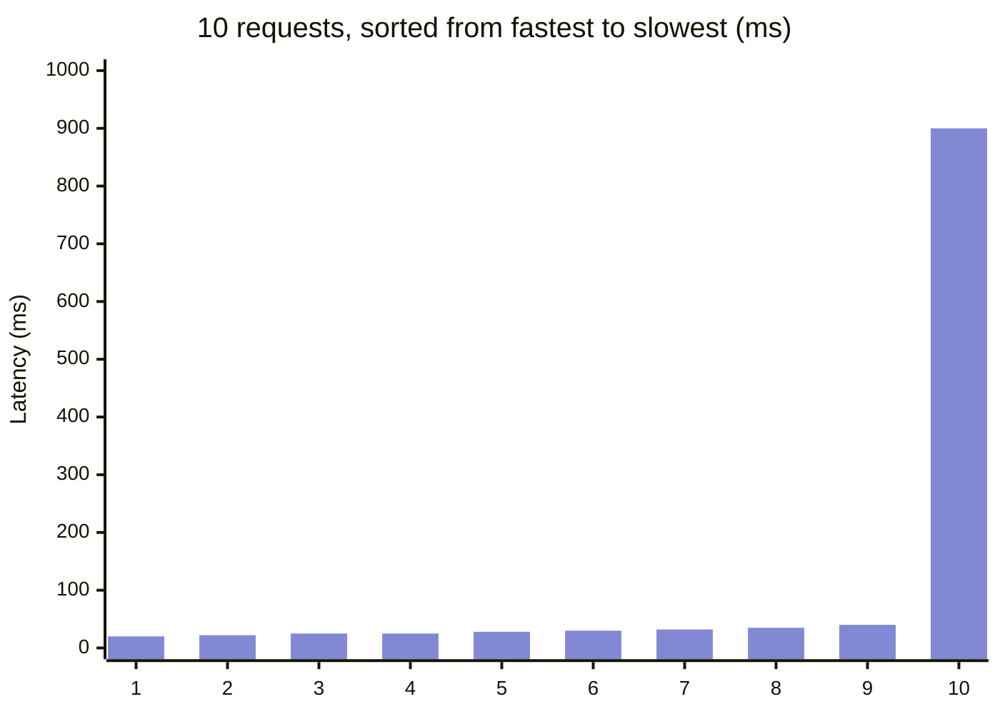
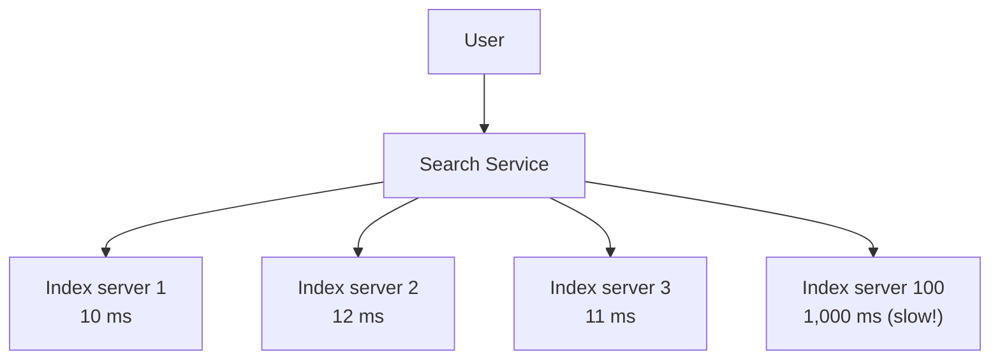

## The idea

**Latency** is how long one request takes, from asking to getting the answer (see [Latency, Throughput and QPS](../hld-basics/latency-throughput-qps.mdx)). To know if a system is fast, you measure the latency of many requests. The question is how to sum them up in one number.

Think of a **pizza shop**. Last night, 9 pizzas arrived in about 25 minutes. One arrived after **3 hours**. The average delivery time is about 40 minutes, which sounds "okay". But nobody waited 40 minutes: nine people were happy, and one person was furious and will never order again. The average hid the real story.

**Percentiles** fix this. Instead of one blended number, they tell you "how slow was it for the slowest 10% or 1% of requests?"

## A worked example: 10 requests

Ten requests came in. Their latencies, in milliseconds (ms), in the order they arrived:

`32, 25, 900, 28, 22, 40, 25, 30, 20, 35`

### Why the average lies

Add them up: 1,157 ms. Divide by 10: the **average is about 116 ms**.

But look at the data: **nine** requests took between 20 and 40 ms, and **one** took 900 ms. No request took anywhere near 116 ms. The average is too slow for the 9 typical requests, and far too fast for the 1 slow one. It describes **nobody**.



### Finding the percentiles

**Step 1: sort** the times from fastest to slowest, and number them:

| Position | 1 | 2 | 3 | 4 | 5 | 6 | 7 | 8 | 9 | 10 |
| --- | --- | --- | --- | --- | --- | --- | --- | --- | --- | --- |
| **Time (ms)** | 20 | 22 | 25 | 25 | **28** | 30 | 32 | 35 | **40** | **900** |

**Step 2:** the **pX** (the "X-th percentile") is the time at position **X% of the way down** the sorted list. Round the position up.

| Percentile | Position | Value | Meaning |
| --- | --- | --- | --- |
| **p50** | 50% of 10 = **5th** | **28 ms** | Half the requests took 28 ms or less |
| **p90** | 90% of 10 = **9th** | **40 ms** | 9 out of 10 requests took 40 ms or less |
| **p99** | 99% of 10 = 9.9, round up = **10th** | **900 ms** | 99 out of 100 requests took 900 ms or less |

Now the story is clear: **typical requests take about 28 ms, most are under 40 ms, but the slowest ones take 900 ms.** That last part is what the average was hiding.

With only 10 requests, p99 is simply the slowest one. Real systems compute percentiles over thousands of requests every minute. With 1,000 requests, p99 is the 990th: there are 10 requests slower than it.

The same thing in code:

```js
function percentile(times, p) {
  const sorted = [...times].sort((a, b) => a - b);
  // Position, counting from 1. Multiply before dividing: (p / 100) can be off
  // by a tiny bit (0.07 * 100 = 7.000000000000001), and then ceil picks the next one.
  const position = Math.ceil((p * sorted.length) / 100);
  return sorted[position - 1];
}

const times = [32, 25, 900, 28, 22, 40, 25, 30, 20, 35];
percentile(times, 50); // 28
percentile(times, 90); // 40
percentile(times, 99); // 900
```

(Monitoring tools use slightly different formulas, so their numbers can differ a little. The idea is the same.)

## p50, p95 and p99 explained

| Percentile | Also called | How many requests are slower | What it tells you |
| --- | --- | --- | --- |
| **p50** | The median | Half | The **typical** experience |
| **p95** | | 1 in 20 | What a user sees on a **bad but normal** moment |
| **p99** | | 1 in 100 | The **tail**: the slow edge of the system |
| **p99.9** | "three nines" | 1 in 1,000 | Used by very large systems, like Amazon's |

**"1 in 100" is not rare.** A user who makes 50 requests in a session (one page load can make many API calls) has about a **40% chance** of hitting at least one request slower than p99. Your heaviest users, who often matter most, hit the tail the most.

## Tail latency

**Tail latency** means the slowest requests: the p99 and above. The tail comes from things that happen only sometimes:

- **Garbage collection pauses:** the language runtime stops the program for a moment to free memory.
- **Cache misses:** most requests hit the cache, a few go to the slow database.
- **Queues:** a burst of traffic makes some requests wait in line.
- **A slow machine:** one server has a busy disk, or a **noisy neighbor**: another program on the same hardware using the disk or CPU.
- **Retries:** a request that failed once and was tried again takes twice as long.

### Fan-out makes the tail worse

Many systems answer one user request by calling **many servers in parallel**, like a search that asks 100 index servers. The user's request is only done when the **slowest** server answers.



Say each server is slow only **1% of the time** (its p99). The chance that **at least one** of them is slow grows fast:

| Servers called per user request | Chance the user request is slow |
| --- | --- |
| 1 | 1% |
| 10 | about 10% |
| 100 | about **63%** |

With 100 servers, **most** user requests are slow, even though each server is fast 99% of the time. That's why big systems care so much about p99 and p99.9.

**Fixes for the tail:** cache more, fix the slow cause (often garbage collection or a slow query), set **timeouts** (see [Retries, Backoff and Timeouts](../messaging/retries-backoff-timeouts.mdx)), call fewer servers, and **hedged requests**: if a server hasn't answered by the usual p95 time, send the same request to a second copy and use whichever answers first.

## What to alert on

- **Alert on p99 (or p95), not the average.** The average can look fine while 1 in 100 users waits seconds.
- **Use a time window.** "p99 above 500 ms **for 5 minutes**", not "one slow request". Single slow requests always happen.
- **Watch the endpoints users feel**, like `/checkout` or `/search`, separately. A fast health check endpoint can hide a slow checkout in a combined number.
- **Watch the error rate too.** Failed requests are often very fast, so a broken service can look "fast".
- **Don't average percentiles.** If server A's p99 is 100 ms and server B's is 900 ms, the overall p99 is **not** 500 ms. Collect a **histogram** (counts of requests in time buckets) from each server, add the histograms together, and then compute the percentile.

An example alert rule for Prometheus (a popular metrics tool), where the alert fires if checkout's p99 is above 0.5 seconds for 5 minutes:

```yaml
- alert: CheckoutSlow
  expr: histogram_quantile(0.99, sum(rate(http_request_duration_seconds_bucket{route="/checkout"}[5m])) by (le)) > 0.5
  for: 5m
  annotations:
    summary: "p99 latency of /checkout is above 500 ms"
```

Which percentile and which limit to pick is a business decision. That is what an **SLO** is: see [SLI, SLO and SLA](./sli-slo-sla.mdx).

## In the real world

**Amazon measures at p99.9.** Amazon's Dynamo paper (2007) explains that Amazon writes its internal performance targets at the **99.9th percentile**, not the average or median, so that almost every customer gets a good experience, not just the typical one.

**Google's "The Tail at Scale".** In this 2013 paper, Jeff Dean and Luiz André Barroso showed the fan-out math above: if each server is slow for 1 request in 100, and a user request needs 100 servers, then 63% of user requests are slow. In one of their tests, sending a backup ("hedged") request after waiting 10 ms cut the 99.9th percentile latency from 1,800 ms to 74 ms, while sending only 2% more requests.

## In the interview

When you write non-functional requirements, state latency as a percentile:

> "The feed should load with a p99 latency under 300 ms. I say p99 and not the average, because the average hides the slow requests, and the slowest 1% often hits our most active users."

If your design fans out to many servers, mention that the tail grows with fan-out, and that timeouts and hedged requests help.

<Callout title="Remember this" type="success">
  - The **average lies**: one slow request pulls it up, and it describes nobody.
  - **Sort, then pick:** p90 = the value 90% of the way down the sorted list.
  - **p50** = typical. **p95** = 1 in 20 slower. **p99** = 1 in 100 slower, the **tail**.
  - **Fan-out** makes the tail worse: 100 servers at 1% slow each = **63%** of requests slow.
  - **Alert on p99 or p95 over a window**, per important endpoint, next to the error rate.
  - **Never average percentiles.** Combine histograms, then compute.
</Callout>
