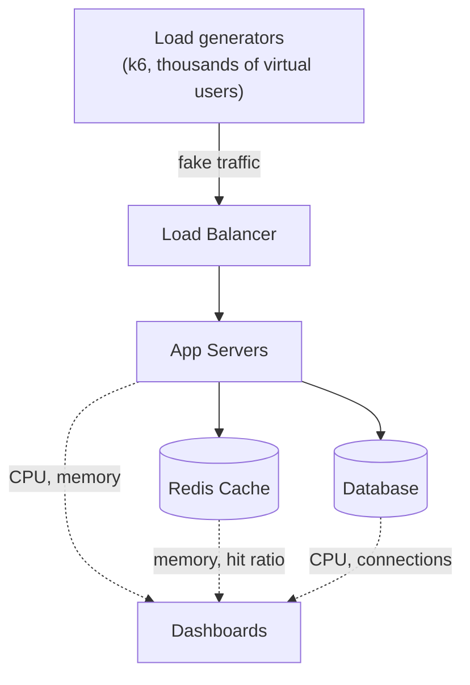
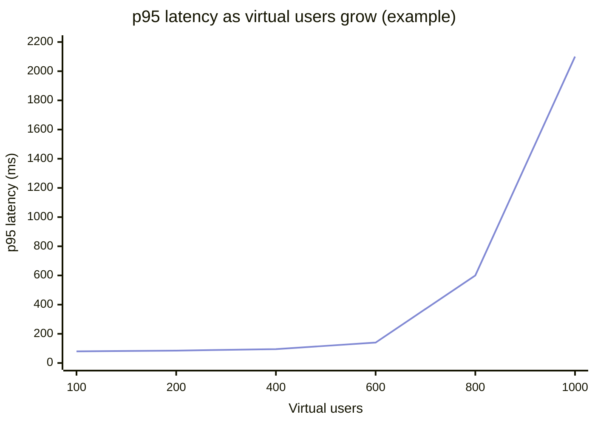

## What is it?

**Load testing** means sending a lot of fake traffic to your system, on purpose, to see how it behaves. You want to learn where it slows down and where it breaks **before** real users do it for you on your busiest day.

Think of a **new restaurant's practice night**. Before the grand opening, the owner invites 100 friends, all at once, and they all order. Maybe the kitchen copes. Maybe the grill can only cook 20 burgers at a time and orders pile up. Either way, it is far better to learn this with friends than on opening night with paying customers and a food critic.

## Why do we need it?

Capacity math on paper (see [Capacity Estimation](../hld-basics/capacity-estimation.mdx)) is only a guess. Many limits show up **only under real load**: a missing index, a connection pool of 10, a cache that is too small, auto-scaling that takes 5 minutes to add servers.

Without a test, you learn these limits from real users, and usually at the worst moment: the sale day or the launch, when traffic and money are at their highest. A load test moves that lesson to a quiet day, on a copy of the system.

## How it works inside

### Virtual users and load generators

The fake users are called **virtual users**. A tool runs them from one or more machines called **load generators**.



The test tool tells you what users felt (latency, errors). Your dashboards tell you **why** (which server was at 100% CPU). You need both.

### Kinds of tests

| Test | What you do | The question it answers |
| --- | --- | --- |
| **Load test** | Send the traffic you **expect** at peak, for a while | "Can we handle a normal busy day?" |
| **Stress test** | Keep **adding** traffic until things break | "Where is the limit, and what breaks first?" |
| **Spike test** | Jump from low to very high traffic **suddenly** | "What happens when a sale starts or a post goes viral?" |
| **Soak test** | Normal traffic for **many hours** | "Does anything get worse over time, like a memory leak?" |

A load test checks you are **ready**. A stress test finds the **limit**. Both are useful.

### What to measure

- **Throughput:** requests per second the system actually handled.
- **Latency:** p50, p95 and p99, not the average. See [Latency Percentiles](./latency-percentiles.mdx).
- **Error rate:** the percentage of failed requests, including timeouts.
- **Saturation:** how full each resource is: CPU, memory, database connections, queue lengths. This tells you **which part** is the bottleneck.

Decide the **pass line** before you start. It is usually your SLO, like "p95 under 200 ms and errors under 0.1%". See [SLI, SLO and SLA](./sli-slo-sla.mdx).

### Tools: k6 and JMeter

| Tool | Tests written in | Good to know |
| --- | --- | --- |
| **k6** | JavaScript | From Grafana Labs. Runs from the command line, easy to keep in Git and run in CI |
| **JMeter** | A visual editor (saved as XML) | From Apache, written in Java. Old, popular, supports many protocols |
| **Gatling** | Java, Scala, Kotlin, JavaScript or TypeScript code | Detailed reports |
| **Locust** | Python | Simple, easy to spread across many machines |

A small k6 test. It ramps up to 200 virtual users, stays there, ramps down, and fails if the pass line is missed:

**Step 1: The plan.** How many users, for how long, and the pass line.

```js
import http from "k6/http";
import { check, sleep } from "k6";

export const options = {
    stages: [
        // Ramp up to 200 users
        { duration: "2m", target: 200 },
        // Stay at 200 users
        { duration: "10m", target: 200 },
        // Ramp down
        { duration: "2m", target: 0 },
    ],
    thresholds: {
        // 95% of requests under 200 ms
        http_req_duration: ["p(95)<200"],
        // Less than 0.1% errors
        http_req_failed: ["rate<0.001"],
    },
};
```

**Step 2: What each virtual user does.** It looks at a random product, then "thinks" for 1 second. k6 runs this again and again for every user.

```js
export default function () {
    const productId = Math.floor(Math.random() * 10000);
    const response = http.get(`https://staging.myshop.com/api/products/${productId}`);

    check(response, {
        "status is 200": (reply) => reply.status === 200,
    });

    sleep(1);
}
```

Run it with `k6 run test.js`. At the end, k6 prints a summary like this (shortened):

```txt
http_req_duration ... avg=92ms  med=78ms  p(90)=140ms  p(95)=180ms
http_req_failed ..... 0.04%
http_reqs ........... 130000   155/s
✓ p(95)<200
✓ rate<0.001
```

### Fixed users vs fixed arrival rate

The script above uses a **fixed number of users**. Each user waits for its answer before it sends the next request. So when the system slows down, the users send **fewer** requests, and the test gets easier just when it should get harder.

Real internet traffic doesn't wait: new users keep arriving at the same rate. To test that, use a **fixed arrival rate**, like "300 new requests per second, however slow the answers are". In k6, this is the `constant-arrival-rate` executor.

## Reading the results

Here is an example stress test of an online shop. Traffic goes up step by step.

This test uses a shorter "think" time than the script above, `sleep(0.15)`. So while the system is fast, each virtual user sends about **5 requests per second**. (With `sleep(1)`, each user sends less than 1 request per second, so 200 users give under 200 requests per second, like the 155/s in the summary above.)

| Virtual users | Requests per second | p95 latency | Errors |
| --- | --- | --- | --- |
| 100 | 500 | 80 ms | 0% |
| 200 | 1,000 | 85 ms | 0% |
| 400 | 2,000 | 95 ms | 0% |
| 600 | 2,900 | 140 ms | 0.05% |
| 800 | 3,100 | 600 ms | 1.5% |
| 1,000 | 3,100 | 2,100 ms | 8% |



How to read it:

1. **Up to 400 users, latency is flat.** The system has spare room.
2. **Around 600 users, latency starts to rise.** Some part is getting busy. This bend is called **the knee**.
3. **After that, throughput stops growing** (stuck at 3,100 requests per second), while **latency and errors shoot up**. Adding users only makes the line longer, like a shop with one cashier: once the cashier is busy all the time, every new customer just waits longer.
4. **Check the dashboards at the knee.** Which resource was full first? Maybe database CPU hit 100%, or the connection pool ran out. That is your bottleneck. See [Finding Bottlenecks](./finding-bottlenecks.mdx).

With a pass line of "p95 under 200 ms", this system handles about **2,900 requests per second**. If the real peak is 2,500, that is too close: there is little room for a surprise. Fix the bottleneck, or add capacity, and test again.

## Making the test realistic

A load test is only useful if it looks like real traffic:

- **Test a copy of production:** same machine sizes, same amount of data. A database with 1,000 rows behaves nothing like one with 100 million.
- **Use many different IDs**, like the random product ID above. If every virtual user asks for the same product, it is always a cache hit, and the test lies.
- **Mix the actions** like real users: lots of browsing, some searching, a few checkouts.
- **Watch the load generator itself.** If its own CPU is at 100%, you are measuring the tester, not your system.
- **Don't load-test other companies.** Replace the payment provider or email service with a fake one (a **mock**).
- **Ramp up slowly**, so caches warm up and auto-scaling has time to react, unless a spike is exactly what you are testing.

## When to use it

- **Before a launch or a big sale** that you know is coming.
- **After big changes** to the architecture, the database or the machine sizes.
- **In CI, as a small regular test**, so a slow release fails the build (the k6 thresholds above do this).
- **To find your real limit** for planning, like how many servers next year's peak needs.

**Don't use it when:**

- **It would hit production at peak hours**, or nobody was told. You can cause the outage you wanted to avoid.
- **Traffic is tiny and steady**, like an internal tool with 20 users. The effort is not worth it.

## Alternatives

| Option | What it is | Pick it when |
| --- | --- | --- |
| **Capacity estimation** | Math on paper from requests per second and what one server can handle | Early design, before anything is built. See [Capacity Estimation](../hld-basics/capacity-estimation.mdx) |
| **Canary release** | Send a small share of **real** traffic to the new version and watch it | You trust real traffic more than fake traffic. See [Deployment Strategies](./deployment-strategies.mdx) |
| **Traffic replay** | Record real production requests and send copies to a test system | You want the real mix of requests, without real users seeing the results |
| **Chaos testing** | Break things on purpose (stop servers, add delay) and watch | You care more about failures than about heavy traffic. Netflix's Chaos Monkey is the famous example |

## In the real world

**Pokémon GO got 50 times the traffic it planned for.** When the game launched in July 2016, Google Cloud, which ran its backend, wrote that player traffic reached **50 times** the launch target, and **10 times** the worst case they had planned for. The servers struggled for days. Planning and testing for only the "expected" load is not enough when a launch goes viral.

**Ticketmaster and the Eras Tour presale.** In November 2022, the presale for Taylor Swift's Eras Tour overwhelmed Ticketmaster. The company said the site received **3.5 billion system requests**, four times its previous peak. Many fans got errors or waited for hours. It is a reminder to stress test far beyond your past record when you know a huge event is coming.

## In the interview

Load testing rarely comes up on its own. Mention it when you talk about **capacity** or a **big launch**:

> "Before the sale, I'd run a stress test against a staging copy with production-sized data, ramping up past our expected peak until something breaks. That shows the first bottleneck and our real limit, so we can fix it or add capacity before real users arrive."

<Callout title="Remember this" type="success">
  - **Load test:** expected peak traffic. **Stress test:** add traffic until it breaks. Also **spike** and **soak** tests.
  - **Why:** many limits show up only **under load**. Find them on a quiet day, not on launch day.
  - Measure **throughput, p95/p99 latency, error rate** and **saturation** of each resource.
  - Look for **the knee**: latency starts to climb, throughput stops growing.
  - The first resource to fill up at the knee is your **bottleneck**.
  - Tools: **k6** (JavaScript), **JMeter** (visual editor), Gatling, Locust.
  - Make it **realistic**: production-sized data, many different IDs, mocked third parties.
  - **Inside:** fixed users slow down when the system does. A **fixed arrival rate** is closer to real traffic.
  - **Alternatives:** capacity math, canary releases, traffic replay, chaos testing.
</Callout>
