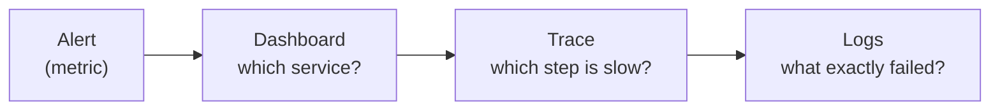
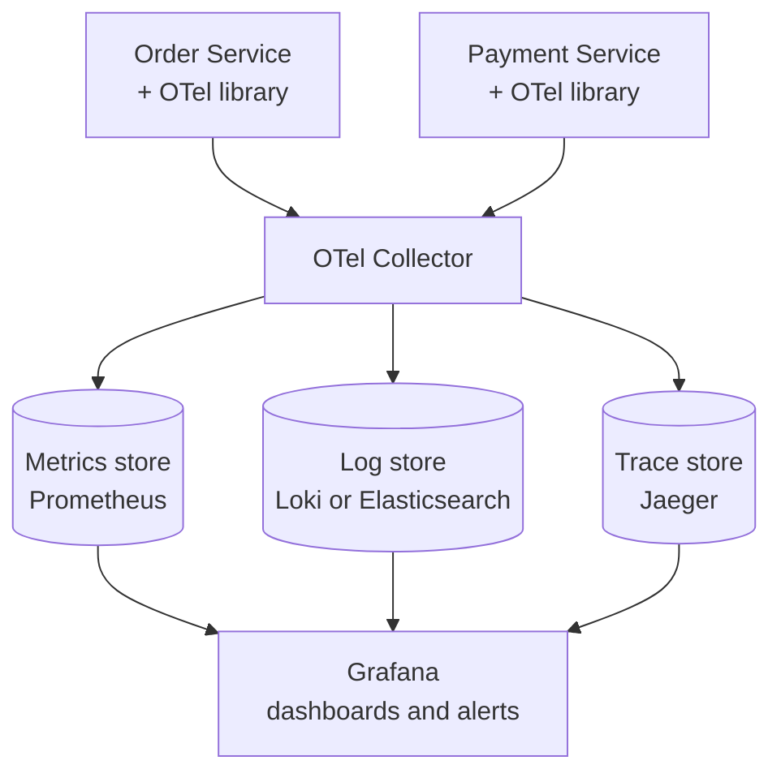

## The idea

Once your system runs in production, you can't attach a debugger or watch every request. **Observability** means the system gives off enough information that you can answer "what is happening, and why?" from the outside.

It comes in three kinds of data, often called the **three pillars**. Think of a **car on a long trip**:

- **Metrics** are the **dashboard**: speed, fuel, engine temperature. Numbers, updated all the time, that tell you **something is wrong**.
- **Logs** are the **trip diary**: "10:15, strange noise from the engine". Detailed notes about single events that tell you **what exactly happened**.
- **Traces** are like **parcel tracking**: "picked up in Delhi, sorted in Mumbai, delivered in Pune". They follow **one request** through every service it visits and show **where the time went**.

## Logs

A **log** is a line of text the app writes when something happens: a request came in, a payment failed, a job finished.

### Structured logging

Old-style logs are plain sentences:

```text
2026-03-02 10:15:03 ERROR Payment failed for user 42, order 981, took 2034ms
```

Easy for a person to read, but hard for a computer to search. **Structured logs** write the same thing as JSON, with named fields:

```json
{
  "time": "2026-03-02T10:15:03Z",
  "level": "error",
  "service": "payment",
  "message": "Payment failed",
  "userId": 42,
  "orderId": 981,
  "durationMs": 2034,
  "traceId": "4bf92f3577b34da6a3ce929d0e0e4736"
}
```

Now you can ask exact questions, like "all errors from the payment service for user 42 in the last hour", and get the answer in seconds.

**Good habits:**

- Use **log levels**: `DEBUG` (very detailed), `INFO` (normal events), `WARN` (strange, but working), `ERROR` (something failed).
- Add a **request ID or trace ID** to every line, so you can find all lines for one request.
- **Never log** passwords, card numbers or tokens.
- Send logs from all servers to **one central place** (like Elasticsearch, Grafana Loki or Splunk). With 200 servers, you can't log in to each one.

## Metrics

A **metric** is a number measured over time: requests per second, error count, CPU use. Metrics are small and cheap to keep, so you keep them for months and draw them as graphs on **dashboards**.

| Type | What it is | Examples |
| --- | --- | --- |
| **Counter** | A number that only goes up | Requests served, errors, orders placed |
| **Gauge** | A number that goes up and down | CPU %, memory used, queue length, open connections |
| **Histogram** | How values are spread, counted in buckets | Request durations, so you can get p50, p95 and p99 |

### The four golden signals

Google's SRE book says that if you can only watch four metrics for a service, watch these:

| Signal | Question it answers | Example |
| --- | --- | --- |
| **Latency** | How long do requests take? | p99 of `/checkout` is 420 ms |
| **Traffic** | How much demand is there? | 3,000 requests per second |
| **Errors** | How many requests fail? | 0.2% return `5xx` |
| **Saturation** | How full is the system? | CPU at 85%, DB connections 95 of 100 used |

Latency should be watched as **percentiles**, not averages. See [Latency Percentiles](./latency-percentiles.mdx).

**Alerts** are rules on metrics that wake someone up, like "error rate above 1% for 5 minutes". Which numbers deserve an alert is covered in [SLI, SLO and SLA](./sli-slo-sla.mdx).

**One trap: high cardinality.** Each metric can have **labels**, like `endpoint="/checkout"`. Every different label value creates a new series to store. A label like `userId` with millions of values creates millions of series and can break your metrics system. Put per-user details in **logs**, not metric labels.

## Traces

With many services, one user click can touch ten of them. When it is slow, which one is to blame? A **trace** answers that.

- A **trace** is the full journey of **one request**. It has a **trace ID**.
- A **span** is **one step** in that journey: one service's work, or one database query. Each span records its start time and how long it took, and knows its **parent span**.

Here is one slow checkout request, drawn as a timeline. Each bar is a span:

```mermaid
gantt
  title One request: POST /checkout (total 300 ms)
  dateFormat x
  axisFormat %L ms
  section API Gateway
  POST /checkout       :0, 300ms
  section Order Service
  create order         :10, 285ms
  section Orders DB
  INSERT order         :20, 15ms
  section Payments
  charge card          :45, 240ms
  section Bank API
  bank request         :55, 220ms
```



At a glance: the bank call takes 220 of the 300 ms. Speeding up the database would barely help.

**How the trace ID travels.** The first service creates a trace ID and passes it to every service it calls, in a request header. The standard header is `traceparent`:

```http
POST /payments HTTP/1.1
traceparent: 00-4bf92f3577b34da6a3ce929d0e0e4736-00f067aa0ba902b7-01
```

Each service reads the ID, records its spans under it, and passes it on. Later, a tracing tool collects all spans with the same ID and draws the timeline.

**Sampling.** Recording every span of every request is costly, so most systems keep only a **sample**. There are two ways to choose:

- **Head-based sampling** decides at the **start** of the request, for example "keep 1 in 100". It is cheap and simple, but at the start nobody knows yet which requests will be slow or fail.
- **Tail-based sampling** decides at the **end**, once all spans of the trace have arrived. Now it can keep **all** slow or failed traces, plus 1% of normal ones. It costs more, because every span must be held for a short time until the choice is made. The OTel Collector (below) can do this.

## How the three work together

A typical problem hunt uses all three, in this order:



1. A **metric** alert fires: "checkout p99 is 3 seconds".
2. The **dashboard** shows the payment service's latency jumped at 10:12.
3. A **trace** of a slow request shows the "bank request" span takes 2.8 seconds.
4. The **logs** for that trace ID show "connection timeout to bank API, retrying".

## OpenTelemetry, in short

Every tool used to need its own code in your app. **OpenTelemetry** (OTel) is one open standard for creating and sending logs, metrics and traces. You add its libraries once, and send the data to **any** tool you like. Changing tools later does not mean changing your code.



- **OTel libraries** exist for most languages. Many can record HTTP calls and database queries automatically.
- The **Collector** is a service that receives the data, filters or samples it, and forwards it to the stores.

## In the real world

**Tracing started at Google.** Google described its tracing system, **Dapper**, in a 2010 paper. It inspired open-source tools: Twitter built **Zipkin**, and Uber built **Jaeger**. Both are still widely used.

**Prometheus came from SoundCloud.** The music service SoundCloud built **Prometheus** to collect metrics, and released it as open source. It became the second project to join the Cloud Native Computing Foundation (CNCF), after Kubernetes, and is now a standard choice for metrics, usually with **Grafana** for dashboards.

**OpenTelemetry joined two projects.** OpenTelemetry was formed in 2019 by merging two earlier projects, OpenTracing and OpenCensus, so the industry would have one standard instead of two.

## In the interview

Observability is rarely the main topic, but it is a great "wrap-up" point, and the core of "design a logging and metrics system" (see [Design a Logging and Metrics System](../questions/logging-metrics.mdx)). Say:

> "Every service sends structured logs, metrics and traces through OpenTelemetry. I'll watch the four golden signals for each service and alert on p99 latency and error rate. Every request gets a trace ID, so when checkout is slow, we can see exactly which service is the cause."

<Callout title="Remember this" type="success">
  - **Metrics** tell you **something is wrong**. **Traces** tell you **where**. **Logs** tell you **why**.
  - Write **structured (JSON) logs** with a **trace ID**. Never log secrets.
  - Metric types: **counter** (only up), **gauge** (up and down), **histogram** (spread, for percentiles).
  - **Four golden signals:** latency, traffic, errors, saturation.
  - A **trace** = one request's journey. A **span** = one step. The ID travels in the `traceparent` header.
  - **OpenTelemetry** = one standard for all three, sent to any tool.
</Callout>
