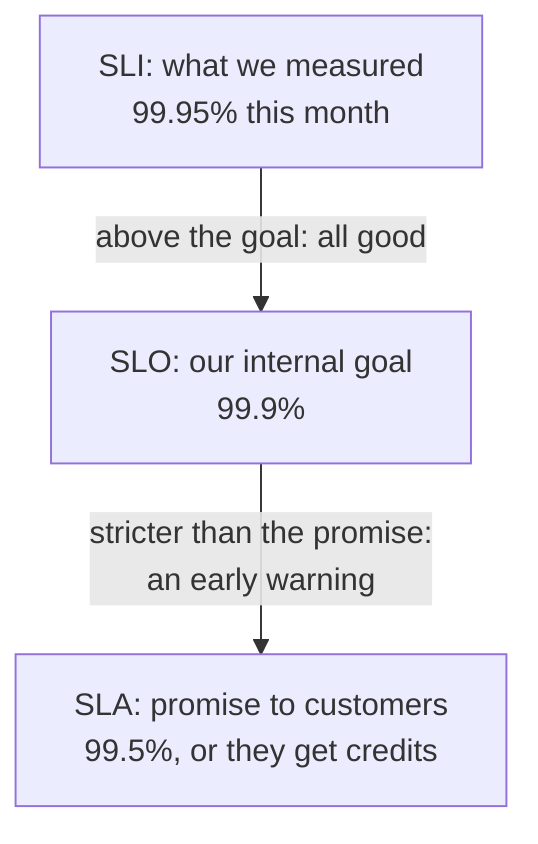
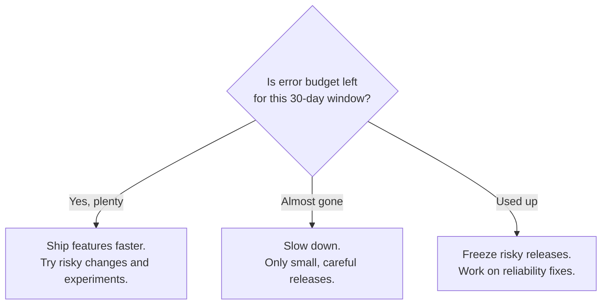

## The idea

"Is our system reliable enough?" is a vague question. SLI, SLO and SLA turn it into numbers.

Think of a **pizza shop** that delivers:

- **SLI** (service level **indicator**) is **what you measure**: "Last month, 97% of pizzas arrived within 30 minutes."
- **SLO** (service level **objective**) is **your own goal**: "We want 95% of pizzas to arrive within 30 minutes." It is written on the kitchen wall, not on the flyer.
- **SLA** (service level **agreement**) is **the promise to customers, with a penalty**: the flyer says "Delivered in 45 minutes, or your pizza is free."

Notice the order: the SLA (45 minutes) is **easier** than the SLO (30 minutes). The shop wants to see trouble coming, and fix it, **long before** it has to give away free pizza.

## SLI: what you measure

An SLI is almost always a **ratio of good events to all events**:

`SLI = good events / all events × 100%`

| Kind | Good event | Example SLI |
| --- | --- | --- |
| **Availability** | A request that did not fail (not a `5xx`) | 99.95% of requests succeeded |
| **Latency** | A request faster than a limit | 99.2% of requests took under 300 ms |
| **Freshness** | Data that was updated recently enough | 99.9% of search results were less than 1 minute old |
| **Durability** | Stored data that was not lost | 100% of uploaded files can still be read |

A few tips:

- **Measure close to the user**, for example at the load balancer, not inside one server. If the server is down, it can't count its own failures.
- **Pick SLIs users feel.** "CPU is at 60%" is not an SLI. "Checkout requests that succeeded" is.
- A `4xx` error is usually the **client's** mistake (see [HTTP Methods, Status Codes and Headers](../foundations/http-methods-status-codes-headers.mdx)), so most teams don't count it as a failure.
- For latency, a "percent of requests under X ms" SLI is the same idea as a percentile. See [Latency Percentiles](./latency-percentiles.mdx).

## SLO: your goal

An SLO is an SLI plus a **target** and a **time window**:

- "**99.9%** of checkout requests succeed, measured over **30 days**."
- "**99%** of search requests finish in under **300 ms**, over **30 days**."

The number of nines decides how much failure you can afford. Over 30 days:

| SLO (availability) | Allowed downtime in 30 days |
| --- | --- |
| 99% | 7.2 hours |
| 99.5% | 3.6 hours |
| 99.9% ("three nines") | 43 minutes |
| 99.95% | 22 minutes |
| 99.99% ("four nines") | 4.3 minutes |

More on the nines in [Availability and Reliability](../hld-basics/availability-reliability.mdx).

**Don't aim for 100%.** It is impossible, and chasing it costs a fortune. Users can't tell 99.99% from 100% anyway, because their own Wi-Fi and phone network fail more often than that. Each extra nine usually costs much more work and money than the one before, and slows down every release.

## SLA: the promise to customers

An SLA is a **contract**. It says what the provider promises and **what happens if it breaks the promise**. Usually that is **service credits**: money off the customer's next bill.

| | SLI | SLO | SLA |
| --- | --- | --- | --- |
| **What it is** | A measurement | A goal | A contract |
| **Who sets it** | Engineers | Engineers and product | Business, lawyers, customers |
| **If you miss it** | Nothing. It's just a number | The team slows down and fixes reliability | The company pays (credits, refunds) |
| **Example** | 99.95% succeeded | 99.9% must succeed | 99.5%, or 10% off the bill |

Internal services usually have **SLOs but no SLA**. SLAs are for paying customers.

## Error budgets

If the SLO is 99.9%, then **0.1% of requests are allowed to fail**. That allowance is the **error budget**. It is not a failure to use it. It is room you are **allowed to spend**.

A worked example. The SLO says 99.9% of requests succeed over 30 days. You expect **100 million requests** in that time.

- Error budget: 0.1% of 100 million = **100,000 failed requests**.
- On day 5, a bad deploy causes 30,000 errors. **30% of the budget is gone.**
- On day 12, a database failover causes 50,000 errors. **80% gone**, with 18 days left.

What do you do with that information? The team agrees on a rule ahead of time:

This ends the old fight between "ship fast" and "keep it stable". Both sides agree on the number. While there is budget, ship. When it is gone, fix things.

Teams also alert on how **fast** the budget is burning. If the whole month's budget would be gone in a day or two at the current error rate, that pages someone right away.

## In the real world

**Google made SLOs and error budgets popular.** Google's book "Site Reliability Engineering" (2016) describes how its teams use SLOs and error budgets to decide when to ship and when to stop and fix things. The book also makes the point that 100% is the wrong reliability target for almost every system.

**Amazon S3: designed for more, promised less.** AWS says S3 Standard is **designed for 99.99% availability**, but its SLA only promises **99.9%** a month. If a month falls below that, customers can claim **service credits**, a discount on their bill. That gap between the goal and the promise is exactly the SLO-vs-SLA idea.

## In the interview

SLOs belong in the **non-functional requirements** at the start of the interview. Say them as numbers:

> "For the booking service, I'll aim for 99.99% availability, because a failed booking loses money, and p99 latency under 500 ms. The recommendations widget can be 99.9%, because if it fails, the page still works without it."

Giving different parts different targets shows you think about what really matters to users.

<Callout title="Remember this" type="success">
  - **SLI** = what you **measure**: good events / all events.
  - **SLO** = your **goal**: SLI + target + time window, like 99.9% over 30 days.
  - **SLA** = the **contract** with customers, with a penalty. Looser than the SLO.
  - **Error budget** = 100% minus the SLO. Budget left: ship. Budget gone: fix reliability.
  - 99.9% over 30 days = about **43 minutes** of downtime. 99.99% = about **4 minutes**.
  - **Never aim for 100%.**
</Callout>
