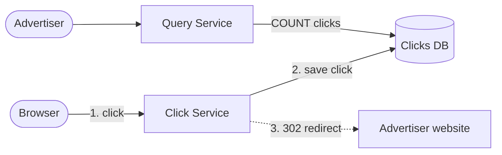
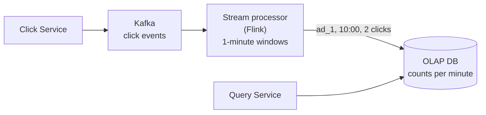
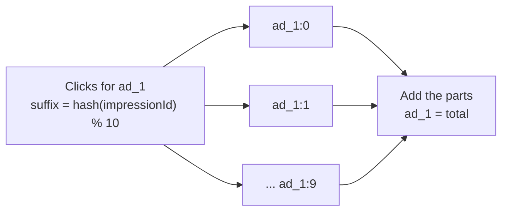
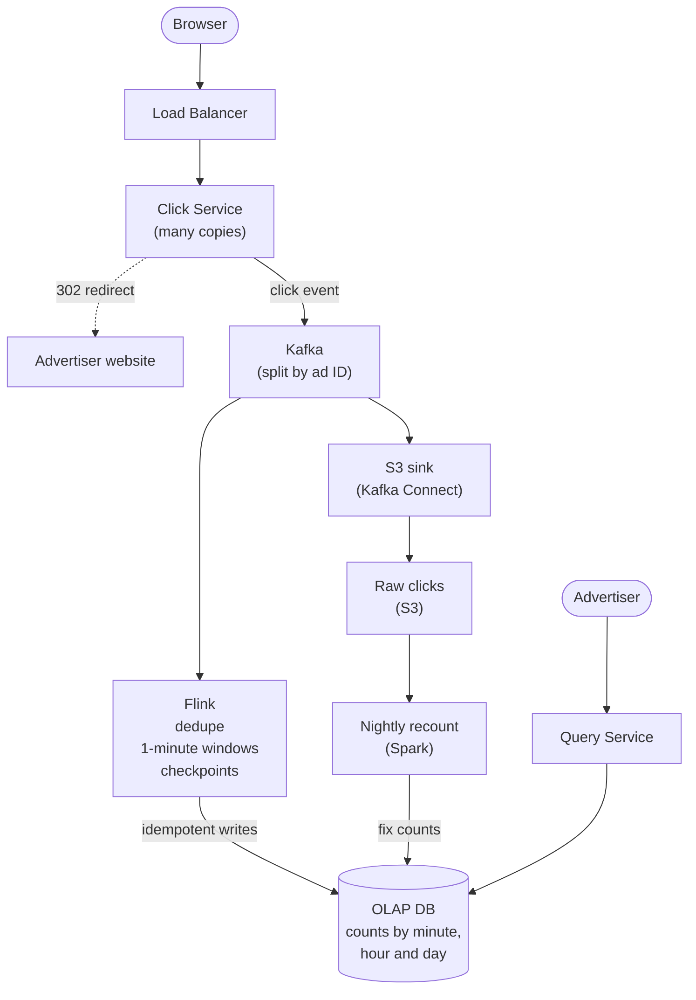

<Callout title="About this question">
  **Difficulty:** Hard. Lots of events, and the counts are money, so they must be right. **Patterns used:**
  [Batch vs Stream Processing](../advanced-components/batch-vs-stream.mdx), [Kafka](../messaging/kafka.mdx),
  [Idempotency](../messaging/idempotency.mdx), [Delivery Guarantees](../messaging/delivery-guarantees.mdx),
  [Hot Keys](../advanced-components/hot-keys-fan-out.mdx),
  [Probabilistic Data Structures](../advanced-components/probabilistic-data-structures.mdx).
</Callout>

## Understand the problem

When you click an ad on a website, two things happen. You are sent to the advertiser's website. And somewhere, a system writes down "ad 123 was clicked".

Advertisers pay **per click**. They also want a dashboard: "how many clicks did my ad get each minute today?". So we must count every click **once**: not zero times (we lose money), not twice (the advertiser pays too much). And we must do it for billions of clicks a day.

## Step 1: Requirements

### Functional requirements

1. Users can click an ad and are sent to the advertiser's website.
2. Advertisers can see click counts for their ads over time, down to **one minute**.

**Out of scope** (say this out loud): choosing which ad to show, ad impressions (views), the billing system itself, deep fraud detection.

### Non-functional requirements

1. **Scale:** 10 million active ads. About 1 billion clicks per day: about **12,000 clicks per second** on average, and about **30,000 per second** at peak.
2. **Correct:** each click counted **exactly once**. This is money.
3. **Fresh:** advertisers see new clicks within about 1 minute.
4. **Fast queries:** dashboard queries answer in under 1 second.
5. **Fast redirect:** the user is never kept waiting while we count.

### Quick math

- **Clicks per second:** 1 billion clicks ÷ 86,400 seconds in a day = about **11,600 per second**, so about **12,000 per second on average**. Clicks are not spread evenly (evenings, big sports games), so plan for about 2 to 3 times that at peak: about **30,000 per second**.
- 1 billion clicks per day. If we store every click and run `COUNT(*)` each time an advertiser opens the dashboard, every query scans millions of rows.
- **Decision:** we must **count ahead of time**. We keep small rows like `(ad 123, 10:05, 42 clicks)`, and the dashboard reads those. How we count ahead is the main deep dive.

## Step 2: Core entities

- **Ad:** ad ID, advertiser, the website to send users to.
- **Click event:** impression ID, ad ID, time, user info (like IP address).
- **Click count:** ad ID, minute, number of clicks.

An **impression** is one showing of an ad to one user. Each time an ad is shown, it gets a unique **impression ID**. We will use it to spot duplicate clicks.

## Step 3: API

```http
GET /click?adId=123&imp=8f2c41d0.signature

→ 302 Found
Location: https://shoes.example.com/sale
```

```http
GET /ads/123/clicks?from=2026-11-19T10:00Z&to=2026-11-19T11:00Z&granularity=minute

→ 200 OK
{
  "adId": "123",
  "points": [
    { "minute": "2026-11-19T10:00Z", "clicks": 42 },
    { "minute": "2026-11-19T10:01Z", "clicks": 38 }
  ]
}
```

The ad link on the web page points to **our** `/click` URL. We record the click, then send the user on with a `302` redirect.

## Step 4: Data flow

1. A user clicks an ad.
2. We record a click event.
3. We send the user to the advertiser's website.
4. We count clicks per ad, per minute.
5. We store those counts.
6. Advertisers read the counts on a dashboard.

## Step 5: High-level design

The simplest design that works: save every click, count when asked.



**Click an ad:**

1. The browser opens `/click?adId=123&imp=...`.
2. The Click Service saves one row for the click.
3. It returns a `302` redirect, and the browser goes to the advertiser's website.

**See the counts:**

1. The advertiser opens the dashboard.
2. The Query Service runs something like:

```sql
SELECT date_trunc('minute', clicked_at) AS minute, COUNT(*) AS clicks
FROM clicks
WHERE ad_id = '123' AND clicked_at >= '2026-11-19 10:00' AND clicked_at < '2026-11-19 11:00'
GROUP BY minute;
```

This works for a small site. At 1 billion clicks a day, these counts get slow, and every dashboard refresh loads the database. Let's fix that.

## Step 6: Deep dives

### 1. How do we keep counts fast and fresh? Batch vs stream

<Callout title="Not great: count raw rows on every query" type="error">
  The design above. Simple, **but** each query scans many rows, and thousands of advertisers refreshing
  dashboards will overload the database.
</Callout>

<Callout title="Okay: a batch job every hour" type="warn">
  Save raw clicks to cheap storage (S3). Every hour, a **batch** job (like Spark) counts clicks per ad per
  minute and writes the results to a fast database. Queries are fast. **But** the numbers are up to an hour old.
</Callout>

<Callout title="Best: stream processing with 1-minute windows" type="success">
  Send each click into Kafka. A **stream processor** (like Apache Flink) reads clicks as they arrive and keeps a
  running count per ad for the current minute. When the minute ends, it writes the counts. Advertisers see new
  numbers within seconds of each minute ending.
</Callout>

**Batch** means "collect a big pile, then process it all at once, later". **Stream** means "process each event as it arrives". (See [Batch vs Stream Processing](../advanced-components/batch-vs-stream.mdx).)

**Tumbling windows.** The stream processor cuts time into fixed buckets that don't overlap: 10:00 to 10:01, 10:01 to 10:02, and so on. These are called **tumbling windows**. Each click goes into the bucket of the minute it happened in:

| Click time | Ad | Goes into window |
| --- | --- | --- |
| 10:00:15 | ad_1 | 10:00 |
| 10:00:40 | ad_1 | 10:00 |
| 10:00:52 | ad_2 | 10:00 |
| 10:01:05 | ad_1 | 10:01 |

When the 10:00 window closes, the processor writes `ad_1 = 2` and `ad_2 = 1` for 10:00.

**Late clicks.** A phone on a bad network might send a 10:00:50 click at 10:01:20. Which time do we use? We use the **event time** (when the click happened), not the time it reached us. So we keep each window open a little longer, say 30 extra seconds, before writing its result. Stream processors track this with a **watermark**: a marker in the stream that says "I believe all clicks before 10:01:00 have now arrived". Clicks that come even later are fixed by the nightly batch job (deep dive 2).

**Where the counts go.** We write them to an **OLAP database**. OLAP means a database built for fast counts and sums over huge numbers of rows, like ClickHouse, Apache Druid or Apache Pinot. For long ranges, we also keep **rollups**: per-hour and per-day totals, so a "last 90 days" chart reads 90 rows, not 129,600.



### 2. How do we count each click exactly once?

Clicks can be lost or counted twice in four places. Each needs its own fix:

| Where it goes wrong | What happens | Fix |
| --- | --- | --- |
| User double-clicks, or a bot clicks again | Same ad view clicked twice | Count **one click per impression ID** |
| Click Service crashes before saving the event | Click lost | Save to Kafka (wait for all copies), **then** redirect |
| Stream processor crashes and re-reads Kafka | Clicks counted twice | **Checkpoints**: save counts and Kafka position together |
| Results written twice after a restart | Count added twice | Write "**set** to 42", never "**add** 42" |

**One click per impression.** When an ad is shown, the ad server makes a unique impression ID and **signs** it with a secret key. A signature is a short code that only our servers can make, so nobody can invent fake IDs. The stream processor remembers which impression IDs it has seen today, and ignores repeats.

**Checkpoints.** Every few seconds, Flink saves a snapshot of two things **together**: its running counts, and its position (offset) in Kafka. If it crashes, it loads the last snapshot and re-reads Kafka **from that saved position**. Clicks after the snapshot are counted again, but the counts were also rolled back to the snapshot, so each click ends up counted exactly once. (See [Delivery Guarantees](../messaging/delivery-guarantees.mdx).)

**Idempotent writes.** The final write must be safe to repeat (see [Idempotency](../messaging/idempotency.mdx)):

```sql
-- The idea in SQL: the same write twice gives the same result
INSERT INTO ad_clicks_by_minute (ad_id, minute, clicks)
VALUES ('ad_1', '2026-11-19 10:00', 2)
ON CONFLICT (ad_id, minute) DO UPDATE SET clicks = EXCLUDED.clicks;
```

<Callout title="Not great: Redis INCR per click" type="error">
  Very fast and simple. **But** if a request is retried, the click is added twice. If Redis loses data, clicks
  are gone. And there is no record left to check against.
</Callout>

<Callout title="Best: dedupe + checkpoints + idempotent writes + a nightly recount" type="success">
  The stream gives fast numbers that are almost always right. A second Kafka consumer, an **S3 sink** (for example
  Kafka Connect's S3 connector), also copies every raw click to S3. Kafka does not do this by itself. Every night
  a **batch job recounts** the day from the raw clicks and fixes any differences. Billing uses the recounted
  numbers.
</Callout>

"Fast stream for fresh numbers, slow batch for the final truth" has a name: the **Lambda architecture**.

### 3. How do we handle huge scale and hot ads?

- **The Click Service is stateless.** It keeps nothing between requests, so we run many copies behind a load balancer.
- **Kafka is split by ad ID.** All clicks for one ad go to one partition, so one Flink worker holds that ad's count. Many partitions and many workers share the load.
- **Hot ads.** A big ad during a sports final can get a huge share of all clicks, and they all land on **one** partition. Fix: add a small number to the key, like `ad_1:0` to `ad_1:9`. Now the clicks spread over 10 partitions. Each worker counts its part, and a small second step adds the 10 parts together. (See [Hot Keys](../advanced-components/hot-keys-fan-out.mdx).)
- **The suffix must come from the impression ID, not chance.** We use `hash(impressionId) % 10`. Why not a random number? Dedupe happens inside each worker: it remembers the impression IDs **it** has seen. With a random suffix, a double-click could send the two copies of the same impression to `ad_1:3` and `ad_1:7`. Two workers each see it once, and the click is counted twice, on exactly the ads that cost the most. With the hash, the same impression ID always gets the same suffix, so its copies always meet in the same worker.



### 4. Exact or approximate counts?

- **Clicks for billing:** must be **exact**. Everything above is about that.
- **"How many different users clicked?":** an exact answer needs a list of every user ID per ad. That is a lot of memory. Here an **approximate** answer is fine. A **HyperLogLog** estimates the number of unique items with a tiny, fixed amount of memory, and is usually off by only about 1%. (See [Probabilistic Data Structures](../advanced-components/probabilistic-data-structures.mdx).)

Ask the interviewer which numbers are for **money** (exact) and which are for **charts** (approximate is okay).

### Final architecture



## In the real world

**Ad platforms filter bad clicks.** Google Ads, for example, says it does not charge advertisers for clicks it detects as **invalid**, like accidental double-clicks or clicks from bots.

**The OLAP databases came from analytics companies.** Apache Druid was first built at Metamarkets, a company that did analytics for online ads. ClickHouse was built at Yandex for its web analytics product. Apache Pinot was built at LinkedIn.

**Apache Flink** is a popular stream processor. It offers exactly-once processing of its own state through **checkpoints**, the way described above, and it supports event time, watermarks and tumbling windows.

**The Lambda architecture** was named by Nathan Marz, who created Apache Storm. It runs a fast stream path and a slow, correct batch path side by side.

## Follow-up questions

<Accordions>
<Accordion title="An advertiser says your click count is wrong. What do you do?">

We kept every raw click in S3. Recount that ad and that day from the raw data, compare it with the dashboard, and show the advertiser the result. Keeping raw events is what makes this possible.

</Accordion>
<Accordion title="The stream processor is down for an hour. Do we lose clicks?">

No. Kafka keeps the click events for days. When Flink comes back, it loads its last checkpoint and reads Kafka from the saved position. It catches up, and the counts come out correct, just late.

</Accordion>
<Accordion title="How would you catch click fraud?">

Start simple: limit clicks per IP address and per user, ignore clicks that come too fast after the ad was shown, and use signed impression IDs. A separate fraud system can score clicks later. The nightly batch job then removes clicks marked as fraud before billing.

</Accordion>
<Accordion title="How long do we keep the data?">

Raw clicks in S3 for as long as billing disputes and law require. Per-minute counts for a few weeks, then roll them up to per-hour and per-day rows, which are tiny.

</Accordion>
</Accordions>

## What the interviewer expects

<Tabs items={['Mid-level', 'Senior', 'Staff']}>
<Tab value="Mid-level">

- A clear click flow: record, then redirect.
- Know that counting raw rows on every query is too slow.
- Count ahead of time per ad per minute, with batch or stream.

</Tab>
<Tab value="Senior">

- Kafka plus a stream processor with tumbling windows.
- Event time vs arrival time, and late clicks.
- All four places where a click can be lost or doubled, and a fix for each.
- Hot ads and splitting their keys, without breaking dedupe.

</Tab>
<Tab value="Staff">

- Everything from senior, but faster.
- Stream for speed plus batch recount for billing (Lambda).
- Which numbers must be exact and which can be approximate.
- Fraud, data retention, and how to answer an advertiser's dispute.

</Tab>
</Tabs>

<Callout title="Remember this" type="success">
  - **Don't count at query time.** Count ahead: one row per ad per minute.
  - **Kafka + Flink + 1-minute tumbling windows** for fresh counts. Use **event time** and a watermark.
  - **Exactly once** = impression-ID dedupe + checkpoints + "set, not add" writes.
  - **Keep raw clicks in S3** and **recount nightly**. Billing uses the recount.
  - **Hot ad** → split its key into parts with `hash(impressionId) % 10`, then add the parts. Never a random suffix: it breaks dedupe.
  - **Money = exact. Charts can be approximate** (HyperLogLog for unique users).
</Callout>
