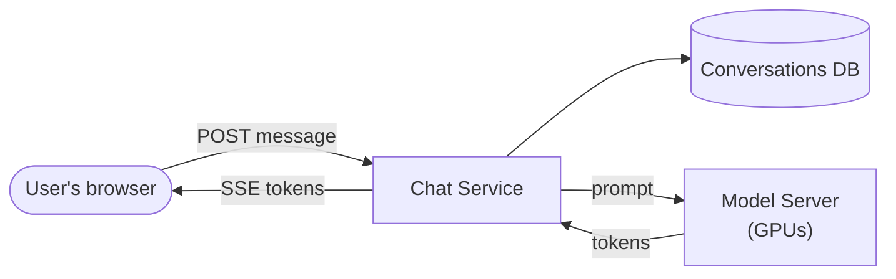
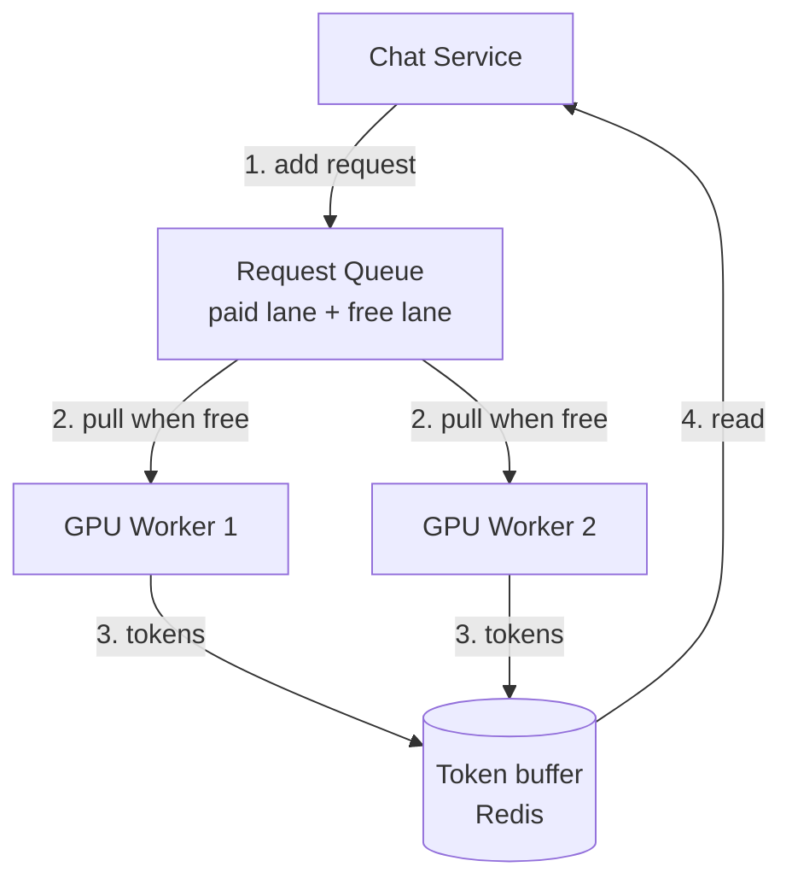
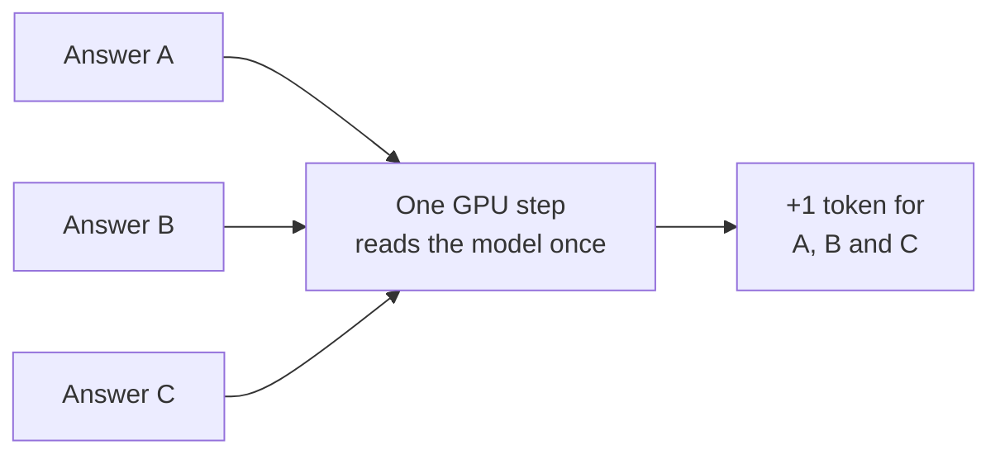
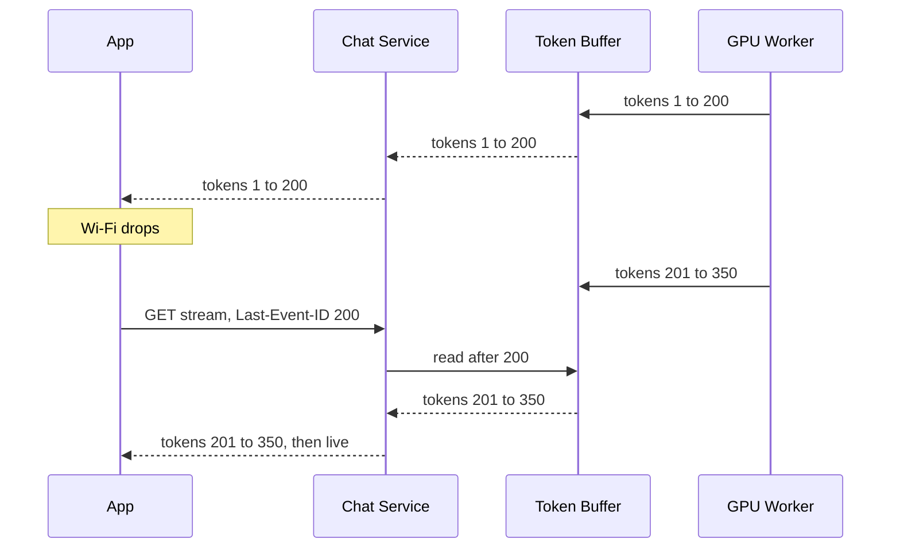
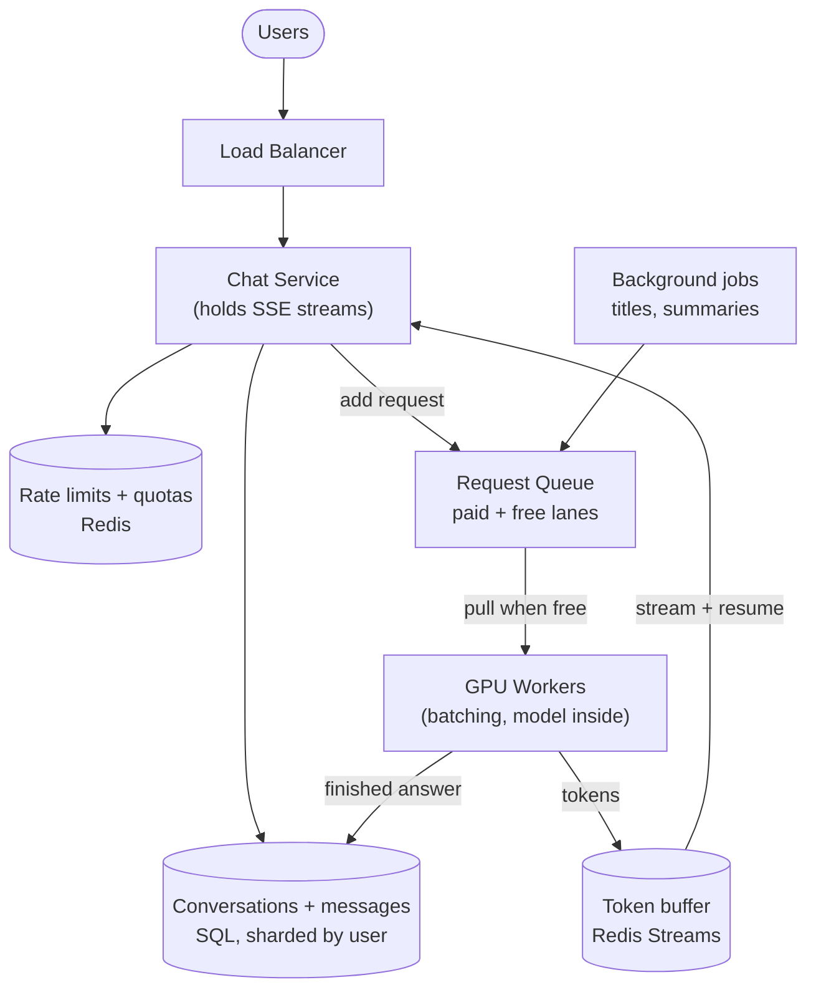

<Callout title="About this question">
  **Difficulty:** Medium. **Patterns used:** [Polling, WebSockets and SSE](../foundations/polling-websockets-sse.mdx),
  [Queueing Basics](../hld-basics/queueing-basics.mdx), [Rate Limiting](../reliability-security/rate-limiting.mdx),
  [Backpressure](../reliability-security/backpressure.mdx), [Graceful Degradation](../reliability-security/graceful-degradation.mdx).
</Callout>

## Understand the problem

You open ChatGPT and type "Plan a 3-day trip to Kyoto". The answer starts to appear within a second, a few words at a time, as if someone is typing. On the left you see your past conversations. You can open one from last week and keep chatting, and it still knows what you said earlier.

Behind it is a **large language model** (LLM). For this question, the model is a **black box**: you give it text (the **prompt**), and it writes text back, one **token** at a time. A token is a piece of a word. In English, one token is about 4 characters, or three quarters of a word. The model runs on **GPU servers**: special, very expensive machines. We don't design the model. We design everything around it.

Three things make it hard:

- **Answers are slow.** The model writes maybe 50 tokens a second, so a long answer takes 10 to 30 seconds. Staring at a spinner that long feels broken, so we must **stream** the answer while it is written.
- **GPUs are the scarce part.** Web servers and databases are cheap and quick to add. GPUs are expensive, and you can't get thousands more in a minute. When more people ask than the GPUs can serve, someone has to wait, get a smaller model, or be told "try again soon".
- **The model has no memory.** It only sees what we send in this one request. To "remember" the conversation, we send the earlier messages again every time. But the model can only read so much at once (its **context window**), and long conversations don't fit.

## Step 1: Requirements

### Functional requirements

1. Users can start a conversation and send messages in it.
2. The answer **streams** back word by word while the model writes it.
3. Users can see their **past conversations**, open one, and continue it.

**Out of scope** (say this out loud): how the model works or is trained, images and voice, file uploads, sharing conversations, and billing. Answering from your own documents (RAG) and content moderation are follow-ups.

### Non-functional requirements

1. **Fast first word:** the first token appears within about 1 second when the system is not overloaded. After that, tokens keep coming faster than people read.
2. **Big:** 100 million daily users, each sending about 10 messages a day.
3. **Fair use of GPUs:** GPUs are the main cost. Keep them busy, and don't let one user or script take more than their share. Paid users get priority.
4. **Never lose a conversation:** once an answer has finished, it is saved. A conversation list that is a second out of date on another device is fine.

### Quick math

- **Messages:** 100 million × 10 = 1 billion messages a day ÷ 86,400 seconds = about **12,000 per second**, maybe 35,000 at peak. Each one needs an answer from the model. For web servers and a database, this is easy.
- **Tokens written:** say an answer is about 500 tokens. 12,000 × 500 = **6 million tokens per second** coming out of the GPUs.
- **Tokens read:** each request also sends the conversation so far. Say 2,000 tokens on average: 12,000 × 2,000 = 24 million tokens per second going in.
- **GPU servers:** assume one GPU server (8 GPUs) can write about 5,000 tokens a second in total, across all the answers it is working on. (A made-up but sensible number. The real one depends a lot on the model.) 6 million ÷ 5,000 = about **1,200 GPU servers** on average, and over 3,000 at peak. **Decision:** the GPUs are the bottleneck and the main cost. Most of the design is about using them well.
- **Open streams:** an answer of 500 tokens at 50 tokens a second takes 10 seconds. By [Little's Law](../hld-basics/queueing-basics.mdx), 12,000 answers per second × 10 seconds = **120,000 streams open** at once, about 360,000 at peak. One server can hold tens of thousands of open streams, so a few dozen servers are enough.
- **Storage:** an answer of 500 tokens is about 2 KB of text. 1 billion answers plus their short questions is about **2 TB per day**, about 800 TB a year. Too much for one machine, so we split it.

## Step 2: Core entities

- **User:** ID and plan (`free` or `paid`), which decides the limits.
- **Conversation:** ID, user ID, title, last updated time.
- **Message:** ID, conversation ID, role (`user` or `assistant`), text, token count, status (`streaming`, `done`, `stopped`, `failed`).
- **Generation request:** one job for the model: which answer to write, the prompt, the plan's lane, and a deadline.

## Step 3: API

Conversations are normal REST calls:

```http
POST /conversations
→ 201 Created
{ "conversationId": "c-42" }

GET /conversations?limit=20&cursor=eyJ1IjoiMjAyNyJ9
→ 200 OK
{ "conversations": [{ "conversationId": "c-42", "title": "Kyoto trip" }], "nextCursor": "eyJ1IjoiMjAyNiJ9" }

GET /conversations/c-42/messages
→ 200 OK  (the messages of this conversation, in order)
```

Sending a message is a `POST`, and the answer **streams back on the same request** as **SSE** (Server-Sent Events): the server keeps the response open and sends an event each time new tokens are written (see [Polling, WebSockets and SSE](../foundations/polling-websockets-sse.mdx)).

```http
POST /conversations/c-42/messages
Accept: text/event-stream
{ "text": "Plan a 3-day trip to Kyoto", "clientMsgId": "cm-7" }

→ 200 OK
Content-Type: text/event-stream

event: start
data: {"userMessageId":"m-101","answerId":"m-102"}

id: 1
data: {"text":"Day 1:"}

id: 2
data: {"text":" Visit"}

event: done
data: {"finish":"stop","outputTokens":512}
```

Two more calls, used in deep dive 5:

```http
GET /messages/m-102/stream
Last-Event-ID: 2
→ the rest of the answer, from event 3 on

POST /messages/m-102/stop
→ 202 Accepted
```

The user ID comes from the **login token**, never from the request body. `clientMsgId` is made by the app, so a retried `POST` does not start (and pay for) a second answer.

<Callout title="EventSource can't send a POST" type="idea">
  The browser's built-in `EventSource` only sends `GET` requests, with no body. So the app sends the `POST` with
  `fetch()` and reads the response body piece by piece as it arrives. The text format is still SSE. The catch: we
  lose the automatic reconnect of `EventSource`, so the app handles a broken stream itself (deep dive 5).
</Callout>

## Step 4: High-level design

Start simple: the Chat Service calls the model directly.



The dashed box is the model. We treat it as a black box.

**Send a message:**

1. The app sends `POST /conversations/c-42/messages`.
2. The Chat Service saves the user's message. It also creates an empty answer message with status `streaming`.
3. It loads the earlier messages of the conversation and builds the **prompt**: the system instructions ("You are a helpful assistant…"), the history, and the new message.
4. It sends the prompt to a model server. The model sends back tokens one by one.
5. The Chat Service passes each token down the SSE stream the moment it arrives, and also collects them.
6. When the model finishes, the Chat Service saves the full answer, marks it `done`, and sends the `done` event.

**Open a past conversation:** the sidebar calls `GET /conversations`, newest first. Opening one calls `GET /conversations/c-42/messages`.

**A new conversation gets a title.** After the first answer, a background job asks the model for a short title like "Kyoto trip", and saves it on the conversation.

This works for a demo. At 35,000 requests a second it breaks in three places: requests pile up on busy GPU servers, a broken connection loses the answer, and long conversations stop fitting in the prompt.

## Step 5: Deep dives

### 1. Streaming the answer: SSE vs WebSockets vs waiting

<Callout title="Not great: wait for the whole answer" type="error">
  Return the answer as normal JSON when it is finished. The user stares at a spinner for 10 to 30 seconds and thinks
  the app is broken. Long, quiet requests can also hit proxy timeouts. Polling for "the tokens so far" every half
  second is not much better: 120,000 open answers × 2 polls a second = 240,000 requests a second, and the text
  arrives in jerky lumps.
</Callout>

<Callout title="Okay: WebSockets" type="warn">
  A two-way connection that stays open. It **works**, and it is truly real time. **But** a chat with a model is turn
  by turn: the user sends one message, then reads one long answer. While the answer streams, data flows only one
  way. A WebSocket is a different protocol after the first request, so every proxy and load balancer on the way must
  support it, and we must build our own reconnect logic and message format on top.
</Callout>

<Callout title="Best: SSE on the response of the POST" type="success">
  One request goes in, a stream of events comes out, over **plain HTTP**. It works through normal load balancers,
  proxies and login headers. Each answer is tied to the request that asked for it, so errors and retries are simple.
  The big model APIs stream this way too: OpenAI's and Anthropic's APIs send answers as server-sent events.
</Callout>

Details that matter in practice:

- **Turn off buffering.** Some proxies collect the whole response before passing it on, so all the tokens arrive in one lump at the end. Turn buffering off for streams (for nginx, the `X-Accel-Buffering: no` header does it).
- **Send small groups of tokens.** At 50 tokens a second, one event per token is fine. Grouping the tokens of every 50 to 100 ms into one event cuts the number of events, and still looks smooth.
- **Keep the connection alive.** While the request waits in a queue (deep dive 2), the stream is quiet. Send a `: ping` comment line every 15 seconds so load balancers don't close it, and maybe a `queued` event so the app can show "waiting…".
- **Stop is a separate call.** A dropped connection is not the same as "stop". It might just be bad Wi-Fi (deep dive 5). So the Stop button calls `POST /messages/m-102/stop`.

If the app already keeps a WebSocket open for other things (voice, live updates), sending tokens over it is fine too. The rest of the design does not change.

### 2. GPUs are scarce: a queue and batching

The Chat Service servers are cheap and easy to add. GPU servers are not. Each one costs a lot, and starting a new one takes minutes, because it must load the model (often tens or hundreds of gigabytes) into GPU memory. So for the next few minutes, GPU capacity is **fixed**, and demand can jump far above it.

<Callout title="Not great: the Chat Service calls a GPU server directly" type="error">
  Each request goes to a random GPU server. Busy servers keep getting more work, and an overloaded server gets slower
  for **everyone** on it. When demand is above capacity, every answer slows down, requests time out after the user
  has waited, and one script sending thousands of requests can take over a whole server.
</Callout>

<Callout title="Okay: a load balancer that picks the least busy GPU server" type="warn">
  Work spreads better. **But** when all servers are full, there is still nowhere to wait: the load balancer keeps
  pushing work onto full servers. There is also no priority for paid users, and no fairness between users.
</Callout>

<Callout title="Best: a request queue, and GPU workers pull when they have room" type="success">
  The Chat Service puts each request in a **queue**. Each GPU worker (a GPU server plus a small program of ours)
  **pulls** a new request only when it has room. The GPUs are never overloaded. Extra work waits in the queue, where we
  can **see** it (queue length, wait time) and **control** it: lanes for paid and free users, deadlines, and early
  rejections (deep dive 3).
</Callout>



How the pieces work:

- **Tokens come back through a buffer.** The worker does not hold the user's connection. It writes tokens to a short-lived **token buffer** for that answer (a Redis Stream, deep dive 5), and the Chat Service server holding the user's stream reads from it. So GPU workers only do GPU work, and any Chat Service server can serve any stream.
- **The worker saves the finished answer.** When the answer ends, the worker saves the full text to the database and marks it `done`, even if nobody is reading the stream anymore.
- **Each request has a deadline.** If a request has waited more than, say, 60 seconds, the user has probably given up. The worker skips it instead of wasting GPU time.
- **Which queue?** One Redis list per lane, RabbitMQ or SQS all work. Kafka fits badly: it has no priorities, and one slow request holds up the requests behind it in its partition.
- **A crashed worker must not leave an answer hanging.** The worker sends a heartbeat while it writes. If the heartbeats stop, the answer is marked `failed`, and the user can regenerate (deep dive 5).

**Batching: many answers on one GPU at once.** The model writes one token per **step**, and in each step the GPU must read the whole model from its memory. That read is the slow part. A step for 64 answers takes only a little longer than a step for 1 answer, because they share the read. So each worker writes many answers at the same time, in one **batch**. This is the main reason one GPU server can write thousands of tokens a second in total.



Three details:

- **Continuous batching.** Answers have different lengths. If a batch waits for its longest answer, the places of the short ones sit empty. Instead, the moment one answer finishes, a new request from the queue takes its place at the very next step.
- **GPU memory is the real limit.** Each answer in progress keeps notes about all its tokens so far in GPU memory (the **KV cache**). A long conversation needs much more memory than a short one. So a worker pulls a new request only when it has enough free memory, not just a free place in the batch.
- **Bigger batch = cheaper, but slower per answer.** More answers in a batch means more tokens per second in total, but each answer gets its tokens a bit slower. Pick a batch size that keeps each stream comfortably faster than people read, say 30 or more tokens a second.

**Adding GPUs takes time.** Add GPU workers based on **queue wait time**, not CPU use. A new worker takes minutes to start, and GPUs can't always be rented at short notice, so keep some spare capacity and plan ahead for the daily peak.

### 3. More users than GPUs: admission control, quotas and degradation

On a busy evening, or the day a new feature launches, more people ask than the GPUs can serve. The queue from deep dive 2 starts to grow. What then?

<Callout title="Not great: let the queue grow" type="error">
  Everyone waits longer and longer. After a minute, users give up and leave, but their requests are still in the
  queue, and the GPUs later spend time on answers nobody reads. Waiting grows very fast when a system runs near
  100% busy (see [Queueing Basics](../hld-basics/queueing-basics.mdx)).
</Callout>

<Callout title="Okay: a fixed queue size, reject when full" type="warn">
  Simple, and it stops the endless wait. **But** paid and free users are treated the same, and "1,000 requests in the
  queue" can mean a 1-second wait or a 1-minute wait, depending on how long the answers are.
</Callout>

<Callout title="Best: admit by expected wait, per lane, and degrade before rejecting" type="success">
  Before adding a request, estimate its wait: the requests ahead of it in its lane ÷ how many requests per second the
  workers take from that lane. If the free lane's wait is over about 20 seconds, answer at once with
  `503 Service Unavailable` and a `Retry-After` header. Failing fast is kinder than failing after a minute. This is
  [backpressure](../reliability-security/backpressure.mdx): push back on the sender instead of letting work pile up.
</Callout>

For example: 6,000 requests are waiting in the free lane, and the workers take 2,000 free requests a second. A new free request would wait about 3 seconds, so it is let in.

**Limits per user and per plan.** Two different limits, both checked in Redis before the request reaches the queue (see [Rate Limiting](../reliability-security/rate-limiting.mdx)):

- **Rate limit:** how many requests per minute. It stops scripts and abuse. Over the limit → `429 Too Many Requests`.
- **Quota:** how much model work in a longer window, like 3 hours or a day. Count it in **tokens**, not requests: a question with a 50-page document pasted in costs far more than "hi".

| Example limits | Free | Paid |
| --- | --- | --- |
| Requests per minute | 10 | 60 |
| Answers being written at once | 1 | 3 |
| Tokens on the main model | small quota, then a smaller model | much bigger quota |
| Queue lane | free | paid (pulled first) |
| Longest answer | shorter | longer |

**Lanes, without starving anyone.** Workers pull from the paid lane first, but not only from it: for example, 3 paid requests for every 1 free request. Otherwise free users could wait forever on a busy day. Limiting each user to 1 or 3 answers at once also stops one person from filling a lane.

**Graceful degradation: a ladder of steps.** When the GPUs are nearly full, give up the least important things first (see [Graceful Degradation](../reliability-security/graceful-degradation.mdx)):

1. Turn off extras that use the model in the background. Auto titles become the first few words of the message, and suggested follow-up questions disappear.
2. Make answers for free users shorter (a lower maximum length).
3. Send free users to a **smaller, cheaper model**. Many more of its answers fit on each GPU.
4. Only then, reject free requests with "We're at capacity, try again in a minute". Paid users are rejected last.

Each step is a switch (a feature flag) that turns on automatically when the queue wait passes a limit, and off again when it falls.

### 4. Storing conversations and building the prompt

**Storing conversations.** Two reads matter: "my newest conversations" for the sidebar, and "the messages of this conversation" to show it and to build the prompt. Every request is about **one user's own data**, so we split the data by user ID: a user's conversations and messages all live on the same shard of a SQL database like PostgreSQL (see [Partitioning and Sharding](../databases/partitioning-sharding.mdx)). The user ID comes from the login token, so we always know which shard to ask.

```sql
CREATE TABLE conversations (
  conversation_id bigint PRIMARY KEY,
  user_id         bigint NOT NULL,
  title           text,
  summary         text,        -- short summary of older messages
  summary_upto    bigint,      -- last message ID the summary covers
  updated_at      timestamptz NOT NULL
);
CREATE INDEX conversations_by_user ON conversations (user_id, updated_at DESC);

CREATE TABLE messages (
  conversation_id bigint NOT NULL,
  message_id      bigint NOT NULL,   -- grows over time
  role            text   NOT NULL,   -- 'user' or 'assistant'
  body            text   NOT NULL,
  token_count     int    NOT NULL,
  status          text   NOT NULL,   -- 'streaming', 'done', 'stopped', 'failed'
  PRIMARY KEY (conversation_id, message_id)
);
```

- **Save each answer once, not each token.** Writing every token would be 6 million database writes a second. Instead, tokens go to the token buffer while the answer streams, and the full answer is saved once at the end. That is about 24,000 writes a second: a question and an answer for each of the 12,000 messages. A very long answer can also be saved every few seconds as it grows.
- **The sidebar** reads the newest 20 rows for the user, sorted by `updated_at`, using the index. The next page uses a cursor made from the last row's `updated_at` and ID (see [API Pagination](../advanced-components/api-pagination-versioning.mdx)).
- **Why not Cassandra?** It would be fine for messages. But the sidebar is sorted by "last updated", which changes on every message, and Cassandra can't change a row's sort key in place (you delete the row and insert it again). 24,000 writes a second is easy for a sharded SQL database.
- **Store the token count** of each message when you save it. Then building the prompt is just adding numbers. There is no need to count the tokens of the whole history again on every turn.

**Building the prompt.** The model remembers nothing between requests. Every turn, we send it everything it should know:

| Part of the prompt | Example size |
| --- | --- |
| System instructions | 500 tokens |
| Summary of older messages | 1,000 tokens |
| Newest messages that fit | up to 8,000 tokens |
| The new message | 50 tokens |
| Room kept for the answer | 4,000 tokens |

The model has a **context window**: the most tokens it can handle in one request, prompt **and** answer together. Many models today take over 100,000 tokens. But long before that limit, every token in the prompt costs GPU time on **every** turn. A longer prompt also means a slower first token, because the model reads the whole prompt before it writes the first word. So we set our own, smaller **budget** for history.

<Callout title="Not great: send the whole history every time" type="error">
  Simple, but a long conversation gets slower and more expensive with every turn. One day it is longer than the
  context window, and the request fails.
</Callout>

<Callout title="Okay: keep only the newest messages that fit" type="warn">
  A **sliding window**: walk back from the newest message, and stop when the budget is full. Cheap and simple.
  **But** the model forgets the start. "My name is Asha" or "I'm vegetarian" falls out of the window.
</Callout>

<Callout title="Best: the newest messages, plus a summary of older ones" type="success">
  When the old part of a conversation no longer fits, a background job asks a small, cheap model to **summarize** it,
  and saves the summary on the conversation (with `summary_upto`, the last message it covers). The prompt is then the
  system instructions + the summary + the newest messages that fit. The model keeps the key facts, and the prompt
  stays short. The price: a summary loses some details.
</Callout>

Here is the sliding window part. It picks the newest messages that fit in the budget:

```js
// Walk back from the newest message, until the budget is full.
function pickRecentMessages(messages, budget) {
    const picked = [];
    let used = 0;

    for (let i = messages.length - 1; i >= 0; i--) {
        const message = messages[i];

        if (used + message.tokenCount > budget) {
            break;
        }

        // Put it at the front, so the order stays oldest to newest
        picked.unshift(message);
        used = used + message.tokenCount;
    }

    return picked;
}
```

Try it with a tiny budget of 16 tokens:

```js
const history = [
    { role: "user", text: "My name is Asha.", tokenCount: 6 },
    { role: "assistant", text: "Nice to meet you!", tokenCount: 8 },
    { role: "user", text: "Plan a trip to Kyoto.", tokenCount: 7 },
];

const recent = pickRecentMessages(history, 16);

console.log(recent.length); // 2
console.log(recent[0].text); // Nice to meet you!
```

The first message did not fit, so the model never sees "My name is Asha." That is the gap the summary fills.

### 5. The stream breaks midway

Asha is on a train. Her Wi-Fi drops after 200 tokens of a 500-token answer. Or she closes her laptop. Or, more rarely, the GPU worker writing her answer crashes. These are two different problems: the **connection** breaks (the answer is fine), or the **answer** breaks (the GPU worker is gone).

**When the connection breaks:**

<Callout title="Not great: the answer lives only in the connection" type="error">
  When the connection drops, the tokens sent so far are all she has. To get the rest she must press Regenerate,
  which writes the whole answer again: double the GPU cost, and a different answer.
</Callout>

<Callout title="Okay: keep writing, and show it when it is done" type="warn">
  The worker finishes the answer and saves it in the database. When the app reconnects, it reloads the conversation.
  **Works**, but she sees nothing until the whole answer is finished, and the app doesn't know when that will be.
</Callout>

<Callout title="Best: a token buffer, and resume from the last event ID" type="success">
  The worker writes tokens to a short-lived buffer for that answer: a **Redis Stream**, a list where each entry gets
  an ID. Each SSE event carries that ID. When the app reconnects, it calls `GET /messages/m-102/stream` with
  `Last-Event-ID`, and the server sends everything after that ID, then the new tokens as they come. If the answer has
  already finished, the server just returns the saved answer.
</Callout>



How it works:

- **One Redis command does both jobs.** The worker adds a small group of tokens every ~100 ms with `XADD tokens:m-102 * text "..."`. The Chat Service waits for new entries with `XREAD BLOCK`, which returns only the entries **after** a given ID. That serves both live streaming and resuming.
- **Any Chat Service server can resume the stream**, because the tokens are in Redis, not in the memory of the server that lost the connection. The load balancer doesn't need sticky connections.
- **The buffer expires**, say 10 minutes after the answer ends (`EXPIRE`). By then the full answer is in the database.
- **Size it:** 120,000 open answers × 10 groups a second = about 1.2 million writes a second. That needs a Redis Cluster, split by answer ID. Grouping matters: one write per token would be 6 million.
- **The app retries by itself.** On a network error, it waits a short, random time, so thousands of apps don't reconnect in the same second. Then it calls the resume URL.
- **Keep writing after a drop.** Most answers finish within a minute, and she sees the full answer when she comes back. To save GPU time, the worker can stop if nobody has read the buffer for a minute or so.

**Retrying the POST.** If the connection dies before the `start` event, the app doesn't know whether the server got its message. It sends the same `POST` again with the same `clientMsgId`. The server finds the message it already created and returns its stream, instead of starting a second answer (see [Idempotency](../messaging/idempotency.mdx)).

**When the answer breaks.** If a GPU worker crashes midway, its heartbeats stop. The Chat Service marks the answer `failed` and sends an `error` event. The app keeps the partial text and shows a **Regenerate** button. Regenerate is a new request with the same prompt. (You could send the prompt plus the partial answer to a new worker and ask it to carry on, but the join often reads badly, so regenerating is the simple choice.)

### 6. Keeping the cost down

The GPUs cost far more than everything else put together. The main ways to spend less:

| Lever | Why it saves money |
| --- | --- |
| **Batching** (deep dive 2) | Many answers share each GPU step. The biggest win. |
| **Shorter prompts** | A history budget and summaries. Input tokens are paid for again on every turn. |
| **The right model for the job** | Titles, summaries and simple questions go to a small model. |
| **Prefix caching** | Reuse the work already done on the same start of a prompt. |
| **A maximum answer length** | Caps the cost of each answer, per plan. |
| **Stop work nobody reads** | The Stop button and expired requests free GPU time at once. |
| **Use quiet hours** | Run background jobs (summaries, tests of new models) at night, when GPUs sit idle. |

**Prefix caching, in more detail.** Each turn of a conversation starts with the same text as the last turn: the system instructions and all the earlier messages. Reading that part again is wasted work. A model server can keep its notes (the KV cache) for a prompt it just handled, and reuse them when the next prompt starts with the same text. This only helps if the next turn reaches the **same** worker. So the queue tries to give a conversation's next turn to the worker that handled the last one, when that worker has room.

**Count the tokens of every request.** Save the input tokens, output tokens and model for each answer. The same numbers drive the quotas (deep dive 3), and show what each feature and each plan really costs.

### Final architecture



## In the real world

**OpenAI's and Anthropic's APIs stream answers with SSE.** With `stream: true`, OpenAI's Chat Completions API sends the answer as `data:` events, a piece at a time, and ends with `data: [DONE]`. Anthropic's API sends named events, such as `content_block_delta` for each piece of text and `message_stop` at the end. This is the idea from deep dive 1.

**"ChatGPT is at capacity right now."** In the first months after its launch in November 2022, ChatGPT often showed this message when demand was higher than it could serve. In February 2023, OpenAI launched **ChatGPT Plus** at $20 a month, and one of its main promises was access **even during peak times**. That is the paid lane and admission control from deep dive 3.

**Usage limits per plan.** ChatGPT limits how many messages each plan can send to its main model. OpenAI has said that when a free user reaches that limit, ChatGPT switches to a smaller model until the limit resets. That is graceful degradation in a real product.

**API rate limits count tokens.** OpenAI's API limits each account by **requests per minute** and **tokens per minute**, with higher limits for higher usage tiers, and returns `429` when you go over. It is the same reason we count tokens, not just requests.

**vLLM**, an open-source model server that started at UC Berkeley in 2023, is built around **continuous batching** and **PagedAttention**: a way to store the KV cache in small blocks, so less GPU memory is wasted and more answers fit in a batch.

**Prompt caching is a real product.** Both OpenAI and Anthropic cache repeated prompt beginnings in their APIs, and charge less for the cached input tokens. That is the prefix caching from deep dive 6.

## Follow-up questions

<Accordions>
<Accordion title="How would you answer questions from the user's own documents (RAG)?">

**RAG** (retrieval-augmented generation) means: find the useful pieces of text first, then put them in the prompt. Ahead of time, split each document into small chunks, turn each chunk into an **embedding** (a list of numbers that captures its meaning), and store them in a [vector database](../advanced-components/vector-databases.mdx). When a question comes in, turn the question into an embedding too, find the closest chunks, and add the best few to the prompt with "answer using these sources". Filter the search by user, so nobody's question finds someone else's files. The chunks use up part of the token budget, so keep only the best few.

</Accordion>
<Accordion title="How do you stop harmful questions and answers (moderation)?">

Check the user's message with a small, fast classifier model **before** it goes into the queue, so blocked requests never use the big model. Check the answer too, while it streams: run the check on each new chunk of text, and if it fails, stop the stream and replace the answer with a short notice. OpenAI offers a moderation endpoint in its API for this kind of check. Log blocked requests, and apply a stricter rate limit to users who keep sending them.

</Accordion>
<Accordion title="Can you cache answers to identical prompts?">

You can: the key is a hash of the model name, the settings and the **full** prompt, and the value is the saved answer. **But** in a chat app it rarely hits, because the prompt contains the whole conversation, which is different for everyone. It helps mostly for a first message with no history, like a common question, or for fixed prompts your own product sends. Watch out: answers can be personal or out of date, and users expect Regenerate to give a new answer. A "semantic" cache, which reuses answers for questions that only **mean** the same, is riskier: "similar" is not "same". Prefix caching on the GPU (deep dive 6) saves more money, with no risk of a wrong answer.

</Accordion>
<Accordion title="How do Edit and Regenerate work?">

Give each message a `parent_id`. Editing a message or regenerating an answer adds a **new** message with the same parent, so a conversation becomes a small **tree**, not a list. The conversation stores which branch the user is looking at. To build the prompt, walk from the newest message up through its parents. The old branch is still there, so the user can switch back to it.

</Accordion>
<Accordion title="The GPUs in one region are full. Can another region help?">

Yes, and it works better here than for most apps. Sending a request to a far region adds maybe 100 ms, while writing the answer takes 10 seconds or more. So a global scheduler can send work to whichever region has free GPUs. Two things can get in the way: laws that say some users' data must stay in their country, and the prefix cache, which lives on the worker that handled the last turn.

</Accordion>
</Accordions>

## What the interviewer expects

<Tabs items={['Mid-level', 'Senior', 'Staff']}>
<Tab value="Mid-level">

- Clear requirements, a REST API for conversations, and a `POST` whose answer streams back.
- Streaming with SSE (or WebSockets), and why waiting for the full answer is bad.
- A conversations table and a messages table, and why the history goes into every prompt.
- Treat the model as a black box on GPUs. Don't try to design the model.

</Tab>
<Tab value="Senior">

- A **queue** in front of GPU workers that pull when they have room, and why calling GPUs directly breaks under load.
- Rate limits and quotas per plan, counted in **tokens**.
- A token budget for the prompt: the newest messages plus a summary, with a token count stored per message.
- A token buffer, so a broken stream can resume with `Last-Event-ID`, an idempotent `POST`, and saving each answer once, not each token.

</Tab>
<Tab value="Staff">

- Batching and continuous batching, GPU memory (KV cache) as the real limit, and the batch size tradeoff.
- Admission control by expected wait, priority lanes that don't starve free users, and a degradation ladder.
- Cost: prefix caching with "same worker" routing, small models where possible, quiet hours, and token counts per request.
- Slow GPU scaling (scale on queue wait, keep spare capacity), and sending work to other regions.

</Tab>
</Tabs>

<Callout title="Remember this" type="success">
  - The model is a black box. **GPUs are the scarce, expensive part**, so the design is about using them well.
  - **POST** the message, and stream the answer back as **SSE** on the same response. One way is all we need.
  - A **queue** in front of GPU workers. Workers **pull** when they have room. **Batching** puts many answers on each
    GPU step.
  - **Admission control**: if the expected wait is too long, say "try again" at once. Paid lane first. Quotas in
    **tokens**.
  - When GPUs are full, **degrade**: extras off, shorter answers, a smaller model, then reject free users.
  - The model has **no memory**. Send a **token budget** of history: the newest messages + a **summary** of older ones.
  - Tokens go to a short-lived **buffer** (Redis Streams). The full answer goes to the DB **once**. Resume with
    **Last-Event-ID**.
  - **Cost**: batching, shorter prompts, small models, **prefix caching**, and stop work nobody reads.
</Callout>
