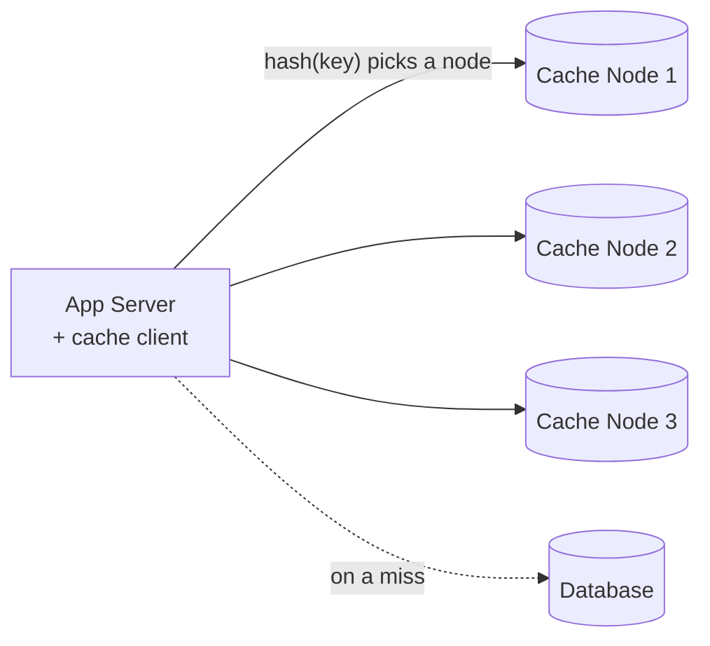
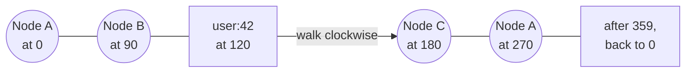
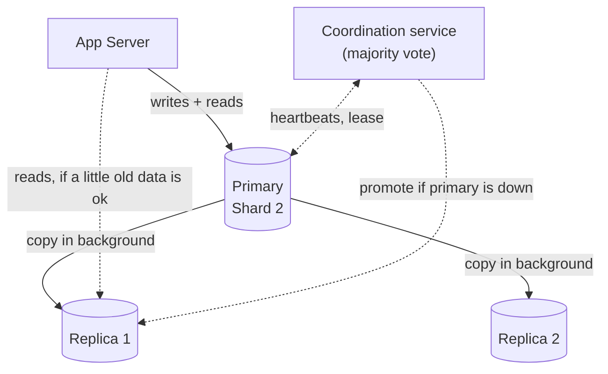
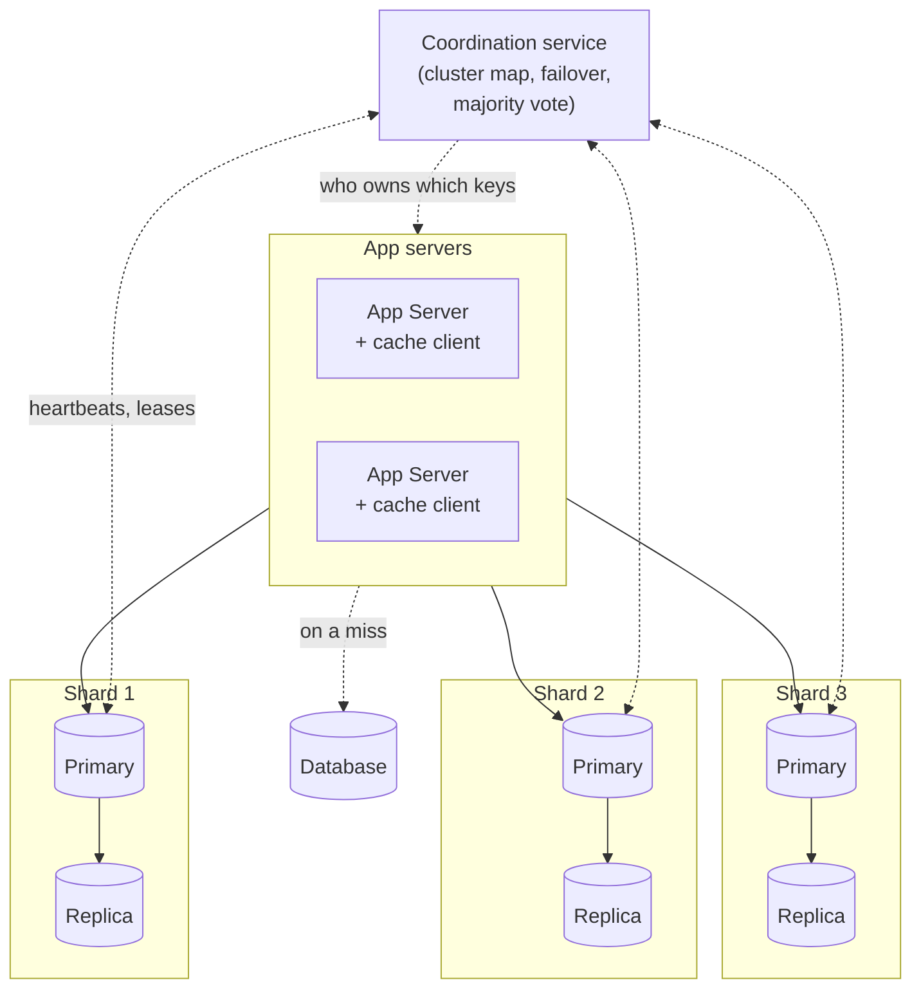

<Callout title="About this question">
  **Difficulty:** Hard. You build the cache itself, not just use one. **Patterns used:**
  [Consistent Hashing](../databases/consistent-hashing.mdx), [Cache Eviction](../caching/cache-eviction.mdx),
  [Replication](../databases/replication.mdx), [Distributed Caching](../caching/distributed-caching.mdx),
  [Hot Keys](../advanced-components/hot-keys-fan-out.mdx).
</Callout>

## Understand the problem

A **cache** keeps data in **memory (RAM)**, so reading it is much faster than reading from a database on disk. App servers ask the cache first. Only if the data is not there (a **cache miss**) do they go to the database.

One machine only has so much RAM. When we want to cache more data than one machine can hold, we spread the data across **many machines**. That is a **distributed cache**. Redis Cluster and Memcached are real examples.

In this question, **we build that system**: how keys are stored, how they are spread across machines, what happens when memory is full, and what happens when a machine dies.

## Step 1: Requirements

### Functional requirements

1. `SET` a key to a value, with an optional **TTL** (time to live: "delete this after 5 minutes").
2. `GET` a key's value.
3. `DELETE` a key.

**Out of scope** (say this out loud): rich data types like lists and sorted sets, transactions, saving data to disk forever, pub/sub.

### Non-functional requirements

1. **Very fast:** `GET` and `SET` in about **1 millisecond**, including the network.
2. **Big:** about **1 TB** of data and **1 million requests per second**.
3. **Always up:** if one machine dies, the cache keeps working. It is a cache: the real data is still in the database, so we pick **availability** over consistency. Losing a few recent writes is acceptable, but be clear about the cost: a lost `SET` only causes a miss, while a lost `DELETE` means **stale data** until the key's TTL runs out (deep dive 3).
4. **Easy to grow:** we can add machines without moving all the data.

### Quick math

- **Memory:** say each machine has 128 GB of RAM and we use about 100 GB for data. 1 TB ÷ 100 GB = about **10 machines**.
- **Traffic:** let's assume one in-memory node handles about 100,000 simple requests per second. 1 million ÷ 100,000 = about **10 machines** again.
- **Decision:** the data **must be split** across about 10 main machines (plus copies for safety). How we split it is the first deep dive.

## Step 2: Core entities

- **Entry:** a key, a value (just bytes) and an expiry time.
- **Node:** one cache machine. It holds part of the keys.
- **Cluster map:** a small table that says which node owns which keys.

## Step 3: API

The "API" is the set of commands a client sends to the cache:

```bash
SET user:42 '{"name":"Asha"}' EX 300   # save for 300 seconds
GET user:42                            # returns '{"name":"Asha"}'
DEL user:42                            # remove it
GET user:42                            # returns (nil): not found
```

Apps don't send these by hand. They use a **cache client library**, like this:

```ts
interface Cache {
  get(key: string): Promise<string | null>;
  set(key: string, value: string, ttlSeconds?: number): Promise<void>;
  delete(key: string): Promise<void>;
}
```

## Step 4: High-level design



**Inside one node:** a **hash map** in memory. A hash map finds a key in about the same time no matter how many keys there are. Each entry stores the value and its expiry time.

**GET a key:**

1. The app calls `get("user:42")`.
2. The client library **hashes** the key (turns it into a number) and uses that number to pick a node, say Node 2.
3. Node 2 looks in its hash map. If the key is there and not expired, it returns the value.
4. If not, the app reads the database and then calls `set` so the next read is fast. This is called **cache-aside** (see [Caching Strategies](../caching/caching-strategies.mdx)).

**SET a key:**

1. The client library hashes the key and picks the same node.
2. That node saves the key, value and expiry time in its hash map.

The simple version picks a node with `hash(key) % N`, where N is the number of nodes. The deep dives fix the problems with this.

## Step 5: Deep dives

### 1. How do we spread keys across nodes?

<Callout title="Not great: hash(key) % N" type="error">
  Easy, and it spreads keys evenly. **But** when N changes, almost every key moves to a different node. Say a key
  hashes to 10. With 3 nodes it lives on node `10 % 3 = 1`. Add a fourth node and it moves to `10 % 4 = 2`.
  Going from 3 to 4 nodes moves about **75%** of all keys. Suddenly most reads miss, and all of them hit the
  database at once.
</Callout>

<Callout title="Best: consistent hashing with virtual nodes" type="success">
  Place nodes and keys on a **ring** of numbers. A key belongs to the **next node clockwise**. Adding or removing
  a node only moves the keys next to it: about **1/N** of the keys, not most of them.
</Callout>

Here is a small ring with numbers from 0 to 359, drawn as a straight line. Bend the line into a circle, so that after 359 it starts again at 0. The key `user:42` hashes to 120. It walks clockwise (to the right) and lands on Node C at 180. (More in [Consistent Hashing](../databases/consistent-hashing.mdx).)



Notice that Node A appears **twice** on the ring. These are **virtual nodes**: each real machine sits at many spots on the ring. This helps in two ways:

- Keys spread **more evenly** across machines.
- When a machine dies, its keys are shared by **many** other machines, not dumped on one neighbor.

**Another good option: hash slots.** Split all keys into a fixed number of **slots**, and give each node a range of slots. To add a node, move some whole slots to it. This is what Redis Cluster does.

**Who keeps the cluster map?** A small coordination service (like ZooKeeper or etcd) stores it. Clients keep a copy and get told when it changes. If a client sends a key to the wrong node, the node replies "that key moved to Node C", and the client updates its map. The same coordination service also decides failover (deep dive 3).

### 2. What happens when memory is full?

Two different things remove keys: **expiry** (the TTL ran out) and **eviction** (memory is full, so something must go).

**Expiry.** Checking every key's TTL all the time is expensive. So we do two cheap things:

- **When a key is read**, check its expiry time. If it has passed, delete it and return "not found".
- **In the background**, a few times a second, look at a small random set of keys with a TTL and delete the expired ones. This cleans up keys that nobody reads anymore.

**Eviction.** When memory is full, which key do we throw away? (See [Cache Eviction](../caching/cache-eviction.mdx).)

<Callout title="Not great: refuse new writes when full" type="error">
  The cache stops learning new data. Fresh, popular data can never get in.
</Callout>

<Callout title="Okay: FIFO (first in, first out)" type="warn">
  Throw away the oldest key. Simple, **but** the oldest key might be the most popular one, like the home page.
</Callout>

<Callout title="Best: LRU (least recently used)" type="success">
  Throw away the key that **nobody has read for the longest time**. Popular keys keep getting read, so they stay.
  This is the usual choice for a cache. But it is not always the default: Redis refuses writes when full unless
  you set `maxmemory-policy` to `allkeys-lru`.
</Callout>

LRU is built from a **hash map** (to find a key fast) plus a **list ordered by last use**. Every read moves the key to the "newest" end. When memory is full, we remove from the "oldest" end. Both steps are fast. In JavaScript, a `Map` keeps keys in the order they were added, which makes a tiny LRU easy:

```js
class LRUCache {
  constructor(capacity) {
    this.capacity = capacity;
    this.map = new Map(); // oldest key first, newest key last
  }

  get(key) {
    if (!this.map.has(key)) return null;
    const value = this.map.get(key);
    this.map.delete(key); // move it to the newest end
    this.map.set(key, value);
    return value;
  }

  set(key, value) {
    this.map.delete(key);
    this.map.set(key, value);
    if (this.map.size > this.capacity) {
      const oldest = this.map.keys().next().value;
      this.map.delete(oldest); // evict the least recently used key
    }
  }
}
```

A real cache saves memory with **approximate LRU**: instead of keeping a perfect order of all keys, it picks a few random keys and evicts the one used longest ago. It is almost as good and needs much less memory.

### 3. What happens when a node dies?

<Callout title="Not great: no copies" type="error">
  A node dies, and its keys are gone. All requests for those keys go to the database at once. A busy database can
  fall over from this sudden load.
</Callout>

<Callout title="Okay: replicas with manual failover" type="warn">
  Each node has a copy. When it dies, a person switches traffic to the copy. **Works, but** it takes minutes, and
  someone must be awake.
</Callout>

<Callout title="Best: replicas with automatic failover" type="success">
  Each **primary** node has one or two **replicas**. When the primary stops answering, the **coordination service**
  (the one that keeps the cluster map) promotes a replica to primary within seconds and updates the map.
</Callout>

How it works (see [Replication](../databases/replication.mdx)):

- **Writes go to the primary.** It copies each write to its replicas **in the background** (asynchronously). It does not wait for them, which keeps writes fast. The cost: if the primary dies, the last few writes may be lost.
- **What a lost write costs.** A lost `SET` is harmless: the next read misses and reloads from the database. A lost `DELETE` is worse. Say the app updated the database and then deleted `user:42` from the cache, and that delete never reached the replica. After failover, the new primary still has the **old** value, and readers get stale data. This is why every cached key should have a **TTL**: it puts a limit on how long stale data can live.
- **Heartbeats.** Each primary sends a small "I'm alive" message to the coordination service every second or so. If a primary misses them for a few seconds, it is marked as down.
- **Majority vote.** The coordination service itself runs on 3 or 5 machines, and makes every decision by **majority vote** (with an algorithm like Raft). So two halves of a broken network can never promote two different replicas. (See [Leader Election and Consensus](../distributed-systems/leader-election-consensus.mdx).)
- **The old primary must stop taking writes.** The vote is not enough on its own. Say the network splits, and the old primary is on the small side, still talking to some app servers. It doesn't know it was replaced, so it keeps accepting writes, and two primaries are taking writes at once: **split brain**. The fix is a **lease**. A primary may accept writes only while it holds a lease that it renews with the coordination service every few seconds, say for 5 seconds at a time. Cut off from the coordination service, it can't renew, so it **stops accepting writes** when the lease runs out. The coordination service waits **longer than the lease** (say 10 seconds) before it promotes a replica. So the old primary has always stopped before the new one starts.
- **Spread the copies.** Put a primary and its replica in different racks or data centers, so one power cut can't kill both.



### 4. What about one very hot key?

Sometimes one key gets a huge share of traffic, like a celebrity's profile. All of it lands on **one** node, no matter how many nodes we have. Three fixes (see [Hot Keys](../advanced-components/hot-keys-fan-out.mdx)):

- **Tiny local cache:** each app server keeps the hottest keys in its own memory for a few seconds.
- **Copies of the key:** store it as `profile:1#1`, `profile:1#2` ... `profile:1#5`. Each name hashes to its own spot, so the copies **usually** land on different nodes (two can still share one). Read a random copy. When the value changes, update or delete **every** copy, or some readers keep getting the old value.
- **Read from replicas** for that key.

### Final architecture



Each primary runs the hash map, TTL checks and LRU eviction. The client library uses the cluster map and consistent hashing to pick the shard. Each primary holds a lease from the coordination service. When a primary dies, the coordination service waits for its lease to run out, promotes its replica, and updates the cluster map.

## In the real world

**Redis Cluster** splits all keys into **16,384 hash slots**. Each primary owns a range of slots, and each primary can have replicas. If a client asks the wrong node, the node answers with a `MOVED` reply that names the right one. Redis Cluster does failover **without** a separate coordination service: the primaries talk to each other, and when a primary fails, a majority of the other primaries vote to promote one of its replicas. A primary that can't reach most of the other primaries stops accepting writes after a timeout. Same ideas as ours, a different place for the vote.

**Redis runs commands on a single thread.** One command finishes before the next one starts, so there are no locks inside. Redis also uses **approximate LRU**: it samples a few keys and evicts the best one among them. And it expires keys both when they are read and with a background job that checks random keys. Careful: Redis's default `maxmemory-policy` is `noeviction`. When memory is full, it refuses writes, which is the "Not great" option above. For a cache, set it to `allkeys-lru`.

**Memcached** has no clustering built in. The **client libraries** pick the server by hashing the key, often with consistent hashing.

**Facebook** runs one of the largest Memcached setups. Their 2013 paper "Scaling Memcache at Facebook" describes **mcrouter**, a proxy that sits between app servers and Memcached and routes each request to the right server.

## Follow-up questions

<Accordions>
<Accordion title="One thread or many threads per node?">

**One thread** (like Redis) is simple: no locks, and commands never step on each other. Memory is so fast that one thread can still do a lot. **Many threads** (like Memcached) use all CPU cores, but need locks. A middle path: one thread runs commands, while extra threads read and write network data.

</Accordion>
<Accordion title="How do you add a node without downtime?">

Add the node to the ring (or give it some hash slots). Move the affected keys in the background. While a key is moving, the old node can reply "ask the new node", and clients retry there. Since it is a cache, simply letting some keys miss and refill from the database also works.

</Accordion>
<Accordion title="A popular key expires and 10,000 requests miss at once. What now?">

This is a **cache stampede**. Let only **one** request rebuild the value (using a short lock), while the others wait a moment or get the old value. Adding a small random amount to each TTL also stops many keys from expiring at the same second. See [Cache Problems](../caching/cache-problems.mdx).

</Accordion>
<Accordion title="Should the cache save data to disk?">

Not for correctness: the database has the real data. But saving a snapshot to disk now and then lets a restarted node **warm up** fast instead of starting empty. Redis offers this as an option.

</Accordion>
</Accordions>

## What the interviewer expects

<Tabs items={['Mid-level', 'Senior', 'Staff']}>
<Tab value="Mid-level">

- A hash map in memory, with TTLs.
- Know why `hash % N` is a problem, and that consistent hashing fixes it.
- LRU eviction and how a hash map plus a list makes it fast.

</Tab>
<Tab value="Senior">

- Consistent hashing with virtual nodes, or hash slots.
- Lazy plus background expiry.
- Replicas with automatic failover, why async copying is okay for a cache, and why a lost `DELETE` means stale data (so use TTLs).
- Hot keys and cache stampedes.

</Tab>
<Tab value="Staff">

- Everything from senior, but faster.
- Split brain: why failover needs a majority vote, and a lease so the old primary stops taking writes.
- Threading model and memory overhead per key.
- Adding nodes live, and running across data centers.

</Tab>
</Tabs>

<Callout title="Remember this" type="success">
  - **Hash map in RAM** per node. About 1 ms per request.
  - **`hash % N` moves most keys** when N changes. **Consistent hashing** moves only about 1/N.
  - **Virtual nodes** spread keys evenly and share the load when a node dies.
  - **Expiry:** check on read, plus a background sampler. **Eviction:** LRU (in Redis, set `allkeys-lru`: the default refuses writes).
  - **Primary + replicas**, async copies, **automatic failover by majority vote** in the coordination service. A **lease** makes the old primary stop taking writes before a new one starts.
  - A lost `DELETE` = **stale data**, so every key gets a TTL.
  - **Hot key** → local cache, copies of the key (update every copy on a change), or read from replicas.
</Callout>
