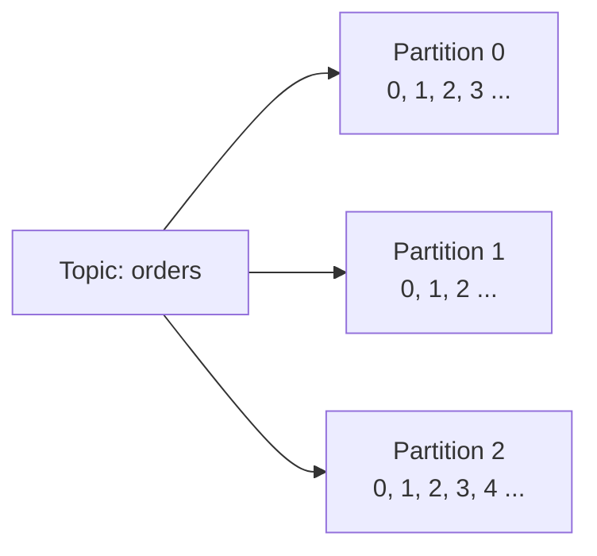
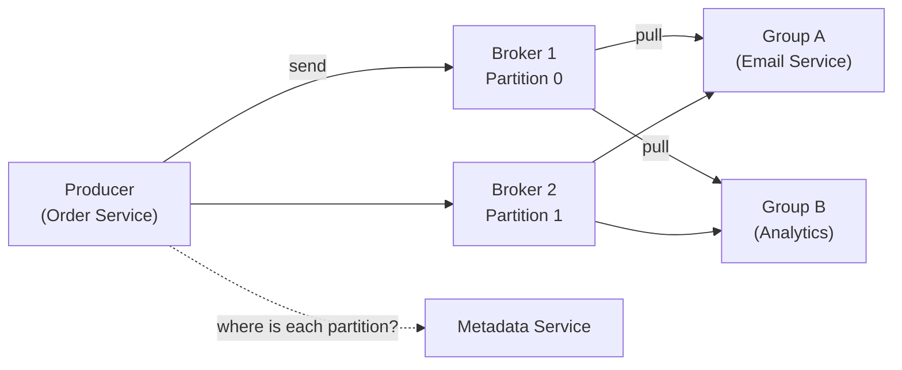
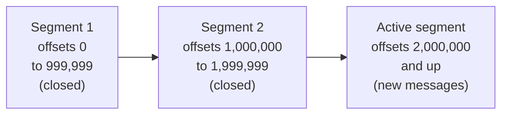
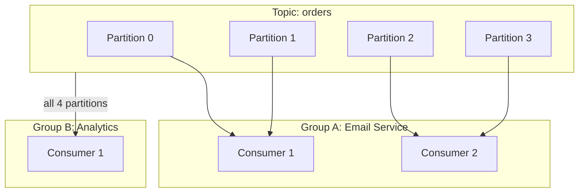
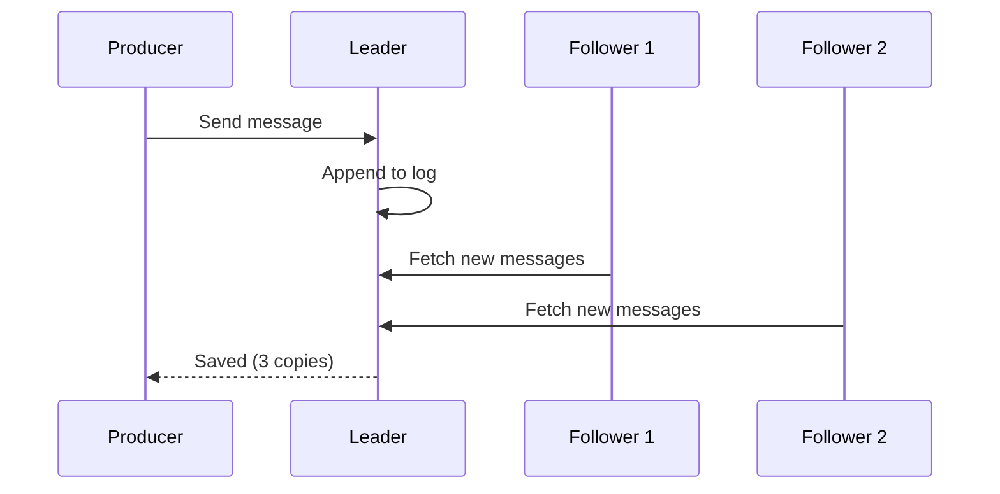
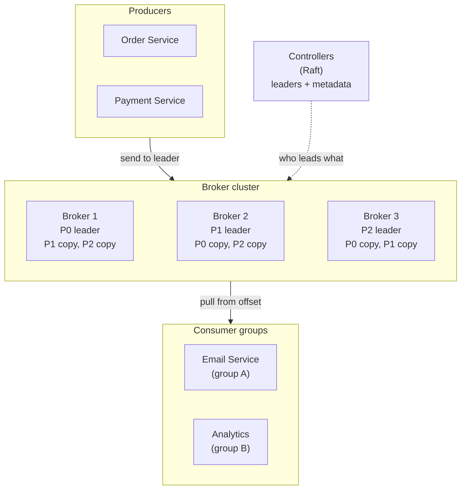

<Callout title="About this question">
  **Difficulty:** Hard. You build the queue itself, not just use one. **Patterns used:**
  [Kafka](../messaging/kafka.mdx), [Message Queues and Pub/Sub](../messaging/message-queues-pub-sub.mdx),
  [Partitioning and Sharding](../databases/partitioning-sharding.mdx), [Replication](../databases/replication.mdx),
  [Delivery Guarantees](../messaging/delivery-guarantees.mdx).
</Callout>

## Understand the problem

A **message queue** sits between services. One service, the **producer**, drops messages in. Other services, the **consumers**, read them later. The producer doesn't wait for the consumer, and the two don't even need to be running at the same time.

Example: when an order is placed, the Order Service sends an `order-placed` message. The Email Service, the Warehouse Service and the Analytics Service each read it and do their own job.

We will build a queue like **Kafka**. Messages are **kept for days**, not deleted when read. So many different services can read the same messages, and a service can go back and read old messages again.

## Step 1: Requirements

### Functional requirements

1. Producers can send messages to a named **topic**, like `orders`.
2. Consumers can read messages from a topic, **in order**.
3. Many different services (consumer groups) can each read **all** the messages of a topic.
4. Messages are kept for a set time (say 7 days), so consumers can **re-read** old messages.

**Out of scope** (say this out loud): message priority, delayed messages, filtering messages by content.

### Non-functional requirements

1. **Durable:** once we say "saved", the message is never lost, even if a machine dies.
2. **High throughput:** 1 million messages per second, about 1 KB each.
3. **Low latency:** a message reaches consumers in under 100 ms.
4. **Scalable:** add machines to handle more traffic.
5. **Ordered:** messages with the same key (like the same user) are read in the order they were sent.

### Quick math

- **Writes:** 1 million × 1 KB = **1 GB per second**.
- **Storage:** 1 GB/s × 86,400 seconds × 7 days = about **600 TB**. With 3 copies of everything, about **1.8 PB**.
- **Decision:** this can't live in memory, and it can't live on one machine. Messages go **on disk**, split across **many machines**. Both are deep dives.

## Step 2: Core entities

- **Message:** an optional key, a value (bytes), a timestamp.
- **Topic:** a named stream of messages, like `orders`.
- **Partition:** one piece of a topic. Each partition is an ordered list of messages that only grows at the end.
- **Offset:** the position number of a message inside a partition: 0, 1, 2, 3 ...
- **Broker:** one server that stores partitions.
- **Consumer group:** a team of consumers that share the work of reading a topic.

## Step 3: API

The "API" is what producers and consumers can do. Real systems like Kafka use a fast binary protocol over TCP instead of HTTP, but the operations are the same:

```js
// Producer: send a message
await producer.send({ topic: 'orders', key: 'user-42', value: '{"orderId": 7}' });
// → { partition: 3, offset: 1042 }

// Consumer: read a batch, starting from where this group left off
const messages = await consumer.poll({ topic: 'orders', group: 'email-service', max: 100 });

// Consumer: save progress ("we are done with 1042, so next time start at 1043")
await consumer.commit({ topic: 'orders', partition: 3, offset: 1043 });
```

Notice the consumer **asks** for messages. This is a **pull** model. Each consumer reads at its own speed, so a slow consumer is never flooded (see [Backpressure](../reliability-security/backpressure.mdx)).

## Step 4: High-level design

A topic is split into **partitions**, and each partition lives on a broker. Each partition is just a list where new messages are added at the end:





**Send a message:**

1. The producer picks a partition. With a key, it uses `hash(key) % partitions`, so the same key always goes to the same partition. That keeps one user's messages **in order**. Without a key, it spreads messages evenly.
2. It asks the Metadata Service which broker holds that partition.
3. It sends the message to that broker. The broker **adds it to the end** of the partition and gives it the next offset.
4. The broker replies "saved at offset 1042".

**Read messages:**

1. The consumer asks the broker: "give me partition 3, starting at offset 1042, up to 100 messages".
2. The broker reads them from disk and sends them back.
3. The consumer handles them, then **commits** its new offset: "next time, start at 1142".

Reading does **not** delete anything. Messages are removed only when they are older than 7 days.

## Step 5: Deep dives

### 1. How do we store messages on disk fast?

<Callout title="Not great: a database table" type="error">
  Insert a row per message and delete it after it is read. **Problems:** every insert updates indexes, deletes
  are slow, and once one consumer deletes a message, no other service can read it.
</Callout>

<Callout title="Best: an append-only log file per partition" type="success">
  Each partition is a file. New messages are **only added at the end**. Nothing is changed in the middle.
  Reading is just "start at this position and read forward".
</Callout>

Why is this so fast? Disks are slow when they jump around (**random** access), but fast when they write one long stream of bytes (**sequential** access). An append-only log only does sequential writes.

Four more tricks:

- **Segments.** One partition is split into **segment** files, for example 1 GB each. Only the newest segment gets new messages. When a segment is older than 7 days, we delete the **whole file** at once. That is much cheaper than deleting messages one by one.
- **A small index.** Each segment has an index file: "offset 1,000,500 is at byte 512,000 in this segment's log" (it is the 500th message, about 1 KB each, in the segment that starts at 1,000,000). So a reader can jump straight to any offset.
- **The OS keeps recent data in memory.** The operating system keeps recently used file data in RAM (the **page cache**). Consumers that keep up read fresh messages from memory, not from disk.
- **Batches.** Producers send many messages in one request, and the broker writes them to disk together. Fewer trips, much more throughput. Batches can also be compressed.



On disk, one partition is just a folder of files. The file name is the first offset inside it:

```bash
orders-3/                          # partition 3 of topic "orders"
  00000000000000000000.log         # messages 0 to 999,999
  00000000000000000000.index       # offset → position in the .log file
  00000000000001000000.log         # messages from 1,000,000 (active)
  00000000000001000000.index
```

### 2. How do consumers keep their place?

Each consumer group saves its **offset** for each partition: "the next message I need is number 1142". The queue stores these offsets for the groups, in a small internal topic of its own.

Because each group has its own offsets, the Email Service and Analytics read the same messages **without affecting each other**. One can be fast and one slow. One can even rewind and re-read yesterday's messages.

**Sharing the work inside a group.** The partitions of a topic are split among the consumers of a group. **One partition is read by only one consumer in the group**, so its order is kept.



- 4 partitions and 2 consumers: each consumer gets 2 partitions.
- 4 partitions and 5 consumers: one consumer sits idle. **The number of partitions is the limit on how many consumers can work in parallel.**
- When a consumer joins or dies, the partitions are shared out again. This is a **rebalance**.

**When to commit the offset?** This decides what happens when a consumer crashes. (See [Delivery Guarantees](../messaging/delivery-guarantees.mdx).)

<Callout title="Not great for important data: commit before processing" type="error">
  If the consumer crashes after committing but before finishing, that message is **skipped forever**. This is
  **at-most-once**: each message is handled zero or one time.
</Callout>

<Callout title="Best default: commit after processing" type="success">
  If the consumer crashes before committing, it handles the same messages again after restart. Nothing is lost,
  but there may be **duplicates**. This is **at-least-once**. Make the consumer
  [idempotent](../messaging/idempotency.mdx), for example by remembering message IDs it already handled.
</Callout>

**Exactly-once** is possible inside the queue system, but costs more. The broker gives each producer an ID and numbers its messages, so a retried send is spotted and not stored twice. And a **transaction** can save "the output messages" and "the new offset" together, so both happen or neither does.

### 3. How do we never lose a message?

A disk can die. So every partition is stored on **3 brokers**: one **leader** and two **followers**.

- Producers and consumers talk to the **leader**.
- Followers keep asking the leader for new messages and copy them.
- Followers that are fully caught up are called **in-sync replicas**.

The producer chooses how long to wait before it hears "saved":

<Callout title="Not great: don't wait (acks = 0)" type="error">
  Fastest. **But** the producer never knows if the message arrived. Messages can be lost silently.
</Callout>

<Callout title="Okay: wait for the leader (acks = 1)" type="warn">
  Fast. **But** if the leader dies right after saving, before any follower copied the message, the message is lost.
</Callout>

<Callout title="Best: wait for all in-sync copies (acks = all)" type="success">
  The leader replies only after the in-sync followers have the message too. Add a rule like "at least 2 copies
  must be in sync". Now a single dead machine never loses a saved message. A little slower, much safer.
</Callout>



**When a leader dies:** a **controller** (a small group of servers that agree using a consensus method like Raft) notices. It picks one of the **in-sync** followers as the new leader and tells everyone. Producers and consumers switch to the new leader. (See [Leader Election and Consensus](../distributed-systems/leader-election-consensus.mdx).)

Put the 3 copies in **different racks or data centers**, so one power cut can't take all of them.

### Final architecture



Each broker stores its partitions as append-only segment files on disk. Every partition has **3 copies**: a leader on one broker and two followers on the other two. Consumer groups pull at their own speed and save their own offsets.

## In the real world

**Kafka** was built at LinkedIn and is now an Apache open-source project. It works exactly like this page: topics split into partitions, each partition an append-only log made of segment files, a leader and followers per partition, and consumers that pull. Consumer offsets are stored in an internal Kafka topic called `__consumer_offsets`. By default, Kafka keeps messages for **7 days**. Its producer has the `acks` setting (`0`, `1` or `all`) described above.

**Kafka replaced ZooKeeper with KRaft.** Older Kafka used a separate system, ZooKeeper, to store metadata and choose leaders. Newer versions use **KRaft**, Kafka's own Raft-based controller, so no extra system is needed.

**Amazon SQS works differently.** When a consumer takes a message, SQS hides it for a while (the **visibility timeout**). If the consumer deletes it in time, it is gone for good. If not, it shows up again for another consumer. There are no offsets and no replay.

**Apache Pulsar** splits the job in two: brokers handle producers and consumers, and a separate storage layer (Apache BookKeeper) stores the data.

## Follow-up questions

<Accordions>
<Accordion title="How many partitions should a topic have?">

Enough for your **most parallel** consumer group. If you need 20 consumers working at once, you need at least 20 partitions. Adding partitions later is possible, but keys then map to different partitions, so per-key order can break during the change. It is common to start with a few more than you need.

</Accordion>
<Accordion title="One key gets far more messages than others. What happens?">

All messages with that key go to **one partition**, so one broker and one consumer get overloaded. This is a **hot partition**. Pick a better key, or add a small suffix to the hot key (like `user-42#3`) to spread it, if strict order for that key is not needed. See [Hot Keys](../advanced-components/hot-keys-fan-out.mdx).

</Accordion>
<Accordion title="One message always makes the consumer crash. What now?">

Otherwise the consumer would retry it forever and the partition would be stuck. After a few tries, move the message to a separate **dead-letter topic**, commit the offset and move on. A person or a job looks at it later. See [Dead-Letter Queues](../messaging/dead-letter-queues.mdx).

</Accordion>
<Accordion title="Push or pull: why do consumers pull?">

With **pull**, each consumer reads at its own speed and can rewind. It can also grab big batches, which is efficient. With **push**, the broker must guess how fast each consumer is, and a slow consumer gets flooded. The downside of pull is that an idle consumer keeps asking. Fix it with **long polling**: the broker holds the request open until there is data or a short timeout passes.

</Accordion>
</Accordions>

## What the interviewer expects

<Tabs items={['Mid-level', 'Senior', 'Staff']}>
<Tab value="Mid-level">

- Topics, partitions and offsets explained clearly.
- Producers append, consumers pull and commit offsets.
- Know that partitions give parallelism and order per partition.

</Tab>
<Tab value="Senior">

- Append-only segment files, an index, and why sequential writes are fast.
- Consumer groups, rebalancing, and "partitions limit parallelism".
- At-least-once vs at-most-once, based on when you commit.
- Leader and followers, `acks = all`, in-sync replicas.

</Tab>
<Tab value="Staff">

- Everything from senior, but faster.
- Exactly-once: producer IDs, sequence numbers and transactions.
- Controller failover, choosing a leader only from in-sync replicas.
- Hot partitions, adding partitions safely, and copies across data centers.

</Tab>
</Tabs>

<Callout title="Remember this" type="success">
  - **Topic → partitions → append-only log** on disk. Sequential writes are fast.
  - **Segments** make deleting old data cheap: delete whole files.
  - **Offsets** are per consumer group. Reading never deletes anything.
  - **One partition → one consumer per group.** Partitions limit parallelism. Order is only per partition.
  - **Commit after processing** = at-least-once. Make consumers idempotent.
  - **3 copies, acks = all**, and a new leader is chosen only from in-sync copies.
</Callout>
