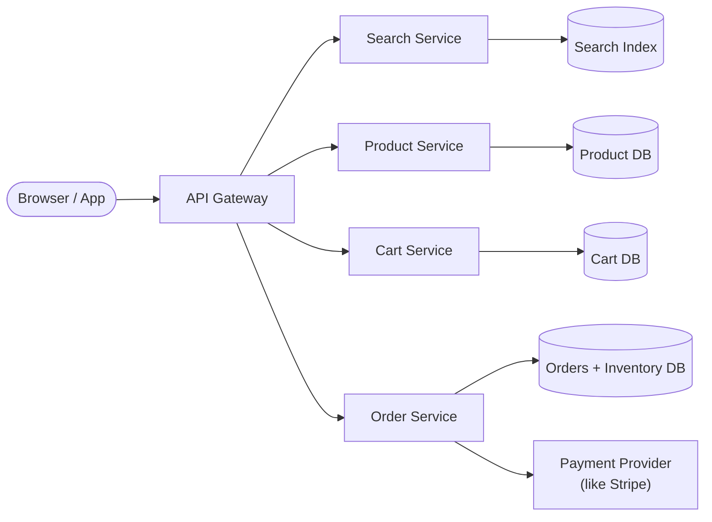
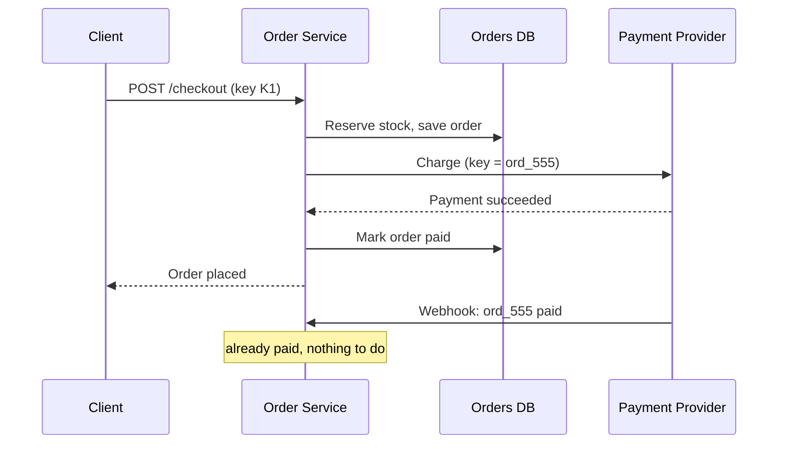
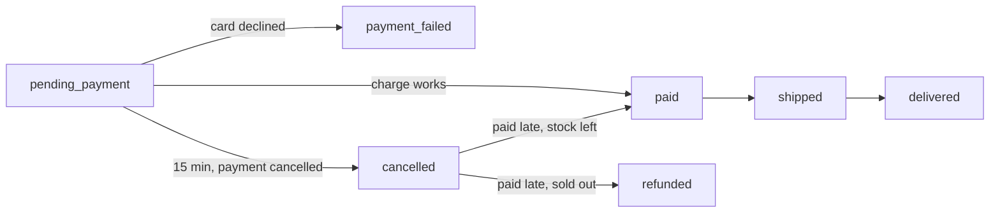
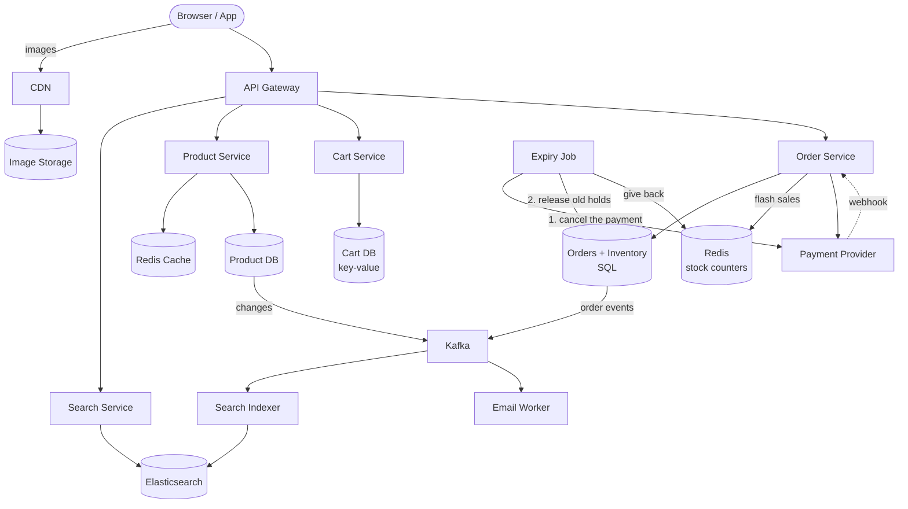

<Callout title="About this question">
  **Difficulty:** Medium. **Patterns used:** [Search and Inverted Indexes](../advanced-components/search.mdx),
  [Caching](../caching/what-is-caching.mdx), [Locks](../databases/locking.mdx),
  [Transactions](../databases/transactions-acid.mdx), [Idempotency](../messaging/idempotency.mdx),
  [Saga Pattern](../distributed-systems/saga-pattern.mdx).
</Callout>

## Understand the problem

An online store like Amazon. Users search for products, look at them, put them in a cart, pay, and then track their order.

Most of the system is easy: showing products is a read-heavy problem with caches. The hard parts are at the end:

- **Overselling:** there is 1 PlayStation left and two people press "Buy" at the same second. Only one can get it.
- **Payments:** the card must be charged **once**. Never zero times for a placed order, never twice.

## Step 1: Requirements

### Functional requirements

1. Users can search for products and view a product page.
2. Users can add products to a cart.
3. Users can check out: pay and place an order.
4. Users can see their orders and the order status.

**Out of scope** (say this out loud): reviews, recommendations, sellers adding products, shipping and delivery tracking, returns.

### Non-functional requirements

1. **No overselling:** if 5 are left, we never sell 6. Stock and orders need **strong consistency** (everyone sees the newest value).
2. **Never charge twice**, and never lose a paid order.
3. **Fast browsing:** search and product pages load in under 200 ms. Here a few seconds of old data is fine, so we pick **availability** for browsing.
4. **Big:** 100 million products, 50 million users per day, 10 million orders per day. Sale days (like Black Friday) bring about 10 times more traffic.

So this system is **two systems in one**: a loose, fast, read-heavy side (browsing) and a strict, careful side (checkout).

### Quick math

- **Orders:** 10 million ÷ 86,400 seconds = about **115 orders per second**, and about 1,200 per second on a sale day. A normal SQL database can handle that, and we need its **transactions** (a group of changes that all happen, or none do). So orders and stock go in **SQL**.
- **Browsing:** 50 million users × 20 page views = 1 billion views per day, or about **12,000 per second**. That needs a **cache**, a **CDN** for images, and a **search index**.
- **Catalog:** 100 million products × about 10 KB = **1 TB**. Big, but simple data that is read by ID, so we can split it across machines by product ID.

## Step 2: Core entities

- **Product:** name, description, price, images, category.
- **Inventory:** how many of a product are available, and how many are held for checkouts.
- **Cart:** a user's cart, with items and quantities.
- **Order:** the items, the prices paid, the address and the status.
- **Payment:** the charge for one order, and its status.

## Step 3: API

```http
GET /products/search?q=running+shoes&cursor=abc123

→ 200 OK
{ "products": [{ "productId": "p_42", "name": "Road Runner 3", "price": 89.99 }], "nextCursor": "def456" }
```

```http
GET /products/{productId}
```

```http
POST /cart/items
{ "productId": "p_42", "quantity": 2 }

→ 200 OK
```

```http
POST /checkout
Idempotency-Key: 7f3e9a1c-checkout-1
{ "paymentMethodId": "pm_123", "addressId": "addr_7" }

→ 201 Created
{ "orderId": "ord_555", "status": "paid" }
```

```http
GET /orders/{orderId}
```

Two rules for checkout:

- The client **never sends prices**. The server reads the current prices itself, or anyone could buy a TV for 1 dollar.
- The client sends an **Idempotency-Key**: a random ID made once per checkout. If the user double-clicks, or the request is retried, the server sees the same key and returns the first result instead of placing a second order.

## Step 4: High-level design



**Search and view products:**

1. The Search Service looks up the words in a **search index** like Elasticsearch, and returns matching products.
2. The Product Service reads full details from the Product DB. Images come from a CDN.

**Add to cart:**

1. The Cart Service saves `userId → items` in the Cart DB. A cart is small and is always read by user ID, so a simple **key-value** database works well.

**Check out:**

1. The Order Service reads the cart and the **current** prices.
2. It **reserves the stock** (deep dive 1) and saves the order as `pending_payment`.
3. It asks the payment provider to charge the card.
4. If the charge works, the order becomes `paid` and the cart is emptied. If not, the stock is released.

**See orders:** the Order Service reads the Orders DB.

## Step 5: Deep dives

### 1. How do we stop overselling?

There is **1 PS5 left**. Alice and Bob press "Buy" at the same moment.

<Callout title="Not great: read the stock, then write it" type="error">
  The app reads `available = 1`, sees it is more than 0, and writes `available = 0`. **Problem:** Alice and Bob
  both read `1` before either one writes. Both orders go through, and we sold 2 PS5s. This is a **race
  condition**: the result depends on who is faster.
</Callout>

<Callout title="Okay: lock the row first" type="warn">
  `SELECT ... FOR UPDATE` locks the inventory row. Bob must wait until Alice is done. **Correct.** **But** the lock
  is held while the app reads the row, checks it, and sends the update: several round trips between the app and the
  database. On a hot product, thousands of buyers wait in line for that lock, and checkout gets slow. See
  [Locks and Deadlocks](../databases/locking.mdx).
</Callout>

<Callout title="Best: one atomic update with a check" type="success">
  Let the database check and change the stock in **one step**. "Atomic" means it happens fully, with nothing in
  between. If the update changes 1 row, you got the item. If it changes 0 rows, it is sold out. The update still
  locks the row, so it is not lock-free. But the check and the change happen inside the database, with no round
  trips to the app in between, so each lock is held for a much shorter time and the line moves much faster. Keep the
  transaction short: no calls to other services inside it.
</Callout>

```sql
BEGIN;

-- For each item in the cart, in product_id order (see below):
-- move 1 PS5 from "available" to "reserved", only if 1 is left.
UPDATE inventory
SET available = available - 1, reserved = reserved + 1
WHERE product_id = 'ps5' AND available >= 1;
-- 1 row changed: you got it.
-- 0 rows changed: sold out. ROLLBACK and stop here.

INSERT INTO reservations (order_id, product_id, quantity, expires_at)
VALUES ('ord_555', 'ps5', 1, NOW() + INTERVAL '15 minutes');

COMMIT;  -- only when every UPDATE changed 1 row
```

Two traps in this code:

- **Check the row count.** If an `UPDATE` changes 0 rows, the item is sold out. The app must `ROLLBACK` and stop. If it carried on to the `INSERT` and `COMMIT`, we would save a reservation for stock we never got, and the other items in the cart would stay held.
- **Carts with many items can deadlock.** Alice's cart has a PS5 and a controller. Bob's cart has the same two items, but his code updates the controller first. Alice locks the PS5 row, Bob locks the controller row, and each waits for the other. This is a **deadlock**. The database notices it and cancels one of the two checkouts. The fix: always update the rows in the **same order**, sorted by `product_id`. Then both start with the same row, and one simply waits for the other. See [Locks and Deadlocks](../databases/locking.mdx).

**Why "reserved" and not just "sold"?** Payment can fail, or the user can close the tab. So we **hold** the item for 15 minutes:

- **Payment works:** the item moves from `reserved` to sold.
- **Payment fails:** the item goes back to `available` right away.
- **15 minutes pass with no answer:** a background **expiry job** finds old reservations. But a slow payment might still go through, so the job **first** asks the provider to cancel the payment (or tells us its final result). Only when the payment is cancelled does the job cancel the order and put the item back in `available`. If the payment already went through, the order becomes `paid` instead. If it is still in progress, the job checks again later.
- **A payment succeeds late anyway** (after we cancelled the order): reserve the item again if any is left, and mark the order `paid`. If it is sold out, refund the customer right away and tell them. We never keep money for an item we can't send.

**When do we reserve?** At **checkout**, not when the item goes into the cart. Most carts are never bought, and holding stock for them would hide items from real buyers.

**Flash sales:** 100,000 people want 1,000 cheap items at 12:00. Even the atomic update gets slow when all of them hit one row. Put a **Redis counter** in front: `stock:ps5`, set to 1,000. A tiny Lua script takes one only if the counter is above 0, so it never goes below 0. It is atomic and very fast. Only the people who got one go on to the database. Everyone else sees "Sold out" right away. When a hold is released (payment fails, or the 15 minutes pass), **give it back** with `INCR stock:ps5`, so someone else can buy it. Without this, released items stay hidden behind a counter that says 0. The database is still the real check. For huge sales, add a waiting room, like in [Design a Ticket Booking System](./ticket-booking.mdx).

### 2. Checkout and payment: never charge twice, never lose an order

Three things can go wrong:

- The user **double-clicks** "Pay".
- The network drops **after** the provider charged the card, but **before** we heard back. Did it work?
- Our server **crashes** halfway through.

<Callout title="Not great: charge the card, then save the order" type="error">
  If the server crashes between the two steps, the customer paid but we have no order. Nobody knows it happened.
</Callout>

<Callout title="Okay: save the order first, then charge" type="warn">
  The order is saved as `pending_payment` before we charge, so we always have a record. **But** if the charge
  request times out and we retry, the card may be charged twice.
</Callout>

<Callout title="Best: order first + idempotency keys + webhooks" type="success">
  Save the order first. Send the **order ID as the idempotency key** to the payment provider, so a retry can never
  charge twice. Let the provider confirm the result with a **webhook**. A cleanup job (the expiry job) checks orders
  that stay `pending_payment` for too long. It cancels the payment **before** it releases the stock.
</Callout>

A **webhook** is a call that the payment provider makes **to us** when something happens, like "payment for `ord_555` succeeded". So even if our first request timed out, we still learn the result.



The direct answer, the webhook and the expiry job can all try to change the same order. So the order's status only changes with a **conditional update**, like `UPDATE orders SET status = 'paid' WHERE order_id = 'ord_555' AND status = 'pending_payment'`. Only the first one wins. The others change 0 rows and know someone got there first. If the webhook finds the order already `cancelled`, it follows the "payment succeeds late" rule from deep dive 1: reserve again, or refund.

**Card numbers never touch our servers.** The payment page uses the provider's own form. The card goes straight to the provider, and we get back a **token** like `pm_123`. This keeps us out of most of **PCI DSS**, the strict security rules for anyone who stores card numbers.

**Order status** moves through clear steps. Each step is one row update in the database:



Checkout touches several services: inventory, payment, then order. If a later step fails, we **undo** the earlier ones: card declined → release the stock. This "do steps, undo on failure" flow is a [saga](../distributed-systems/saga-pattern.mdx).

### 3. How do we make browsing fast?

This side is all about reads, and a few seconds of old data is fine.

- **Search:** the Product DB is the source of truth. Every change flows through Kafka to a **search indexer**, which updates Elasticsearch. Search may be a second behind. That is okay. See [Search and Inverted Indexes](../advanced-components/search.mdx).
- **Product pages:** cache them in Redis. Popular products are read thousands of times for every change.
- **Images:** store them in object storage and serve them through a [CDN](../caching/cdn.mdx), close to the user.
- **"Only 3 left!"** on the product page comes from the cache, so it can be a little wrong. That is fine, because the **real** check happens at checkout with the atomic update.

Be loose where it is safe (browsing), and strict where money is (checkout).

### Final architecture



## In the real world

- **Amazon's shopping cart** is the reason Amazon built **Dynamo**, described in a famous 2007 paper. Amazon wanted "add to cart" to **always work**, even when servers or the network fail. When two copies of a cart disagree, Dynamo keeps both and they are **merged**. The paper says that this means a deleted item can sometimes come back. For a cart, Amazon chose availability over perfect correctness.
- **Stripe** (a payment provider) lets you send an `Idempotency-Key` header with a request. If you retry with the same key, Stripe returns the first result instead of charging again. This is exactly deep dive 2.
- **Stripe Checkout and Stripe Elements** collect card details on Stripe's side. The store only gets an ID for the payment method, so card numbers never reach the store's servers.
- **Large stores** usually run product search on a separate search engine, such as Elasticsearch or OpenSearch, instead of the main database.

## Follow-up questions

<Accordions>
<Accordion title="The price changes while the item is in the cart. What happens?">

The cart stores only the product ID and quantity, not the price. At checkout, we read the current price and show it to the user before they pay. The order then saves the **price paid**, so later price changes never change an old order.

</Accordion>
<Accordion title="Where does the cart of a user who is not logged in live?">

In the browser (in local storage or a cookie), or in the Cart DB under a random guest ID. When the user logs in, we **merge** the guest cart into their real cart.

</Accordion>
<Accordion title="The payment provider is slow or down. What do we do?">

Use a **timeout** so we don't wait forever. Retry with the **same idempotency key**, so a retry never charges twice. If the provider keeps failing, a [circuit breaker](../reliability-security/circuit-breaker.mdx) stops sending requests for a while. The order stays `pending_payment`, and the webhook or the cleanup job sorts it out later.

</Accordion>
<Accordion title="How do you make sure the confirmation email is always sent?">

Use the [outbox pattern](../distributed-systems/outbox-pattern.mdx). In the same transaction that marks the order `paid`, also write an "order paid" event to an `outbox` table. A small worker reads the outbox and sends the events to Kafka. Now the order and the event are saved together, or not at all.

</Accordion>
<Accordion title="We have many warehouses. How does inventory change?">

Keep stock per **product and warehouse**. At checkout, pick a warehouse that has the item and is close to the address, then run the same atomic update on that row. The product page shows the total across warehouses.

</Accordion>
</Accordions>

## What the interviewer expects

<Tabs items={['Mid-level', 'Senior', 'Staff']}>
<Tab value="Mid-level">

- Clear requirements and one endpoint per feature.
- Separate services for products, cart and orders.
- Spot the overselling problem and fix it with a lock or an atomic update.
- Use a payment provider instead of handling cards yourself.

</Tab>
<Tab value="Senior">

- Say that browsing and checkout need **different** consistency.
- Reservations with expiry, and why we reserve at checkout. Cancel the payment before releasing a hold.
- Check the row count, and lock items in `product_id` order to avoid deadlocks.
- Idempotency keys on checkout and on the payment call, plus webhooks.
- Keep search in sync with the database through events.

</Tab>
<Tab value="Staff">

- Everything from senior, but faster.
- Flash sales: Redis counters, queues and waiting rooms.
- Sagas across services, and what to undo at each step.
- Reconciliation: matching our orders against the provider's records every day.

</Tab>
</Tabs>

<Callout title="Remember this" type="success">
  - **Two systems in one:** browsing is read-heavy and can be a bit stale. Checkout must be strictly correct.
  - **No overselling:** one atomic `UPDATE ... WHERE available >= 1`. 0 rows changed = sold out, so roll back.
    Update cart items in `product_id` order to avoid deadlocks.
  - **Reserve at checkout** with an expiry, and release the stock if payment fails. Before an expired hold is
    released, cancel the payment. If a payment still succeeds late, reserve again or refund.
  - **Never charge twice:** save the order first, use **idempotency keys**, and listen for **webhooks**.
  - Card numbers go **straight to the payment provider**, never through our servers.
  - The stock shown on the product page can be approximate. The **real check is at checkout**.
</Callout>
