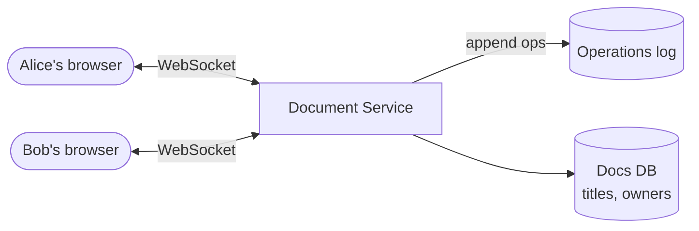
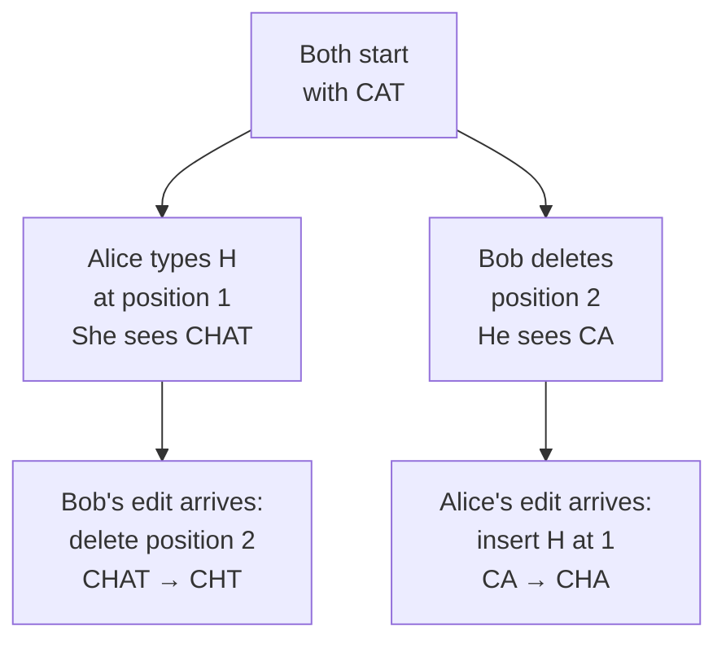
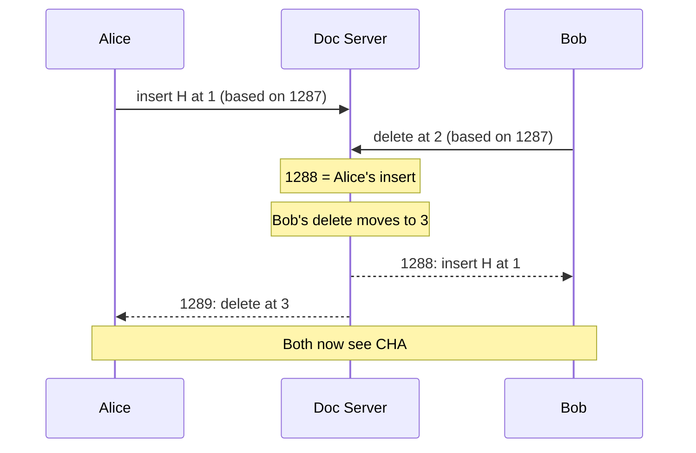
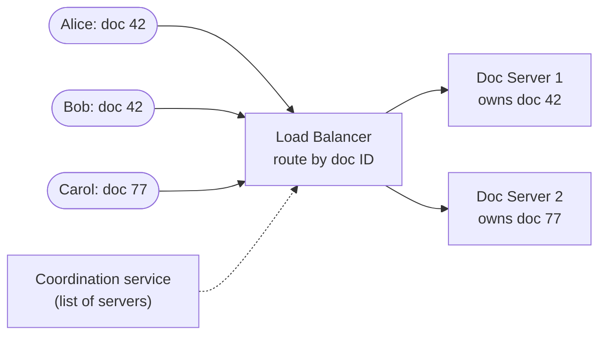
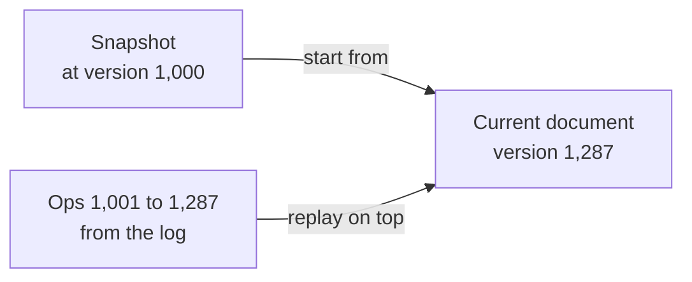
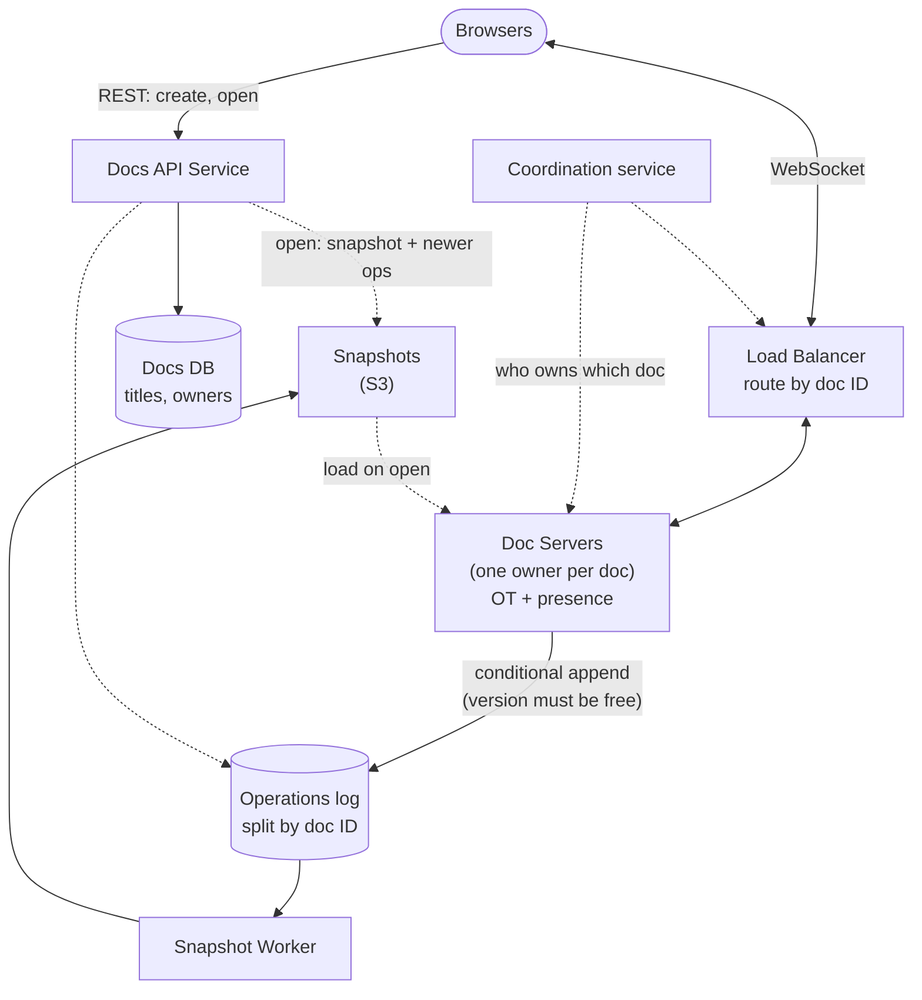

<Callout title="About this question">
  **Difficulty:** Hard. The hard part is not scale. It is two people typing at the same moment. **Patterns used:**
  [WebSockets](../foundations/polling-websockets-sse.mdx), [Consistent Hashing](../databases/consistent-hashing.mdx),
  [Event Sourcing](../distributed-systems/event-sourcing.mdx), [Stateless vs Stateful](../hld-basics/stateless-vs-stateful.mdx),
  [Idempotency](../messaging/idempotency.mdx).
</Callout>

## Understand the problem

Alice, Bob and Carol open the same document. All three type at the same time. Each of them sees the others' changes within a moment, and sees their colored cursors move.

The tricky promise is this: when everyone stops typing, **all three screens show exactly the same text**, and nobody's typing was lost. Making that true when edits cross each other on the network is the heart of this question.

## Step 1: Requirements

### Functional requirements

1. Users can create and open a document.
2. Many users can edit the same document at the same time and see each other's changes live.
3. Users can see who else is in the document and where their cursors are.
4. (Optional) Users can see old versions and go back to one.

**Out of scope** (say this out loud): comments, sharing and permissions, rich formatting details (we treat the document as plain text), offline editing (a follow-up).

### Non-functional requirements

1. **Fast:** others see my change in about **100 to 200 ms**.
2. **Same result for everyone:** after all edits arrive, every copy of the document is identical. This is called **convergence**.
3. **Never lose an edit:** once the editor shows "Saved", the edit is safe, even if a server dies.
4. **Scale:** millions of documents. Most have 1 to 5 editors at a time. A few have up to about 100.

**No quick math needed.** Documents are small and each edit is a few bytes. Say so out loud: the hard part here is **edits at the same time**, not data size.

## Step 2: Core entities

- **Document:** ID, title, owner, current version number.
- **Operation (op):** one small edit, like "insert `H` at position 1" or "delete position 2". It also records who made it and which version it was based on.
- **Snapshot:** the full text of the document at some version.
- **Presence:** who is in the document right now, and where their cursor is.

## Step 3: API

Normal REST for creating and opening documents:

```http
POST /docs
{ "title": "Trip plan" }
→ 201 Created
{ "docId": "d_42" }

GET /docs/d_42
→ 200 OK
{ "docId": "d_42", "version": 1287, "content": "Day 1: fly to Rome..." }
```

Live editing needs messages in **both** directions: my edits go up, and everyone else's come down. So we open a **WebSocket**, a connection that stays open and lets the server push messages at any time (see [Polling, WebSockets and SSE](../foundations/polling-websockets-sse.mdx)).

```http
GET /docs/d_42/live?fromVersion=1287
Upgrade: websocket
```

`fromVersion` is the version the browser already has. Someone may type between the `GET /docs/d_42` call and the moment the WebSocket opens. So the server first sends every op **after** version 1287, then the live ops. Without it, those edits would be missed, and this browser's copy would differ from everyone else's.

A message from the browser to the server, "I typed `H` at position 1, based on version 1287":

```json
{ "type": "op", "opId": "c7f3a-17", "baseVersion": 1287, "op": { "insert": "H", "at": 1 } }
```

The `opId` is this tab's own random **client ID** (`c7f3a`) plus a counter. A user ID alone is not enough: Alice may have the same document open in two tabs.

A message from the server to everyone else, and a cursor update:

```json
{ "type": "op", "version": 1288, "userId": "alice", "op": { "insert": "H", "at": 1 } }
{ "type": "cursor", "userId": "alice", "at": 2 }
```

## Step 4: High-level design



**Open a document:**

1. The browser calls `GET /docs/d_42` and gets the text and its version number, say 1287.
2. It opens a WebSocket for `d_42` with `fromVersion=1287`. The server first sends any ops after 1287, so nothing typed in between is missed.
3. The server adds the user to the list of people in that document.

**Edit:**

1. Alice types. Her browser **shows the change right away**. It doesn't wait for the server. Until the server confirms it, the op is **pending**.
2. The browser sends the op to the Document Service. It keeps only **one op in flight**: anything Alice types before the server confirms that op waits in a **buffer** in the browser (deep dive 1 shows why).
3. The server puts the op **in order** with all other ops for this document, gives it the next version number, and saves it to the operations log.
4. The server sends the op to everyone else in the document. Each browser first **adjusts the op against its own pending ops** (the one in flight, then the buffer), then applies it.
5. The server tells Alice "saved as version 1288". Her browser then sends the buffer, combined into one op, based on version 1288.

Notice we save **ops**, not the whole document after each keystroke. Each op is tiny, and the list of ops is the full history.

## Step 5: Deep dives

### 1. Two people type at the same time: OT and CRDTs

Here is the problem in its smallest form. The document says `CAT`. Positions start at 0: `C` is 0, `A` is 1, `T` is 2.

- **Alice** inserts `H` at position 1. She sees `CHAT`.
- **Bob**, at the same moment, deletes position 2 (the `T`). He sees `CA`.

Each person then receives the other's edit **exactly as it was sent**:



Alice ends with `CHT` and Bob with `CHA`. **The copies are different**, and Alice lost the wrong letter. On Alice's screen, position 2 is now the `A`, because her `H` pushed everything one step to the right. The right answer for both is `CHA`.

<Callout title="Not great: last write wins" type="error">
  Each person saves the whole document, and the last save wins. Simple, **but** everyone else's typing is
  silently thrown away.
</Callout>

<Callout title="Okay: lock a paragraph while someone types in it" type="warn">
  No clashes, because two people can never edit the same place. **But** people get blocked, and it doesn't feel
  live. Old desktop tools worked like this.
</Callout>

<Callout title="Best: Operational Transformation (OT)" type="success">
  When two edits cross, **adjust one of them** so it still means what its author meant. Bob meant "delete the
  `T`". After Alice's insert, the `T` is at position 3, so Bob's edit becomes "delete position 3". A central
  server decides the order of edits, and transforms them. Each browser also transforms incoming edits against its
  own edits that the server has not confirmed yet.
</Callout>

**OT** stands for **Operational Transformation**. The rules are simple for plain text:

- If someone **inserted** text **before** my position, move my position **right** by that many characters.
- If someone **deleted** text **before** my position, move my position **left**.
- If their change is **after** my position, change nothing.
- **Same spot.** Two inserts at the same position: a fixed rule picks which goes first, for example the lower client ID. Every copy uses the same rule, so they agree. Two deletes of the same letter: the second becomes a **no-op** (it does nothing), because the letter is already gone.

```js
// Adjust a delete so it still removes the same letter after someone else's insert
function transformDelete(deleteEdit, insertEdit) {
    // The insert came before (or at) our spot: move right by the inserted text's length
    if (insertEdit.at <= deleteEdit.at) {
        const newPosition = deleteEdit.at + insertEdit.text.length;
        return { at: newPosition };
    }

    // The insert came after our spot: nothing changes
    return deleteEdit;
}

console.log(transformDelete({ at: 2 }, { at: 1, text: "H" })); // { at: 3 }
```

Here is how the server uses it. Both edits were based on version 1287. The server picks Alice's first, so Bob's edit must be transformed against it:



Alice receives the **transformed** delete. Her own insert is already confirmed as version 1288, so she has nothing pending and applies it as it is. `CHAT` becomes `CHA`.

Bob receives Alice's insert, but his own delete is still **pending**: it is on his screen, and the server has not confirmed it yet. So Bob's browser first transforms the insert against his pending delete. The delete (position 2) is after the insert (position 1), so the insert stays "insert `H` at 1". `CA` becomes `CHA`. Same text everywhere.

**Why the browser must transform too.** Change the example a little. Bob deletes position 0 (the `C`) instead, and sees `AT`. The server again puts Alice's insert first. Bob's delete at 0 stays at 0, because Alice's insert is after it. Everyone else ends with `HAT`.

- **Wrong:** Bob's browser applies "insert `H` at 1" as it came. `AT` becomes `AHT`. Bob's copy is now different.
- **Right:** Bob's browser transforms it against his pending delete first. A letter **before** position 1 was deleted, so the insert moves left, to position 0. `AT` becomes `HAT`.

The rule: before applying an op from the server, the browser transforms it against **all its pending ops** (the one in flight, then the buffer), and updates those pending ops the same way. The server transforms incoming ops against what it already has; each browser does the same against what it has typed.

**Why only one op in flight?** Say Alice types `H` at 1, then `E` at 2 (`CAT` → `CHAT` → `CHEAT`), and sends both at once, before the server confirms either. Both say "based on 1287". The server saves `H` as 1288. Then it transforms `E` against 1288, which is Alice's **own** `H`. An insert came before position 2, so `E` moves to 3, and the server stores `CHAET`. But Alice had already counted her `H` when she typed `E`. The copies now differ.

So the browser sends **one op at a time**. While `H` is in flight, `E` waits in the buffer (more typing joins the buffer too). When the server confirms `H` as 1288, the browser sends `E` based on 1288. Now the server transforms `E` only against **other people's** ops, never against Alice's own earlier ones. Google Wave and the open-source ot.js library work this way.

**The other approach: CRDTs.** A **CRDT** (Conflict-free Replicated Data Type) avoids positions completely. Every character gets a **unique ID that never changes**:

| Character | C | A | T |
| --- | --- | --- | --- |
| ID | `c1` | `a1` | `t1` |

- Alice's edit becomes "insert `H` **after `c1`**".
- Bob's edit becomes "delete **`t1`**".

IDs don't move when other people type, so these edits can be applied **in any order**, on any copy, and the result is always `CHA`. If two people insert after the same character at the same moment, every copy sorts the two inserts the same way (for example, by client ID), so they still agree. Deleted characters are kept as hidden markers called **tombstones**, so later edits that point at them still work.

| | OT | CRDT |
| --- | --- | --- |
| How | Server orders edits and adjusts positions | Characters have fixed IDs. Any order works |
| Needs a central server? | Yes | No. Copies can even sync peer to peer |
| Offline editing | Hard | Natural |
| Memory | Small | Bigger: an ID per character, plus tombstones |
| Used by | Google Docs | Yjs, Automerge, many newer apps |

**For this design we pick OT.** We already have a server for every document, and OT keeps memory small. If offline editing becomes important, CRDTs are the better fit.

### 2. How do all editors of one document reach the same server?

OT needs **one place** that decides the order of ops for a document. So all editors of `d_42` must talk to the **same** Document Service server. That server keeps the document in memory. This makes the Document Service **stateful** (see [Stateless vs Stateful](../hld-basics/stateless-vs-stateful.mdx)).

<Callout title="Not great: any user to any server" type="error">
  Alice lands on server 1 and Bob on server 2. Neither server sees all the ops, so nobody can put them in one
  order.
</Callout>

<Callout title="Best: route by document ID" type="success">
  Use [consistent hashing](../databases/consistent-hashing.mdx) on the document ID to choose its **owner
  server**. The load balancer sends every WebSocket for `d_42` to that owner. A coordination service (like
  ZooKeeper) keeps the list of servers.
</Callout>



**When an owner server dies:** its documents move to the next server on the ring. That server loads each document (snapshot plus recent ops, see the next deep dive). Browsers notice the dropped WebSocket, reconnect with `fromVersion` set to the last version they have, and **resend the op the server never confirmed** (then the buffer, as usual). Each op has an ID like `c7f3a-17` (client ID plus counter), so if the server already saved it, it simply ignores the copy. That is [idempotency](../messaging/idempotency.mdx).

**What if the old owner is not dead, just slow?** It may have lost contact with the coordination service for a few seconds while still serving its browsers. Now two servers think they own `d_42`. Both could save a different op as version 1288, and the document would split into two histories.

The fix is a **fence** in the ops log. Each entry's key is `(doc_id, version)`, and an append succeeds **only if that version is still free** (a conditional write: a second insert of the same key fails). So only one server can ever write version 1288, and the history stays one straight line. When a server's append fails, it knows someone else wrote to this document. It asks the coordination service who the owner is. If it is still the owner, it loads the newer ops from the log and goes on. If not, it drops the document from memory and closes its WebSockets, and those browsers reconnect to the real owner. (See [Leader Election and Consensus](../distributed-systems/leader-election-consensus.mdx).)

### 3. How do we save the document and its versions?

**The operations log.** Every op is **appended** to a log with its version number: version 1, 2, 3, and so on. We never change old entries. Replaying all ops from the start rebuilds the document exactly. Storing every change as an event like this is called [Event Sourcing](../distributed-systems/event-sourcing.mdx).

**Snapshots.** A busy document can have a million ops. Replaying all of them every time someone opens it is slow. So after every 1,000 new ops or so, a background worker saves a **snapshot**: the full text at that version.



**Open a document** = load the latest snapshot, then replay only the ops after it.

**When is an edit "saved"?** The server writes the op to the log **first**, and only then tells the author "saved". Until then, the browser keeps the op as **pending** and will resend it after a reconnect.

**Version history** is almost free. Any old version can be rebuilt from the log: load the snapshot just before it, then replay ops up to it. Version 1,250 = the snapshot at 1,000 + ops 1,001 to 1,250. To "restore" version 1,250, we don't delete anything. We add **new** ops that turn the current text back into version 1,250's text. History is never lost.

**Where it lives:** the ops log in a database that is good at fast appends and supports conditional writes (for the fence above), split by document ID. Snapshots in object storage like S3. Titles and owners in a normal SQL database. The Docs API reads the latest snapshot and the newer ops to answer `GET /docs/d_42`.

### 4. How do we show who is online?

Presence (who is here, where their cursor is) changes all the time, and nobody needs it tomorrow. So we **never write it to the database**.

- The owner server keeps the list of connected users **in memory**.
- When a WebSocket closes, or a user sends no heartbeat (a small "I'm still here" message) for about 30 seconds, we remove them and tell everyone.
- **Cursor moves are frequent.** The browser sends at most a few per second. If one is lost, the next one fixes it, so we don't save or retry them.
- Cursor positions also shift when others type, so the same OT rules adjust them.

### Final architecture



## In the real world

**Google Docs uses OT.** Google explained this on its Drive blog in 2010, when it launched the new real-time Docs editor: every change is saved as an operation, and operations made at the same time are transformed so that everyone ends up with the same document.

**Google Docs limits live editors.** Google's help pages say up to **100 people** can work on the same Docs, Sheets or Slides file at the same time. That fits our design: one owner server per document is plenty.

**Figma took ideas from CRDTs, but kept a central server.** In a 2019 blog post, "How Figma's multiplayer technology works", Figma explained that its system is inspired by CRDTs, but because Figma has a central server, it could use a simpler design than a full CRDT.

**Open-source CRDT libraries** like **Yjs** and **Automerge** let apps add live, offline-friendly collaboration without building the algorithm from scratch.

## Follow-up questions

<Accordions>
<Accordion title="How would you support offline editing?">

The browser saves ops locally while offline. On reconnect, it sends them all. With OT, the server must transform a long list of old ops against everything that happened meanwhile, which is hard to get right. This is where **CRDTs** shine: offline edits merge naturally, in any order.

</Accordion>
<Accordion title="How does undo work when others are also typing?">

Undo only **your own** last op. Make the opposite op (undo "insert H at 1" with "delete at 1"), then **transform** it against everything others did since, so it still points at the right place. Never undo other people's work.

</Accordion>
<Accordion title="A document is shown on a big screen to 10,000 viewers. Now what?">

Viewers don't edit, so they don't need the owner server's ordering. The owner sends each new op to a **pub/sub** layer, and separate broadcast servers push it to viewers. The owner only talks to the few real editors.

</Accordion>
<Accordion title="How do bold, italics and other formatting work?">

They are just more op types, like "make positions 5 to 10 bold". The same idea applies: when edits cross, adjust the ranges so they still cover the text the author meant.

</Accordion>
</Accordions>

## What the interviewer expects

<Tabs items={['Mid-level', 'Senior', 'Staff']}>
<Tab value="Mid-level">

- WebSockets for live updates, and sending small ops, not the whole document.
- Show the clash with a simple example, and know that OT or CRDTs fix it.
- A clear save flow: ops log plus snapshots.

</Tab>
<Tab value="Senior">

- Explain OT with a worked example, including why the browser transforms incoming ops against its pending ops and keeps only one op in flight, and how CRDTs differ, with tradeoffs.
- Join and rejoin with `fromVersion`, so no op is missed.
- Route all editors of a document to one owner server with consistent hashing.
- Snapshots plus ops replay, "saved" only after the log write, and resending pending ops with IDs.
- Presence kept in memory, never in the database.

</Tab>
<Tab value="Staff">

- Everything from senior, but faster.
- Owner server failover without losing or doubling ops, and without two owners (a conditional log append as a fence).
- Offline editing and when to move to CRDTs.
- Huge audiences: separating editors from viewers.

</Tab>
</Tabs>

<Callout title="Remember this" type="success">
  - **The hard part is edits at the same time**, not scale.
  - **Positions shift** when others type. `CAT` example: Bob's "delete 2" must become "delete 3".
  - **OT:** a central server orders ops and transforms them. Each browser also transforms incoming ops against its own **pending** ops. Google Docs uses it.
  - **One op in flight** per browser, the rest buffered. Then the server never transforms an op against the same browser's earlier ops.
  - **CRDT:** characters get fixed IDs, so any order works. Great for offline, uses more memory.
  - **One owner server per document**, chosen by consistent hashing on the doc ID. The log only accepts a version once, so two owners can't split the history.
  - **Ops log + snapshots:** open = latest snapshot + newer ops. "Saved" only after the log write.
</Callout>
