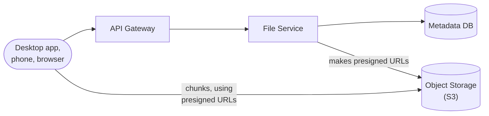
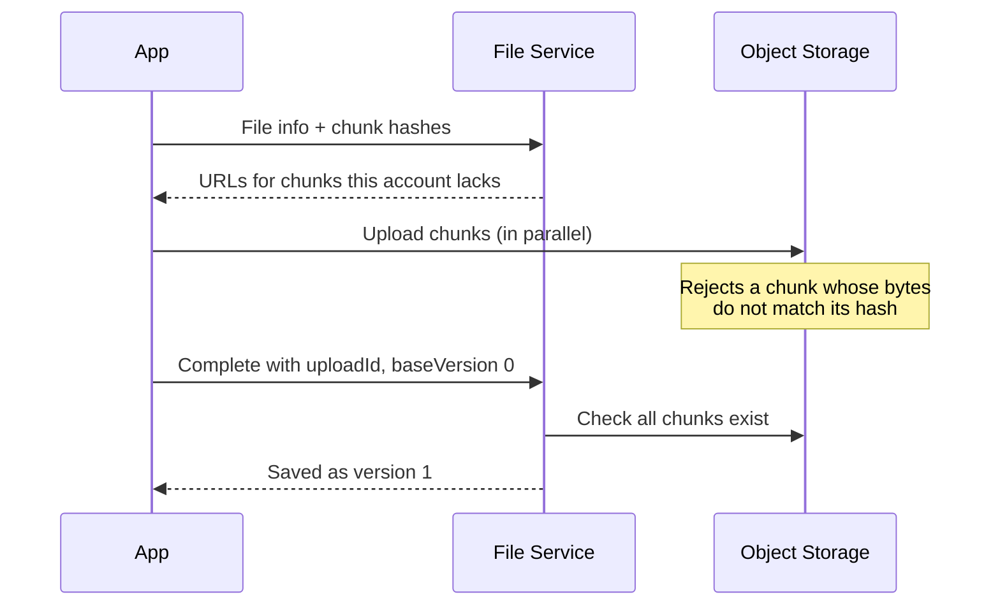
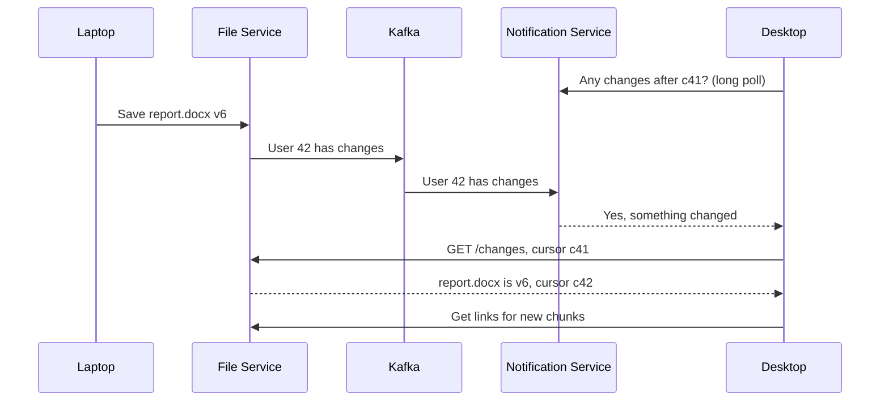
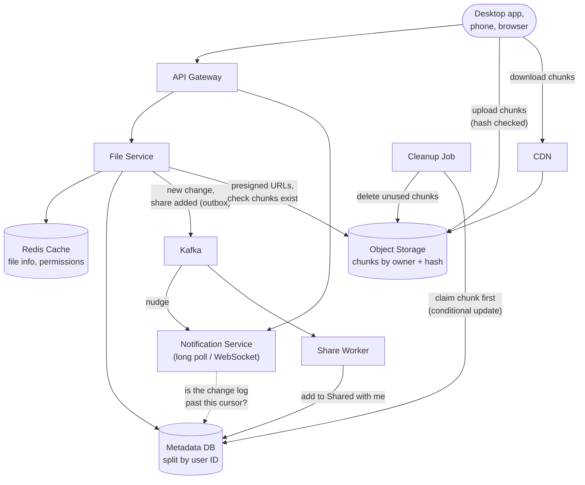

<Callout title="About this question">
  **Difficulty:** Medium. **Patterns used:** [File Upload and Download](../advanced-components/file-upload-download.mdx),
  [Object, Block and File Storage](../advanced-components/storage-types.mdx), [CDN](../caching/cdn.mdx),
  [Polling, WebSockets and SSE](../foundations/polling-websockets-sse.mdx), [Locks and Deadlocks](../databases/locking.mdx).
</Callout>

## Understand the problem

A service like Google Drive or Dropbox. Users put files in the cloud, open them on any device, and share them with other people.

The desktop app watches a folder on the computer. Change a file on your laptop, and a few seconds later the new version is on your desktop and your phone too. This is called **sync**.

The hard parts: files can be huge (a 20 GB video), networks drop in the middle of uploads, and two devices can change the same file at the same time.

## Step 1: Requirements

### Functional requirements

1. Users can upload a file.
2. Users can download a file.
3. Users can share a file or folder with other users.
4. Files sync automatically across all of a user's devices.

**Out of scope** (say this out loud): editing a document together live (that is [Design Google Docs](./google-docs.mdx)), searching inside files, file previews, storage plans and billing.

### Non-functional requirements

1. **Never lose a file:** once an upload is done, the file is safe, even if a data center has problems.
2. **Big files:** up to 50 GB. If the network drops, the upload **continues** where it stopped.
3. **Fast sync:** a change shows up on the user's other devices within a few seconds.
4. **Always up:** 99.9% uptime. If another device sees a change a few seconds late, that is fine. So we pick **availability**, with **eventual consistency** (all devices end up the same, just not at the same instant).
5. **Big:** 100 million users.

### Quick math

- **File data:** 100 million users × about 5 GB each = **500 PB**. No database can hold that. File bytes go in **object storage** like Amazon S3: cheap, very durable, and almost no size limit.
- **File info:** 100 million users × 1,000 files × about 1 KB = **100 TB**. Much smaller, but still too big for one database. We **split it by user ID** across many machines.

## Step 2: Core entities

- **File:** the file info, also called **metadata** ("data about the data"): name, size, owner, folder, current version.
- **Chunk:** a 4 MB piece of a file. Each chunk is named by its **hash**.
- **File version:** one saved state of a file: the ordered list of its chunks.
- **Share:** who can see or edit a file or folder.

A **hash** (like SHA-256) is a fingerprint of some data. The same bytes always give the same hash. Different bytes give a different hash. So two chunks with the same hash have the same content.

## Step 3: API

```http
POST /files
Idempotency-Key: 5b2e8c1a-7d4f-4a9e-b3c6-1f0e2d9a8b7c
{ "name": "holiday.mp4", "folderId": "fld_1", "chunks": ["hash_a1", "hash_b2", "hash_c3"] }

→ 201 Created
{
  "fileId": "f_77",
  "uploadId": "up_91",
  "uploads": [{ "chunk": "hash_b2", "url": "https://storage.example.com/u_42/hash_b2?signature=..." }]
}
```

The server returns upload links only for chunks that **this user's account** does not already have. (Not chunks that *anyone* has: see deep dive 1 for why.) The **`Idempotency-Key`** is made once by the app and sent again on every retry, so a lost reply never creates a second file (see [Idempotency](../messaging/idempotency.mdx)). The **`uploadId`** names this one save. The client then sends each chunk straight to storage, and tells the server when it is done:

```http
POST /files/{fileId}/complete
{ "uploadId": "up_91", "baseVersion": 0 }

→ 200 OK
{ "fileId": "f_77", "version": 1 }

→ 409 Conflict          (someone else saved first)
{ "currentVersion": 6 }
```

**Saving a change** to a file works the same way. `POST /files/{fileId}/versions` with the new chunk list returns a new `uploadId` and upload links for the new chunks. Then `complete` sends **`baseVersion`**: the version the change started from (`0` for a brand-new file). If another device saved a newer version in the meantime, the server answers `409 Conflict` (deep dive 4).

**A retry gets the first answer.** If `complete` worked but its reply was lost, the app sends it again. The server sees that `up_91` is already saved, and answers `200` with that version again, not a conflict.

```http
GET /files/{fileId}

→ 200 OK
{ "name": "holiday.mp4", "version": 1, "chunks": [{ "hash": "hash_a1", "url": "https://cdn.example.com/..." }] }
```

```http
POST /files/{fileId}/shares
{ "email": "ben@example.com", "permission": "view" }

GET /changes?cursor=c41

→ 200 OK
{ "changes": [{ "fileId": "f_77", "version": 2 }], "cursor": "c42" }

GET /changes/poll?cursor=c42          (long poll: waits up to about a minute)

→ 200 OK
{ "changes": true }
```

## Step 4: High-level design



**Upload a file:**

1. The app cuts the file into 4 MB chunks and computes each chunk's hash.
2. It sends the file name and the list of hashes to the File Service.
3. The File Service saves the file info with status `uploading`, and makes an `uploadId` for this save. It returns a **presigned URL** for each chunk that this user's account does not have yet. A presigned URL is a link to storage with a signature in it. It lets the holder upload (or download) one object for a short time, without our servers in the middle.
4. The app uploads the chunks **straight to object storage**, several at a time. Storage checks that each chunk's bytes really match its hash (deep dive 1).
5. The app calls `complete` with its `uploadId` and `baseVersion: 0`. The File Service checks that every chunk is there, saves version 1, and marks the file `ready`.

**Download a file:**

1. The app asks the File Service for the file.
2. The File Service checks that the user is allowed to see it, and returns the chunk list with short-lived download links.
3. The app downloads the chunks, several at a time, and joins them in order.

**Share a file:**

1. The owner adds Ben with `view` permission. The File Service saves a row in the `shares` table, next to the file.
2. Ben's "Shared with me" list needs its own copy. The metadata is split by user ID, so the `shares` rows live on the **owner's** shard. Finding "everything shared with Ben" there would mean asking **every** shard. So we also add a row to a `shared_with_me` table, split by **Ben's** user ID. His list is then one query on one shard.
3. The two rows are on different shards, so they can't be saved in one transaction. The File Service saves the `shares` row together with a "share added" event in an outbox table, in one transaction (the [Outbox Pattern](../distributed-systems/outbox-pattern.mdx)). The event goes through Kafka, and a Share Worker adds Ben's `shared_with_me` row. Ben's list may show the file a second later. That is fine.
4. Every download or change checks `shares` (or the owner) first.

## Step 5: Deep dives

### 1. How do we upload big files?

<Callout title="Not great: send the whole file through our servers" type="error">
  A 10 GB upload keeps one of our servers busy for many minutes, and many gateways reject very large requests. If
  the network drops at 99%, the user starts again from zero.
</Callout>

<Callout title="Okay: one presigned URL, straight to storage" type="warn">
  Our servers are free now, because the bytes go directly to object storage. **But** it is still one big
  request. A dropped connection still means starting over. And there is a hard limit: one S3 upload request can
  carry at most 5 GB, so a 50 GB file can't go in one request at all.
</Callout>

<Callout title="Best: chunks + presigned URLs + resume" type="success">
  Cut the file into 4 MB chunks and upload each one straight to storage. If the network drops, the app asks
  "which chunks do you already have?" and uploads only the rest. Chunks also upload **in parallel**, which is
  faster.
</Callout>

Example: a 1 GB video is **256 chunks**. The Wi-Fi drops after chunk 180. When it comes back, the app uploads only the last **76 chunks**, not the whole gigabyte.

Chunks give us two more wins for free:

- **Upload only what changed:** when a file changes, the app hashes the chunks again and uploads only chunks with a **new** hash. A 2 GB log file that grows at the end only uploads its last chunk and the new ones.
- **Store each chunk once (deduplication):** a chunk is stored under its owner and its hash, like `u_42/hash_b2`. If the same chunk is already in **this account** (for example, in an old version of the same file), we skip it.



Two safety rules make chunk names trustworthy:

- **Dedupe only inside one account.** Why not across all users? Then the server would say "I already have `hash_b2`, no need to upload" to **anyone** who sends that hash. Someone who only knows a file's hashes (posted online, say) could "upload" it in a second without ever having the bytes, and then download the real file. In 2011 a tool called Dropship did exactly this with Dropbox. Inside one account, you can only reuse chunks you uploaded yourself.
- **Check that the bytes match the hash.** The app tells us the hash. A buggy or bad app could upload different bytes under that name, and every later version that reuses the chunk would then be corrupted. So storage checks it during the upload: the presigned URL requires a SHA-256 checksum equal to the chunk's hash, and storage rejects the upload if the bytes don't match (S3 supports checksums like this). If our storage can't do that, a worker hashes each new chunk before `complete` succeeds.

### 2. How do changes reach the user's other devices?

Sync has two directions.

**From the laptop to the cloud:** the desktop app asks the operating system to tell it whenever a file in the sync folder changes. When that happens, it does the chunk upload from deep dive 1 and saves a new version.

**From the cloud to the other devices:** every change is written to a **change log** for that user: change 41, change 42, and so on. Each device keeps a **cursor**: a bookmark that says "I have seen everything up to change 41".

After saving a change, the File Service also sends a small "user 42 has changes" event to **Kafka**. The Notification Service reads Kafka and nudges that user's devices. Kafka keeps the two services apart: if the Notification Service is slow or restarting, events wait in Kafka instead of slowing down saves. (If a nudge event is ever lost, nothing breaks: the change log is the truth. The device's next long poll carries its cursor, so it finds the change, at most about a minute later.)

<Callout title="Not great: ask for the full file list every few seconds" type="error">
  Every device downloads the info of all 1,000 files, again and again, to spot what changed. Huge waste, and our
  servers drown in these requests.
</Callout>

<Callout title="Okay: poll for changes with a cursor" type="warn">
  Every 30 seconds, the device calls `GET /changes?cursor=c41` and gets only what is new. Much cheaper. **But**
  changes arrive up to 30 seconds late, and most calls return nothing.
</Callout>

<Callout title="Best: a live nudge + the cursor" type="success">
  Each device keeps a **long poll** (or a WebSocket) open to a Notification Service. When something changes, the
  service sends a tiny nudge: "you have changes". The device then calls `/changes` with its cursor. The nudge is
  only a hint. The **cursor is the truth**, so a missed nudge never loses a change.
</Callout>

**Long polling** means the device asks "any changes?", and the server keeps the request open until there is a change, or until about a minute passes. Then the device asks again. It works through almost any network, and is simpler than WebSockets.

The long poll must carry the device's **cursor** (`GET /changes/poll?cursor=c42`). The Notification Service first checks the change log: if it is already past `c42`, it answers **right away**. Why? Say a change happens after the device called `/changes`, but before it opened its next long poll. The nudge for it finds no open request and is gone. Without the cursor, the device would wait until something else changed. (The Dropbox API's `list_folder/longpoll` takes a cursor for the same reason.)



If a device was offline for a week, it simply sends its old cursor and gets every change since then.

### 3. Where do we store file data, and where file info?

| | File data (the bytes) | File info (metadata) |
| --- | --- | --- |
| **Size** | Huge: 500 PB | Small: about 1 KB per file |
| **Where** | Object storage (S3) | SQL database, split by user ID |
| **Why** | Cheap, durable, no size limit | Needs transactions and fast queries |

Main metadata tables:

| Table | What it holds |
| --- | --- |
| `files` | `fileId`, `ownerId`, `parentFolderId`, `name`, `currentVersion` |
| `file_versions` | `fileId`, `version`, the ordered list of chunk hashes, `uploadId` (the save that made it, unique per file) |
| `chunks` | `ownerId`, `hash`, `size`, `refCount` (how many versions or unfinished uploads use it), `state` (`live` or `deleting`), `lastUsedAt` |
| `shares` | `fileId`, `userId`, `permission` (split by the file owner's ID) |
| `shared_with_me` | `userId`, `fileId` (split by the **recipient's** ID, for the "Shared with me" list) |
| `changes` | `userId`, change number, `fileId`, what happened |

Two good habits:

- **Folders point to parents by ID, not by full path.** Renaming a folder with 10,000 files inside is then a **one-row** update.
- **Versions are cheap.** A new version is just a new list of chunk hashes, and most chunks are shared with the old version. Old chunks are deleted only when **no** version uses them anymore.

**Deleting unused chunks safely.** A Cleanup Job deletes chunks that nothing uses. There is a race. The job sees `hash_b2` with `refCount = 0`. At the same moment, a new upload asks "do you have `hash_b2`?", hears "yes, skip it", and never uploads it. Then the job deletes the bytes, and the new version points at a chunk that is gone.

The fix: both sides change the **same row** with a conditional update, so only one can win.

```sql
-- Upload reuses a chunk: take a reference only if the chunk is still live.
UPDATE chunks SET ref_count = ref_count + 1, last_used_at = now()
WHERE owner_id = 'u_42' AND hash = 'hash_b2' AND state = 'live';
-- 0 rows changed: no live chunk. Add its row, and hand out an upload link.
INSERT INTO chunks (owner_id, hash, ref_count, state, last_used_at)
VALUES ('u_42', 'hash_b2', 1, 'live', now())
ON CONFLICT (owner_id, hash) DO NOTHING;
-- Still 0 rows: the row is there, maybe 'deleting'. Wait a moment, then try both again.

-- Cleanup claims a chunk: only if unused, and unused for at least a day.
UPDATE chunks SET state = 'deleting'
WHERE owner_id = 'u_42' AND hash = 'hash_b2'
  AND ref_count = 0 AND last_used_at < now() - interval '1 day';
-- 1 row changed: now it is safe to delete the bytes, then the row.
```

The upload takes its reference when `POST /files` answers, not at `complete`, so a chunk can't be deleted while an upload still needs it. Uploads that are never completed release their references after a day. The one-day wait is an extra safety margin for slow uploads and retries.

**Why wait when a chunk is `deleting`?** A fresh upload of `hash_b2` would use the same storage key, `u_42/hash_b2`, and the same row. Cleanup could delete the new bytes right after they land. So the upload waits until cleanup has deleted the old bytes and then the row (usually well under a second), and only then adds a new row. If cleanup crashes after claiming a chunk, its next run finishes every `deleting` row (deleting the same bytes twice is harmless). In that rare case, the upload waits until then.

### 4. Two devices change the same file. Who wins?

Ana edits `report.docx` on her laptop during a flight, with no internet. At the same time, Ben (she shared it with him) edits it and saves. Both started from **version 5**. Ben's save arrives first and becomes **version 6**. Then Ana lands.

<Callout title="Not great: the last save wins" type="error">
  Ana's upload overwrites Ben's version 6. Ben's work is gone, and nobody is told.
</Callout>

<Callout title="Okay: lock the file while someone edits" type="warn">
  Only one person can edit at a time. **But** it does not work offline (Ana could not take the lock on the plane),
  and people forget to unlock files.
</Callout>

<Callout title="Best: check the version, and keep both copies on a conflict" type="success">
  Every save says which version it started from. If that is still the current version, the save wins. If not,
  the server says **conflict**, and the app saves Ana's file as a **separate copy**, like
  `report (Ana's conflicted copy).docx`. Nothing is lost, and a human decides how to combine them.
</Callout>

Both apps send `baseVersion: 5` in their `complete` call. For each save, the File Service runs:

```sql
BEGIN;
-- "My change is based on version 5." Move on only if 5 is still current.
UPDATE files SET current_version = current_version + 1   -- 5 becomes 6
WHERE file_id = 'f_77' AND current_version = 5;
-- 0 rows changed: 5 is not current anymore. ROLLBACK. Conflict!
-- 1 row changed: this save won. Add version 6 in the same transaction.
INSERT INTO file_versions (file_id, version, chunk_hashes, upload_id)
VALUES ('f_77', 6, ARRAY['hash_a1', 'hash_d4'], 'up_93');
-- Also in this transaction: the change log row and the outbox event.
COMMIT;
```

Ben's save runs first: 1 row changes, and it becomes version 6. Ana's save runs later: 0 rows change, so the server answers `409 Conflict`, and Ana's app saves her file as the conflicted copy.

**Is it a real conflict, or my own retry?** Say Ben's `complete` worked, but the reply was lost, and his app sends it again with `baseVersion: 5`. The update changes 0 rows, because of Ben's **own** save. Without care, Ben's app would make a conflicted copy of itself. So before answering `409`, the server looks for a version with this `uploadId`. `up_93` is already version 6, so it answers `200` with version 6 again. A retry gets the first answer. (`upload_id` is unique per file, so the same save can never become two versions.)

This is **optimistic locking**: don't lock anything, just check the version when you save. See [Locks and Deadlocks](../databases/locking.mdx).

Why not merge the two files automatically? Most files are **binary** (photos, videos, zip files). There is no safe way to merge two photos. Live merging works only for special formats, like documents in [Google Docs](./google-docs.mdx).

### Final architecture



## In the real world

- **Dropbox** splits files into **4 MB blocks** and names each block by its **SHA-256 hash**. Only blocks that changed are uploaded, which is exactly deep dive 1.
- Around **2016**, Dropbox moved most of its file data off Amazon S3 into its **own storage system, called Magic Pocket**. At their size, owning the storage was cheaper.
- Dropbox later **rewrote its sync engine**, called **Nucleus**, in the Rust language, because sync is the hardest and most bug-prone part of the product.
- When two edits clash, Dropbox keeps both and names one of them a **"conflicted copy"**, like deep dive 4.
- The **Dropbox API** has a `list_folder/longpoll` endpoint, so apps can wait for changes, and a **cursor** that apps use to fetch only what changed.
- The **Google Drive API** supports **resumable uploads**: if a large upload breaks, the app can continue from where it stopped.
- **Amazon S3** is designed for **99.999999999%** ("eleven nines") durability of stored objects. This is why object storage is the default home for file bytes.

## Follow-up questions

<Accordions>
<Accordion title="How do you delete a file?">

First a **soft delete**: mark it deleted and move it to the trash for 30 days, so the user can undo. After that, delete the file info. A **cleanup job** later deletes chunks that no version uses anymore, claiming each chunk with a conditional update first, so it never deletes a chunk that a new upload just reused (deep dive 3).

</Accordion>
<Accordion title="Two users upload the exact same file. Do we store it twice?">

With chunk hashes, we could store it once. **But** sharing chunks between different users is risky. A fast "upload" tells someone that a file already exists in the system. Worse, anyone who knows a file's hashes could claim the chunks without having them, then download the file (the Dropship problem from deep dive 1). That is why our design dedupes only **inside one user's account**. Storage costs a bit more, and that is the price of safety.

</Accordion>
<Accordion title="A shared folder has 1,000 members. How do they all get changes?">

Give the shared folder its own change log. Each device keeps one cursor per shared folder it can see. When a file changes, the Notification Service nudges every member who is online. Offline members catch up with their cursor later.

</Accordion>
<Accordion title="How do you check permissions fast on every request?">

Cache the answer to "can user X see file Y?" in Redis for a short time. When a share is added or removed, delete the cached answer. Permissions given on a folder apply to everything inside it, so the check walks up the parent folders (and the cache makes that cheap).

</Accordion>
</Accordions>

## What the interviewer expects

<Tabs items={['Mid-level', 'Senior', 'Staff']}>
<Tab value="Mid-level">

- Clear requirements and API.
- File bytes in object storage, file info in a database.
- Presigned URLs, so big files don't go through our servers.
- A basic sync idea, like polling for changes.

</Tab>
<Tab value="Senior">

- Chunks with hashes: resumable uploads, upload only what changed, store each chunk once per account, and check the bytes match the hash.
- Change log + cursor + a live nudge (through Kafka) for sync.
- Version checks (`baseVersion` on save) and conflicted copies, and a retried save that is not mistaken for a conflict (`uploadId`).
- Split metadata by user ID, with a "Shared with me" copy split by the recipient.

</Tab>
<Tab value="Staff">

- Everything from senior, but faster.
- Shared folders and how change logs work across many users.
- Cleaning up unused chunks safely, and the privacy side of deduplication.
- Cost: storage tiers for old versions, and the CDN only where it helps.

</Tab>
</Tabs>

<Callout title="Remember this" type="success">
  - **Bytes in object storage, file info in a database.** Never put big files in a database.
  - **Chunks + hashes** give resumable uploads, upload-only-what-changed, and deduplication. Dedupe only inside one account, and check the bytes match the hash.
  - **Presigned URLs:** the app talks to storage directly. Our servers only hand out links.
  - **Sync = change log + cursor**, plus a **nudge** (long poll or WebSocket) so devices know when to look. The long poll carries the cursor, so no change waits for a lost nudge.
  - **Conflicts:** the save sends its `baseVersion`. If it is old, keep both copies. Never lose work silently. A retried `complete` with the same `uploadId` gets `200`, not a conflict.
  - Folders point to their **parent by ID**, so renames are cheap.
</Callout>
