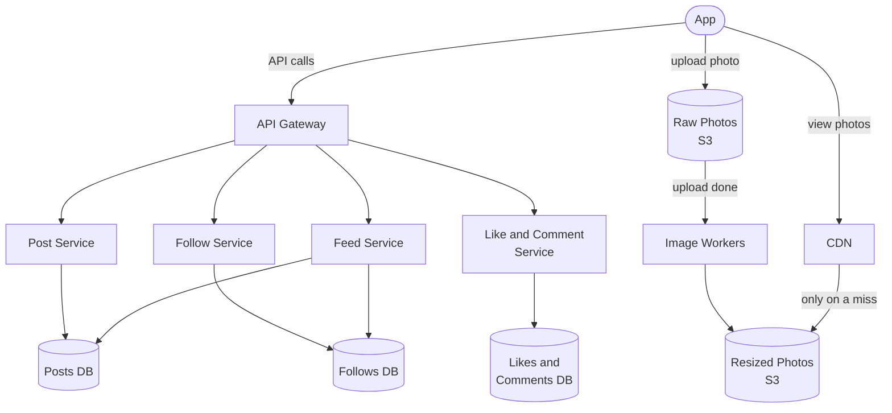
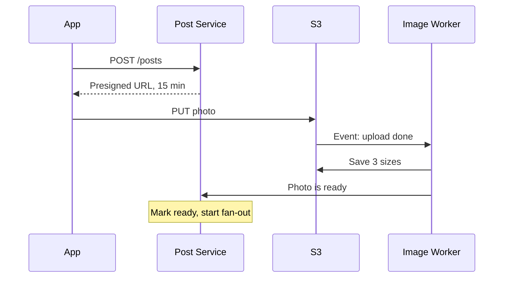
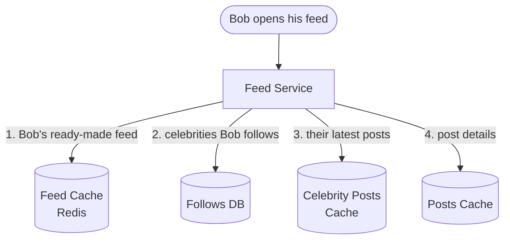
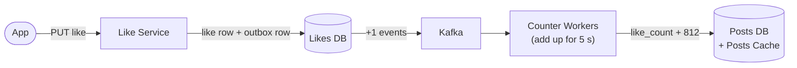
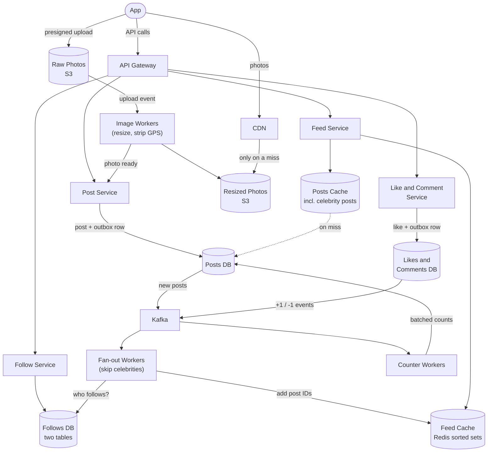

<Callout title="About this question">
  **Difficulty:** Medium. **Patterns used:** [File Upload and Download](../advanced-components/file-upload-download.mdx),
  [CDN and Edge Caching](../caching/cdn.mdx), [Hot Keys and Fan-out](../advanced-components/hot-keys-fan-out.mdx),
  [Kafka](../messaging/kafka.mdx), [Partitioning and Sharding](../databases/partitioning-sharding.mdx).
</Callout>

## Understand the problem

You take a photo, add a caption, and post it. Your followers see it in their **home feed** a few seconds later. They scroll, tap the heart, and leave comments. Under each photo they see "1,532 likes".

Instagram is two problems you may already know, joined together:

- **Photos:** big files that must upload fast from a phone and load fast everywhere. This is the [File Upload and Download](../advanced-components/file-upload-download.mdx) pattern.
- **The feed:** each user sees the latest photos from everyone they follow. This is [Design a News Feed](./news-feed.mdx).

What is new here: **resizing images**, the **follow graph** at huge scale, and **like counts** on posts that get millions of likes.

## Step 1: Requirements

### Functional requirements

1. Users can **post a photo** with a caption.
2. Users can **follow** and unfollow other users.
3. Users see a **home feed** of photos from people they follow, newest first, and can scroll to older ones.
4. Users can **like** and **comment** on photos, and see the like and comment counts.

**Out of scope** (say this out loud): videos and Reels, Stories, direct messages, search and Explore, ads, photo filters (done on the phone).

### Non-functional requirements

1. **Fast feed:** the feed loads in under 500 ms. Photos start showing right away.
2. **Never lose a photo:** once a post is shared, the photo is stored safely.
3. **Available over consistent:** a new post may take a few seconds to reach followers' feeds. A like count can be a few seconds behind.
4. **Big:** 500 million daily users, 100 million new photos a day. Some accounts have **hundreds of millions** of followers.
5. **Read-heavy:** every photo is viewed many times more than it is posted.

### Quick math

- **New posts:** 100 million a day = about **1,200 per second**.
- **Photo storage:** each photo is about 2 MB after the app shrinks it, plus about 0.5 MB for the smaller sizes we make (deep dive 1). 100 million × 2.5 MB = **250 TB per day**, about **90 PB per year**. **Decision:** photos go in **object storage** (like S3), never in a database.
- **Feed reads:** 500 million users × 20 feed opens a day = 10 billion a day = about **115,000 per second**. We read feeds far more than we write posts, so we build feeds **ahead of time**.
- **Photo traffic:** 500 million users × 100 photos viewed a day × 200 KB = **10 PB per day**, about 1 Tbps on average. **Decision:** photos must come from a **CDN**, close to users.
- **Fan-out:** 1,200 posts per second × 200 followers on average = about **240,000 feed updates per second**. Fine for Redis. But one post from an account with 300 million followers is 300 million updates. Deep dive 2.

## Step 2: Core entities

- **User:** a person with an account, plus their follower and following counts.
- **Post:** ID, author, caption, photo keys (where the image files are), **status** (`pending` or `ready`), time, `like_count`, `comment_count`.
- **Follow:** "user A follows user B".
- **Like:** "user A likes post P". One per user per post.
- **Comment:** ID, post, author, text, time.
- **Feed:** the list of post IDs to show one user.

## Step 3: API

```http
POST /posts
Idempotency-Key: 7c2e9a41-5b3d-4f8e-9a6c-1d2e3f4a5b6c
{ "caption": "Sunset in Goa", "contentType": "image/jpeg", "sizeBytes": 2400000 }

→ 201 Created
{ "postId": "p_901", "status": "pending", "uploadUrl": "https://storage.example.com/raw/p_901?signature=..." }
```

The app then uploads the photo **straight to storage**, with the `uploadUrl`. That request never touches our servers:

```http
PUT https://storage.example.com/raw/p_901?signature=...
Content-Type: image/jpeg
(the photo bytes)

→ 200 OK
```

The **`Idempotency-Key`** is made once per "Share" tap and sent again on every retry, so a flaky network never creates two posts (see [Idempotency](../messaging/idempotency.mdx)).

```http
PUT /users/u_7/follow
→ 204 No Content

DELETE /users/u_7/follow
→ 204 No Content
```

```http
GET /feed?limit=20&cursor=p_880

→ 200 OK
{
  "posts": [
    {
      "postId": "p_870", "author": "maria", "caption": "...",
      "images": { "small": "https://cdn.example.com/p_870/320.jpg", "large": "https://cdn.example.com/p_870/1080.jpg" },
      "likeCount": 1532, "commentCount": 48, "likedByMe": true
    }
  ],
  "nextCursor": "p_850"
}
```

```http
PUT /posts/p_870/like
→ 204 No Content

DELETE /posts/p_870/like
→ 204 No Content
```

Like is a **`PUT`**, not a `POST`: liking twice is the same as liking once. A double tap or a retry can't add two likes.

```http
POST /posts/p_870/comments
{ "text": "Beautiful!" }

→ 201 Created
{ "commentId": "c_55" }
```

Comments are read with `GET /posts/p_870/comments?cursor=...`. The current user always comes from the **login token**, never from the request body.

## Step 4: High-level design

We start simple: build the feed when the user opens it.



**Post a photo:**

1. The app sends `POST /posts`. The Post Service saves the post with status `pending`, and returns a **presigned URL**: a link that allows uploading one file to storage, for a few minutes.
2. The app uploads the photo **straight to raw storage**.
3. Storage sends an "upload done" event. An **image worker** makes the smaller sizes and saves them.
4. The post becomes `ready`. Only now can followers see it.

**Follow someone:** the Follow Service saves `(follower = me, followee = u_7)` in the Follows DB.

**Read the feed (simple version):**

1. The Feed Service asks the Follows DB: "who does this user follow?" Say, 300 people.
2. It asks the Posts DB for their recent `ready` posts, merges them, and returns the newest 20.
3. The app loads each photo **from the CDN**, using the URLs in the response.

**Like a photo:** the Like Service saves a like row, and the post's like count goes up (deep dive 4).

The simple feed touches 300 authors on **every** feed open, 115,000 times a second. That is deep dive 2.

## Step 5: Deep dives

### 1. How do we upload and serve photos?

**Uploading.** Never send photo bytes through our API servers. The app gets a presigned URL and uploads straight to S3. The [File Upload and Download](../advanced-components/file-upload-download.mdx) lesson covers presigned URLs, safety rules and resumable uploads. Two extra tricks for photos:

- **Shrink on the phone first.** A camera photo can be 5 MB or more. The app resizes and compresses it before upload, to about 2 MB. Uploads on a weak mobile network get much faster.
- **The server picks the file name** (`raw/p_901`), never the user. So nobody can overwrite someone else's photo.

**Resizing.** A phone showing the feed doesn't need a 2 MB photo. A small grid square needs far less.

<Callout title="Not great: serve the original photo to everyone" type="error">
  Every feed view downloads a 2 MB file, even for a tiny thumbnail. The feed is slow on mobile, and we pay for
  10 times more traffic than we need.
</Callout>

<Callout title="Okay: resize on the fly, when a size is first asked for" type="warn">
  An image service behind the CDN makes any size on demand, like `?w=320`, and the CDN caches it. Very flexible.
  **But** the first viewer of every size waits for the resize, and a new post going viral means many resizes at
  the same moment.
</Callout>

<Callout title="Best: make a few fixed sizes right after upload" type="success">
  As soon as the upload finishes, background **image workers** make every size we need, and save them to S3. By
  the time anyone sees the post, all sizes are ready. Viewers just download a file.
</Callout>

| Size | Width | Used for | About |
| --- | --- | --- | --- |
| Small | 320 px | Profile grid, slow networks | 30 KB |
| Medium | 640 px | The feed on most phones | 100 KB |
| Large | 1080 px | Big screens, zooming in | 250 KB |

The app picks the size that fits its screen and network. The **original** is kept too, in cheaper storage, so we can make new sizes or newer formats later.



What the image worker does, in order:

1. **Check the file.** Is it really an image, under the size limit? Reject anything else.
2. **Remove hidden data.** Photos carry **EXIF** data inside the file, often including the exact **GPS location** where the photo was taken. Strip it, or we leak where people live.
3. **Make the 3 sizes** and save them under keys like `p_901/640.jpg`.
4. **Tell the Post Service** the photo is ready. It marks the post `ready` and starts the fan-out (deep dive 2). The fan-out waits for this step, or followers would see a broken image.

The S3 event can arrive twice, so every step is safe to repeat: if the post is already `ready`, do nothing. If the upload never arrives, a small cleanup job deletes old `pending` posts.

**Serving.** Photos go through a [CDN](../caching/cdn.mdx): servers all over the world that keep copies of popular files. A viewer in Mumbai downloads from a server in Mumbai. A photo file **never changes** once made (an edit makes a new file with a new key). So the CDN can keep it for a year (`Cache-Control: max-age=31536000, immutable`), and almost every view is a cache hit.

### 2. How do we build the home feed fast?

This is the classic feed problem. [Design a News Feed](./news-feed.mdx) covers it in full. Here is the short version, with Instagram's numbers.

<Callout title="Not great: fan-out on read (build the feed when it is opened)" type="error">
  Every feed open asks the database for the recent posts of hundreds of people, then merges and sorts them.
  115,000 times a second. The database can't keep up, and feeds are slow.
</Callout>

<Callout title="Okay: fan-out on write (build every feed ahead of time)" type="warn">
  When a post becomes `ready`, background workers add its ID to the feed of **each** follower, in Redis. Opening
  a feed is then one fast read. **But** an account with 300 million followers means 300 million writes for one
  photo.
</Callout>

<Callout title="Best: a mix of both" type="success">
  Fan out on write for normal users. For **celebrities** (say, more than 100,000 followers), don't fan out: merge
  their latest posts in **when the feed is read**. Most people follow only a few celebrities, so the merge is
  small.
</Callout>



How it works:

1. When a post becomes `ready`, the Post Service saves the status **and** a "new post" event in one transaction (an [outbox](../distributed-systems/outbox-pattern.mdx)). The event goes to Kafka, so a crash can never lose it.
2. **Fan-out workers** read the event. If the author is a celebrity, they stop. If not, they get the author's followers and add the post ID to each follower's feed.
3. Each feed is a Redis **sorted set** of post IDs, scored by time. We keep only the newest **500 IDs**, and only for users active in the last 30 days.
4. When Bob opens the app, the Feed Service reads his feed, merges in his celebrities' latest posts, and takes the newest 20.
5. **Hydration:** it fetches the details of those 20 posts (caption, image keys, counts) from the posts cache in one batch, and turns image keys into CDN URLs.

A celebrity's latest posts are read by millions of people, so they are a **hot key**. Keep copies of them on several cache servers, or in each Feed Service's own memory for a few seconds. See [Hot Keys and Fan-out](../advanced-components/hot-keys-fan-out.mdx).

Instagram has shown a **ranked** feed since 2016, not newest first. Ranking fits in after step 4: collect candidates, score them, keep the best. See deep dive 3 of [Design a News Feed](./news-feed.mdx).

### 3. How do we store the follow graph?

The **follow graph** is the list of "who follows whom". Two questions must be fast:

- **"Who do I follow?"** To build my feed, and to find the celebrities I follow.
- **"Who follows me?"** To fan out my posts, and to show my followers list.

At our size, the follows table has **tens of billions** of rows, so it must be **sharded** (split across many databases). The trouble: a table can be sharded by only one column.

<Callout title="Not great: one table, sharded by follower" type="error">
  "Who do I follow?" goes to one shard. **But** "who follows me?" must ask **every** shard, because my followers
  are spread everywhere. Every fan-out becomes a query to hundreds of databases.
</Callout>

<Callout title="Okay: a graph database" type="warn">
  Graph databases like Neo4j are built for questions with **many hops**, like "friends of friends of friends".
  We only ever ask **one hop**. A graph database is one more system to run and scale, for no real gain.
</Callout>

<Callout title="Best: store each follow twice, once for each direction" type="success">
  A `following` table sharded by `follower_id`, and a `followers` table sharded by `followee_id`. Each question
  goes to exactly **one** shard. Storage doubles, and that is a fair price.
</Callout>

```sql
-- "Who do I follow?" Sharded by follower_id.
CREATE TABLE following (
  follower_id BIGINT,
  followee_id BIGINT,
  created_at  TIMESTAMP,
  PRIMARY KEY (follower_id, followee_id)
);

-- "Who follows me?" The same follows, sharded by followee_id.
CREATE TABLE followers (
  followee_id BIGINT,
  follower_id BIGINT,
  created_at  TIMESTAMP,
  PRIMARY KEY (followee_id, follower_id)
);
```

Nice details:

- **Writing both tables.** The Follow Service writes the `following` row and an outbox row in one transaction. A worker then writes the `followers` row. For a second or two, I follow you but I'm not yet in your followers list. Nobody notices.
- **Counts are stored numbers.** "12.3M followers" is a `follower_count` on the user row, updated in the background, never a `COUNT(*)` over millions of rows.
- **Celebrities I follow.** Keep a small set per user in Redis, like `celebs_followed:u_42`. The Feed Service reads it on every feed open, instead of scanning everyone I follow.
- **Huge follower lists.** A celebrity's followers all live on one shard, in one long list. That is fine: we never fan out their posts, and the followers screen reads the list one page at a time.

### 4. How do we count likes and comments?

A famous singer posts a photo. It gets **millions of likes in an hour**, thousands per second at the peak. And every feed view shows the like count of 20 posts.

<Callout title="Not great: COUNT(*) on the likes table every time" type="error">
  Feeds show about 2 million posts per second (115,000 feed opens × 20 posts). Counting millions of like rows
  for each one is impossible.
</Callout>

<Callout title="Okay: a like_count column, updated with each like" type="warn">
  Insert the like and run `like_count = like_count + 1` in the same transaction. Correct. **But** on a viral post,
  thousands of updates per second hit **the same row**, and each waits for the row lock. This **hot row** slows
  down the whole database.
</Callout>

<Callout title="Best: the likes table is the truth, and counts are added up in batches" type="success">
  Save each like as a row. Send a "+1" event to Kafka. Counter workers add up the events for each post for a
  few seconds, then write **one** update: `like_count = like_count + 812`. Thousands of writes become one.
</Callout>



**Count only real changes.** A double tap, or a retry after a lost reply, must not count twice:

```sql
INSERT INTO likes (post_id, user_id) VALUES ('p_870', 'u_42')
  ON CONFLICT (post_id, user_id) DO NOTHING;
-- 1 row inserted: a new like. Write a "+1" outbox row in the same transaction.
-- 0 rows inserted: already liked. Do nothing.
```

An unlike works the same way: delete the row, and send "-1" only if a row was really deleted. So the count always matches the likes table, however many times the app retries.

More details:

- **Never add a batch twice.** The counter worker saves its Kafka position in the **same transaction** as the counts, so a crash can't add the same batch again. This is exactly how view counts work in deep dive 4 of [Design YouTube](./youtube.mdx).
- **Nobody needs the exact number.** The app shows "1.2M likes". A count a few seconds behind is fine.
- **"Did I like this?"** The feed shows a red heart on posts I liked. The likes table's key `(post_id, user_id)` answers that. The Feed Service checks all 20 posts in one batch.
- **Comments** are stored in a comments table sharded by `post_id`, so all comments of one post live together. They are read newest first with a cursor. The comment count is updated in batches, just like likes.

### Final architecture



## In the real world

- **Instagram** launched in October **2010**. **Facebook bought it in 2012** for about $1 billion, when it had just **13 employees**.
- In a 2012 blog post, **"Sharding & IDs at Instagram"**, the team explained its 64-bit IDs: **41 bits of time**, **13 bits for the shard**, and **10 bits for a counter**. The IDs are made inside PostgreSQL and **sort by time**, which is handy for feeds. Data was split into thousands of small **logical shards**, spread over fewer physical database servers. See [Distributed ID Generation](../distributed-systems/distributed-id-generation.mdx).
- **Facebook built Haystack** (described in a 2010 paper) to store billions of photos. Normal file systems needed several disk reads per photo just for file information. Haystack packs many photos into one big file and keeps a small index in memory, so one photo is about **one disk read**.
- Facebook stores its social graph in **TAO** (described in a 2013 paper): a cache built for "objects and the links between them", like users and who follows whom, on top of MySQL.
- Instagram moved from a **newest-first** feed to a **ranked** feed in **2016**.
- In **2021**, Instagram let people **hide like counts** on posts, after testing it in some countries from 2019.

## Follow-up questions

<Accordions>
<Accordion title="A normal user goes viral and passes 100,000 followers. What changes?">

Their account is marked as a celebrity, and new posts are no longer fanned out. Posts already in feeds stay there. Use a gap between the two limits (for example, become a celebrity at 100,000, and go back only below 80,000), so an account near the line doesn't flip back and forth every day.

</Accordion>
<Accordion title="How do private accounts work?">

A follow becomes a **request** that the owner must approve. Only approved followers get the posts in their feed. Photo URLs use long random keys that can't be guessed, and for private accounts the CDN URLs can be **signed** and expire after a short time, so a copied link stops working.

</Accordion>
<Accordion title="A user deletes a photo. What happens?">

Mark the post deleted. Feeds only hold IDs, so a deleted post is simply skipped during hydration. Then delete the image files from S3, and **purge** them from the CDN, because the CDN was told it may keep them for a year.

</Accordion>
<Accordion title="How would you add videos?">

The upload works the same way, with multipart uploads for big files. Instead of resizing, video is **transcoded** into several qualities and cut into small segments for adaptive streaming. See [Design YouTube](./youtube.mdx).

</Accordion>
<Accordion title="Bob follows someone new. When do their photos show up?">

A "new follow" event goes to Kafka (through the outbox). A small backfill job adds that person's last 20 post IDs to Bob's feed. If they are a celebrity, there is nothing to do: their posts are merged in at read time anyway.

</Accordion>
</Accordions>

## What the interviewer expects

<Tabs items={['Mid-level', 'Senior', 'Staff']}>
<Tab value="Mid-level">

- Clear requirements, entities and API, with like as an idempotent `PUT`.
- Photos in object storage, uploaded with presigned URLs, served from a CDN.
- A working feed, and moving to fan-out on write when asked about speed.
- Cursor paging for the feed and comments.

</Tab>
<Tab value="Senior">

- Resize into fixed sizes after upload, strip GPS data, and fan out only when the post is `ready`.
- The hybrid feed for celebrities, with numbers.
- A follow graph stored in both directions, each sharded by its first column.
- Batched like counts that never count a like twice, and no hot row.

</Tab>
<Tab value="Staff">

- Everything from senior, but faster.
- Cost: storage tiers for originals, CDN cache rules, keeping feeds only for active users.
- Tricky cases: crossing the celebrity limit, deletes and CDN purges, private accounts, unfollows.
- Where ranking fits in, and how the system behaves when the fan-out queue falls behind.

</Tab>
</Tabs>

<Callout title="Remember this" type="success">
  - **Photo bytes never go through our API.** Presigned URL → S3. Views come from a **CDN**. Files never change, so they cache for a year.
  - **Image workers** make 3 fixed sizes right after upload and **strip GPS** data. The post becomes `ready`, and **only then** fans out.
  - **Feed:** fan-out on write for normal users, **merge celebrities at read time**. Details in [Design a News Feed](./news-feed.mdx).
  - **Follow graph:** store each follow **twice** (`following` by follower, `followers` by followee), so each question hits one shard.
  - **Likes:** the likes table is the truth (`ON CONFLICT DO NOTHING`, so no double counts). Counts are **added up in batches** through Kafka, to avoid a hot row.
  - Counts like followers and likes are **stored numbers**, a few seconds behind. Never `COUNT(*)` on a page view.
</Callout>
