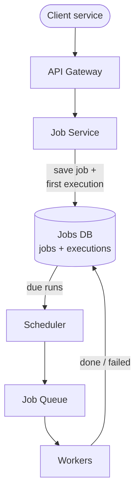
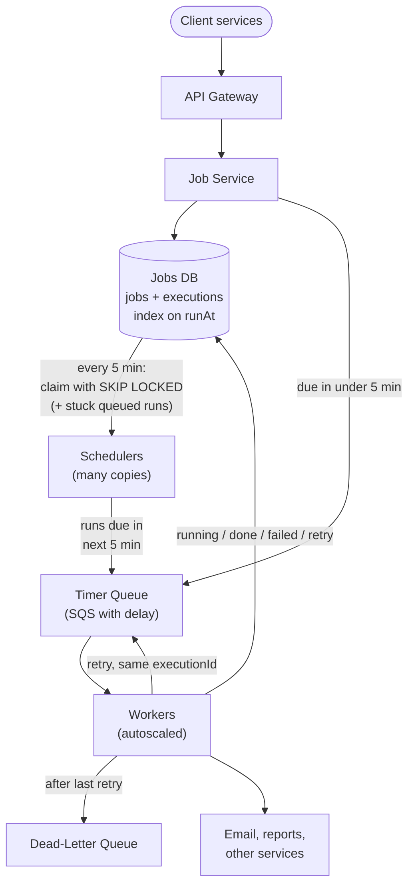

<Callout title="About this question">
  **Difficulty:** Medium. **Patterns used:** [Background Jobs and Job Scheduling](../advanced-components/background-jobs.mdx),
  [Message Queues](../messaging/message-queues-pub-sub.mdx), [Retries and Backoff](../messaging/retries-backoff-timeouts.mdx),
  [Idempotency](../messaging/idempotency.mdx), [Distributed Locking](../distributed-systems/distributed-locking.mdx).
</Callout>

## Understand the problem

A job scheduler runs a piece of work at a set time. Other teams' services use it. For example:

- "Send this reminder email **tomorrow at 9:00**."
- "Build the sales report **every Monday at 8:00**."
- "Cancel this unpaid order **in 30 minutes**."

The scheduler stores each job, wakes it up when it is due, hands it to a worker, and retries it if it fails.

A repeating time is usually written as a **cron expression**: a short text with five parts (minute, hour, day of month, month, day of week). For example, `0 9 * * 1` means "every Monday at 9:00". The `*` means "any".

## Step 1: Requirements

### Functional requirements

1. Users can schedule a job to run **once** at a given time, or **again and again** with a cron expression.
2. Users can see the status of a job and its past runs.
3. Users can cancel a job.

A job is a **task name** (like `send_email`) plus a **payload** (the data the task needs). Workers have the code for each task.

**Out of scope** (say this out loud): jobs that wait for other jobs (workflows), priority levels, and writing the task code itself.

### Non-functional requirements

1. **On time:** a job starts within **2 seconds** of its due time.
2. **Never lost:** once we accept a job, it must run, even if servers crash.
3. **Runs once:** a job run should not happen twice (more on this in the deep dives).
4. **Big:** 10 million job runs per day, with big spikes at round times like midnight.
5. **Always up:** 99.9% uptime. If the scheduler is down, every team's jobs stop.

### Quick math

- **Average:** 10 million runs ÷ 86,400 seconds = about **115 runs per second**. One database can handle that.
- **Spikes:** people love round times. Say **1 million jobs** are due at exactly midnight. If each job takes 1 second, one worker would need 11 days. To finish in about 1 minute we need about **17,000 jobs running at the same time**. So we need **many workers**, and a **queue** in front of them to hold the rush.
- **Storage:** 10 million runs × about 1 KB = 10 GB per day. Keep 30 days of history = 300 GB. That fits on one database. Delete older runs.

## Step 2: Core entities

- **Job:** what to run (task + payload), the schedule (one time or cron), and who owns it.
- **Execution:** one run of a job. It has a run time, a status and an attempt number.

Why two entities? A repeating job runs many times. Keeping the **definition** (Job) apart from **each run** (Execution) makes the most important query simple: "which executions are due now?"

## Step 3: API

```http
POST /jobs
Idempotency-Key: reminder-amy-2026-11-20
{
  "task": "send_email",
  "payload": { "to": "amy@example.com", "template": "reminder" },
  "schedule": { "type": "once", "runAt": "2026-11-20T09:00:00Z" }
}

→ 201 Created
{ "jobId": "job_123" }
```

For a repeating job, send `"schedule": { "type": "cron", "expression": "0 9 * * 1" }` instead.

The `Idempotency-Key` is a unique name for this request, chosen by the client. If the client times out and sends the same request again, we see the same key and return the same `jobId`, instead of creating a second job (and sending Amy two reminders). The key is saved with a unique index in the `jobs` table. See [Idempotency](../messaging/idempotency.mdx).

```http
GET /jobs/{jobId}/executions?status=failed

→ 200 OK
[
  { "executionId": "ex_9", "runAt": "2026-11-16T09:00:00Z", "status": "failed", "attempt": 3 }
]
```

```http
DELETE /jobs/{jobId}

→ 204 No Content
```

## Step 4: High-level design



**Schedule a job:**

1. A client service sends `POST /jobs`.
2. The Job Service saves the job in the `jobs` table. If it has seen this `Idempotency-Key` before, it returns the existing `jobId` instead.
3. In the same transaction, it adds the **first execution** row, with its `runAt` time and status `scheduled`. For a cron job, it works out the next time from the cron expression.
4. It returns the `jobId`.

**Run a job:**

1. Every few seconds, the Scheduler asks the database: "which executions are due and still waiting?"
2. It puts each due execution in the Job Queue and marks it `queued`.
3. For a repeating job, it also adds the **next** execution row (the next cron time).
4. A worker takes the execution from the queue, marks it `running`, runs the task, and marks it `done` or `failed`.

**See status:** the Job Service reads the `executions` table for that job.

**Cancel a job:** the Job Service marks the job `cancelled` and deletes its waiting executions. A worker also checks the job status just before it runs, in case the run was already in the queue.

**Executions table:**

| Column | Example |
| --- | --- |
| `executionId` (primary key) | `ex_9` |
| `jobId` | `job_123` |
| `runAt` | `2026-11-20T09:00:00Z` |
| `status` | `scheduled`, `queued`, `running`, `done`, `failed` |
| `attempt` | `1` |

## Step 5: Deep dives

### 1. How do we find due jobs fast?

<Callout title="Not great: check every job, every second" type="error">
  Read every row in the `jobs` table and work out from each schedule whether it is due. With millions of jobs,
  this means reading millions of rows every second. Far too slow.
</Callout>

<Callout title="Okay: an index on runAt, and poll the database" type="warn">
  Add an **index** on `runAt` in the `executions` table. An index is like a list kept sorted by time, so the
  database can jump to "due now" without reading every row. The Scheduler runs this query every second. **Works**
  well at small scale. **But** the database gets a query every second from every Scheduler copy, forever.
</Callout>

<Callout title="Best: the database for later, a timer queue for the next few minutes" type="success">
  The database stays the **source of truth** (the place that has the correct data). Every 5 minutes, a Scheduler
  loads all runs due in the **next 5 minutes** and puts them in a **timer queue**: a queue that holds each message
  until its exact time. Workers get each run right on time, and the database sees one query every 5 minutes.
</Callout>

Two good choices for the timer queue:

- **A queue with a delay**, like Amazon SQS. You can send a message with a delay of up to 15 minutes. It becomes visible to workers only when the delay is over.
- **A Redis sorted set**, where the **score** is the run time. A sorted set keeps items sorted by score, so the first items are always the next ones due.

```bash
# Add run ex_9, due at Unix time 1795165200 (2026-11-20 09:00 UTC)
ZADD due_runs 1795165200 "ex_9"

# Every second: get the runs whose time has come (score up to "now")
ZRANGEBYSCORE due_runs 0 1795165200 LIMIT 0 100

# Claim a run before handing it to a worker
ZREM due_runs "ex_9"   # returns 1 only for the first poller that removes it
```

With a sorted set, watch out: we run many pollers for safety, and they all read the same due runs. So a poller must **claim** each run before it hands it to a worker. `ZREM` removes the run and returns 1 only to the poller that removed it. Every other poller gets 0 and skips that run. (A small Lua script can also "read and remove" in one step.)

One catch: a job created **now** that is due in **2 minutes** would be missed, because the last 5-minute load has already happened. So the Job Service saves that run as `queued` (not `scheduled`), and puts it **straight into the timer queue**. The `queued` status matters: the 5-minute load only picks `scheduled` runs, so it won't queue this run a second time.

What if the Job Service crashes after saving the row, but before the timer queue has it? The row says `queued`, but nothing will ever run it. So the Scheduler also picks up runs that are still `queued` 10 minutes after their due time, and queues them again (see the query in deep dive 3). If such a run was only slow, not lost, it may run twice. Idempotent tasks make that safe (deep dive 3).

### 2. Workers, retries and crashes

<Callout title="Not great: the Scheduler sends jobs straight to workers" type="error">
  The Scheduler must know which worker is free. If a worker dies while holding a job, the job is lost. At midnight
  the workers are flooded.
</Callout>

<Callout title="Best: a queue in the middle, and workers pull" type="success">
  Workers **pull** jobs from the queue when they are ready. At midnight the queue just gets longer, and nothing is
  lost. We add more workers when the queue grows (this is called **autoscaling**).
</Callout>

**What if a worker crashes in the middle of a job?** Queues like SQS use a **visibility timeout**. When a worker takes a message, the queue hides it for, say, 5 minutes. If the worker finishes, it deletes the message. If the worker dies, it never deletes it, so the message shows up again and another worker takes it. For long jobs, the worker sends a **heartbeat** ("I am still working") that keeps the message hidden longer.

**What if the task fails?** For example, the email provider is down. We retry with **exponential backoff**: wait a little, then longer and longer, so we don't hammer a service that is already in trouble.

| Attempt | Wait before it |
| --- | --- |
| 1 | runs on time |
| 2 | 1 minute |
| 3 | 2 minutes |
| 4 | 4 minutes |
| 5 | 8 minutes |

A retry is **the same execution row**, with `attempt + 1` and a later `runAt`. It keeps its `executionId`, so its idempotency key stays the same (deep dive 3). If it got a new ID, the email task would think the retry is a brand new email, and could send it twice. The waits are shorter than 5 minutes, so the worker sets the row back to `queued` and puts the retry straight into the timer queue with that delay, just like a new job that is due soon. After the last attempt, we mark the run `failed`, put it in a [dead-letter queue](../messaging/dead-letter-queues.mdx) (a queue for messages that keep failing) and alert the job's owner.

### 3. How do we make sure each job runs only once?

A job can run twice in two ways:

1. **Two Scheduler copies pick the same due run** and both put it in the queue.
2. **A worker does the job, then crashes before it says "done".** The queue thinks the job never ran, so another worker runs it again.

<Callout title="Not great: only one Scheduler server" type="error">
  No duplicates from problem 1. **But** if that one server dies, no job runs anywhere. It is a **single point of
  failure**.
</Callout>

<Callout title="Okay: many Schedulers, one leader" type="warn">
  Run three copies. They pick one **leader** (using a lock in Redis or a tool like ZooKeeper), and only the leader
  schedules. **Works**, but one machine still does all the work, and there is a gap of a few seconds when the
  leader dies.
</Callout>

<Callout title="Best: Schedulers share the work with row locks, and tasks are idempotent" type="success">
  All Scheduler copies work at the same time. Each one **claims** a batch of rows with
  `SELECT ... FOR UPDATE SKIP LOCKED`, so no two copies get the same row. For problem 2, every task is
  **idempotent**: running it twice has the same effect as running it once.
</Callout>

```sql
BEGIN;

-- FOR UPDATE locks the rows we pick.
-- SKIP LOCKED skips rows another Scheduler has already locked.
SELECT execution_id FROM executions
WHERE (status = 'scheduled' AND run_at <= NOW() + INTERVAL '5 minutes')
   OR (status = 'queued' AND run_at <= NOW() - INTERVAL '10 minutes') -- stuck: queued, never started
ORDER BY run_at
LIMIT 1000
FOR UPDATE SKIP LOCKED;

-- Put these runs in the timer queue, then:
UPDATE executions SET status = 'queued' WHERE execution_id IN (...);

COMMIT;
```

Problem 2 can never be fully solved. The network can always fail between "the work is done" and "I told the queue". So no real system gives true **exactly-once** running. What we build is:

> **At-least-once delivery + idempotent tasks = the job takes effect once.**

To make a task idempotent, use the `executionId` as an **idempotency key**. It stays the same across all attempts of a run. For example, the `send_email` task first checks "did I already send an email for `ex_9`?" Or it passes `ex_9` to the email provider, which ignores a second request with the same key. See [Delivery Guarantees](../messaging/delivery-guarantees.mdx).

### Final architecture



## In the real world

- **Cron on Linux** is the classic scheduler. It runs jobs on **one machine**. If that machine is down at 9:00, the 9:00 job does not run. This is why big companies build distributed schedulers.
- **Kubernetes CronJob** runs a job on a cron schedule inside a Kubernetes cluster. Its documentation warns that in rare cases a CronJob can start a job **twice, or not at all**, so jobs **should be idempotent**. This is the same lesson as deep dive 3.
- **Apache Airflow** (first built at Airbnb) runs scheduled data workflows. Since Airflow 2.0 you can run **more than one scheduler** at the same time. They share the work by locking rows in the database with `SELECT ... FOR UPDATE`, using `SKIP LOCKED` where the database supports it.
- **Amazon SQS** lets you delay a message by up to 15 minutes, and uses a **visibility timeout** to hand a message to another consumer if the first one does not finish.
- **Sidekiq**, a popular job library for Ruby, keeps scheduled jobs in a **Redis sorted set**, sorted by run time.

## Follow-up questions

<Accordions>
<Accordion title="A job runs for 2 hours. How do you stop another worker from taking it?">

The worker sends a **heartbeat** every minute or so. Each heartbeat pushes the visibility timeout (or the lease time in the database) further out. If the heartbeats stop, the worker is probably dead, and after the timeout another worker takes the job.

</Accordion>
<Accordion title="1 million jobs are due at midnight. What happens?">

The Schedulers load them a few minutes early, so the timer queue is ready. At midnight the queue fills up, and workers autoscale based on queue length. Some jobs start a few seconds late. For jobs where the exact second does not matter (like a nightly cleanup), we can add **jitter**: a small random delay that spreads them out.

</Accordion>
<Accordion title="How do you handle time zones and daylight saving time?">

Store every `runAt` in **UTC** (one world time with no daylight saving). For a cron job, also store the user's time zone, like `Europe/London`. Each time we compute the next run, we use that time zone and turn the result into UTC. Then "9:00 every Monday" stays 9:00 for the user, even when the clocks change.

</Accordion>
<Accordion title="What if the Jobs database goes down?">

Use a primary database with **replicas** and automatic failover (a replica takes over). Jobs already in the timer queue keep running. New jobs wait until the database is back. Runs may be a little late, but none are lost, because they are saved in the database before we say "201 Created".

</Accordion>
<Accordion title="How do you stop one team from flooding the system?">

Give each team a **quota**: a limit on how many jobs it can create and how many can run at the same time. Use separate queues, or limits per team inside the workers, so one team's midnight rush does not delay everyone else. See [Rate Limiting](../reliability-security/rate-limiting.mdx).

</Accordion>
</Accordions>

## What the interviewer expects

<Tabs items={['Mid-level', 'Senior', 'Staff']}>
<Tab value="Mid-level">

- Clear requirements and API.
- A design with a database, a scheduler, a queue and workers.
- An index on `runAt` to find due jobs.
- Retries when a job fails.

</Tab>
<Tab value="Senior">

- Split **Job** from **Execution**.
- An `Idempotency-Key` on `POST /jobs`, and one `executionId` across all retries.
- The two-layer idea: database for later, timer queue for the next few minutes.
- Handle worker crashes with visibility timeouts and heartbeats.
- Explain why exactly-once is not possible, and use idempotent tasks instead.
- Share work across schedulers with `SKIP LOCKED`.

</Tab>
<Tab value="Staff">

- Everything from senior, but faster.
- Fairness between teams: quotas and separate queues.
- What happens in each failure: database down, queue down, a region down.
- Monitoring: how late jobs start, queue length, failed runs. Alerts when jobs fall behind.

</Tab>
</Tabs>

<Callout title="Remember this" type="success">
  - Split **Job** (what and when) from **Execution** (one run). Index executions by `runAt`.
  - `POST /jobs` takes an **Idempotency-Key**. A run that goes straight to the timer queue is saved as `queued`, so
    it is not queued twice.
  - **Two layers:** the database holds all jobs. A **timer queue** holds the next few minutes.
  - Put a **queue** between the scheduler and the workers. Workers pull, and autoscale at busy times.
  - Retry with **exponential backoff**, then a **dead-letter queue**.
  - Many schedulers share work with `SELECT ... FOR UPDATE SKIP LOCKED`.
  - Exactly-once is not possible. **At-least-once + idempotent tasks** = the job takes effect once. Retries keep the
    same `executionId`, so the idempotency key stays the same.
</Callout>
