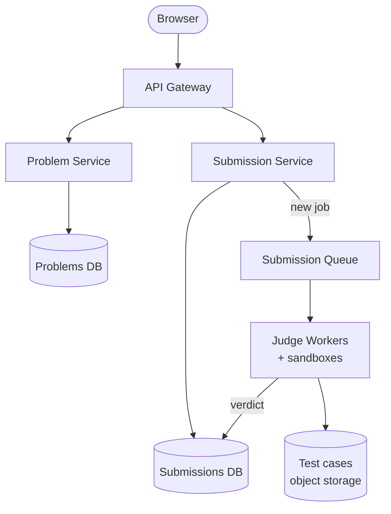
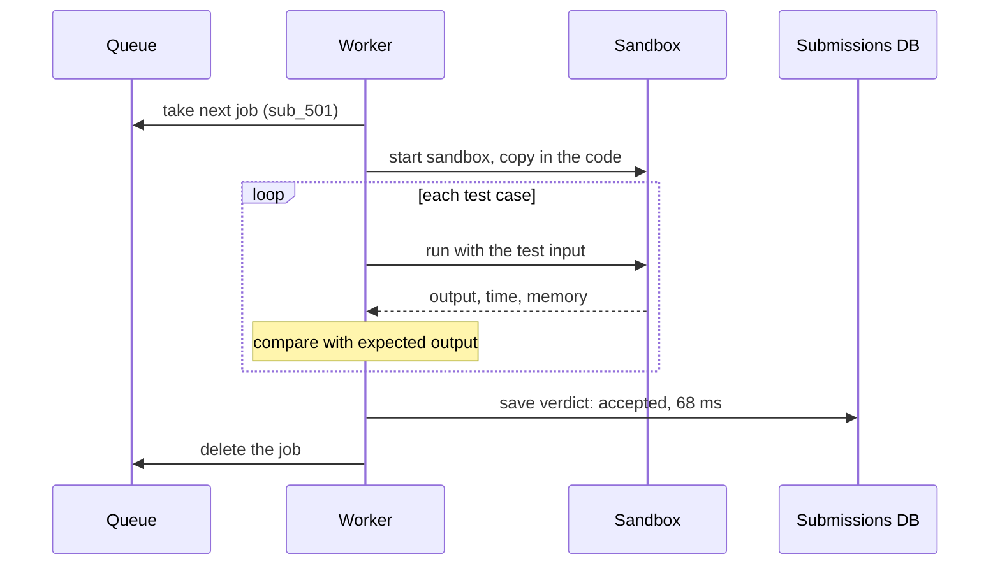
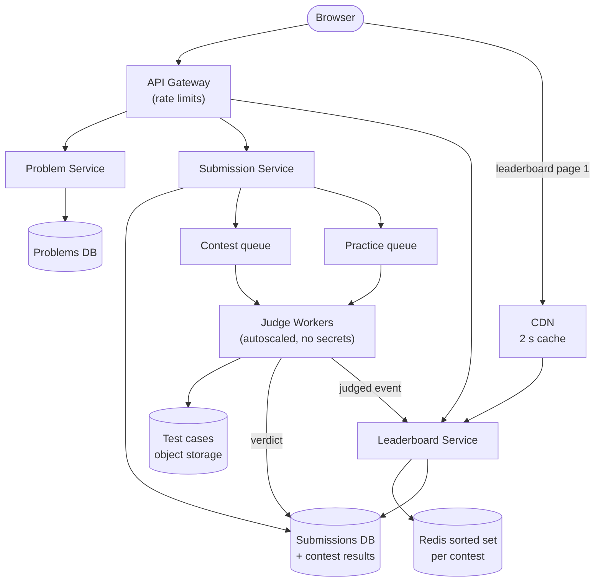

<Callout title="About this question">
  **Difficulty:** Medium. **Patterns used:** [Background Jobs](../advanced-components/background-jobs.mdx),
  [Message Queues](../messaging/message-queues-pub-sub.mdx), [Polling, WebSockets and SSE](../foundations/polling-websockets-sse.mdx),
  [Redis](../caching/redis.mdx), [Containers](../production/cicd-docker-kubernetes.mdx).
</Callout>

## Understand the problem

A site like LeetCode or HackerRank. Users pick a problem, write code in the browser, and press **Submit**. The server runs the code against many hidden test cases, and a few seconds later the user sees the result: **Accepted**, **Wrong Answer**, **Time Limit Exceeded**, and so on. In a weekly contest, thousands of people solve the same problems at the same time and watch a live leaderboard.

Three things make it hard:

- **We run strangers' code on our machines.** The code could delete files, read secrets, attack other sites, or loop forever. We must assume some of it will try.
- **Contest rushes.** Thousands of people press Submit in the same few minutes, especially near the end.
- **A live leaderboard** for up to 100,000 contestants, where everyone also wants to see their own rank.

## Step 1: Requirements

### Functional requirements

1. Users can view a list of problems and open one.
2. Users can submit code in several languages (JavaScript, Python, Java, C++) and see the result.
3. Users can join a contest and see a live leaderboard.

**Out of scope** (say this out loud): sign-up and login details, discussion pages, writing new problems (admin tools), and cheating checks (see the follow-ups).

### Non-functional requirements

1. **Safe:** user code can never harm our servers, see other users' data, or read the expected answers.
2. **Fast:** a normal submission gets its result in under about 5 seconds.
3. **Contest rush:** up to 100,000 contestants in one contest, with a burst of submissions near the end.
4. **Fair:** the same code gets the same result every time. Run times should not depend on luck.
5. **Leaderboard:** can be a few seconds old. So the leaderboard picks **availability** over strict consistency.

### Quick math

- **Normal day:** 1 million submissions per day ÷ 86,400 seconds = about **12 per second**. Small.
- **Contest:** 100,000 users × about 5 submissions each = 500,000 submissions in 90 minutes = about 90 per second on average. Near the end it can be 5 times that: about **500 per second**.
- **CPU:** running all tests of one submission takes about 2 seconds of CPU. 500 per second × 2 seconds = **1,000 CPU cores** busy at peak. That is about 30 to 40 machines with 32 cores each. On a normal day, 12 × 2 = 24 cores, so 1 or 2 machines. **Decision:** a **queue** in front of the workers, and workers that **scale up** for contests.
- **Storage:** code is small. 1 million × about 2 KB = **2 GB per day**. A normal SQL database is fine. Test cases can be big (some are megabytes), so they go in **object storage** like Amazon S3.

## Step 2: Core entities

- **Problem:** title, description, time limit, memory limit, starter code for each language.
- **Test case:** an input and its expected output. Hidden from users.
- **Submission:** user, problem, language, code, **status** (`queued`, `running`, `done`), **verdict** (`accepted`, `wrong_answer`, `time_limit`, …), run time, memory used.
- **Contest:** a set of problems, a start time and an end time.
- **Leaderboard entry:** a contestant, their points, and their finish time.

## Step 3: API

```http
GET /problems?cursor=abc&limit=50
GET /problems/{problemId}
```

```http
POST /problems/{problemId}/submissions
Idempotency-Key: 9c1e2f7a-sub-1
{ "language": "javascript", "code": "function twoSum(nums, target) { ... }" }

→ 202 Accepted
{ "submissionId": "sub_501", "status": "queued" }
```

**202 Accepted** means "I got it, and I'm working on it". The result is not ready yet. The app asks for it with:

```http
GET /submissions/{submissionId}

→ 200 OK
{ "status": "done", "verdict": "accepted", "passed": 57, "total": 57, "runtimeMs": 68, "memoryMb": 42 }
```

```http
GET /contests/{contestId}/leaderboard?page=1

→ 200 OK
{ "rows": [{ "rank": 1, "user": "asha", "points": 18, "finishTime": "00:41:10" }], "me": { "rank": 1532 } }
```

The **Idempotency-Key** is a random ID the browser makes once per click on Submit. If the user double-clicks, or the browser retries after a timeout, the server finds the key and returns the first submission. So nobody gets two submissions (or two wrong-try penalties) for one click. See [Idempotency](../messaging/idempotency.mdx).

## Step 4: High-level design



**View a problem:**

1. The Problem Service reads the problem from the database. Problems almost never change, so they are cached (and the static parts can go on a [CDN](../caching/cdn.mdx)).

**Submit code:**

1. The browser sends `POST /submissions` with the code.
2. The Submission Service saves a submission with status `queued`, puts a job (`sub_501`) on the queue, and answers `202` right away.
3. A Judge Worker takes the job. It starts a **sandbox**: a locked-down box where the code runs (deep dive 1).
4. It runs the code against each test case and compares the output with the expected output.
5. It saves the verdict in the Submissions DB, with status `done`.
6. Meanwhile, the browser asks `GET /submissions/sub_501` every second. Once the status is `done`, it shows the result (deep dive 3).

## Step 5: Deep dives

### 1. How do we run untrusted code safely?

Someone submits code that deletes every file, reads our database password from the environment, starts a thousand copies of itself, or just runs `while (true) {}`. Our design must survive all of these.

<Callout title="Not great: run the code on the API server" type="error">
  Start the code as a normal process on the server that handles requests. The code can read the server's files and
  secrets, call our internal services, and use all the CPU. One bad submission takes down the site for everyone.
</Callout>

<Callout title="Okay: a container per submission" type="warn">
  Run each submission in its own **container** (like Docker), with limits on CPU, memory and time. The code sees its
  own small file system, not ours. **Much better.** **But** all containers share the host machine's **kernel** (the
  core of the operating system). A bug in the kernel can let clever code break out of the container.
</Callout>

<Callout title="Best: a hardened sandbox, on separate machines" type="success">
  Start from the container and add more walls: **no network**, a **read-only** file system, a **non-root** user, and
  **seccomp**, a Linux feature that blocks dangerous system calls. For even stronger isolation, use **gVisor** or a
  **Firecracker micro-VM**, which give each run its own small kernel. And run all of this on **judge machines that
  hold no secrets**, in their own network.
</Callout>

Each limit stops a different attack:

| Limit | What it stops |
| --- | --- |
| **Time limit** (say 2 s of CPU per test, plus a wall-clock limit) | Endless loops. The wall-clock limit also catches code that just sleeps. |
| **Memory limit** (say 256 MB) | Code that grabs all the memory. |
| **Process limit** (say 64) | A **fork bomb**: code that copies itself again and again. |
| **No network** | Attacking other sites, downloading tools, or sending our test data out. |
| **Read-only file system**, plus a small temp folder | Deleting or changing files, and filling the disk. |
| **Output limit** (say 10 MB) | Printing gigabytes of text. |
| **Non-root user, seccomp** | Breaking out of the sandbox into the machine. |

Linux enforces the time, memory and process limits with **cgroups** (control groups), the same feature containers use.

**How a worker judges one submission:**



Details that matter:

- **Expected outputs never enter the sandbox.** The worker passes in only the **input**, reads the program's output, and compares it **outside**. So the code can't read the answers.
- **Stop at the first failed test.** The verdict is "Wrong Answer on test 12". No need to run the other 45.
- **LeetCode asks for a function, not a whole program.** For each language, the worker adds a small **wrapper** around the user's code. It reads the test input, calls `twoSum(nums, target)`, and prints the result.
- **A fresh sandbox every time.** A used sandbox may hold files left by the last user. Starting a container takes time, so each worker keeps a **pool of warm, unused sandboxes** for each language. Each one is used once, then thrown away.
- **Compile errors** (in languages like Java or C++) are caught before any test runs. The verdict is `compile_error`, with the compiler's message.

### 2. The queue and the workers: handling a contest rush

<Callout title="Not great: run the code inside the API request" type="error">
  The API server judges the code while the browser waits. Each request takes seconds. In a contest rush, thousands
  of slow requests pile up, the API servers run out of threads, and even "view a problem" stops working.
</Callout>

<Callout title="Okay: a queue with a fixed number of workers" type="warn">
  The API saves the job and returns at once. Workers take jobs from the queue. The site stays up in a rush, because
  the queue just gets longer. **But** with a fixed number of workers, a contest peak means a queue of minutes, and
  on a quiet day most workers sit idle.
</Callout>

<Callout title="Best: a queue, plus workers that scale with it" type="success">
  The number of workers follows the **queue length**: more jobs waiting means more workers. Contest start times are
  **known in advance**, so we start extra workers 15 minutes before a contest begins. Autoscaling alone is too slow
  for a burst that starts in seconds.
</Callout>

More details:

- **Two queues: contest and practice.** Workers always take contest jobs first. So thousands of people practicing can never slow down a contest. Keeping the two kinds of work apart like this is the [bulkhead](../reliability-security/bulkhead.mdx) idea.
- **Which queue?** A job queue like **Amazon SQS** fits well: each job goes to exactly one worker. See [Kafka vs RabbitMQ vs SQS](../messaging/kafka-vs-rabbitmq-vs-sqs.mdx).
- **One submission per CPU core.** Two submissions on the same core would slow each other down, and the same code would get different run times. That would be unfair. All judge machines are also the **same type**, so time limits mean the same thing everywhere.
- **Limit each user.** At most one running submission per user, and about 10 per minute (a [rate limit](../reliability-security/rate-limiting.mdx)). One person can't fill the queue.

**What if a worker crashes in the middle of a job?** The queue hides a job while a worker has it (SQS calls this the **visibility timeout**). If the worker dies, it never deletes the job, so the job shows up again and another worker runs it. See [Design a Job Scheduler](./job-scheduler.mdx).

Running a submission twice is safe: the same code and the same tests give the same verdict. The worker writes the verdict only if it is not written yet:

```sql
-- Save the verdict once, even if two workers judged the same submission.
UPDATE submissions
SET status = 'done', verdict = 'accepted', runtime_ms = 68
WHERE id = 'sub_501' AND status <> 'done';
```

If a job fails again and again (say, 3 times), it goes to a [dead-letter queue](../messaging/dead-letter-queues.mdx), and the user sees "Internal error, please try again" instead of waiting forever.

### 3. How does the user get the result?

The result is ready 1 to 5 seconds after the click. How does it reach the browser?

<Callout title="Not great: keep the request open until the verdict is ready" type="error">
  The `POST` waits until judging is done. This brings back every problem the queue solved: slow requests pile up in a
  rush, and a proxy may cut off a long request. If the connection drops, the result is lost.
</Callout>

<Callout title="Okay: push the result with WebSockets or SSE" type="warn">
  The browser keeps a connection open, and the server pushes the verdict the moment it is saved. **Instant.** **But**
  the worker must find the server that holds this user's connection, so we need Pub/Sub between them. That is a lot of
  moving parts to save about one second.
</Callout>

<Callout title="Best: poll every second" type="success">
  The browser asks `GET /submissions/sub_501` every second until the status is `done`. Each poll reads **one row by
  its primary key**, which is very cheap. Nothing to route, nothing stateful, and it works through any proxy.
</Callout>

The math: at the contest peak, 500 submissions per second × about 5 polls each = **2,500 reads per second**. A small load for one database with a read replica.

Polling is the right call **because the wait is short**. If judging took minutes, or the page needed many live updates, SSE would be worth it. Saying this out loud shows you choose tools by need, not by fashion. See [Polling, WebSockets and SSE](../foundations/polling-websockets-sse.mdx).

### 4. The live contest leaderboard

A common ranking rule (LeetCode and the ICPC programming contest both use a version of it):

1. **More points first.** Harder problems are worth more points (for example 3, 4, 5 and 6 points).
2. **Same points: the earlier finish time wins.** Finish time = when you solved your last problem, plus a **penalty** for each wrong try (LeetCode adds 5 minutes, ICPC adds 20).

In our design, wrong tries count only once that problem is solved. So a score can only go **up** during a contest.

<Callout title="Not great: sort the whole table on every page view" type="error">
  `ORDER BY points DESC, finish_time ASC` over 100,000 rows. Getting "my rank" means counting everyone ahead of me.
  With 100,000 people refreshing every few seconds, that is tens of thousands of heavy queries per second.
</Callout>

<Callout title="Okay: rebuild the leaderboard every minute" type="warn">
  A job sorts everyone once a minute and caches the result. Cheap. **But** after an accepted solution, a contestant
  waits up to a minute to see their new rank, which feels broken in a live contest.
</Callout>

<Callout title="Best: a Redis sorted set" type="success">
  A **sorted set** keeps members sorted by a score. Updating one score, reading the top 50, and finding one member's
  rank are all fast, even with 100,000 members. See [Redis](../caching/redis.mdx).
</Callout>

A sorted set sorts by **one** number, but we rank by two (points, then finish time). So we pack both into one number.

**Step 1: Turn points and finish time into one score.** More points must always win, so points get a big weight:

```js
// Finish time = when the last problem was solved,
// plus 5 minutes for every wrong try.
function finishSeconds(lastSolvedSeconds, wrongTries) {
    const PENALTY_SECONDS = 5 * 60;
    const penalty = wrongTries * PENALTY_SECONDS;

    return lastSolvedSeconds + penalty;
}

// Turn points and finish time into one number for Redis.
// More points always wins. With equal points, earlier wins.
function leaderboardScore(points, finishTime) {
    const POINTS_WEIGHT = 1000000;

    return points * POINTS_WEIGHT - finishTime;
}
```

**Step 2: Score three contestants.** A bigger number means a better place:

```js
// Asha: 18 points, last solve at 36 min 10 s, 1 wrong try
const ashaFinish = finishSeconds(2170, 1);
console.log(ashaFinish); // 2470
console.log(leaderboardScore(18, ashaFinish)); // 17997530

// Ben: 18 points, last solve at 55 min, no wrong tries
const benFinish = finishSeconds(3300, 0);
console.log(leaderboardScore(18, benFinish)); // 17996700

// Chen: only 12 points, but finished very early
const chenFinish = finishSeconds(1200, 0);
console.log(leaderboardScore(12, chenFinish)); // 11998800
```

How it works:

- Asha and Ben both have 18 points, so the finish time decides: Asha finished earlier, so her number is bigger.
- Chen finished first, but 12 points × 1,000,000 can never beat 18 points × 1,000,000. Points always win.
- The weight just has to be bigger than any possible finish time. A 90-minute contest is 5,400 seconds, plus penalties, which is far below 1,000,000.

**Step 3: Store and read it in Redis.**

```bash
# Asha solved another problem. Save her new score.
# GT means "only raise a score, never lower it".
ZADD contest:42 GT 17997530 "asha"

# The top 50, best first.
ZRANGE contest:42 0 49 REV WITHSCORES

# Asha's place (0 means first).
ZREVRANK contest:42 "asha"
```

Details that matter:

- **Who updates it?** When a contest submission is judged, the worker sends a small event. A Leaderboard Service updates the contestant's row in a `contest_results` table (points, wrong tries, last solve time), works out the new score, and writes it to Redis.
- **Why `GT`?** Two of Asha's submissions can be judged at the same moment by two workers, and their updates can reach Redis in the wrong order. Scores only go up, so with `GT` an older, lower score can never overwrite a newer one.
- **The database is the truth.** If Redis is lost, we rebuild the sorted set from `contest_results`.
- **Everyone asks for the same first page.** 100,000 people refreshing every 5 seconds = 20,000 requests per second, mostly for page 1. Cache the top page for 2 seconds (in memory or on a CDN). Each person's own rank (`ZREVRANK`) is a quick Redis call.

### Final architecture



## In the real world

- **LeetCode weekly contests** have 4 problems and last 90 minutes. Contestants are ranked by score, then by finish time, and each wrong submission adds a **5-minute penalty**.
- The **ICPC**, the big university programming contest, adds **20 minutes** for each rejected try on a problem you later solve. It also **freezes the scoreboard** for the last hour, so the final ranking is a surprise until the end.
- **Judge0** is an open-source code execution system used by many coding sites. It runs code in **isolate**, a sandbox first built for the **International Olympiad in Informatics** (IOI). Isolate uses the same Linux features as containers: namespaces and cgroups.
- **AWS Lambda** runs customer code in **Firecracker** micro-VMs, which Amazon made open source in 2018. Google made **gVisor** open source the same year. Both exist to run untrusted code with stronger walls than a plain container.

## Follow-up questions

<Accordions>
<Accordion title="Some problems have many correct answers, or decimal answers. How do you judge them?">

Exact comparison fails when "any valid order" is allowed, or when `0.3333333` and `0.33333334` are both right. These problems get a small **checker** program, written by the problem author. It reads the input and the user's output, and decides if the answer is valid (for example, "within 0.000001 of the right value"). The checker runs on the worker, outside the sandbox.

</Accordion>
<Accordion title="What about the 'Run' button with my own input?">

Same path, smaller job: run the code on the sample tests or the user's input, and show the output. Use its own queue, so many "Run" clicks can't slow down real submissions. Its results don't need to be kept for long.

</Accordion>
<Accordion title="How do you stop cheating in contests?">

After the contest, compare all accepted solutions to each problem and flag pairs that are too similar. Stanford's **MOSS** is a well-known tool for this. It runs in the background, never on the submit path. Flagged users are reviewed before the final ranking is published.

</Accordion>
<Accordion title="How do you show 'your code beat 80% of submissions'?">

Keep a **histogram** of run times for accepted submissions, for each problem and language: how many ran in 0 to 10 ms, 10 to 20 ms, and so on. A new run time just finds its bucket and counts what is above it. No need to store or sort every run time.

</Accordion>
<Accordion title="The test cases for one problem are 500 MB. Now what?">

Workers keep test cases in a local cache on disk, keyed by problem ID and version. During a contest there are only 4 problems, so after the first job every worker has them. When an author changes the tests, the version changes, and workers download the new set.

</Accordion>
</Accordions>

## What the interviewer expects

<Tabs items={['Mid-level', 'Senior', 'Staff']}>
<Tab value="Mid-level">

- Clear requirements, entities and API, with `202 Accepted` for a submission.
- Run code in containers with time and memory limits, never on the API server.
- A queue and workers, so judging doesn't happen inside the request.
- Poll for the result.

</Tab>
<Tab value="Senior">

- A full list of sandbox limits (time, memory, processes, network, file system) and what each stops.
- Expected outputs stay outside the sandbox. A fresh sandbox for every run.
- Autoscaling workers, scaling up before a contest, separate contest and practice queues.
- Worker crashes, re-runs and a verdict that is saved only once.
- A Redis sorted set leaderboard, with points and finish time packed into one score.

</Tab>
<Tab value="Staff">

- Everything from senior, but faster.
- Containers vs gVisor vs micro-VMs: how strong each wall is, and what it costs in start-up time.
- Fair timing: one job per core, the same machine type everywhere.
- Explain why polling beats WebSockets here, and when it would not.
- Out-of-order leaderboard updates (`ZADD GT`) and caching the hot first page.

</Tab>
</Tabs>

<Callout title="Remember this" type="success">
  - **Never trust user code.** Run it in a sandbox: time, memory and process limits, **no network**, read-only files,
    non-root, seccomp. Stronger walls: gVisor or a micro-VM. Judge machines hold no secrets.
  - **Expected outputs stay outside** the sandbox. A fresh sandbox for every run.
  - Submit returns **202 Accepted**. A **queue** in front of **autoscaled workers**. Scale up **before** a contest.
  - **Contest queue first**, practice second. One submission per CPU core, for fair timing.
  - A crashed worker's job comes back (**visibility timeout**). Re-running is safe; save the verdict once.
  - Results: **poll every second**. Cheap, and the wait is short.
  - Leaderboard: **Redis sorted set**. Score = points × 1,000,000 − finish time. `ZADD GT` so scores only go up.
  - Cache page 1 of the leaderboard for a couple of seconds.
</Callout>
