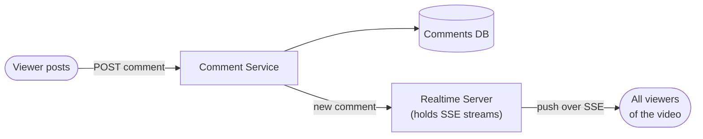
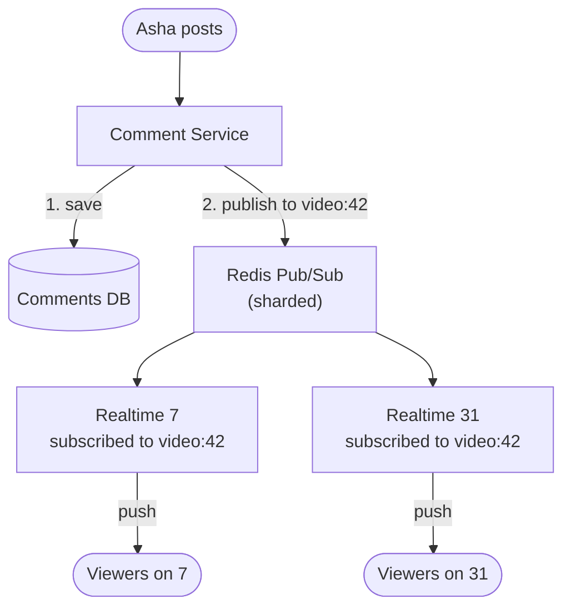
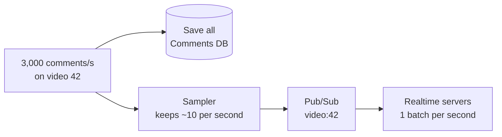
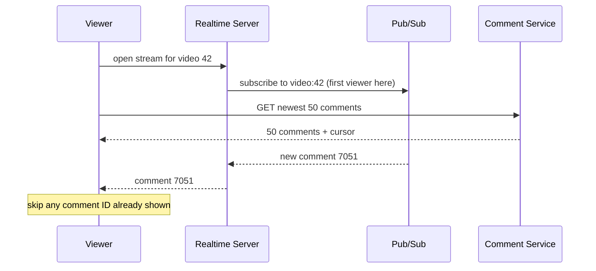
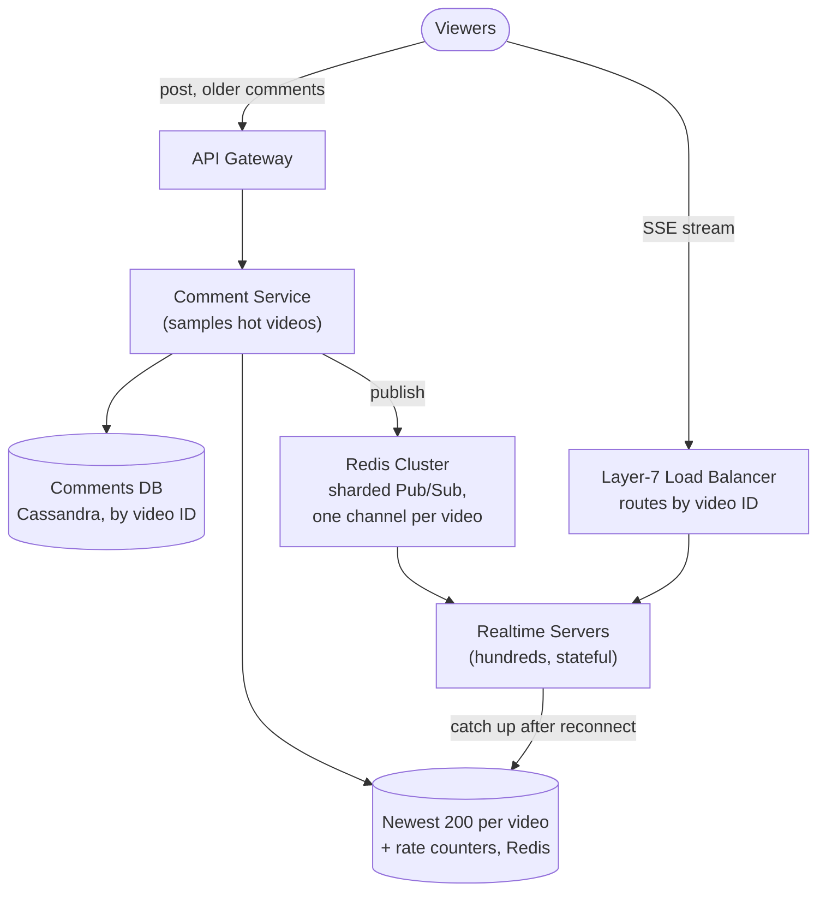

<Callout title="About this question">
  **Difficulty:** Medium. **Patterns used:** [Polling, WebSockets and SSE](../foundations/polling-websockets-sse.mdx),
  [Pub/Sub](../messaging/message-queues-pub-sub.mdx), [Stateless vs Stateful Servers](../hld-basics/stateless-vs-stateful.mdx),
  [Hot Keys and Fan-out](../advanced-components/hot-keys-fan-out.mdx), [Cursor Pagination](../advanced-components/api-pagination-versioning.mdx).
</Callout>

## Understand the problem

A famous singer goes live on Facebook. Millions of people watch. Viewers type comments, and every viewer sees new comments slide up next to the video within a second or two. Someone who joins late can scroll up to read what was said before.

Three things make it hard:

- **One comment, millions of screens.** Writing a comment is cheap. Showing it to 10 million viewers is the real work.
- **Viewers are spread over hundreds of servers.** The comment arrives at one server, but the viewers of that video are connected to many others.
- **Too many comments to read.** On a huge video, thousands of comments arrive every second. No human can read that fast.

## Step 1: Requirements

### Functional requirements

1. Viewers can post a comment on a live video.
2. Viewers see new comments in near real time while they watch.
3. Viewers can see comments posted before they joined (scroll up for older ones).

**Out of scope** (say this out loud): the video stream itself, replies to comments, likes and reactions (see the follow-ups), and the details of spam filtering.

### Non-functional requirements

1. **Fast:** a new comment reaches viewers within about 1 second.
2. **Big:** 1 million live videos at the same time, 100 million viewers in total, and one huge video can have **10 million** viewers.
3. **Availability over consistency:** if one viewer sees a comment half a second later than another, or two comments in a slightly different order, that is fine.
4. **Never lose a posted comment:** once the poster sees it posted, it is saved.

### Quick math

- **Comments written:** most viewers never comment. Say each viewer posts about 1 comment an hour: 100 million ÷ 3,600 seconds = about **30,000 comments per second**. Easy for a database that spreads over many machines.
- **Storage:** 30,000 × about 200 bytes = 6 MB per second, about **500 GB per day** at that rate. Too much for one machine over time, so we spread it out.
- **Connections:** 100 million open connections. If one server holds about 200,000, we need about **500 realtime servers**. So the viewers of one video are almost never on one server.
- **The huge video:** 10 million viewers ÷ 3,600 = about **3,000 comments per second** on that one video. Sending each one to every viewer = 3,000 × 10 million = **30 billion deliveries per second**. Impossible, and pointless. **Decision:** huge videos need special handling (deep dive 3).

## Step 2: Core entities

- **Live video:** ID, creator, status (`live` or `ended`).
- **Comment:** ID, video ID, author, text, time.
- **Viewer stream:** an open connection from one viewer to one realtime server, for one video.

## Step 3: API

Posting a comment and reading older comments are normal REST calls:

```http
POST /videos/{videoId}/comments
{ "text": "This song is amazing!" }

→ 201 Created
{ "commentId": 7001, "createdAt": "2027-03-01T20:15:04Z" }
```

```http
GET /videos/{videoId}/comments?limit=50&cursor=eyJpZCI6NzAwMX0

→ 200 OK
{ "comments": [{ "commentId": 7000, "author": "Ben", "text": "Hi from Pune!" }], "nextCursor": "eyJpZCI6Njk1MH0" }
```

The author comes from the **login token**, never from the request body. The cursor is explained in deep dive 4.

New comments arrive on a **stream** that stays open while the viewer watches. We use **SSE** (Server-Sent Events): one HTTP connection, and the server sends events down it whenever it wants (see [Polling, WebSockets and SSE](../foundations/polling-websockets-sse.mdx)).

```http
GET /videos/{videoId}/comments/stream
Accept: text/event-stream

→ 200 OK
Content-Type: text/event-stream

id: 7001
data: {"commentId":7001,"author":"Asha","text":"This song is amazing!"}
```

<Callout title="Why two different ways?" type="idea">
  Viewers **read** all the time but **write** rarely. So reading uses a long-lived stream, and writing uses a plain
  `POST`, which is simple, easy to retry and easy to rate limit.
</Callout>

## Step 4: High-level design

Start simple, with just one realtime server.



**Watch a video:**

1. The viewer's app opens the SSE stream for video 42. The Realtime Server keeps it in memory, in a list: `video 42 → [stream 1, stream 2, …]`.
2. The app also loads the newest 50 comments with `GET /comments`.

**Post a comment:**

1. The app sends `POST /videos/42/comments`.
2. The Comment Service gives the comment a time-ordered ID (like a [Snowflake ID](../distributed-systems/distributed-id-generation.mdx)) and **saves it first**. Then it answers `201`.
3. It hands the comment to the Realtime Server.
4. The Realtime Server loops over the list of streams for video 42, and sends the comment down each one.

This works for a small site. With 100 million viewers we need 500 realtime servers, and that breaks step 3: which server should get the comment?

## Step 5: Deep dives

### 1. How do we push comments to viewers? SSE vs WebSockets vs polling

<Callout title="Not great: polling every few seconds" type="error">
  Each app asks "any new comments?" every 2 seconds. 100 million viewers ÷ 2 seconds = **50 million requests per
  second**, and most answers are "nothing new". Comments also show up to 2 seconds late.
</Callout>

<Callout title="Okay: WebSockets" type="warn">
  A two-way connection that stays open. It is truly real time and **works**. **But** we don't need two ways:
  viewers post a comment rarely, and a normal `POST` does that well. A WebSocket is a different protocol after the
  first request, so every proxy and load balancer on the way must support it, and we must write our own
  reconnect and catch-up logic.
</Callout>

<Callout title="Best: SSE (Server-Sent Events)" type="success">
  A one-way stream from server to browser, over **plain HTTP**. Browsers have it built in (`EventSource`), and they
  **reconnect by themselves**. On reconnect, the browser sends the ID of the last event it got, so the server can
  send only what was missed. Over HTTP/2, many streams share one connection.
</Callout>

**Catching up after a dropped connection.** Each event carries an `id:` line (the comment ID). When the connection drops, the browser reconnects and sends a header: `Last-Event-ID: 7001`. The server sends the comments after 7001, then carries on with new ones. We get this almost for free.

**Keep connections alive.** Load balancers often close a connection that is quiet for about 60 seconds. On a quiet video, the server sends a tiny keep-alive line (`: ping`) every 30 seconds. Browsers ignore lines that start with `:`, but the line keeps the connection open.

If the mobile app already keeps a WebSocket open (for chat, say), reuse it for comments. One connection per phone is better than two.

### 2. Viewers are on 500 servers. How does a comment reach them all?

Asha posts on video 42. Her `POST` lands on one Comment Service server. The 10,000 viewers of video 42 are connected to many different realtime servers. Realtime servers are **stateful**: each one holds its own open streams (see [Stateless vs Stateful Servers](../hld-basics/stateless-vs-stateful.mdx)). How do we get the comment to the right ones?

<Callout title="Not great: send every comment to every realtime server" type="error">
  Each server keeps the comments for its viewers and drops the rest. 30,000 comments per second × 500 servers =
  **15 million messages per second**, and almost all of them are thrown away.
</Callout>

<Callout title="Okay: one Pub/Sub channel per video, viewers on random servers" type="warn">
  **Pub/Sub** means publish and subscribe: a sender publishes to a named channel, and everyone subscribed to it gets
  the message. A realtime server subscribes to `video:42` when it has a viewer of video 42. The Comment Service
  publishes each comment to `video:42`. **Works.** **But** viewers land on random servers. The 5 viewers of a small
  video sit on 5 different servers, so each of its comments is copied 5 times. And every server holds
  subscriptions for hundreds of thousands of videos.
</Callout>

<Callout title="Best: one channel per video, and viewers of the same video on the same servers" type="success">
  The SSE URL contains the video ID (`/videos/42/comments/stream`). A **layer-7 load balancer** can read the URL, so
  it sends all viewers of video 42 to the **same server**, picked by hashing the video ID with
  [consistent hashing](../databases/consistent-hashing.mdx). A small video now needs **one** subscription and
  **one** copy of each comment. Each server only subscribes to the videos it owns.
</Callout>



How the pieces work:

- **Subscribe once per video, not once per viewer.** A realtime server subscribes to `video:42` when its **first** viewer of video 42 connects, and unsubscribes when the **last** one leaves. In memory it keeps `video 42 → list of open streams`. A video with 10 million viewers on 50 servers has 50 subscribers on its channel, not 10 million.
- **A video too big for one server gets more servers.** One server holds about 200,000 viewers. A small service keeps a list of hot videos and how many servers each one needs. For video 42 with 50 servers, the load balancer hashes `42#0`, `42#1`, … `42#49`, and sends each new viewer to one of them at random. This is the usual fix for a [hot key](../advanced-components/hot-keys-fan-out.mdx): split it over several places.
- **Use sharded Redis Pub/Sub.** Plain Pub/Sub in a Redis Cluster sends every message to every node, so adding nodes doesn't help. **Sharded** Pub/Sub (Redis 7 and newer, `SSUBSCRIBE` and `SPUBLISH`) puts each channel on one shard, picked by a hash of its name. Adding shards adds capacity.
- **Why not Kafka?** A topic per live video would mean a million topics that start and end every few minutes. Kafka is built for fewer, long-lived topics. We also don't need Kafka's stored history here: the database already has it.

<Callout title="Pub/Sub can drop messages, and that is fine" type="idea">
  Redis Pub/Sub does not store messages. If a realtime server is restarting, it misses some comments. That is okay:
  every comment was **saved in the database first**. When the viewer's stream reconnects, `Last-Event-ID` brings
  back what was missed. The database is the source of truth. Pub/Sub is only the fast path.
</Callout>

### 3. The huge video: 3,000 comments a second

From the quick math: 3,000 comments per second × 10 million viewers = 30 billion deliveries per second. And even if we could send them, the comment box would scroll far too fast to read.

<Callout title="Not great: send every comment to every viewer" type="error">
  30 billion deliveries per second. The servers melt, phones drain their batteries, and the comments fly past
  faster than anyone can read.
</Callout>

<Callout title="Okay: batch the comments" type="warn">
  Each realtime server collects new comments and sends **one event per viewer per second** with all of them inside.
  10 million sends per second instead of 30 billion. **But** each batch still carries 3,000 comments. Too much data,
  and still unreadable.
</Callout>

<Callout title="Best: sample, then batch" type="success">
  A person can read maybe 5 to 10 comments a second. So for a hot video we **show only a sample**: about 10 comments
  per second. Everything is still saved, and anyone can scroll up to read it all. The sample is sent in **one batch
  per second**.
</Callout>



How the sampling works:

- **A shared counter gives the rate.** Every second, a Redis counter tells the Comment Service how many comments video 42 got (`INCR` on a key like `rate:42:<second>`).
- **Keep each comment with a chance.** Each Comment Service server keeps a new comment with chance `10 ÷ rate`. At 3,000 comments a second, that is 1 in 300. The servers don't need to talk to each other.
- **Some comments always get through:** the creator's own comments, and maybe pinned or verified accounts.
- **Your own comment always shows on your screen.** The app adds it right away when you press send. It doesn't wait for the stream.
- **Small videos skip all this.** Under about 10 comments a second, every comment is published.

Sampling also helps Pub/Sub: only 10 messages per second go into the `video:42` channel, not 3,000.

The math after the fix: 10 million viewers × 1 batch per second = 10 million sends per second, spread over 50 servers = **200,000 sends per second per server**. Each send is a small batch of about 10 comments.

### 4. Joining late, and loading older comments

**Joining a video.** The viewer needs two things: the newest comments, and every comment after that. Do it in this order:



**Open the stream first, then load the newest page.** In the other order, a comment posted between the two steps would be missed. Our order can show a comment twice (once in the page, once on the stream), so the app skips any comment ID it already has.

**Scrolling up for older comments:**

<Callout title="Not great: page numbers (offset)" type="error">
  `?page=7` means "skip 300 comments, give me 50". On a live video, new comments land on top all the time, so the
  pages shift. The viewer sees the same comments twice. Deep pages are also slow, because the database still walks
  past every skipped row.
</Callout>

<Callout title="Okay: older than a time" type="warn">
  `?before=20:15:04.120` gives comments older than that moment. Pages no longer shift. **But** on a busy video, many
  comments share the same millisecond, so some get skipped or repeated at page edges.
</Callout>

<Callout title="Best: a cursor made from the last comment ID" type="success">
  Comment IDs are **unique** and **grow over time**. The cursor is just the ID of the last comment on the page.
  "Give me 50 comments older than 7001" never skips or repeats, and new comments on top change nothing. See
  [API Pagination](../advanced-components/api-pagination-versioning.mdx).
</Callout>

We store comments in a wide-column database like [Cassandra](../databases/cassandra-dynamodb.mdx), which spreads writes over many machines. The **partition key** is the video ID, so all comments of a video sit together, already **sorted by comment ID**:

```sql
CREATE TABLE comments (
  video_id   text,
  comment_id bigint,     -- grows over time, so it sorts by time
  author_id  text,
  body       text,
  PRIMARY KEY (video_id, comment_id)
) WITH CLUSTERING ORDER BY (comment_id DESC);

-- The next page: 50 comments older than the cursor (7001), newest first.
SELECT comment_id, author_id, body
FROM comments
WHERE video_id = 'v42' AND comment_id < 7001
LIMIT 50;
```

Two more details:

- **Everyone asks for the same first page.** When a big stream goes viral, millions of new viewers ask for "the newest 50 comments of video 42" in the same minute. Keep the newest 200 comments of each live video in a **Redis list** (`LPUSH`, then `LTRIM` to 200). The first page and short reconnects read from it. Older pages are rare, and go to Cassandra.
- **A very busy video makes one partition huge.** 3,000 comments a second is 10 million comments an hour. Add a time bucket to the partition key, like `(video_id, 10-minute bucket)`. Scrolling up reads one bucket, then the one before it.

### Final architecture



## In the real world

**Facebook opened Live to all users in 2016.** Comments and reactions appear while the video plays, which is exactly this problem.

**LinkedIn explained how it streams likes and comments on live videos**, in a talk called "Streaming a Million Likes/Second" (QCon, 2019). Viewers keep an **SSE** connection to a frontend server. Each frontend server tells a dispatcher which live videos its viewers are watching, and the dispatcher sends each like or comment only to the frontend servers that need it. This is the "one channel per video" idea from deep dive 2.

**YouTube live chat has a "Top chat" view.** Viewers can switch between **Top chat**, which hides likely spam, and **Live chat**, which shows every message. It is the same idea as sampling a huge video: most viewers don't want to see everything.

**Twitch chat is built on IRC**, a chat protocol from the 1980s. Apps can connect to it over WebSockets. Twitch chat is a busy two-way chat, not a comment box people mostly read, so a two-way connection fits there.

## Follow-up questions

<Accordions>
<Accordion title="How do you show likes and floating hearts?">

Never send each like on its own. A huge video can get far more likes than comments. Count them instead: each Comment Service server adds likes to a counter, and once a second we publish one small event, like `{ "hearts": 1204 }`. The app plays that many hearts (or fewer) as an animation.

</Accordion>
<Accordion title="How do you stop spam and remove bad comments?">

Before publishing, check the comment: a [rate limit](../reliability-security/rate-limiting.mdx) per user (say, 1 comment every 2 seconds), a word filter, and a block list. To remove a comment later, mark it deleted in the database and publish a small `delete` event with its ID. Apps already showing it hide it.

</Accordion>
<Accordion title="A realtime server crashes. What happens?">

Its viewers lose their streams. `EventSource` reconnects by itself, and the load balancer sends them to the next server on the hash ring. That server subscribes to the video and sends the missed comments, using `Last-Event-ID`. Apps wait a short **random** time before reconnecting, so 200,000 viewers don't all arrive in the same second.

</Accordion>
<Accordion title="Do all viewers see comments in the same order?">

Almost. Comment IDs grow over time, and the app sorts each batch by ID. Two comments posted in the same moment through different servers can swap places. For live comments, that doesn't matter.

</Accordion>
<Accordion title="What happens when the live stream ends?">

The Comment Service publishes an `ended` event, and the realtime servers close the streams and unsubscribe. The comments stay in the database. If each comment also stores how far into the video it was posted, a replay can show comments at the right moment, using the same cursor API.

</Accordion>
</Accordions>

## What the interviewer expects

<Tabs items={['Mid-level', 'Senior', 'Staff']}>
<Tab value="Mid-level">

- Clear requirements, with a `POST` for comments and a stream for new ones.
- Push instead of polling, and a reason for picking SSE or WebSockets.
- Save the comment first, then push it.
- Page through older comments.

</Tab>
<Tab value="Senior">

- Explain why realtime servers are stateful, and route comments with **one Pub/Sub channel per video**.
- Subscribe once per video per server, not once per viewer.
- Cursor pagination by comment ID, and why offset pagination breaks on a live video.
- Open the stream first, then load the newest page, and drop duplicates by ID.

</Tab>
<Tab value="Staff">

- Do the fan-out math for a huge video and propose **sampling plus batching**.
- Route viewers of the same video to the same servers, and split hot videos over many servers.
- Reconnect storms, `Last-Event-ID` catch-up, and a Redis cache for the first page.
- Know when **not** to use Kafka, and why dropped Pub/Sub messages are fine.

</Tab>
</Tabs>

<Callout title="Remember this" type="success">
  - Reading is huge, writing is small. **POST** to write, **SSE** to read.
  - SSE reconnects by itself and sends **Last-Event-ID**, so catching up is almost free.
  - **Save first, then publish.** The database is the truth. Pub/Sub is only the fast path.
  - **One Pub/Sub channel per video.** Each realtime server subscribes once per video, not once per viewer.
  - A layer-7 load balancer puts **viewers of the same video on the same servers**. Hot videos get many servers.
  - **Huge video:** 3,000 comments/s × 10 million viewers is impossible. **Sample** about 10 per second, and send
    **one batch per second**.
  - Join: **open the stream first, then load the newest page**, and skip duplicate IDs.
  - Older comments: **cursor = last comment ID**, stored by video ID in Cassandra.
</Callout>
