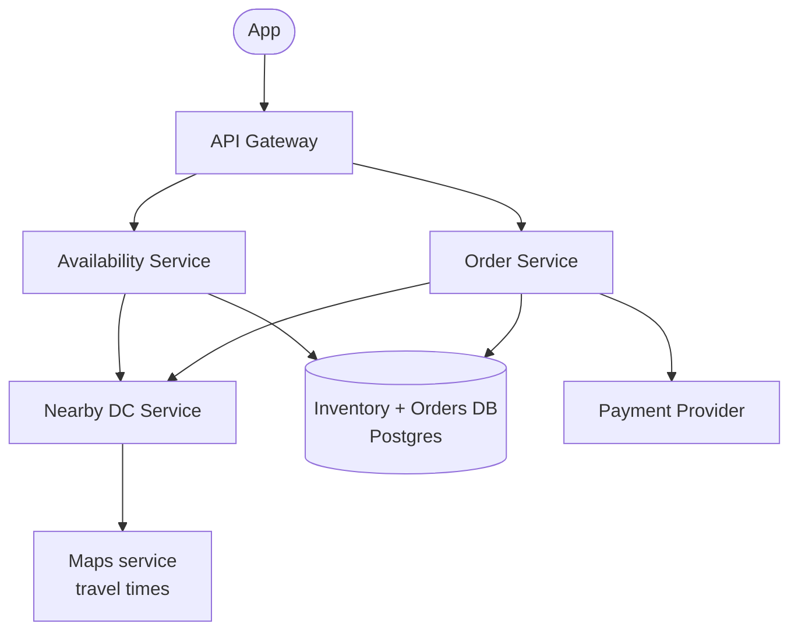
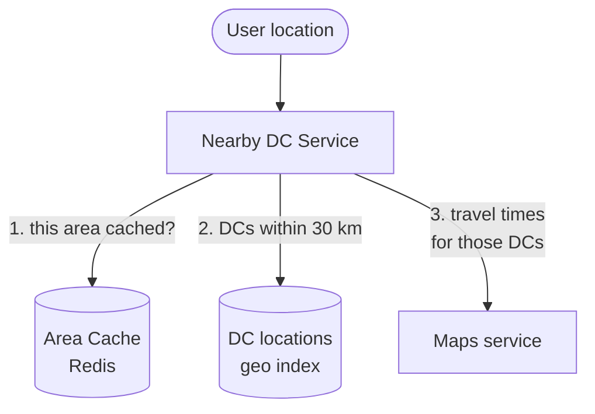
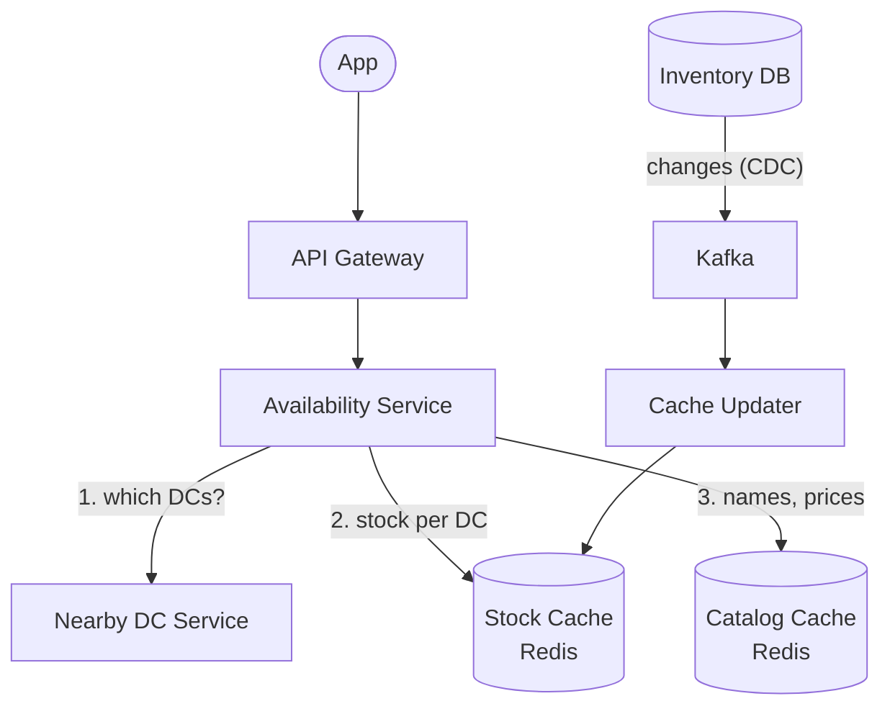
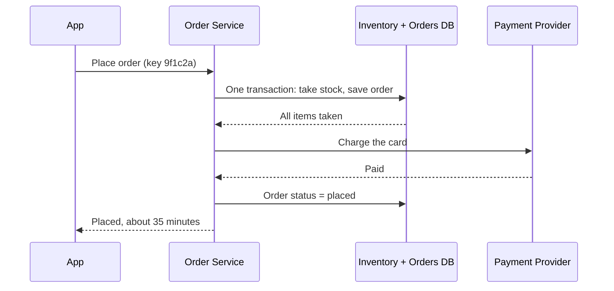
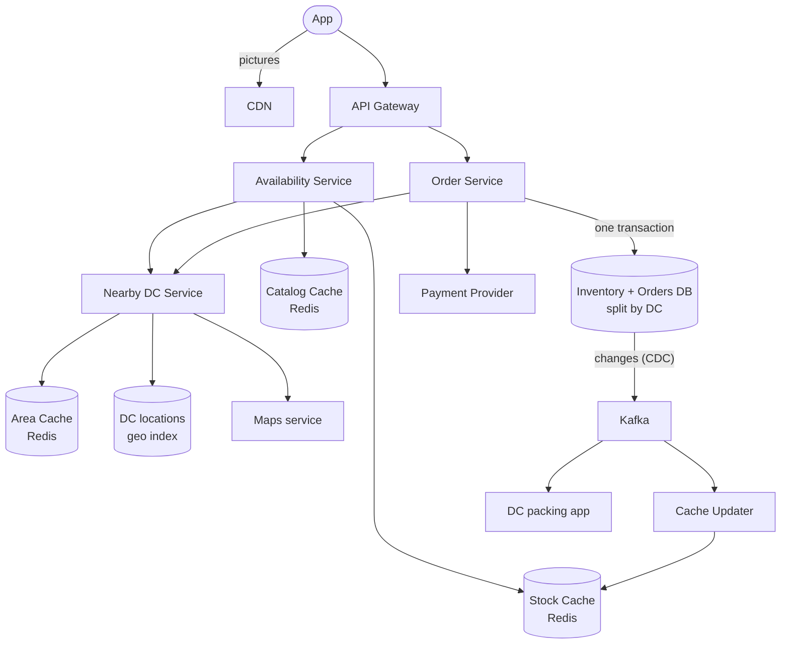

<Callout title="About this question">
  **Difficulty:** Medium. **Patterns used:** [Geospatial Indexing](../advanced-components/geospatial-indexing.mdx),
  [Transactions and ACID](../databases/transactions-acid.mdx), [Dealing with Contention](../distributed-systems/dealing-with-contention.mdx),
  [Scaling Reads](../hld-basics/scaling-reads.mdx), [Change Data Capture](../distributed-systems/change-data-capture.mdx).
</Callout>

## Understand the problem

It is 11 pm, and you want chips, ice cream and a cold drink. You open an app like Gopuff. The company does not shop at a store for you. It runs its own small warehouses all over the city, called **distribution centers (DCs)**, full of snacks, drinks and household items. The app shows only the items that a DC near you has in stock **and** can bring to you within about **an hour**. You order, someone in the DC packs a bag, and a driver brings it.

Three things make it interesting:

- **What you can buy depends on where you are.** Two users in the same city see different items, because different DCs can reach them. And "can reach" is about **travel time**, not straight-line distance.
- **Many people look, few buy.** Every app open and every category page checks availability. It must be fast for millions of users.
- **Never sell what isn't there.** A DC has 1 tub of ice cream left, and two people order it in the same second. Only one can get it. And an order with 5 items must get all 5, or none.

## Step 1: Requirements

### Functional requirements

1. Users can see the items **available for delivery to their location**, by category, with how many are left.
2. Users can **place an order** for several items and quantities, delivered within about an hour.

**Out of scope** (say this out loud): assigning drivers and planning routes, live tracking of the driver (see [Design Uber](./uber.mdx)), restocking DCs from suppliers, payment details (a payment provider handles them, see [Design a Payment System](./payment-system.mdx)), searching items by name, promotions.

### Non-functional requirements

1. **Fast availability:** item lists load in under 200 ms.
2. **No overselling:** placing an order needs **strong consistency**. Two users can never both get the last tub of ice cream.
3. **Browsing can be a few seconds behind:** browsing picks **availability**, ordering picks **consistency**. If an item sold out a second ago, a user may still see it, and their order is told "sorry, just sold out".
4. **Big:** 10 million daily users and 10,000 DCs, with peaks on Friday nights and big game days.

### Quick math

- **Availability checks:** 10 million users × 20 page views a day = 200 million a day = about **2,300 per second**, and about 5 times that at peak = over **10,000 per second**.
- **Orders:** 1 million a day = about **12 per second**, maybe 100 per second at peak. Page views outnumber orders about **200 to 1**. **Decision:** cache availability heavily. The order path is small, so it can afford a careful database transaction.
- **Inventory data:** 10,000 DCs × 5,000 items each = 50 million rows × about 50 bytes = **2.5 GB**. That fits in one database, even in memory. The hard parts are not size. They are "which DCs can reach this user?" and "never sell the last item twice".

## Step 2: Core entities

- **Item:** a product in the catalog: name, picture, category, price. The same item is sold in every city.
- **Distribution Center (DC):** a small warehouse, with a **location** (latitude and longitude) and opening hours.
- **Inventory:** how many of one item are in one DC: `(dc_id, item_id, quantity)`. This is the number that must never go below zero.
- **Order:** user, delivery location, the DC it ships from, a status, and its **order items** (item and quantity).
- **User:** the person browsing and ordering.

## Step 3: API

```http
GET /items/available?lat=40.7306&lng=-73.9866&category=snacks&cursor=...

→ 200 OK
{
  "items": [
    { "itemId": "i_chips", "name": "Sea Salt Chips", "price": 3.49, "available": 4 },
    { "itemId": "i_soda", "name": "Cola 12-pack", "price": 7.99, "available": 12 }
  ],
  "nextCursor": "..."
}
```

Only items with `available` above 0 come back. The app can show "Only 2 left" when the number is small.

```http
POST /orders
Idempotency-Key: 9f1c2a-order-1
{
  "lat": 40.7306,
  "lng": -73.9866,
  "items": [
    { "itemId": "i_chips", "quantity": 2 },
    { "itemId": "i_soda", "quantity": 1 }
  ],
  "paymentMethodId": "pm_123"
}

→ 201 Created
{ "orderId": "o_77", "status": "placed", "etaMinutes": 35 }
```

If an item ran out, the answer is **`409 Conflict`**, naming the item, and nothing is taken. The **Idempotency-Key** means a double tap on "Place order", or a retry after a timeout, returns the first order instead of making a second one (see [Idempotency](../messaging/idempotency.mdx)). The server works out which DCs can deliver by itself. It never trusts a list of DCs sent by the app. As always, the user ID comes from the **login token**.

## Step 4: High-level design



**See items:**

1. The app sends the user's location and a category.
2. The Availability Service asks the **Nearby DC Service**: "Which DCs can deliver here within an hour?" (deep dive 1)
3. It reads the stock of those DCs, adds up each item's quantity across them, and drops items with 0 (deep dive 2).
4. It adds names, pictures and prices from the catalog, and returns one page.

**Place an order:**

1. The Order Service asks the Nearby DC Service which DCs can deliver, and picks the closest one that has everything in the order.
2. In **one transaction**, it takes the stock of every item and saves the order. All or nothing (deep dive 3).
3. It charges the card, marks the order `placed`, and sends it to the DC to be packed.

Inventory and orders live in **one database**, so one order is one normal transaction. This database is the source of truth for stock.

## Step 5: Deep dives

### 1. Which DCs can deliver to this user within an hour?

The promise is about **time**, not distance. A DC 4 km away across a river may need 55 minutes if the nearest bridge is far away. A DC 20 km away by highway may need 25 minutes. And the hour also includes **packing** the bag. See [Geospatial Indexing](../advanced-components/geospatial-indexing.mdx) for how "near me" indexes work.

<Callout title="Not great: ask the maps service about every DC, on every request" type="error">
  Get the travel time from all 10,000 DCs to the user, every time someone opens the app. At 10,000 page views per
  second, that is 100 million route calculations per second. Far too slow, and maps services charge for each
  calculation.
</Callout>

<Callout title="Okay: straight-line distance only" type="warn">
  Keep the DC locations in a geo index (only 10,000 DCs, so they fit in memory, or use PostGIS), and say "every
  DC within 15 km can deliver". Fast and free. **But** it is often wrong: the user across the river sees items
  that can't arrive in time, and the user near the highway misses items that could.
</Callout>

<Callout title="Best: narrow down by distance, then check real travel time" type="success">
  **First**, a geo query finds the few DCs within a generous straight-line radius, say 30 km. That is usually 5 to
  20 DCs. **Then** ask the maps service for the travel times from just those DCs to the user, in **one** call (a
  "matrix" request). Keep the DCs where packing time + travel time is 60 minutes or less. Cache the answer by area.
</Callout>



Once the travel times come back, the last step is a simple filter:

```js
// The promise to the user: delivered within one hour
const MAX_MINUTES = 60;

// Keep only the DCs that can get an order to the user in time
function dcsThatCanDeliver(nearbyDcs) {
    const result = [];

    for (const dc of nearbyDcs) {
        // Time to pack the bag, plus time on the road
        const totalMinutes = dc.packingMinutes + dc.travelMinutes;

        if (totalMinutes <= MAX_MINUTES) {
            result.push(dc.id);
        }
    }

    return result;
}
```

Here are three DCs near one user. The closest one is not always the fastest:

```js
const nearbyDcs = [
    { id: "dc_1", km: 3, packingMinutes: 10, travelMinutes: 15 },
    // Close, but across the river: the bridge is far away
    { id: "dc_2", km: 4, packingMinutes: 10, travelMinutes: 55 },
    // Farther, but on the highway
    { id: "dc_3", km: 20, packingMinutes: 10, travelMinutes: 25 },
];

console.log(dcsThatCanDeliver(nearbyDcs)); // [ 'dc_1', 'dc_3' ]
```

**Cache by area, so most requests skip the maps service.** Round the user's location to a **geohash cell** of 6 characters (about 1 km wide), and cache "cell → DCs that can deliver" for about **10 minutes**. Everyone in that cell shares one answer. Traffic changes during the day, so keep the TTL short. The answer is worked out for the middle of the cell, so leave a few minutes of margin: count a DC only if it can make it in about 55 minutes.

**Another option: work it out ahead of time.** Every 15 minutes, a job draws the area each DC can reach in time, using current traffic. This shape on the map is called an **isochrone** ("everywhere within 45 minutes of this DC"). Store the shapes in PostGIS. Now "which DCs can deliver here?" becomes "which shapes contain this point?", one fast query with **no** maps call while the user waits.

**If the maps service is slow or down,** fall back to straight-line distance with a small, safe radius. Users see fewer items for a while, but the app still works. See [Graceful Degradation](../reliability-security/graceful-degradation.mdx).

### 2. How do we show availability fast to many users?

To show one page of snacks, we need the stock of the user's 2 or 3 DCs, added up per item. Over 10,000 times per second at peak.

<Callout title="Not great: query the main database on every page view" type="error">
  `SELECT item_id, SUM(quantity) FROM inventory WHERE dc_id IN ('dc_1', 'dc_3') GROUP BY item_id`. Each DC has
  about 5,000 items, so every page view reads thousands of rows. Thousands of times per second, on the **same**
  database that must place orders quickly. Orders slow down because people are browsing.
</Callout>

<Callout title="Okay: send these reads to read replicas" type="warn">
  The primary only takes orders, and the replicas answer browsing. A replica is about a second behind, which is
  fine for browsing. **Works.** **But** every page view still runs the same heavy query, and we need many replicas
  for numbers that barely change from one second to the next.
</Callout>

<Callout title="Best: cache each DC's stock in Redis, kept fresh by CDC" type="success">
  Keep one small Redis hash per DC and category, like `stock:dc_1:snacks`, holding about 200 items and their
  quantities. The Availability Service reads the hashes for the user's DCs, and adds them up in memory. Every
  change to the inventory table flows through **CDC** and Kafka to a small worker that updates the hash, about a
  second later.
</Callout>



- **Why CDC and not a TTL?** A TTL of a minute would show sold-out items for up to a minute. CDC updates the cache about a second after every order and every restock. See [Change Data Capture](../distributed-systems/change-data-capture.mdx).
- **The cache is allowed to be a little wrong.** The real check happens when the order is placed (deep dive 3). If a user orders an item that sold out a second ago, they get "sorry, just sold out", and pick something else.
- **The catalog** (names, prices, pictures) almost never changes. Cache it for a long time, and serve pictures from a [CDN](../caching/cdn.mdx).
- **The busiest areas** can also cache the final list per **cell and category** for a few seconds, so neighbors share one answer.
- If the cache is lost, rebuild it from the database (or a replica). The database is always the truth. See [Scaling Reads](../hld-basics/scaling-reads.mdx).

### 3. How do we place an order without selling stock that isn't there?

`dc_1` has **1 tub of ice cream** left. Alice and Bob both order it at 21:00:00. Alice's order also has 2 bags of chips and 1 soda. Two rules:

- **No overselling:** only one of them gets the ice cream.
- **All or nothing:** if Alice can't get the ice cream, her chips and soda must not stay taken for an order that failed.

<Callout title="Not great: check, then take, in the app" type="error">
  The app reads `quantity = 1` for both Alice and Bob, sees that it is above 0, and writes `quantity = 0` for both.
  Both orders go through, and we sold one tub twice. This is a **race condition**. And if the items are taken one by
  one without a transaction, a failure halfway leaves the chips taken for an order that never happened.
</Callout>

<Callout title="Okay: lock the rows first, then check" type="warn">
  In a transaction, `SELECT ... FOR UPDATE` locks the inventory rows. The app checks the numbers, then updates them.
  **Correct.** **But** the locks are held across several round trips between the app and the database. On a busy
  item, orders wait in line for the lock. See [Locks and Deadlocks](../databases/locking.mdx).
</Callout>

<Callout title="Best: one short transaction, with one atomic update per item" type="success">
  For each item: `quantity = quantity - 2 ... AND quantity >= 2`. The database checks and changes the number in
  **one step**. 1 row changed means we got the items. 0 rows means there are not enough, so we **roll back**, and
  every item in the order goes back. The order rows are saved in the same transaction.
</Callout>

```sql
BEGIN;

-- One UPDATE per item, sorted by item_id (see below).
-- Take 2 bags of chips from dc_1, only if at least 2 are left.
UPDATE inventory
SET quantity = quantity - 2
WHERE dc_id = 'dc_1' AND item_id = 'i_chips' AND quantity >= 2;
-- 1 row changed: got them. 0 rows: not enough. ROLLBACK and stop.

UPDATE inventory
SET quantity = quantity - 1
WHERE dc_id = 'dc_1' AND item_id = 'i_icecream' AND quantity >= 1;

UPDATE inventory
SET quantity = quantity - 1
WHERE dc_id = 'dc_1' AND item_id = 'i_soda' AND quantity >= 1;

INSERT INTO orders (order_id, user_id, dc_id, status)
VALUES ('o_77', 'u_42', 'dc_1', 'pending_payment');

INSERT INTO order_items (order_id, item_id, quantity)
VALUES ('o_77', 'i_chips', 2), ('o_77', 'i_icecream', 1), ('o_77', 'i_soda', 1);

COMMIT;  -- only when every UPDATE changed 1 row
```

How it works:

- **Alice and Bob race.** The database runs the two ice cream updates one after the other. The first changes the row to 0. The second finds `quantity >= 1` false, changes 0 rows, and that whole order rolls back. Its chips and soda go back too. That user gets `409 Conflict`: "Ice cream just sold out."
- **Check every row count.** If the app ignored a 0 and went on to `COMMIT`, it would save an order for ice cream it never got.
- **Sort the updates by `item_id`.** Two orders with the same items then lock the rows in the same order, so they can't **deadlock** (see [Design a Ticket Booking System](./ticket-booking.mdx)).
- **A safety net:** a `CHECK (quantity >= 0)` constraint on the table. If a bug ever tried to go below zero, the database refuses.
- **One database for inventory and orders.** That is what makes this one plain transaction. If stock and orders lived in two services, we would need a saga, which is much harder (see [Transactions and ACID](../databases/transactions-acid.mdx) and [Saga Pattern](../distributed-systems/saga-pattern.mdx)).
- **If the chosen DC can't fill the order,** try the next DC on the "can deliver" list.

**Payment comes after the transaction, never inside it.** A payment call can take seconds, and the row locks must last milliseconds. So the transaction above is a **reservation**: the stock is taken, and the order waits in `pending_payment`.



- **Payment fails:** in one transaction, give every item back (`quantity = quantity + 2`) and mark the order `cancelled`.
- **The server crashes before it knows:** a cleanup job finds orders stuck in `pending_payment` for a few minutes, asks the payment provider what happened, and then either confirms the order or gives the stock back. This is the same pattern as [Design E-commerce](./e-commerce.mdx).
- **Reserve at checkout, not in the cart.** Most carts are never ordered. Holding stock for them would hide items from people who really want to buy.

**Is the row lock a problem here?** Not at our numbers. 100 orders per second at peak, spread over 10,000 DCs, is about one order per DC every 100 seconds. Even a very busy DC gets maybe one per second, and each update holds the row lock for about a millisecond. It becomes a problem only when thousands of people want the **same item at the same DC** in the same second, like "free ice cream for the first 100 orders". Then put a fast Redis counter in front of the database, or line up the orders per DC. See [Dealing with Contention](../distributed-systems/dealing-with-contention.mdx).

### 4. How do we handle peak load?

Friday and Saturday nights, a big game, a snowstorm: everyone stays home and orders at once. Traffic can be 5 to 10 times normal.

- **Reads grow the most, and caches take them.** The area cache and the stock cache answer almost every page view. The services keep no state, so we add servers. Add them **before** known peaks (a big game is on the calendar), because autoscaling takes minutes.
- **Split the database by DC.** All rows of one DC, its stock and its orders, live on one shard. An order uses only one DC, so it is still a transaction on one machine. Each city's rush lands on its own shard. See [Sharding](../databases/partitioning-sharding.mdx).
- **The real limit is people, not servers.** A DC with 8 packers and 15 drivers can only send so many orders an hour. If it takes more, the "within an hour" promise breaks. So each DC reports its current **wait time**, and the Nearby DC Service uses it as the packing time in deep dive 1. A busy DC drops out of the "can deliver" list for faraway users first, and the app shows fewer items or a later time. This is [backpressure](../reliability-security/backpressure.mdx).
- **Everything after the order is async.** The new order row flows through CDC into Kafka. The DC's packing screen, driver assignment, emails and analytics read it from there. A slow email service never slows down ordering.

### Final architecture



## In the real world

- **Gopuff** was started in 2013 by two students at Drexel University in Philadelphia. It does not send shoppers to stores. It buys its own stock and keeps it in its own small warehouses, which it calls **micro-fulfillment centers**, and delivers from there. That is the model on this page.
- **Instacart** works the other way: a shopper picks your order from a real grocery store's shelves. Its stock data can be wrong, so customers can choose a **replacement** in advance, in case an item is missing.
- In India, **Blinkit** (bought by Zomato in 2022), **Zepto** and **Swiggy Instamart** promise deliveries in about **10 minutes**, from small warehouses that are closed to shoppers, often called **dark stores**. With such a short promise, each store can only serve the area a few minutes around it.
- Maps companies sell the tools from deep dive 1. **Google Maps Platform** and **Mapbox** both offer **matrix** APIs: travel times between many starting points and end points in one call. Mapbox also has an **Isochrone** API ("everywhere you can reach in 20 minutes"). **OSRM** is a free, open-source routing engine that can compute travel time tables on your own servers.

## Follow-up questions

<Accordions>
<Accordion title="No single DC has every item in the order. What then?">

Split it into one delivery per DC: two bags, maybe two drivers, paid together. Each part takes stock from its own DC in its own transaction. If one part fails, cancel the other part and give its stock back. A simpler choice: fill each order from one DC, and tell the user "this item is not available with the rest of your order".

</Accordion>
<Accordion title="The database says 3 are left, but the shelf is empty. What happens?">

The packer marks the item missing in the packing app. We refund that item, tell the user, and set that DC's quantity to 0, so the app stops showing it. Regular stock counts fix the numbers. For items whose count is often wrong, the app can show "sold out" when only 1 is left.

</Accordion>
<Accordion title="A truck restocks the DC. How do the new items show up in the app?">

Staff scan the boxes as they arrive, and the system runs `quantity = quantity + 200` for each item. The change flows through CDC to the stock cache, so the items show up in the app a second or two later. No extra work.

</Accordion>
<Accordion title="How do you show 'arrives in about 25 minutes'?">

Add up the DC's current wait time, the packing time, and the travel time from the maps service (with current traffic). Show a range, like "20 to 30 minutes", and update it once a driver picks up the bag.

</Accordion>
<Accordion title="Why not keep the stock only in Redis? It is faster.">

Redis can check and take stock in one step (a small Lua script), and it is very fast. **But** taking several items all-or-nothing is harder, and Redis can lose its last writes in a crash. At about 100 orders per second, the database is fast enough, and it is the source of truth. Put a Redis counter in front only for a flash sale on one item.

</Accordion>
</Accordions>

## What the interviewer expects

<Tabs items={['Mid-level', 'Senior', 'Staff']}>
<Tab value="Mid-level">

- Clear requirements, entities and API, with inventory stored per **DC and item**.
- Find nearby DCs with a geo index, not a normal index on latitude and longitude.
- Stop overselling with an atomic update, and take several items in one transaction.

</Tab>
<Tab value="Senior">

- Travel time, not distance: a geo query first, then one matrix call for the few DCs left, cached by geohash cell.
- Fast reads: a stock cache per DC kept fresh by CDC. Browsing may be a little stale, ordering is strongly consistent.
- Check row counts, sort updates by item, and keep payment outside the transaction, with stock given back if payment fails.

</Tab>
<Tab value="Staff">

- Everything from senior, but faster.
- DC capacity (packers and drivers) as backpressure that changes what users can see.
- Shard by DC, so an order is always a one-shard transaction.
- Isochrones worked out ahead of time, a fallback when the maps service is down, and when contention really becomes a problem.

</Tab>
</Tabs>

<Callout title="Remember this" type="success">
  - Inventory is stored per **DC and item**. What a user can buy = stock in the DCs that can reach them in time.
  - **Time, not distance:** a geo index narrows to a few DCs, then one maps "matrix" call checks real travel time.
    Cache the answer per **geohash cell** for about 10 minutes.
  - **Read-heavy:** about 200 page views per order. Cache each DC's stock in Redis, kept fresh by **CDC**.
  - Browsing may be a second stale. **The truth is the atomic update** at order time.
  - **No overselling:** `quantity = quantity - 2 WHERE ... AND quantity >= 2`, one update per item, sorted by item,
    in **one transaction**. 0 rows changed = roll back everything.
  - Keep inventory and orders in **one database**, split by DC, so an order is one plain transaction.
  - **Payment after the reservation**, never inside the transaction. Give the stock back if payment fails.
  - At peak, the real limit is **packers and drivers**. Feed each DC's wait time back into "who can deliver".
</Callout>
