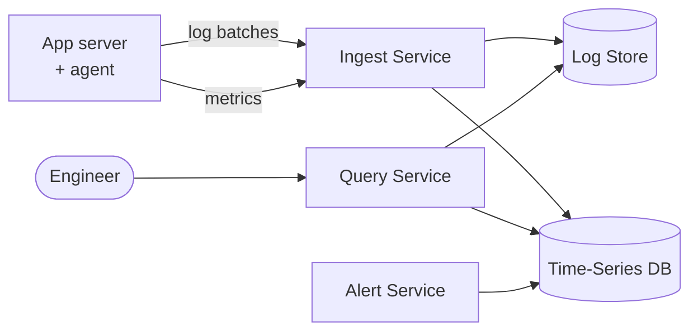
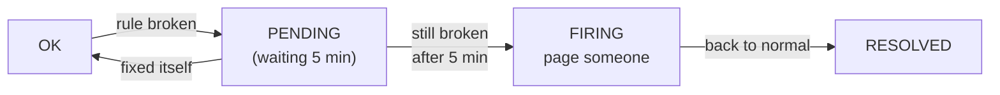
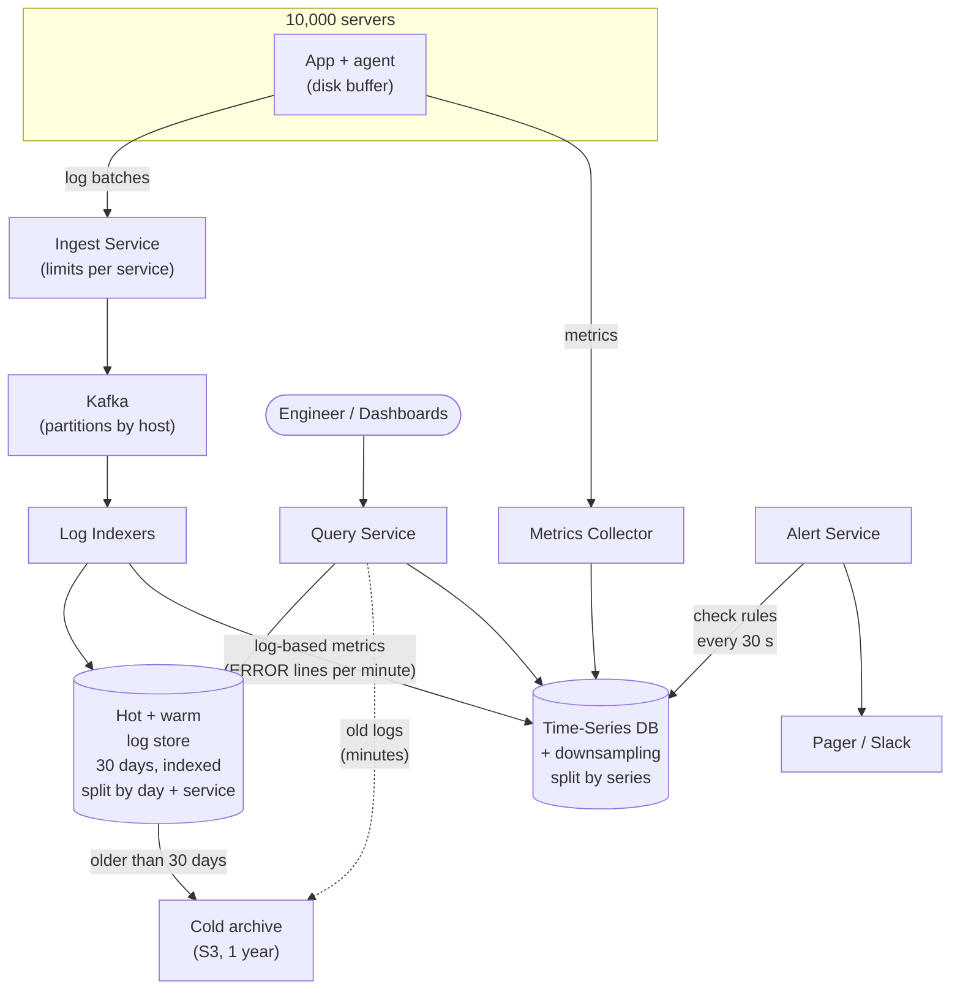

<Callout title="About this question">
  **Difficulty:** Hard. Huge amounts of writes, and fast searches on top. **Patterns used:**
  [Observability](../production/observability.mdx), [Kafka](../messaging/kafka.mdx),
  [Search and Inverted Indexes](../advanced-components/search.mdx), [Backpressure](../reliability-security/backpressure.mdx),
  [Partitioning and Sharding](../databases/partitioning-sharding.mdx).
</Callout>

## Understand the problem

A company runs **10,000 servers**. When something breaks at 3 a.m., engineers need to answer "what happened?" fast. They use two kinds of data:

- **Logs** are text lines that describe one event. Example: `10:15:02 ERROR checkout order=981 card declined`. Logs answer "what exactly happened to this order?"
- **Metrics** are numbers measured over time. Example: "checkout requests per second" or "CPU use %". Metrics answer "is something wrong right now, and since when?"

We build one system that **collects** both from every server, **stores** them, lets engineers **search** logs and see metric **charts**, and **alerts** someone when a number looks bad. Real examples: Datadog, Splunk, the ELK stack, Prometheus with Grafana.

## Step 1: Requirements

### Functional requirements

1. Collect logs and metrics from all servers.
2. Search logs by words, service, level and time range, like "errors from checkout in the last hour".
3. Show metrics as charts on dashboards.
4. Alert the on-call engineer when a rule is broken, like "more than 5% of checkout requests fail for 5 minutes".

**Out of scope** (say this out loud): distributed tracing, user permissions, building the dashboard screens.

### Non-functional requirements

1. **Huge write volume:** 10,000 servers, all writing all the time.
2. **Fresh:** new logs searchable within about 1 minute. Alerts fire within about 1 minute of the rule being met (for a "5 minutes" rule, once the 5 minutes are up).
3. **Fast search:** searching the last day of logs takes a few seconds.
4. **Never hurts the apps:** collecting must not slow down the servers. If our system has trouble, the apps keep running.
5. **Keep data:** logs searchable for 30 days, kept cheaply for 1 year. Metrics kept for 1 year.

Losing a few log lines in a disaster is not the end of the world, but we should try hard not to. Logs pour in fastest **exactly when things break**, which is when engineers need them most.

### Quick math

- **Logs:** 10,000 servers × 100 lines per second × 200 bytes = **200 MB per second**. That is about **17 TB per day**, and about **500 TB for 30 days**. **Decision:** we can't keep all of that on fast, expensive disks. We need **hot** (fast) and **cold** (cheap) storage, and we must compress.
- **Metrics:** 10,000 servers × 1,000 metrics each = **10 million time series**. One reading every 10 seconds = **1 million numbers per second**. **Decision:** a normal SQL table with one row per reading would drown. We need a **time-series database**.

## Step 2: Core entities

- **Log entry:** time, service, host, level (`INFO`, `ERROR`...), message, extra fields like `orderId`.
- **Time series:** one metric with one set of **labels**, like `http_requests{service="checkout", status="500"}`. It holds a list of `(time, value)` points.
- **Alert rule:** a metric query, a limit, how long it must last, and who to notify.

## Step 3: API

```http
POST /logs
[
  { "ts": "2026-11-19T10:15:02Z", "service": "checkout", "level": "ERROR",
    "message": "card declined", "orderId": "981" }
]

GET /logs/search?q=declined&service=checkout&level=ERROR&from=2026-11-19T09:00Z&to=2026-11-19T10:00Z
```

```http
POST /metrics
[ { "name": "http_requests", "labels": { "service": "checkout", "status": "500" },
    "ts": 1795083302, "value": 1234 } ]

GET /metrics/query?name=http_requests&service=checkout&from=-1h&step=60s
```

```http
POST /alerts
{
  "name": "Checkout errors high",
  "query": "error_rate(service=checkout)",
  "above": 0.05,
  "for": "5m",
  "notify": "payments-oncall"
}
```

Agents on the servers call `POST /logs` and `POST /metrics` with **batches**, never one line at a time.

## Step 4: High-level design



**Collect logs:**

1. The app writes log lines to a local file (or to standard output).
2. A small **agent** program on every server reads that file, groups lines into batches, compresses them, and sends them on.
3. The Ingest Service saves them in the Log Store.

**Collect metrics:**

1. The app keeps counters in memory, like "requests so far: 1234".
2. Every 10 seconds the agent sends the current values. (Or a collector **pulls** them, see below.)
3. The Ingest Service saves them in the Time-Series DB.

**Search and charts:** the engineer sends a query. The Query Service reads the Log Store or the Time-Series DB and returns lines or chart points.

**Alerts:** every 30 seconds, the Alert Service runs each rule against the Time-Series DB. If a rule stays broken long enough, it notifies the on-call engineer.

## Step 5: Deep dives

### 1. How do we collect from 10,000 servers without losing data?

<Callout title="Not great: the app sends each line straight to the database" type="error">
  Every log line becomes a network call inside the app. If the database is slow, **the app gets slow too**. And
  10,000 servers sending tiny requests will flood the database.
</Callout>

<Callout title="Okay: an agent batches lines and sends them to storage" type="warn">
  The app just writes to a local file, so it never waits. **But** during an outage, error logs can jump 10 times.
  That spike hits storage directly, exactly when we need it most.
</Callout>

<Callout title="Best: agent → Kafka → indexer workers" type="success">
  Agents send batches (`POST /logs`) to a thin Ingest Service, which checks them and puts them in
  [Kafka](../messaging/kafka.mdx). Indexer workers read from Kafka and write to storage at a steady speed. Kafka is a big **buffer**: during a spike, data waits there safely instead of being dropped.
</Callout>

Three more safety rules:

- **The agent has a disk buffer.** If the Ingest Service can't be reached (or Kafka behind it is down), the agent saves batches to local disk and sends them later. If even that fills up, it drops `DEBUG` lines first and keeps `ERROR` lines.
- **Limits per service.** If one service suddenly logs 100 times more than usual (a **log storm**), the Ingest Service limits or samples it, so it can't drown everyone else. This is [backpressure](../reliability-security/backpressure.mdx).
- **Clean data at the agent.** Remove passwords, card numbers and emails before logs leave the server.

**Push or pull for metrics?** Both work:

| | Push (agent sends) | Pull (collector asks) |
| --- | --- | --- |
| How | The agent sends numbers every 10 s | The collector calls each server's `/metrics` page every 10 s |
| Good for | Short jobs, servers behind firewalls | Knowing who is down: a failed pull means "server down" |
| Used by | StatsD, the Datadog agent | Prometheus |

### 2. How do we store this much data?

**Metrics: a time-series database.** Metric data has a special shape. Points arrive in time order. Old points never change. And we nearly always read a range of time for one series. A **time-series database (TSDB)** is built for exactly this:

- It stores the points of one series **together**, in blocks of, say, 2 hours.
- It **compresses** them very well. Timestamps come every 10 seconds: 10:00:00, 10:00:10, 10:00:20. Instead of saving each full time, save the first one and then "same gap as before", which takes almost no space. Values change slowly too, so save only **how much they changed**.
- **Downsampling** saves space for old data. Keep 10-second points for 2 weeks, 1-minute averages for 3 months, and 1-hour averages for a year. A chart of last year doesn't need 10-second detail.

<Callout title="Watch out: too many label values" type="warn">
  Every new combination of labels creates a **new time series**. A label like `status` has a few values. A label
  like `userId` has millions, so it creates millions of series and can crash the TSDB. The number of different
  values is called **cardinality**. Never put user IDs or order IDs in metric labels. Put them in logs.
</Callout>

**Logs: hot and cold storage.** Recent logs are searched often. Old logs almost never.

| Tier | Age | Where | Search speed | Cost |
| --- | --- | --- | --- | --- |
| **Hot** | Last 7 days | Fast SSD disks, fully indexed | Seconds | High |
| **Warm** | 7 to 30 days | Cheaper disks | Slower | Medium |
| **Cold** | 30 days to 1 year | Compressed files in object storage (S3) | Minutes, or restore first | Very low |

We also **split logs by day**: one index per day. Deleting old data is then just "drop the whole index for that day", which is instant. Deleting rows one by one would take forever.

**Partitioning: spreading the work over many machines.** 200 MB of logs per second and 10 million time series are far too much for one machine. So every layer is split into parts, and each part lives on a different machine (see [Partitioning and Sharding](../databases/partitioning-sharding.mdx)):

- **Kafka:** the log topic has many partitions (say 200), and the Ingest Service picks one for each batch by `hash(host)`. 10,000 servers spread evenly over them. Each indexer worker reads a few partitions, so adding workers adds speed.
- **Log store:** each day's index is split again **by service**, into shards on many machines. A search for "checkout, last hour" opens only today's checkout shards, not everything.
- **Time-series DB:** series are spread over machines by `hash(metric name + labels)`. All points of one series sit on one machine, so reading one series is one fast read. A chart that adds up many series asks several machines in parallel and merges the answers.

### 3. How do we search logs fast?

<Callout title="Not great: scan every file" type="error">
  Like running `grep` over 500 TB. Each search would take hours.
</Callout>

<Callout title="Best: always narrow by time and service first, then use an index" type="success">
  Every search **must** have a time range. Data is already split by day and service, so a search for "checkout
  errors, last hour" only opens a tiny slice of the data. Inside that slice, an index finds the matching lines.
</Callout>

There are two ways to build that index, and both are used in real life:

**1. Index every word (full-text).** This is an **inverted index**: for each word, keep a list of the log lines that contain it. It works like the index at the back of a book. (See [Search and Inverted Indexes](../advanced-components/search.mdx).)

| Word | Log lines that contain it |
| --- | --- |
| `declined` | 3, 17, 42 |
| `timeout` | 5, 17 |
| `checkout` | 3, 5, 17, 42 |

A search for "declined timeout" just reads two short lists and finds line 17. Very fast. **Downside:** the index can be almost as big as the logs, and building it costs a lot of CPU.

**2. Index only the labels.** Index just `service`, `level`, `host` and time. Keep the log text in compressed chunks. To search, use the labels to pick the right chunks, then scan only those chunks, **in parallel** on many machines. **Upside:** much cheaper to store. **Downside:** a search for one word across everything is slower.

Pick full-text if engineers search for random words a lot. Pick labels-only if cost matters most and searches usually start with "which service?".

### 4. How do alerts work without waking people for nothing?

A rule looks like this: **"If more than 5% of checkout requests fail for 5 minutes, page the on-call engineer."**

The Alert Service checks every rule every 30 seconds. The **"for 5 minutes"** part matters. A 10-second blip should not wake anyone up. So an alert moves through states:



More rules for good alerts:

- **Alert on metrics, not logs.** Checking a number is fast and cheap. If you need log-based alerts, first turn logs into a metric, like "count of `ERROR` lines per minute". The log indexers can count these as they write, and send the counts to the Time-Series DB.
- **Group and remove duplicates.** One database outage can break 200 rules at once. Send **one** message, "database down, 200 alerts", not 200 pages.
- **Route** each alert to the right team: payments alerts to the payments on-call, and so on.
- **Watch the watcher.** If the alert system itself dies, nobody gets alerts. A common trick: an alert that **always** fires, sent to an outside service. If that alert ever **stops** arriving, the outside service pages someone. This is often called a **dead man's switch**.

### Final architecture



## In the real world

**The ELK stack** is a popular open-source logging setup: **E**lasticsearch stores and searches logs with a full-text inverted index, **L**ogstash processes logs on the way in, and **K**ibana shows them. Small agents like Filebeat ship the log files.

**Prometheus** was first built at SoundCloud. It **pulls** metrics: it calls a `/metrics` page on each server on a schedule, and stores the numbers in its own time-series database. A separate tool, **Alertmanager**, groups duplicate alerts, routes them to the right team, and lets people silence them. Prometheus alerts also have a `for` setting, with the same pending and firing states shown above.

**Grafana Loki** uses the "index only the labels" idea. It doesn't index the log text. It stores compressed chunks, often in object storage, and scans them at search time.

**Facebook's Gorilla** was an in-memory time-series database described in a 2015 paper. Its compression stores the **difference between gaps** for timestamps and only the **changed bits** for values. Later time-series databases, including Prometheus, use similar ideas.

## Follow-up questions

<Accordions>
<Accordion title="How do you connect a log line to a metric spike or a slow request?">

Give every request a **trace ID** and print it in every log line it causes. When a chart shows a spike, you jump to the logs from that minute, and then follow one trace ID across all services. See [Observability](../production/observability.mdx).

</Accordion>
<Accordion title="What if the logging system itself goes down?">

Apps keep running: they only write to local files. Agents buffer on disk. Kafka keeps data for days. When the indexers come back, they catch up from where they stopped. You lose freshness for a while, not data.

</Accordion>
<Accordion title="How do you keep costs under control?">

Drop or sample `DEBUG` logs in production, set a log budget per team, compress everything, move old data to cheap storage fast, and downsample old metrics. Logging bills grow quietly, so show each team what they spend.

</Accordion>
<Accordion title="How do you handle many data centers?">

Collect and store in each region, so data doesn't cross the world on every write. The Query Service sends a search to every region and merges the answers. Keep the alerting system running in more than one region.

</Accordion>
</Accordions>

## What the interviewer expects

<Tabs items={['Mid-level', 'Senior', 'Staff']}>
<Tab value="Mid-level">

- Agents on each server, batching and sending.
- Separate stores for logs and metrics, and why.
- A clear search flow with a time range, and simple threshold alerts.

</Tab>
<Tab value="Senior">

- Kafka as a buffer for spikes, and agents with disk buffers.
- Time-series storage, compression and downsampling. Warn about high cardinality.
- Hot, warm and cold tiers, split by day. Partitioning at every layer: Kafka, log shards, time series.
- Full-text index vs labels-only index, with the tradeoffs.
- Alerts with a "for" duration, grouping and routing.

</Tab>
<Tab value="Staff">

- Everything from senior, but faster.
- Cost per GB stored and searched, and budgets per team.
- Multi-region search, and "who watches the watcher".
- Protecting the system from one noisy service, and scrubbing private data.

</Tab>
</Tabs>

<Callout title="Remember this" type="success">
  - **Logs = text events. Metrics = numbers over time.** Store them differently.
  - **Agent → Kafka → indexers.** Kafka absorbs the spike that comes with every outage.
  - **Metrics go in a time-series DB:** compressed blocks, downsampled with age. Keep label cardinality low.
  - **Logs go hot → warm → cold**, split by day so deleting is instant.
  - **Every search has a time range.** Then full-text index, or labels-only plus a parallel scan.
  - **Alerts:** on metrics, with "for 5 minutes", grouped, routed, and watched from outside.
</Callout>
