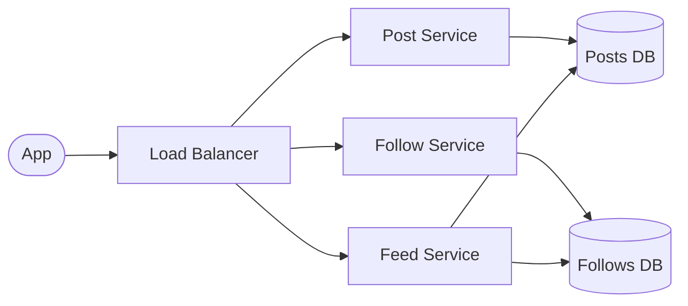
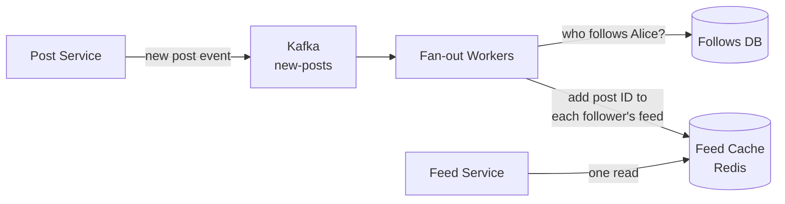
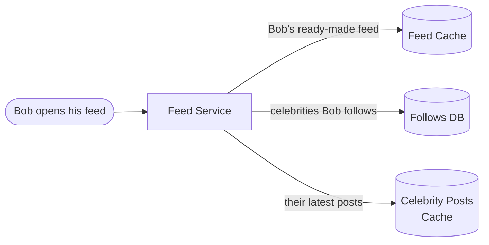
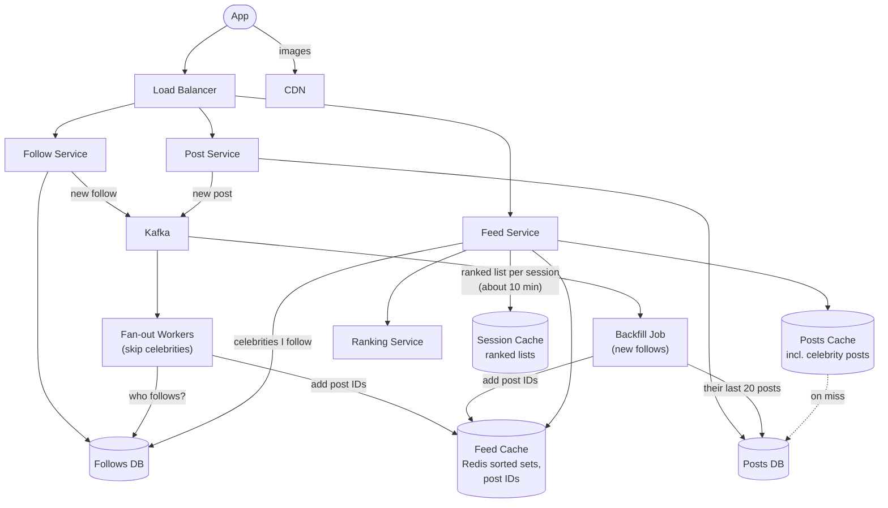

<Callout title="About this question">
  **Difficulty:** Medium. **Patterns used:** [Hot Keys and Fan-out](../advanced-components/hot-keys-fan-out.mdx),
  [Caching](../caching/what-is-caching.mdx), [Redis](../caching/redis.mdx), [Kafka](../messaging/kafka.mdx),
  [API Pagination](../advanced-components/api-pagination-versioning.mdx).
</Callout>

## Understand the problem

When you open Twitter (X), Instagram or Facebook, the first screen is your **feed**: a list of posts from the people you follow, newest (or most interesting) first. You scroll down to see more.

Saving one post is easy. The hard part: when you open the app, we must collect posts from the **hundreds of people** you follow, in a fraction of a second, for **hundreds of millions** of users.

## Step 1: Requirements

### Functional requirements

1. Users can **create posts**.
2. Users can **follow** other users.
3. Users can see a **feed** of posts from the people they follow.
4. Users can **scroll** down to load older posts.

**Out of scope** (say this out loud): likes and comments, ads, search, and the details of image upload.

### Non-functional requirements

1. **Fast:** the feed loads in under 200 ms.
2. **A little delay is okay:** a new post may take a few seconds to appear in followers' feeds. So we pick **availability** over consistency.
3. **Big:** 200 million daily users.
4. **No follower limit:** some accounts have 100 million followers.

### Quick math

- **Feed reads:** 200 million users × 10 feed opens a day = 2 billion a day = about **23,000 per second**. We read feeds far more often than we write posts. So we should do the hard work **when a post is written**, not every time a feed is read.
- **Posts:** if half of the users post once a day, that is 100 million posts a day = about **1,200 per second**.
- **Fan-out:** if the average user has 200 followers, each post must reach 200 feeds. 1,200 × 200 = about **240,000 feed updates per second**. That is fine for a fast store like Redis. But one celebrity with 100 million followers creates **100 million** updates from a single post. We handle that in deep dive 2.

## Step 2: Core entities

- **User:** a person with an account.
- **Post:** ID, author, text, image link, time.
- **Follow:** "user A follows user B".
- **Feed:** the list of post IDs to show one user.

## Step 3: API

```http
POST /posts
{ "text": "Just finished my first marathon!", "mediaUrl": "https://cdn.example.com/p/123.jpg" }

→ 201 Created
{ "postId": "p-901" }
```

```http
PUT /users/u-7/follow
→ 204 No Content

DELETE /users/u-7/follow
→ 204 No Content
```

```http
GET /feed?limit=20&cursor=p-880

→ 200 OK
{
  "posts": [ { "postId": "p-870", "author": "maria", "text": "..." } ],
  "nextCursor": "p-850"
}
```

The current user (who is posting, or following) always comes from the login token, never from the request body. The **cursor** is a bookmark: "start after this post". More on it in deep dive 3.

## Step 4: High-level design

We start with the simplest version: build the feed when the user opens it.



**Create a post:**

1. The app sends `POST /posts`.
2. The Post Service saves the post in the Posts DB, with an ID that grows over time.
3. It returns the new post ID.

**Follow someone:**

1. The app sends `PUT /users/u-7/follow`.
2. The Follow Service saves a row `(follower = me, followee = u-7)` in the Follows DB.

We need two questions to be fast: "who do I follow?" (to build my feed) and "who follows me?" (to send my posts out). So the Follows table gets an **index** on each column.

**Read the feed (simple version):**

1. The app sends `GET /feed`.
2. The Feed Service asks the Follows DB: "who does this user follow?" Say, 300 people.
3. It asks the Posts DB for the recent posts of those 300 people.
4. It merges them, sorts them newest first, and returns the top 20.

This works for a small app. But step 3 touches 300 authors on **every** feed open, 23,000 times a second. That is our first deep dive.

## Step 5: Deep dives

### 1. How do we build feeds fast? Fan-out on read vs fan-out on write

**Fan-out** means one thing spreading out to many. Here, one post must reach many feeds. We can do that work when the feed is **read**, or when the post is **written**.

<Callout title="Not great: fan-out on read (build the feed when it is opened)" type="error">
  This is the simple version above. Writing a post is cheap. But every feed open queries hundreds of authors, then merges and sorts. At 23,000 feed opens per second, the database is overloaded and feeds are slow.
</Callout>

<Callout title="Okay: fan-out on write (build the feed ahead of time)" type="warn">
  When Alice posts, a background worker adds the post ID to the feed of **each** of her followers. Every feed is a ready-made list in Redis, so opening it is **one** fast read. **But** a celebrity with 100 million followers means 100 million writes for one post.
</Callout>

<Callout title="Best: a mix of both" type="success">
  Fan out on write for normal users. For celebrities, skip the fan-out and add their posts at **read** time. Details in deep dive 2.
</Callout>



1. Alice posts. The Post Service saves the post **and** a "new post" event in the same database transaction (an [outbox](../distributed-systems/outbox-pattern.mdx)). A small relay then puts the event on [Kafka](../messaging/kafka.mdx), so a crash between the two steps can never lose it. Alice gets her answer right away.
2. Fan-out workers read the event and get Alice's followers from the Follows DB.
3. For each follower, they add the post ID to that follower's feed in Redis.
4. When Bob opens his feed, the Feed Service reads Bob's feed. One call.

Each feed is a Redis **sorted set**: a set where every item has a number (a **score**), kept in order of that score. The item is the post ID, and the score is the post's time in milliseconds (our post IDs grow over time, so the time can be read from the ID).

```bash
# add the new post ID to Bob's feed, scored by its time
ZADD feed:bob 1795089600123 p-901
# keep only the newest 500 (remove everything below them)
ZREMRANGEBYRANK feed:bob 0 -501
# first page: the 20 newest IDs
ZRANGE feed:bob +inf -inf BYSCORE REV LIMIT 0 20
# next page: start AT the cursor post's time (read from its ID), ask for a few extra,
# then skip everything up to and including the cursor post
ZRANGE feed:bob 1795089000000 -inf BYSCORE REV LIMIT 0 25
```

Why not ask for "less than the cursor's time" (written `(1795089000000`)? Two posts can share the same millisecond. If a page ends on one of them, "less than" would skip the other one forever. Posts with the same score always come back in the same order, so skipping up to the cursor post is exact.

Why not a plain Redis list? A list can only be read **by position** ("items 20 to 39"). New posts keep arriving at the front, so positions shift while you scroll, and you see the same posts twice. A sorted set can be read **by score**: "20 posts older than this one". That is exactly what the cursor in deep dive 3 needs.

Keep the feed cache small:

- Store **post IDs only** (8 bytes each), not whole posts. The text is fetched later, in one batch, from a posts cache. Turning IDs into full posts is called **hydration**.
- Keep only the newest **500 IDs** per user. Very few people scroll further.
- Only keep feeds for **active** users, like people who opened the app in the last 30 days. Skip the others during fan-out. If one comes back, build their feed the slow way once.

Memory: 200 million users × 500 IDs × 8 bytes = **800 GB** of raw IDs. But Redis adds a lot on top. By default, a sorted set with more than **128** items switches to a big format (a **skiplist** plus a hash table) that costs roughly 100 bytes per item. 200 million × 500 × 100 bytes = about **10 TB**. The fix: raise the Redis setting `zset-max-listpack-entries` to 512. Then each 500-item feed stays in the compact **listpack** format, at roughly 20 to 30 bytes per item: about 2 to 3 TB. Spread over a Redis cluster, that is fine.

### 2. The celebrity problem

A pop star with 100 million followers posts. With fan-out on write:

- One post means **100 million** Redis writes.
- It takes minutes to reach everyone, so the last fans see it much later than the first.
- While the workers are busy with the star, normal people's posts wait in line too.

The fix is the **hybrid** approach:

1. Mark users with many followers (say, more than 100,000) as **celebrities**. Don't fan out their posts.
2. Keep a short list per user: "celebrities I follow". Most people follow only a few.
3. When Bob opens his feed, the Feed Service merges two lists: Bob's ready-made feed (posts from normal people), and the latest posts of the few celebrities he follows. It sorts them and returns the top 20.



A celebrity's latest posts are read by millions of people, so they become a **hot key**: one cache key that gets a huge share of all traffic. The fix: keep copies of that key on several cache servers, or in each Feed Service's own memory for a few seconds. See [Hot Keys and Fan-out](../advanced-components/hot-keys-fan-out.mdx).

### 3. Ranking and paging through the feed

**Paging.** The app asks for 20 posts at a time.

<Callout title="Not great: page numbers (offset)" type="error">
  `GET /feed?page=2` means "skip 20, give me the next 20". But new posts keep arriving at the top while you scroll. Everything moves down, and you see the same posts again on page 2.
</Callout>

<Callout title="Best: a cursor" type="success">
  `GET /feed?cursor=p-850` means "give me 20 posts **older than** post p-850". New posts at the top don't change what comes after p-850. Post IDs grow over time, so "older than" is a simple compare. The feed is a sorted set scored by time, so Redis can answer "older than" directly. See [API Pagination](../advanced-components/api-pagination-versioning.mdx).
</Callout>

**Ranking.** Newest first is the simplest order. Most big apps show the **most interesting** posts first instead. A simple version has three stages:

1. **Collect candidates:** the newest 500 post IDs from the user's feed, plus celebrity posts.
2. **Score each one.** For example: `score = 3 × (how often I like this author) + 2 × (likes in the last hour) − (hours since posted)`. So a post from your best friend 3 hours ago can rank above a post from a stranger 5 minutes ago.
3. **Filter and sort:** remove posts the user already saw or hid, sort by score, and return the top 20.

Big companies use machine learning models for step 2. In the interview, a simple formula is enough. What matters is showing **where** ranking fits.

With ranking, the order is no longer by time, so "older than p-850" stops working. The fix: rank once when the user opens the app, save that ranked list for the session (in a cache, for about 10 minutes), and page through the saved list.

Last step, **hydration**: fetch the details of the 20 chosen posts from the posts cache in **one** batch, plus author names and like counts. Posts that were deleted are simply skipped. Use a **pipeline** of `GET`s, grouped by Redis server: many commands sent at once, without waiting for each answer. Most Redis Cluster clients do the grouping for you. A single `MGET` would fail with a `CROSSSLOT` error, because in a cluster the 20 keys live on different servers.

### Final architecture



## In the real world

**Twitter used fan-out on write, with a hybrid for big accounts.** In a well-known talk, "Timelines at Scale", Twitter engineer Raffi Krikorian explained that each user's home timeline was a list of tweet IDs kept in **Redis**, limited to about 800 entries. When you tweeted, the system pushed the tweet ID into your followers' timelines. For accounts with huge numbers of followers, the talk described merging their tweets in at read time instead: the same hybrid as on this page.

**Twitter published its "For You" feed code in 2023.** It works in the same three stages as deep dive 3: collect candidate tweets, rank them with a machine learning model, then filter (for example, remove tweets from blocked accounts).

**Instagram switched from newest first to a ranked feed in 2016.** Before that, posts were shown in time order. Instagram said people were missing many posts from the people they cared about most.

**Facebook's early ranking was called EdgeRank.** Around 2010, Facebook described three signals: how close you are to the person who posted, the type of post, and how old it is. Today it uses machine learning models with many more signals.

## Follow-up questions

<Accordions>
<Accordion title="Bob follows someone new. When do their posts show up?">

The Follow Service puts a "new follow" event on Kafka (through an outbox too, so it can never be lost). A small **backfill job** reads it and adds the new person's last 20 post IDs to Bob's feed. (If the new person is a celebrity, there is nothing to do: their posts are merged in at read time anyway.) For an unfollow, filter that person's posts out at read time, and clean the feed later in the background.

</Accordion>
<Accordion title="A post is deleted. Do you remove it from millions of feeds?">

No. Feeds only hold IDs. During hydration, a deleted post can't be found (or is marked deleted), so it is skipped. Old IDs fall off the end of the feed lists on their own.

</Accordion>
<Accordion title="A user comes back after 6 months. What happens?">

We skipped inactive users during fan-out, so they have no ready-made feed. Build it once the slow way (fan-out on read), save it in the feed cache, and from then on they are a normal active user again.

</Accordion>
<Accordion title="How do you show like counts?">

Keep counts in a separate counter store, like Redis `INCR`, updated in the background. A count that is a few seconds old is fine. For very popular posts, add up likes in memory for a second and write them in one batch.

</Accordion>
</Accordions>

## What the interviewer expects

<Tabs items={['Mid-level', 'Senior', 'Staff']}>
<Tab value="Mid-level">

- A clear API and data model: posts, follows, feed.
- A working simple design that builds the feed on read.
- Moving to fan-out on write when asked about speed.
- Cursor paging instead of page numbers.

</Tab>
<Tab value="Senior">

- Compare fan-out on read and on write, with numbers.
- Solve the celebrity problem with the hybrid approach.
- Size the feed cache: IDs only, 500 per user, active users only, and the compact listpack format (about 10 TB without it). A sorted set, so a cursor can page by time.
- Hydration and hot keys.

</Tab>
<Tab value="Staff">

- A ranking pipeline: candidates, scoring, filtering.
- Cost tradeoffs, like not keeping feeds for inactive users.
- Tricky cases: unfollows, deletes, privacy changes, blocked users.
- What happens when the fan-out queue falls behind, and how to protect active users first.

</Tab>
</Tabs>

<Callout title="Remember this" type="success">
  - Feeds are **read-heavy**, so do the work **at write time** (fan-out on write).
  - The feed cache stores **post IDs only**: newest 500, active users only, in a Redis **sorted set** scored by time.
    Raise `zset-max-listpack-entries` to 512, or the feeds take about 10 TB instead of 2 to 3 TB.
  - **Celebrities:** don't fan out. Merge their posts **at read time** (the hybrid).
  - Page with a **cursor**, not page numbers. Hydrate with a pipeline of `GET`s, not `MGET` (`CROSSSLOT` in a cluster).
  - Ranking = **collect candidates → score → filter**.
  - Handle deletes and unfollows **lazily, at read time**.
</Callout>
