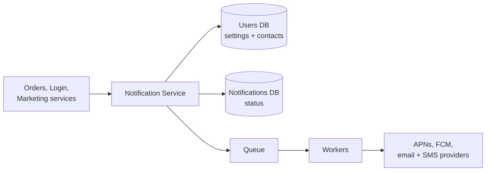
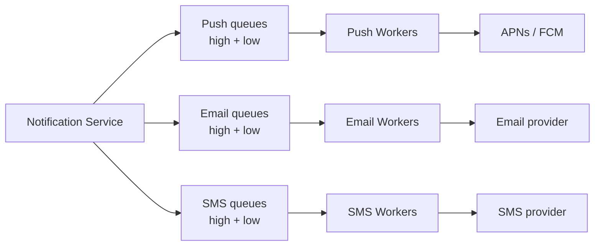
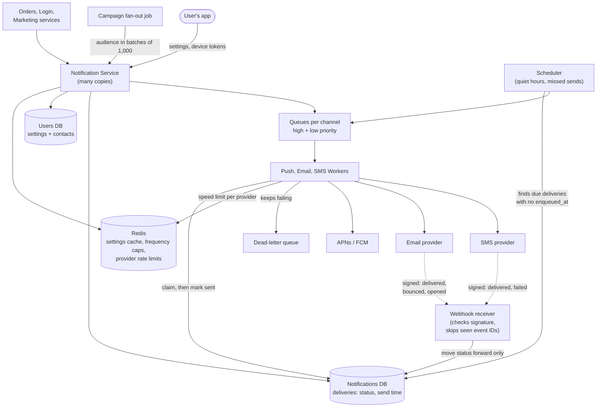

<Callout title="About this question">
  **Difficulty:** Easy. **Patterns used:** [Message Queues](../messaging/message-queues-pub-sub.mdx),
  [Retries and Backoff](../messaging/retries-backoff-timeouts.mdx), [Idempotency](../messaging/idempotency.mdx),
  [Dead-Letter Queues](../messaging/dead-letter-queues.mdx), [Delivery Guarantees](../messaging/delivery-guarantees.mdx).
</Callout>

## Understand the problem

Many teams in a company need to tell users things:

- The Orders team: "Your order has shipped."
- The Login team: "Your code is 482913."
- The Marketing team: "Big sale this weekend!"

Instead of every team building this again, we build one **notification service**. Any team calls it with "send this to user 42". The service decides **how** to reach the user, and makes sure the message gets there.

We don't deliver the messages ourselves. We hand them to **providers**: outside companies that do the last step.

| Channel | Who delivers it |
| --- | --- |
| **Push** to an iPhone | Apple's **APNs** (Apple Push Notification service) |
| **Push** to an Android phone | Google's **FCM** (Firebase Cloud Messaging) |
| **Email** | An email provider, like Amazon SES or SendGrid |
| **SMS** | An SMS provider, like Twilio |

## Step 1: Requirements

### Functional requirements

1. Other services can send a notification to a user by **push, email or SMS**.
2. Users can choose **which** notifications they get, and on which channel.
3. (Optional) A service can send one message to **millions** of users at once, like a marketing campaign.

**Out of scope** (say this out loud): building our own email or SMS delivery, a tool to design email templates, and the in-app inbox (the bell icon inside the app).

### Non-functional requirements

1. **Reliable:** once we accept a notification, it must not get lost. We would rather retry than lose it.
2. **No duplicates:** users hate getting the same SMS twice. Duplicates must be very rare.
3. **Fast for urgent ones:** a login code must arrive within a few seconds. A marketing email can wait a few minutes.
4. **Big:** 100 million notifications per day, with big spikes during marketing campaigns.

### Quick math

- 100 million per day ÷ 86,400 seconds = about **1,200 per second** on average. That alone is not much.
- But one marketing campaign can ask for **10 million** messages at once. And the providers limit how fast **we** can send. So we can't send everything right away. We need a **queue** to hold the work and send it at a safe speed.

## Step 2: Core entities

- **Notification:** who it is for, the type (like `order_shipped`), the text, and the caller's idempotency key.
- **Delivery:** one row per notification **and** channel, with its own status (`queued`, `sending`, `sent`, `delivered`, `bounced`, `failed`), and an `enqueued_at` time: when it was put on the queue (empty until then). `queued` means "waiting to be sent"; `enqueued_at` tells us whether it is really on the queue yet. "Order shipped" by push and by email is one notification with two deliveries. So when the push is `sent`, the email still shows `queued`, and the email worker doesn't skip it.
- **Contact info:** the user's email, phone number, and **device tokens**. A device token is the address of one app on one phone. Apple or Google gives it to the app, and the app sends it to us.
- **Preferences:** what the user wants, like "order updates by push, no marketing emails".
- **Template:** text with blanks, like `Your order {orderId} has shipped.`

## Step 3: API

```http
POST /notifications
Idempotency-Key: order-981-shipped
{
  "userId": "u-42",
  "type": "order_shipped",
  "channels": ["push", "email"],
  "data": { "orderId": "981" }
}

→ 202 Accepted
{ "notificationId": "n-7f3a" }
```

- `202 Accepted` means "we got it, and will deliver it soon". The caller doesn't wait for Apple or Twilio.
- There is no `priority` field. The service sets the priority from the type (login codes are high, marketing is low), so a caller can't push its messages to the front of the line.
- The `Idempotency-Key` is a unique name for this request, chosen by the caller. If the Orders service sends the same request twice (for example after a timeout), we see the same key and don't create a second notification. See [Idempotency](../messaging/idempotency.mdx).

```http
PATCH /users/me/notification-settings
{
  "marketing": { "email": false, "push": true },
  "quietHours": { "from": "22:00", "to": "08:00", "timeZone": "Asia/Kolkata" }
}

→ 200 OK
```

```http
POST /users/me/devices
{ "platform": "ios", "deviceToken": "a1b2c3d4..." }

→ 201 Created
```

## Step 4: High-level design



**Send a notification:**

1. The Orders service calls `POST /notifications` for user 42.
2. The Notification Service checks the user's **settings**. If the user turned off this type, it stops here.
3. It looks up the **contact info**: device tokens, email, phone number.
4. It fills in the **template**: "Your order 981 has shipped."
5. In one transaction, it saves the notification and one **delivery** row per channel in the Notifications DB, each with status `queued` and an empty `enqueued_at`.
6. It puts one message per delivery on the **queue**, sets `enqueued_at` on those rows, and returns `202`.
7. A **worker** takes the message from the queue, **claims** the delivery row, sends it to the right provider, and sets that delivery's status to `sent`.

**What if we crash between step 5 and step 6?** The rows are saved, but nothing is on the queue. This is a **dual write**: two systems, and no way to update both in one step. So a small **scheduler** job (it also handles quiet hours, see deep dive 3) runs every minute. It finds deliveries with `enqueued_at IS NULL` that have been due for over a minute, puts them on the queue, and sets `enqueued_at`. The database is the source of truth, and the queue is filled from it. This is the idea behind the [outbox pattern](../distributed-systems/outbox-pattern.mdx). If we crash after step 6 but before setting `enqueued_at`, a delivery can land on the queue twice. That is fine, because the claim in deep dive 2 lets only one worker send it.

**Change settings:** the app calls `PATCH /users/me/notification-settings`, and we save the settings in the Users DB. `PATCH` changes only the fields sent; `PUT` would replace all the settings.

**Register a phone:** when the app starts, it gets a device token from Apple or Google and sends it with `POST /users/me/devices`.

Why the queue? The caller gets a fast answer. If a provider is slow or down, messages wait safely in the queue instead of being lost. And workers can send at a speed the providers accept.

## Step 5: Deep dives

### 1. How do we keep urgent messages fast?

<Callout title="Not great: one queue for everything" type="error">
  Marketing sends 10 million emails. A login code arrives right after, and waits behind all 10 million. And if the SMS provider is down, failing SMS messages get in the way of everything else.
</Callout>

<Callout title="Okay: one queue per channel" type="warn">
  Push, email and SMS each get their own queue and their own workers. A slow email provider no longer blocks push. **But** a login code still waits behind a marketing blast on the same channel.
</Callout>

<Callout title="Best: one queue per channel and per priority" type="success">
  Each channel gets a **high** and a **low** priority queue. Login codes and security alerts go to high. Marketing goes to low. High-priority queues have their own workers, so they are never stuck behind bulk sends.
</Callout>



More things that keep it smooth:

- **Workers scale with the queue.** If the low-priority email queue grows, add more email workers. When it is empty, remove them.
- **Workers respect the provider's speed limit.** Put a [rate limiter](./rate-limiter.mdx) in front of each provider, so we don't get blocked.
- **Big campaigns go in slowly.** For 10 million users, don't call the API 10 million times. A **fan-out job** reads the audience list in batches of 1,000 users. Each batch goes through the same checks as any notification (settings, frequency caps), then onto the low-priority queue, bit by bit.

### 2. Retries, and never sending twice

Providers fail sometimes: timeouts, `500` errors, or "slow down" answers (`429`). We must retry, but carefully.

<Callout title="Not great: never retry" type="error">
  Simple, and it never sends twice. But every small network glitch loses a message. A user who never gets a login code can't log in.
</Callout>

<Callout title="Okay: retry right away" type="warn">
  We stop losing messages. But if the provider is overloaded, instant retries make it worse. And a **timeout** is tricky: maybe the provider **did** send the SMS, and only its answer got lost. A blind retry then sends it twice.
</Callout>

<Callout title="Best: retry with backoff, and claim before sending" type="success">
  Wait longer after each failure (1 s, 2 s, 4 s, plus a little randomness). After 5 tries, move the message to a **dead-letter queue**: a separate queue for messages that keep failing, where an engineer can look at them later. And before each send, the worker **claims** the delivery row, so only one worker can send it.
</Callout>

Why claim, and not just check? A plain "read the status, and send if it is not `sent`" has a race. If the queue gives the same message to two workers, both read `queued`, and both send. A claim is **one** conditional update. Only one worker can win it:

```sql
-- Claim the delivery. Only one worker can win.
UPDATE deliveries
SET status = 'sending', lease_until = now() + interval '1 minute'
WHERE id = $1
  AND (status = 'queued'
       OR (status = 'sending' AND lease_until < now()))  -- an old claim has run out
RETURNING *;
```

0 rows back means the delivery is already sent, or another worker is sending it right now. The claim has a time limit, called a **lease**. If a worker crashes while sending, the lease runs out, and someone else can claim the row.

Here is the worker, in simple code. `db.move(id, from, to)` is a conditional update like the claim: it changes the status only if the row still has the `from` status, and returns false if not.

**Step 1: Claim and send.**

```js
// The queue message is acknowledged only when handle() finishes.
// If the worker crashes, the queue gives the message to another worker later.
// message.attempt is 1 for the first try.
async function handle(message) {
    // Claim the row (the UPDATE above)
    const delivery = await db.claimDelivery(message.deliveryId);

    // Already sent, or another worker has it: skip
    if (!delivery) {
        return;
    }

    try {
        // APNs, FCM, email or SMS. It sends delivery.id too, so webhooks can find the row.
        await provider.send(delivery);

        // Returns false if a webhook already said "delivered"
        await db.move(delivery.id, "sending", "sent");
    } catch (error) {
        await handleFailure(message, delivery);
    }
}
```

**Step 2: When the send fails.** Give up after 5 tries, or put the message back to try again later.

```js
async function handleFailure(message, delivery) {
    // That was the 5th try: move it to the dead-letter queue
    if (message.attempt >= 5) {
        await db.move(delivery.id, "sending", "failed");
        await deadLetterQueue.put(message);
        return;
    }

    // Free the row for the next try, unless a webhook already moved it on
    const freed = await db.move(delivery.id, "sending", "queued");
    if (!freed) {
        return;
    }

    // Wait 1 s, 2 s, 4 s, 8 s, plus up to 1 s of random jitter
    const backoffMs = 1000 * 2 ** (message.attempt - 1);
    const jitterMs = Math.random() * 1000;
    const waitMs = backoffMs + jitterMs;

    const nextMessage = {
        deliveryId: message.deliveryId,
        attempt: message.attempt + 1,
    };
    await queue.putLater(nextMessage, waitMs);
}
```

Keep the lease (1 minute) shorter than the time the queue waits before it gives an unacknowledged message to another worker (say 5 minutes). Then, after a crash, the new worker finds the old lease already run out, and can claim the row.

There are two places where duplicates can come from, and one fix for each:

| Where | Example | Fix |
| --- | --- | --- |
| The caller sends twice | Orders service retries after a timeout | `Idempotency-Key`, saved with a unique index in the Notifications DB |
| We send twice | The queue gives a message to a worker again | The worker claims the delivery row before sending; only one claim can win |

**Who writes each status?** Three parts of the system change a delivery's status. Every change is a conditional update that names the status it expects, so a late or repeated update can never undo a newer one:

| Status | Who sets it |
| --- | --- |
| `queued` | The Notification Service, when it saves the row. A worker, before a retry. |
| `sending` | A worker, when it claims the row. |
| `sent` | The worker, after the provider accepts the message. |
| `delivered`, `bounced` | The webhook receiver, when the provider reports back. |
| `failed` | The worker after the last try, or the webhook receiver (for example, "SMS failed"). |

**Webhooks from providers.** Email and SMS providers call our **webhook receiver** with news like "delivered" or "bounced". Anyone can call that URL, so the receiver first **checks the signature** (the provider signs each call with a secret only it and we know), and **skips event IDs it has already handled**. Then it moves the status forward only: `delivered` can replace `queued`, `sending` or `sent`, but nothing replaces `delivered`. So a `delivered` that arrives before the worker's `sent` is kept, because the worker's update needs a row that is still `sending`. These are the same rules as in [Design a Payment System](./payment-system.mdx).

<Callout title="Exactly once is not possible here" type="idea">
  If a worker crashes **after** the provider sent the SMS but **before** we saved `sent`, the retry sends it again. We can't see inside the provider, so no design can fully stop this. We make it **rare**, not impossible. Say this in the interview; it shows you understand [delivery guarantees](../messaging/delivery-guarantees.mdx).
</Callout>

### 3. User settings, and not sending too much

Too many notifications make people turn them all off, or delete the app. So the service protects users:

- **Settings check:** every notification checks the user's settings first. Settings are read on every send, so keep them in a **cache** (Redis) in front of the database.
- **Frequency caps:** for example, at most 3 marketing pushes per user per day. This is a counter per user in Redis, just like a [rate limiter](./rate-limiter.mdx).
- **Quiet hours:** don't buzz a phone at 3 a.m. the user's time. Save non-urgent deliveries with a send time, and the **scheduler** job (the same one that catches missed sends) moves them into the queue when that time comes. Login codes ignore quiet hours, because the user asked for them right now.
- **Grouping:** "5 people liked your photo" instead of 5 separate pushes.
- **Unsubscribe:** every marketing email has an unsubscribe link. In many countries this is required by law.
- **Clean up dead devices:** when a user deletes the app, the device token stops working. APNs and FCM don't tell us on their own. Instead, the answer to our **next** push says so: APNs answers `410` with the reason `Unregistered`, and FCM answers with the error `UNREGISTERED`. We delete the token and stop sending to it.

### Final architecture



## In the real world

**Every push to an iPhone goes through Apple's APNs.** There is no other way to send a push notification to an iOS app. On Android, Google's FCM plays the same role. So a notification service is always a **middleman**: it decides what to send and when, and the platform does the last step.

**Providers limit you too.** Amazon SES gives every account a **maximum send rate** (emails per second) and a daily sending limit. This is why workers send at a controlled speed instead of as fast as they can.

**LinkedIn built "Air Traffic Controller"**, a system that decides whether a notification is worth sending at all, and on which channel. Its goal is to avoid flooding members with too many messages.

**Slack shared a flowchart** of its "should we send this notification?" logic. It checks many things in order: is the channel muted, is the user active on another device right now, is "do not disturb" on, and more. It shows how much of this problem is really about deciding **not** to send.

## Follow-up questions

<Accordions>
<Accordion title="How do you send a message to 10 million users?">

A fan-out job reads the audience in batches (say 1,000 users at a time). Each batch goes through the normal settings and caps checks, so users who turned marketing off are skipped, and then onto the **low-priority** queue. Workers send at the speed the providers allow, so the whole campaign may take an hour. That is fine for marketing. You can also send by time zone, so everyone gets it in their morning.

</Accordion>
<Accordion title="How do you know if a notification was delivered or opened?">

Many providers call us back with a **webhook**: a URL on our side that the provider calls when something happens, like "email delivered" or "SMS failed". A small **webhook receiver** service takes these calls. It checks the signature, skips events it has already seen, and only moves a delivery's status forward (deep dive 2). For emails, a tiny invisible image in the email tells us when it was opened. Opens are saved as events, not as a status.

</Accordion>
<Accordion title="A user has a phone and a tablet. Where do you send the push?">

The simple answer: to every device token the user has. A smarter answer: to the device they used most recently, so both don't buzz at once. Say the tradeoff out loud.

</Accordion>
<Accordion title="The SMS provider is down for an hour. What happens?">

Messages wait in the queue, so nothing is lost. A **circuit breaker** stops workers from calling the broken provider again and again (see [Circuit Breaker](../reliability-security/circuit-breaker.mdx)). Better: have a **second SMS provider**, and switch to it when the first one fails. For login codes, you could also fall back to email.

</Accordion>
<Accordion title="How would you add an in-app inbox (the bell icon)?">

Treat it as one more channel. A worker writes the notification into an **Inbox** table for that user. The app reads the inbox when it opens. If the app is already open, the server can push the new item live over a WebSocket (see [Polling, WebSockets and SSE](../foundations/polling-websockets-sse.mdx)).

</Accordion>
</Accordions>

## What the interviewer expects

<Tabs items={['Mid-level', 'Senior', 'Staff']}>
<Tab value="Mid-level">

- The channels, and that we use providers like APNs, FCM and Twilio.
- A queue between the API and the workers, and why.
- Checking user settings before sending.
- Retrying failed sends.

</Tab>
<Tab value="Senior">

- Separate queues per channel and priority, so urgent messages are never stuck.
- Two dedupe checks: idempotency key at the API, and claiming the delivery row in the worker.
- Signed, de-duplicated provider webhooks, and conditional status updates, so a late update can't undo a newer one.
- Status per delivery (notification + channel), not per notification.
- Save first, then queue. A scheduler job catches deliveries that never reached the queue (the dual write).
- Backoff with jitter, and a dead-letter queue.
- Frequency caps, quiet hours, and provider speed limits.

</Tab>
<Tab value="Staff">

- Why exactly-once is impossible, and which way to lean for each type (a login code may be sent twice; a payment alert must not be lost).
- Backup providers and failover.
- Cost: SMS costs money per message, push is almost free, so prefer push when it works.
- Watching delivery rates per provider, with alerts when they drop.

</Tab>
</Tabs>

<Callout title="Remember this" type="success">
  - Callers get **202 Accepted**. The real sending happens later, from a **queue**.
  - **Separate queues per channel and priority**, so login codes never wait behind marketing.
  - **Retry with backoff + jitter**, then send to a **dead-letter queue**.
  - One **delivery** row per notification and channel, each with its own status.
  - Save first, then queue. A **scheduler** puts missed deliveries (empty `enqueued_at`) on the queue (the outbox idea).
  - Every status change is a **conditional update**, so a late update can't undo a newer one. Provider webhooks are
    **signed** and de-duplicated by event ID.
  - **Two dedupe checks:** idempotency key at the API, and a **claim** (one conditional update) in the worker.
  - Exactly-once is impossible. Make duplicates **rare**.
  - Respect users: **settings, frequency caps, quiet hours**.
</Callout>
