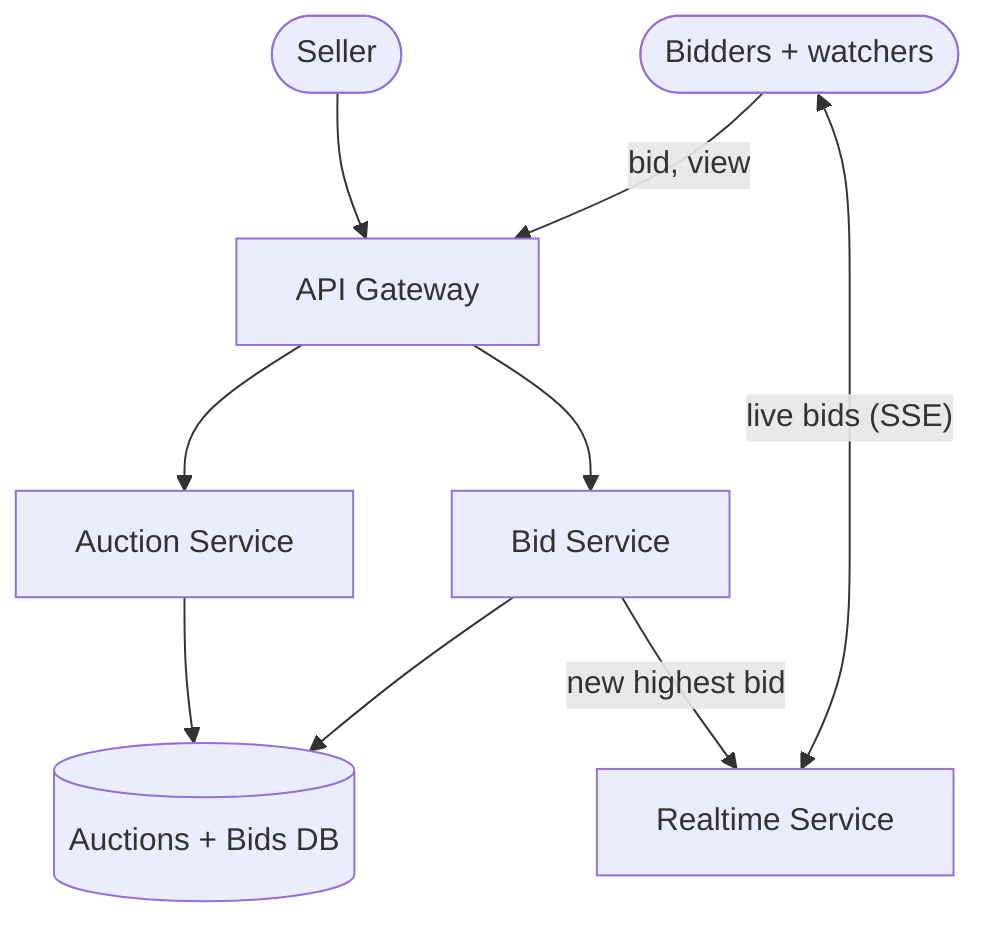
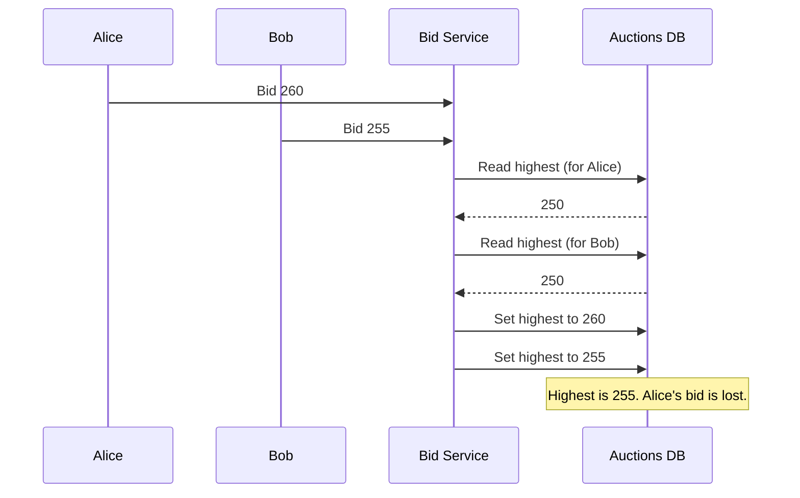
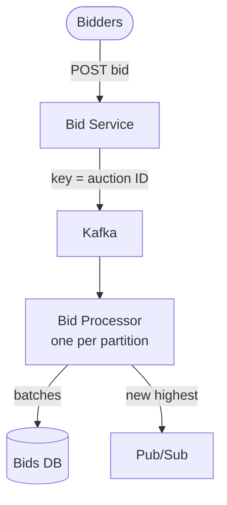
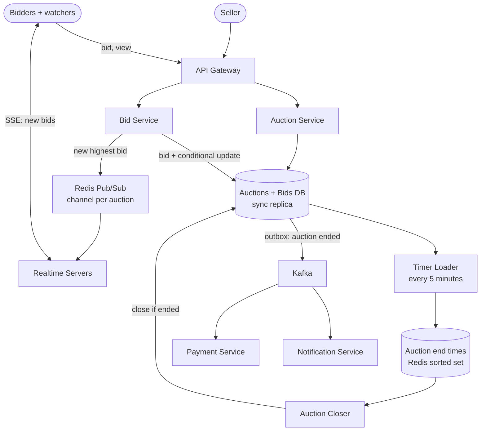

<Callout title="About this question">
  **Difficulty:** Medium. **Patterns used:** [Dealing with Contention](../distributed-systems/dealing-with-contention.mdx),
  [Locks and Deadlocks](../databases/locking.mdx), [Polling, WebSockets and SSE](../foundations/polling-websockets-sse.mdx),
  [Idempotency](../messaging/idempotency.mdx), [Replication](../databases/replication.mdx).
</Callout>

## Understand the problem

An auction site like eBay. A seller lists an item, say a signed guitar, with a starting price and an end time. Buyers place bids. Each new bid must be higher than the current highest one. When time runs out, the highest bidder wins. Everyone looking at the page sees the price go up, live.

Three things make it hard:

- **Many bids at the same moment.** In the last seconds, many people bid on the same item at once. We must never accept a bid that is lower than, or equal to, the current highest one. And we must never lose the real highest bid.
- **Live updates.** Everyone watching should see each new highest bid within a second.
- **Ending on time.** At exactly 18:00:00, bidding stops. A bid that arrives at 18:00:01 is refused, and the winner is chosen right away.

## Step 1: Requirements

### Functional requirements

1. Sellers can create an auction: an item, a starting price and an end time.
2. Users can bid. A bid is accepted only if it is at least the starting price, and **higher** than the current highest bid.
3. Users see the current highest bid, live, while they watch.
4. When the auction ends, the highest bidder wins, and the winner and the seller are told.

**Out of scope** (say this out loud): payment and shipping, searching for items, "Buy It Now", seller ratings, fraud checks. Automatic bidding and anti-sniping are good follow-ups.

### Non-functional requirements

1. **Correct bids:** bids need **strong consistency**. A lower or tied bid never wins. Two bids can never both be "the highest".
2. **Durable:** once a user sees "You are the highest bidder", that bid is **never lost**, even if a server dies a second later.
3. **Fast live updates:** watchers see a new highest bid within about 1 second.
4. **Ends on time:** bidding stops at the end time, to the second.
5. **Scale:** 10 million auctions open at once, and 100 million bids a day.

### Quick math

- **Bids:** 100 million a day ÷ about 100,000 seconds = **1,000 bids per second** on average, maybe 10,000 at peak. Spread over 10 million auctions, that is easy for a database split over a few machines. **Decision:** total volume is not the problem. **One hot auction** is.
- **The hot auction:** a rare item in its last minute gets **100 bids per second**, all on **one row**. A short conditional update holds that row's lock for about a millisecond, so one row can take roughly 1,000 of them per second. **Decision:** a conditional update is enough for almost every auction. A queue per auction is only for extreme cases (deep dive 1).
- **Watchers:** 1 million people have an auction page open at any moment. If each one asks "anything new?" every 2 seconds, that is **500,000 requests per second**, nearly all answered "no". **Decision:** push new bids to watchers.
- **The hot auction's watchers:** 100,000 watchers × 100 bids per second = **10 million messages per second** for one item. **Decision:** only the newest highest bid matters, so send it at most 4 times a second: 400,000 messages per second, spread over many servers.
- **Storage:** 100 million bids × about 100 bytes = **10 GB a day**. Small.

## Step 2: Core entities

- **Auction:** item, seller, starting price, end time, **status** (`open` or `ended`), the **current highest bid** and who made it, and a **version** number that goes up with every new highest bid.
- **Item:** title, description, photos.
- **Bid:** auction, bidder, amount, time. We keep **every** accepted bid, not just the highest.
- **User:** a buyer or a seller.

## Step 3: API

```http
POST /auctions
{ "itemId": "item_5", "startingPriceCents": 10000, "endTime": "2027-03-01T18:00:00Z" }

→ 201 Created
{ "auctionId": "auc_1", "status": "open" }
```

```http
GET /auctions/{auctionId}

→ 200 OK
{ "auctionId": "auc_1", "highestBidCents": 25000, "version": 41, "endTime": "2027-03-01T18:00:00Z", "status": "open" }
```

```http
POST /auctions/{auctionId}/bids
Idempotency-Key: 9d1f6a2e-bid-1
{ "amountCents": 26000 }

→ 201 Created
{ "bidId": "bid_88", "status": "accepted", "highestBidCents": 26000 }

→ 409 Conflict
{ "status": "rejected", "reason": "too_low", "highestBidCents": 27000 }
```

New bids arrive on a **stream** that stays open while the user watches (deep dive 2):

```http
GET /auctions/{auctionId}/stream
Accept: text/event-stream

→ 200 OK
Content-Type: text/event-stream

data: {"highestBidCents":26000,"version":42,"endTime":"2027-03-01T18:00:00Z"}
```

Notes:

- Money is a whole number of cents (`26000` = $260.00), never a decimal number.
- The bid carries the **full amount**, not "+$10". If the user's page is a few seconds old, they still bid exactly what they meant.
- A refused bid gets `409 Conflict` with the current highest bid, so the app can show "Someone bid $270. Bid again?"
- The **Idempotency-Key** is made once per tap on "Bid". If the network drops and the app retries, the server returns the first answer, instead of treating the retry as a new bid (deep dive 1).
- The bidder comes from the **login token**, never from the request body.

## Step 4: High-level design



**Create an auction:**

1. The seller sends `POST /auctions`. The Auction Service saves it as `open`, with its end time.

**Watch an auction:**

1. The app loads the auction with `GET /auctions/auc_1`.
2. It opens the SSE stream. The Realtime Service remembers that this connection watches `auc_1`.

**Place a bid:**

1. The app sends `POST /auctions/auc_1/bids` with an idempotency key.
2. The Bid Service checks and saves the bid in **one atomic step**: only if it is higher than the current highest bid, and the auction is still open (deep dive 1).
3. If accepted, it tells the Realtime Service, which pushes the new highest bid to every watcher (deep dive 2).

**End the auction:**

1. At the end time, the auction is closed, and the highest bidder wins (deep dive 3).

## Step 5: Deep dives

### 1. How do we never accept a lower or tied bid?

The highest bid is $250. Alice bids $260, and Bob bids $255, at the same moment. Both bids are higher than $250. But only Alice's should end up on top.

<Callout title="Not great: read the highest bid, compare in code, then save" type="error">
  Both requests read "$250", both pass the check, and both save. Whichever save lands **last** wins. If it is
  Bob's, the highest bid is now $255, and Alice's higher bid is lost. This is a **race condition** (a "lost
  update").
</Callout>



<Callout title="Okay: lock the auction row while checking" type="warn">
  Start a transaction, lock the row with `SELECT ... FOR UPDATE`, compare, save, commit. Bob's request waits until
  Alice's is done, then reads $260 and is refused. **Correct.** **But** every bid on a hot auction waits in line for
  the lock, and if the server holding the lock is slow (a long pause, a slow network), everyone behind it waits too.
  See [Locks and Deadlocks](../databases/locking.mdx).
</Callout>

<Callout title="Best: one conditional update" type="success">
  Put the rule **inside** the update: "set the highest bid to $260, **only if** the current one is lower and the
  auction is still open". The database runs it on one row at a time. 1 row changed means accepted. 0 rows means too
  low, or too late. No separate read, and the lock lasts only as long as one short update.
</Callout>

```sql
BEGIN;
-- 1. Save the bid. idempotency_key is unique, so a retry inserts 0 rows.
--    The app checks: 0 rows means a retry. Return the saved bid's answer.
INSERT INTO bids (bid_id, auction_id, bidder_id, amount_cents, idempotency_key)
VALUES ('bid_88', 'auc_1', 'u_alice', 26000, '9d1f6a2e-bid-1')
ON CONFLICT (idempotency_key) DO NOTHING;

-- 2. Make it the highest bid, only if it beats the current one
--    and the auction is still open.
UPDATE auctions
SET highest_bid_cents = 26000,
    highest_bidder_id = 'u_alice',
    version = version + 1
WHERE auction_id = 'auc_1'
  AND status = 'open'
  AND end_time > NOW()
  AND starting_price_cents <= 26000
  AND highest_bid_cents < 26000;
-- 1 row changed: accepted. COMMIT.
-- 0 rows: too low, or the auction has ended. ROLLBACK (the bid row goes too).
COMMIT;
```

When Alice ($260) and Bob ($255) race, one update runs first. If Alice's goes first, Bob's finds `highest_bid_cents = 26000`, which is not lower than his 25500, so it changes 0 rows. If Bob's goes first, it is accepted for a moment, and then Alice's beats it. Either way, **$260 ends on top**. A **tie** is refused too, because $260 is not lower than $260. So the first person to bid an amount keeps it.

**Why insert the bid first?** Say Alice's bid worked, but the answer got lost, and her app sends it again. Now the highest bid is her own $260, so the update would change 0 rows, and she would be told "too low". The unique idempotency key stops this. The retry inserts 0 rows, so we look up her saved bid and answer "accepted" again. A double-click at the same moment waits for the first transaction to finish, then does the same. (A refused bid is rolled back, so its retry is simply checked again, and refused again: the highest bid never goes down.)

**Optimistic locking, the general version.** Our rule ("higher than the current highest") fits in one `WHERE`. When the rule is too complex for that, use a **version** number: read the auction (version 41), decide in code, then update with `WHERE version = 41`. If someone changed the auction in between, the version is now 42, the update changes 0 rows, and we read again and retry. On a hot auction many requests may retry over and over, so prefer the single conditional update when the rule fits. Here, a failed update is not a reason to retry: it **is** the answer ("too low").

#### Even hotter: put each auction's bids in a line

Say a celebrity charity auction gets **thousands** of bids per second in its final minute. That is more than one row can take. Then we **serialize** the bids: each auction's bids go into one line and are checked one at a time.



1. The Bid Service stamps each bid with the time it arrived, and writes it to **Kafka**, using the auction ID as the key. All bids for `auc_1` go to the same partition, in order.
2. One **Bid Processor** reads each partition. It keeps the current highest bid of each auction **in memory**, so checking a bid takes microseconds.
3. It writes the results to the database in small batches, and publishes each new highest bid to the watchers.

The tradeoffs:

- **The answer is no longer instant.** `POST` returns `202 Accepted` ("bid received"), and "you are the highest bidder" arrives on the stream a moment later.
- **The end time uses the arrival stamp**, not the time the processor reads the bid. A bid that arrived at 17:59:59 still counts, even if the line was long. And the auction can only be closed after the processor has handled every bid that arrived before the end.
- **Crashes:** if a processor dies, another one takes over its partition. It reloads the highest bids from the database, and skips bids it already handled (each bid has its own ID).
- **More moving parts.** So in the interview, start with the conditional update. It handles hundreds of bids per second on one auction. Bring up the line only if the interviewer pushes the numbers higher. See [Dealing with Contention](../distributed-systems/dealing-with-contention.mdx).

### 2. How do watchers see new bids live?

This is the same problem as [Live Comments](./live-comments.mdx), only smaller: one small number (the highest bid) changes, and many people watch it.

<Callout title="Not great: the page asks every second or two" type="error">
  500,000 requests per second, nearly all answered "no change". And a new bid shows up to 2 seconds late, which
  matters a lot in the final seconds.
</Callout>

<Callout title="Okay: WebSockets" type="warn">
  A two-way connection that stays open. It **works**. **But** we don't need two ways: bids are rare, and a plain
  `POST` sends them well, with easy retries and rate limits. A WebSocket also needs our own reconnect logic.
</Callout>

<Callout title="Best: SSE, plus one Pub/Sub channel per auction" type="success">
  **SSE** is a one-way stream from server to browser, over plain HTTP. Browsers reconnect by themselves. Each
  realtime server subscribes to the channel `auction:auc_1` when its first watcher of that auction connects. The
  Bid Service publishes every new highest bid to that channel. See
  [Polling, WebSockets and SSE](../foundations/polling-websockets-sse.mdx).
</Callout>

Details that make it right:

- **Publish after commit, never before.** Otherwise watchers might see a bid that then gets rolled back.
- **Send the whole state, not a change.** Each event says "the highest bid is $260, version 42, ends at 18:00:00", not "+$10". If an event is lost, the next one fixes the screen. On reconnect, the app just loads the auction again.
- **Never go backwards.** Events can arrive out of order through different servers. The app ignores any event with a **lower version** than the one it shows, so the price on screen never drops from $260 to $255.
- **Hot auctions send less often.** With 100 bids per second, the realtime server sends the newest state at most every 250 ms. Watchers can't see more than that anyway.
- **The bidder's own screen updates at once.** The app shows "You are the highest bidder" from the `POST` answer, without waiting for the stream.

### 3. How do we end the auction exactly on time?

Two separate jobs: **stop accepting bids** at the end time, and **close the auction** (pick the winner, tell people, start payment).

**Stopping bids is already done.** The bid update has `AND end_time > NOW()`. A bid that reaches the database at 18:00:00.2 is refused, even if nothing has closed the auction yet. And `NOW()` is the **database's** clock, one clock for everyone, so two app servers whose clocks are slightly different can't disagree (see [Clocks](../distributed-systems/clocks.mdx)). The time that counts is when the bid **reaches us**, not when the user tapped. So correctness never depends on the closing job being on time.

Closing still needs to happen promptly, so the winner hears "You won!" within a second or two.

<Callout title="Not great: a job every minute that looks for ended auctions" type="error">
  Run `WHERE status = 'open' AND end_time <= NOW()` once a minute. Winners hear up to a minute late. Without a good
  index, the query also reads millions of open auctions each time.
</Callout>

<Callout title="Okay: the same query every second, with an index" type="warn">
  An index on `(status, end_time)` makes "which auctions just ended?" fast. **Works**, and closes on time. **But** the
  database gets a query every second, forever, from every copy of the job.
</Callout>

<Callout title="Best: a timer queue for the next few minutes, the database as backup" type="success">
  Every 5 minutes, load the auctions ending in the **next 5 minutes** into a timer queue, like a **Redis sorted set**
  scored by end time. An **Auction Closer** checks it every second and closes each auction right on time. A slow
  backup job still runs the indexed query every minute, to catch anything the timers missed.
</Callout>

```bash
# auc_1 ends at Unix time 1803924000 (2027-03-01 18:00:00 UTC)
ZADD auction_ends 1803924000 "auc_1"

# Every second: which auctions have reached their end time?
ZRANGEBYSCORE auction_ends 0 1803924000 LIMIT 0 100

# Claim one before closing it (returns 1 only for the first closer)
ZREM auction_ends "auc_1"
```

This is the same timer idea as in [Design a Job Scheduler](./job-scheduler.mdx). An auction created with less than 5 minutes to go goes straight into the sorted set.

**Closing is one conditional update**, so running it twice does no harm:

```sql
-- Close auc_1, only if it is still open and its end time has really passed.
UPDATE auctions SET status = 'ended'
WHERE auction_id = 'auc_1' AND status = 'open' AND end_time <= NOW();
-- 1 row:  we closed it. The winner is highest_bidder_id.
--         In the same transaction, write an outbox row: "auc_1 ended".
-- 0 rows: already closed, or the end time was moved later. Do nothing.
```

The outbox row goes to Kafka ([Outbox Pattern](../distributed-systems/outbox-pattern.mdx)). From there, the Notification Service tells the winner and the seller, and the Payment Service asks the winner to pay. If the Closer crashes after the update, the event is still sent, because it was saved in the same transaction.

### 4. How do we make sure no accepted bid is lost?

Alice sees "You are the highest bidder" at 17:59:58. One second later, the database server dies. Her bid must still be there.

<Callout title="Not great: keep the highest bid only in Redis" type="error">
  A small Lua script in Redis can check and set the highest bid very fast. **But** Redis copies data to its replicas
  **asynchronously**. If the main Redis dies, the last bids it accepted may never have reached the replica. People
  were told "you are winning", and their bids are gone.
</Callout>

<Callout title="Okay: a database, with replicas that copy later" type="warn">
  Bids are saved on disk, so a restart loses nothing. **But** if the main database dies and a replica takes over, the
  last second of writes may not have been copied yet. The last seconds of an auction are exactly when the most
  important bids arrive.
</Callout>

<Callout title="Best: answer 'accepted' only after the bid is safe on two machines" type="success">
  Use **synchronous replication**: the commit waits until at least one replica also has the bid. Then the Bid
  Service answers "accepted". If the main database dies, the replica that takes over has every accepted bid. See
  [Replication](../databases/replication.mdx). With the Kafka design, wait until Kafka has stored the bid on several
  machines (`acks=all`).
</Callout>

A few more rules:

- **Never answer before the commit.** "Accepted" means saved.
- **Bids are append-only.** We never update or delete a bid. The auction's `highest_bid_cents` is only a quick copy of the highest accepted bid. If the two ever disagree, the bids table is the truth, and we can rebuild the auction row from it.
- **Retries are safe.** The idempotency key means a retry after a timeout never creates a second bid, and never gets a false "too low".

### Final architecture



## In the real world

- **eBay** uses **automatic bidding**. You enter the most you are willing to pay, and eBay bids for you, one small step at a time, only as much as needed to keep you on top. The winner pays about one step more than the second-highest bidder's maximum, not their own maximum.
- eBay auctions have a **fixed end time**. So many people bid in the very last seconds, called **sniping**, and there are tools that place a bid for you a few seconds before the end.
- Some auction sites use a **soft close** instead. On Bring a Trailer (an auction site for classic cars), a bid in the final two minutes resets the clock to two minutes, so everyone gets a chance to answer.
- Auctions where the winner pays the second-highest price are called **second-price auctions**. Online ad auctions have long used versions of the same idea.

## Follow-up questions

<Accordions>
<Accordion title="How would you add automatic bidding, like eBay's?">

Each user can store a **maximum** they are willing to pay, kept secret. The auction keeps the leader's maximum. When a new bid comes in, compare it with the leader's maximum. If the leader's maximum is higher, the leader stays on top, and the shown price rises to the new bid plus one step. If the new bid is higher, the new bidder leads, at the old maximum plus one step.

The rule now reads and compares several values, so it no longer fits in one simple `WHERE`. Use **optimistic locking with a version**, or the per-auction line from deep dive 1, where one processor handles one bid at a time.

</Accordion>
<Accordion title="What is sniping, and how would you stop it?">

**Sniping** is bidding in the last second, so nobody has time to answer. Fix it with a **soft close**: any bid in the last 2 minutes pushes the end time to 2 minutes after that bid. It fits in the same conditional update: `SET end_time = GREATEST(end_time, NOW() + INTERVAL '2 minutes')`.

The Bid Service also moves the auction's timer: `ZADD auction_ends <new time> auc_1` replaces the old score. If an old timer still fires, the close update checks `end_time <= NOW()`, changes 0 rows, and nothing happens. The new end time goes out to watchers in the next stream event.

</Accordion>
<Accordion title="The winner never pays. Then what?">

Give the winner a deadline, say 48 hours, with the same kind of timer. If they don't pay, the seller can offer the item to the **second-highest bidder** at their bid. We kept every accepted bid, so we know who that is.

</Accordion>
<Accordion title="My clock said 17:59:59, but my bid was refused. Why?">

The **server's** time decides, not the phone's. Phone clocks can be seconds off. When the page loads, the server sends its current time, and the app uses the difference to show a countdown that matches the server. The app also warns "Ending in 10 seconds", so people don't wait until the final instant.

</Accordion>
<Accordion title="How do you split the database as it grows?">

[Shard](../databases/partitioning-sharding.mdx) by **auction ID**. An auction and all its bids live on the same shard, so placing a bid is still one transaction on one machine. For a user's "My bids" page, copy each bid to a second table keyed by bidder, in the background ([Change Data Capture](../distributed-systems/change-data-capture.mdx)). That page can be a second behind.

</Accordion>
</Accordions>

## What the interviewer expects

<Tabs items={['Mid-level', 'Senior', 'Staff']}>
<Tab value="Mid-level">

- Clear requirements, entities and API, with the bid amount as a full number.
- A simple design with auction and bid services and a database.
- Spot the race between two bids, and fix it with a lock or a conditional update.
- Push new bids to watchers instead of having every page poll.

</Tab>
<Tab value="Senior">

- Compare read-then-write, row locks, conditional updates and version-based optimistic locking, with tradeoffs.
- Refuse ties and late bids in the same `WHERE`, using the database's clock.
- Idempotency key inserted first, so a retry never gets a false "too low".
- SSE plus Pub/Sub per auction, whole-state events with a version, and slowing updates down for hot auctions.
- A timer queue to close auctions on time, with a conditional close.

</Tab>
<Tab value="Staff">

- Everything from senior, but faster.
- Know when one row is not enough, and serialize bids per auction through Kafka, with arrival-time stamps.
- Durability: synchronous replication, or `acks=all`, before saying "accepted". Why Redis alone is risky.
- Soft close against sniping, and how it fits the timers and the close update.

</Tab>
</Tabs>

<Callout title="Remember this" type="success">
  - **Never accept a lower or tied bid:** one conditional update,
    `WHERE status = 'open' AND end_time > NOW() AND highest_bid_cents < new_bid`. 0 rows = too low or too late.
  - Read, compare in code, then save = **lost update**. Put the rule inside the `WHERE`.
  - Insert the bid with a unique **Idempotency-Key** first, so a retry never gets "too low" for its own bid.
  - Version-based **optimistic locking** for complex rules. A **line per auction** (Kafka keyed by auction ID) only
    for extreme auctions.
  - **Live bids:** SSE plus one Pub/Sub channel per auction. Send the whole state with a **version**. Publish after
    commit.
  - **Bidding stops** because of `end_time > NOW()` on the database's clock. **Closing** uses a timer queue and a
    conditional close, with a backup sweep.
  - **Durable:** say "accepted" only after the bid is on two machines. Bids are append-only.
  - Sniping → **soft close**: a late bid pushes the end time out.
</Callout>
