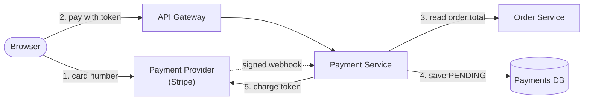
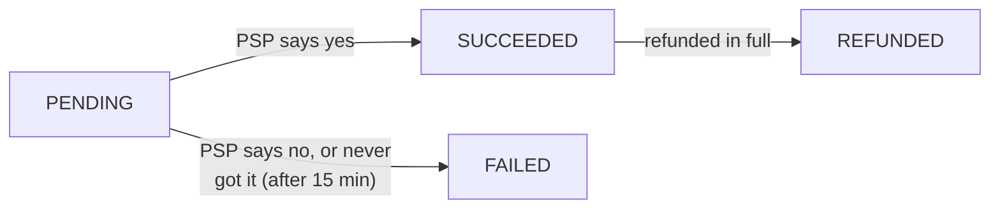
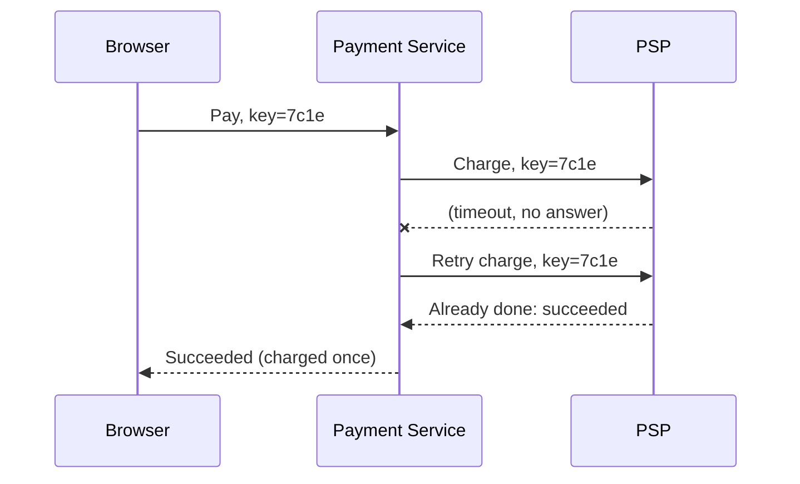
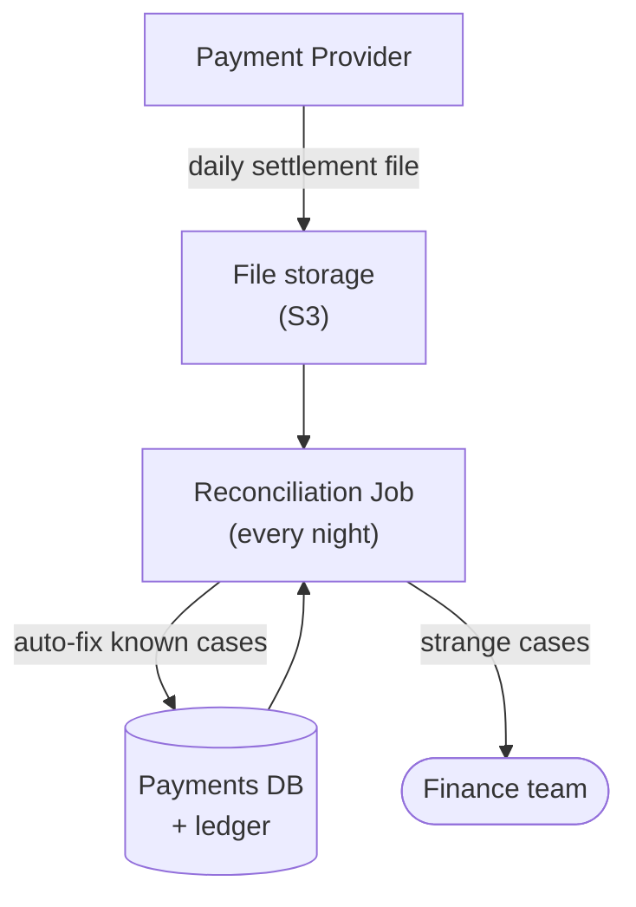
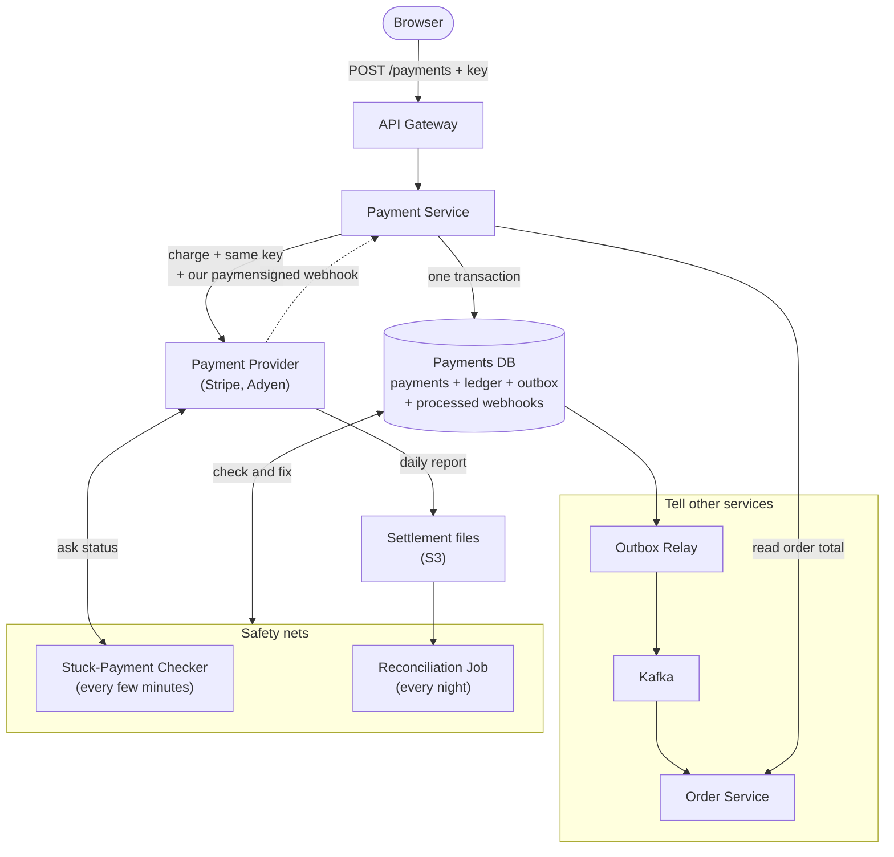

<Callout title="About this question">
  **Difficulty:** Hard. Small traffic, but every mistake costs real money. **Patterns used:**
  [Idempotency](../messaging/idempotency.mdx), [Transactions and ACID](../databases/transactions-acid.mdx),
  [Retries, Backoff and Timeouts](../messaging/retries-backoff-timeouts.mdx),
  [Outbox Pattern](../distributed-systems/outbox-pattern.mdx).
</Callout>

## Understand the problem

We are building the payment part of an online store, like the "Pay" button on Amazon. When a buyer clicks "Pay", we take money from their card and record it.

We do **not** talk to banks or to Visa directly. We use a **payment service provider (PSP)**, like Stripe, Adyen or PayPal. A PSP is a company that talks to the card networks and banks for us. We send it "charge this card $25", and it tells us "done" or "declined".

So our job is not moving money ourselves. Our job is to **keep perfect records**: never charge a buyer twice, never lose a payment, and always be able to explain every cent.

## Step 1: Requirements

### Functional requirements

1. Buyers can pay for an order with a card.
2. Buyers and the store can see the status of a payment: pending, succeeded or failed.
3. (Optional) The store can refund a payment.

**Out of scope** (say this out loud): storing card numbers ourselves, paying money out to sellers, currency exchange, subscriptions, fraud checks.

### Non-functional requirements

1. **Correct:** never charge twice, never lose a payment. Here we pick **consistency over availability**. It is better to say "please try again" than to charge a buyer twice.
2. **Safe:** card numbers never touch our servers. Card companies have strict rules, called **PCI DSS**, for anyone who handles card numbers. If we never see them, most of those rules don't apply to us.
3. **Auditable:** every money movement is recorded forever. An accountant must be able to trace every cent.
4. **Scale:** about 1 million payments per day.
5. **Speed:** a payment can take a few seconds. Buyers accept that. Correctness matters much more than speed.

### Quick math

- 1 million payments per day ÷ about 100,000 seconds in a day = about **10 payments per second**. Even at 10 times that at busy times, one good SQL database handles it easily.
- **Decision:** scale is not the hard part here. We use a normal **SQL database with transactions**, because correctness is everything. No sharding, no fancy NoSQL.

## Step 2: Core entities

- **Payment:** one attempt to take money for an order. Amount, currency, status, idempotency key, the PSP's payment ID.
- **Ledger entry:** one line in our money book. "This account went up or down by this amount."
- **Account:** a "bucket" in the ledger, like "buyer", "store" or "PSP fees".
- **Refund:** money given back for a payment.

## Step 3: API

```http
POST /payments
Idempotency-Key: 7c1e2a9f-4b3d-4e8a-9a51-2f6d0c8b1e44
{
  "orderId": "ord_123",
  "cardToken": "tok_abc"
}

→ 201 Created
{ "paymentId": "pay_789", "amount": 2500, "currency": "USD", "status": "PENDING" }
```

```http
GET /payments/pay_789
→ 200 OK
{ "paymentId": "pay_789", "status": "SUCCEEDED" }

POST /payments/pay_789/refunds
Idempotency-Key: 0d9b6c1a-8f2e-4c7d-b3a4-5e6f7a8b9c0d
{ "amount": 2500 }
```

Four small details that matter:

- **The browser never sends the amount.** It sends only the `orderId`. The server reads the price from the order. If the browser sent `"amount": 2500`, a buyer could change it to `1` and get the book for one cent.
- **Money is a whole number of cents.** `2500` means $25.00. Never use decimal numbers (floats) for money. In most languages `0.1 + 0.2` gives `0.30000000000000004`.
- **`cardToken`, not a card number.** The buyer types the card number into the PSP's own form. The PSP gives back a **token**: a random stand-in for the card that is useless to a thief. We only ever see the token.
- **`Idempotency-Key`** is a unique ID the client makes for each payment attempt. It is the key to "never charge twice". See deep dive 1.

The PSP also calls **us**. This is a **webhook**: a URL on our side that the PSP calls when something changes, like "the bank finally approved payment `pay_789`".

```http
POST /webhooks/psp
PSP-Signature: v1=5f2b9c...
{
  "eventId": "evt_901",
  "type": "payment.succeeded",
  "pspPaymentId": "pi_456",
  "metadata": { "paymentId": "pay_789" },
  "amount": 2500
}
```

Anyone on the internet can call this URL. So we never trust a webhook just because it arrived:

- **Check the signature.** The PSP signs each webhook with a secret that only it and we know. We compute the signature again on our side. If it doesn't match, we reject the call. Without this check, anyone could send "payment succeeded" and get a free order.
- **De-duplicate by event ID.** The PSP may send the same webhook more than once. We save each `eventId` in a `processed_webhooks` table with a **unique** rule. If the insert fails, we have seen this event already, so we answer `200 OK` and do nothing. This insert goes in the **same transaction** as the status update and the ledger lines. If it were saved on its own and we crashed right after, the event would be marked "seen" but never applied, and the PSP's resend would be skipped.
- **Find the payment by our own ID.** When we charge, we send our `paymentId` to the PSP as **metadata** (extra fields the PSP stores and sends back). The webhook carries it back. We can't match by `pspPaymentId` alone: after a timeout we never got the PSP's ID, so it is still empty in our database.

## Step 4: High-level design



**Pay for an order:**

1. The browser shows the PSP's card form. The card number goes **straight to the PSP**. The browser gets back a token.
2. The browser sends `POST /payments` with the token, the order ID and an idempotency key. No amount.
3. The Payment Service reads the order's total and currency from the Order Service. The server decides the price, never the browser.
4. The Payment Service saves a payment row with status `PENDING` **before** calling the PSP. If our server crashes in the middle, this row tells us "a payment was in progress".
5. The Payment Service asks the PSP to charge the token, and sends our `paymentId` as metadata.
6. The PSP answers "succeeded" or "declined". We update the status and write ledger entries.
7. We return the result to the browser.

**Check the status:** read the payment row by its ID.

**Slow answers:** sometimes the bank needs the buyer to approve the payment in their banking app. Then the PSP says "pending" now and calls our **webhook** later. When the webhook arrives, we check its signature, skip it if we have seen its event ID, find the payment by our `paymentId`, and update it. The event ID and the update are saved in one transaction.

The status of a payment only moves forward:



## Step 5: Deep dives

### 1. How do we never charge twice?

Double charges happen in three common ways:

- The buyer **double-clicks** the "Pay" button.
- The buyer's network drops, and the app **retries** the request.
- **The worst one:** we call the PSP, and the call **times out**. Did the charge happen or not? We don't know. If we retry, we might charge twice. If we don't, we might lose a sale.

<Callout title="Not great: disable the Pay button after one click" type="error">
  This stops double-clicks. **But** it does nothing about network retries or timeouts between our server and the
  PSP. Good to have, not enough.
</Callout>

<Callout title="Okay: check for an existing payment first" type="warn">
  Before charging, look up "is there already a payment for this order?". **Problem:** two requests can check at
  the exact same moment. Both see "no payment", and both charge. This is a **race condition**.
</Callout>

<Callout title="Best: an idempotency key, end to end" type="success">
  The client makes one unique key per payment attempt and sends it with every retry. Our database has a
  **unique** rule on that key, so only the first request can create a payment. We also pass our own key to the
  PSP, so retrying a timed-out charge is safe too.
</Callout>

**Idempotent** means "doing it twice has the same result as doing it once" (see [Idempotency](../messaging/idempotency.mdx)). Here is how the key protects each step:

```sql
CREATE TABLE payments (
  id               TEXT PRIMARY KEY,
  idempotency_key  TEXT NOT NULL UNIQUE,  -- a second insert with the same key fails
  order_id         TEXT NOT NULL,
  amount_cents     BIGINT NOT NULL,
  refunded_cents   BIGINT NOT NULL DEFAULT 0,  -- refunds so far (deep dive 2)
  currency         TEXT NOT NULL,
  status           TEXT NOT NULL,         -- PENDING, SUCCEEDED, FAILED, REFUNDED
  psp_payment_id   TEXT                   -- empty until the PSP answers (still empty after a timeout)
);

-- At most one live payment per order. A FAILED payment doesn't count, so the buyer can try again.
CREATE UNIQUE INDEX one_live_payment_per_order
  ON payments (order_id) WHERE status IN ('PENDING', 'SUCCEEDED');
```

1. A request arrives with key `7c1e...`. We read the order's amount on the server and try to insert a `PENDING` row with that key.
2. If the insert fails because the key already exists, this is a retry. If the saved payment is final (`SUCCEEDED` or `FAILED`), we **return the saved result** instead of charging again.
3. When we call the PSP, we send the same key. Stripe, for example, accepts an `Idempotency-Key` header. If the PSP already charged with that key, it returns the first result instead of charging again.
4. If the saved payment is still `PENDING`, maybe we crashed after saving it but before calling the PSP. So a retry **calls the PSP again with the same key**. That is safe: the PSP charges at most once per key. So a retry always ends with the first result, never a second charge.

**Two tabs, two keys.** The idempotency key stops retries of the *same* attempt. But a buyer can open the order in two browser tabs and press "Pay" in both. Each tab makes its own key, so the key alone lets both through. The **partial unique index** above closes this gap: it allows only one `PENDING` or `SUCCEEDED` payment per order. The second tab's insert fails, and we tell it "this order is already being paid".



### 2. How do we record money? The double-entry ledger

A **ledger** is the company's money book. The simple idea is a `balance` column that we update. That is dangerous: if a bug changes a balance, the old value is gone, and nobody can explain what happened.

Instead, we use **double-entry bookkeeping**, the way banks and accountants have worked for hundreds of years. The rule is simple: **money never appears or disappears. It only moves.** Every payment is written as at least two lines, and the lines always add up to zero.

Example: a buyer pays $25.00 for a book. The PSP keeps a $1.00 fee.

| Account | Change |
| --- | --- |
| Buyer | −25.00 |
| Store | +24.00 |
| PSP fees | +1.00 |
| **Total** | **0.00** |

If the total of all lines is ever not zero, we know right away that there is a bug.

Three rules make the ledger trustworthy:

- **Append-only.** We never update or delete a ledger line. To fix a mistake or give a refund, we add **new** lines that move the money back. The full history is always there.
- **One transaction.** The status change and the ledger lines are saved in **one database transaction**. Either all of it is saved, or none of it (see [Transactions and ACID](../databases/transactions-acid.mdx)).
- **Balances are sums.** The balance of an account is the sum of its lines. We can cache it, but the lines are the truth.

```sql
CREATE TABLE ledger_entries (
  id            BIGSERIAL PRIMARY KEY,
  payment_id    TEXT NOT NULL,
  source_id     TEXT NOT NULL,   -- what caused the lines: 'pay_789' (the charge) or 're_42' (a refund)
  account       TEXT NOT NULL,   -- 'buyer', 'store', 'psp_fees'
  amount_cents  BIGINT NOT NULL,
  UNIQUE (source_id, account)    -- the same charge or refund can never be written twice
);

BEGIN;
UPDATE payments SET status = 'SUCCEEDED'
  WHERE id = 'pay_789' AND status = 'PENDING';  -- only move forward once
-- The app checks how many rows changed.
-- 0 rows: someone already did this (a repeated webhook, or the checker got there first).
--         ROLLBACK and stop. No ledger lines.
-- 1 row:  we won. Write the ledger lines.

INSERT INTO ledger_entries (payment_id, source_id, account, amount_cents) VALUES
  ('pay_789', 'pay_789', 'buyer',    -2500),
  ('pay_789', 'pay_789', 'store',     2400),
  ('pay_789', 'pay_789', 'psp_fees',   100);
COMMIT;
```

Why both checks? The same "succeeded" news can reach us four ways: the PSP's answer, the webhook, the stuck-payment checker, and the nightly reconciliation (deep dive 3). Only the one whose `UPDATE` changes 1 row writes ledger lines. The unique rule on `(source_id, account)` is a second lock on the door: even if a bug skips the row check, the database refuses duplicate lines.

**Refunds.** A refund adds **new** lines with its own `source_id` (the refund's ID). Nothing old is touched. Careful with the fee: the PSP may keep its fee on a refund (Stripe does). Then the fee line is not reversed. The store pays it:

| Account | Change |
| --- | --- |
| Buyer | +25.00 |
| Store | −25.00 |
| **Total** | **0.00** |

The store got $24.00 and gave back $25.00, so the refund cost it the $1.00 fee. The ledger shows this clearly, and the lines still add up to zero.

**Partial refunds.** A refund carries an `amount`, so the store can give back part of a payment. It must never give back more than was paid, even when two refunds run at the same moment. So each refund first takes its share with one conditional update:

```sql
-- Refund $10.00 of pay_789: only if that much is still left to refund.
UPDATE payments SET refunded_cents = refunded_cents + 1000
WHERE id = 'pay_789' AND status = 'SUCCEEDED'
  AND refunded_cents + 1000 <= amount_cents;
-- 0 rows changed: more than what is left (or not paid). Refuse the refund.
```

In the same transaction we save the refund as `PENDING`. Then it goes through the same steps as a payment: call the PSP with the refund's own key, and let the checker fix stuck ones. If the PSP refuses it, we take the 1000 back off `refunded_cents`. When `refunded_cents` reaches `amount_cents`, the payment becomes `REFUNDED`.

**Telling other services.** When a payment succeeds, the Order Service must ship the book. We could save to the database and then send a Kafka message, but the server might crash between the two. So we use the [Outbox Pattern](../distributed-systems/outbox-pattern.mdx): in the same transaction, we also write the event to an `outbox` table. A small relay process reads that table and sends the events to Kafka.

### 3. How do we know our records match the PSP? Reconciliation

Even with all of this, our records and the PSP's records can disagree:

- A webhook got lost.
- Our server crashed after the PSP charged the card, but before we saved "succeeded".
- A bug, or a manual change on the PSP's dashboard.

**Reconciliation** means comparing our list of payments with the PSP's list, line by line, and fixing every difference. We do it at two speeds.

**Fast: the stuck-payment checker.** Every few minutes, a job finds payments that have been `PENDING` for too long. It asks the PSP "what happened to this payment?", looking it up by our `paymentId` (the PSP's ID may be missing after a timeout). Then it updates the status with the same "only if still `PENDING`" update as above. This fixes most timeouts within minutes.

What if the PSP has **no record** of the payment? Then our server crashed after saving `PENDING`, before the charge reached the PSP. If the payment is old enough (say 15 minutes), the checker marks it `FAILED`, with the same "only if still `PENDING`" update. Now the order is free again: the partial unique index ignores `FAILED` payments, so the buyer can press "Pay" once more. If a late charge does reach the PSP after all, the nightly reconciliation catches it (the table below).

This is the usual fix for "a crash between two steps": either save both steps in one transaction (the [Outbox Pattern](../distributed-systems/outbox-pattern.mdx)), or run a **sweeper** that finds rows stuck in the middle and finishes them. A PSP call can't join our transaction, so here the checker is the sweeper.

**Slow but complete: the daily report.** Each day the PSP gives us a **settlement report**: a file with every charge, refund and fee it processed. A nightly job compares it with our database.



| What we find | What it means | What we do |
| --- | --- | --- |
| PSP says paid, we say `PENDING` | We missed the answer | Mark it `SUCCEEDED`, add ledger lines |
| PSP says paid, we say `FAILED` | We gave up too early, and a late charge got through | Refund that charge, or alert a human |
| We say paid, PSP has no record | Something is badly wrong | Alert a human right away |
| Amounts are different | Fees or a bug | Send to the finance team to check |

Reconciliation is the **safety net under everything else**. Idempotency stops most problems. Reconciliation catches the rest.

### Final architecture



## In the real world

**Card numbers go straight to the PSP.** Stripe's ready-made payment forms (Stripe Elements and Checkout) send the card number from the browser directly to Stripe. The store's server only gets an ID for the card. This keeps most PCI rules away from the store.

**Stripe supports idempotency keys.** Any `POST` request to Stripe's API can carry an `Idempotency-Key` header. If you retry with the same key, Stripe returns the first result instead of doing the work again.

**Stripe signs its webhooks.** Each webhook carries a `Stripe-Signature` header that the receiver must check. Stripe's docs also warn that the same event can arrive more than once, and suggest saving the IDs of events you have already handled.

**Airbnb wrote about this exact problem.** In a 2019 engineering blog post, "Avoiding Double Payments in a Distributed Payments System", Airbnb described the idempotency library they built for their payment services.

**Double-entry bookkeeping is very old.** Italian merchants used it hundreds of years ago, and every bank and accounting system still uses it today.

## Follow-up questions

<Accordions>
<Accordion title="What if the PSP is down?">

Retry with **backoff** (wait longer between each try) and a **circuit breaker** (stop calling for a while after many failures). Big companies often connect **two PSPs**, for example Stripe and Adyen, and send payments to the second one if the first is down.

Be careful about **which** payments may switch. A payment where we know for sure the first PSP did **not** charge (for example, the connection was refused, so the request never arrived) can go to the second PSP. A payment whose first call **timed out** must not: the first PSP may have charged the card, and charging at the second PSP would take the money twice. That payment stays `PENDING` with the first PSP until the stuck-payment checker gets a final answer from it.

</Accordion>
<Accordion title="Why not use a distributed transaction (2PC) with the PSP?">

We can't. The PSP is another company, and it will not join our database transaction. So we use a different plan: save `PENDING` first, call the PSP with an idempotency key, then save the result. If anything breaks in between, the stuck-payment checker and reconciliation fix it. This is the same idea as the [Saga Pattern](../distributed-systems/saga-pattern.mdx).

</Accordion>
<Accordion title="How does a refund work?">

A refund is its own request with its own idempotency key. We check its amount against what is left to refund (a conditional update on `refunded_cents`), call the PSP's refund API, then add **new** ledger lines that move the money back. We never edit or delete the original payment lines. If the PSP keeps its fee, the fee line stays, and the store's account pays it.

</Accordion>
<Accordion title="How do we pay sellers in a marketplace?">

The ledger already knows how much each seller is owed: it is the sum of their account's lines. A daily payout job sends bank transfers through the PSP. It uses the same ideas: an idempotency key per payout, ledger lines for every transfer, and reconciliation with the bank.

</Accordion>
</Accordions>

## What the interviewer expects

<Tabs items={['Mid-level', 'Senior', 'Staff']}>
<Tab value="Mid-level">

- A clear flow: card number to the PSP, token to us, charge, save the result.
- The server reads the amount from the order. The browser never sends it.
- Know that a retry can charge twice, and fix it with an idempotency key.
- Use a SQL database with transactions, and whole cents for money.

</Tab>
<Tab value="Senior">

- Handle the timeout case: "we don't know if it charged", and why saving `PENDING` first matters.
- Explain the double-entry ledger and why it is append-only. Ledger lines are written only by the update that moved the status.
- Webhooks for slow answers: signed, de-duplicated by event ID, matched by our `paymentId`. The outbox pattern to tell other services.
- One live payment per order, even with two tabs open.
- Reconciliation as the safety net.

</Tab>
<Tab value="Staff">

- Everything from senior, but faster.
- Two PSPs and how to switch between them safely (never switch a payment whose first answer is unknown).
- Payouts to sellers, refunds and disputes in the same ledger.
- How finance and auditors use the ledger, and how to prove nothing was lost.

</Tab>
</Tabs>

<Callout title="Remember this" type="success">
  - **Correctness over speed.** About 10 payments per second, so one SQL database is fine.
  - **Never touch card numbers.** The PSP gives us a **token**.
  - **The server sets the amount** from the order. The browser sends only the order ID.
  - **Save PENDING first**, then call the PSP. A timeout means "we don't know yet".
  - **Idempotency key end to end:** unique in our database, and passed to the PSP. A retry of a `PENDING` payment calls the PSP again with the same key. If the PSP never got it, the checker marks it `FAILED` after a set time.
  - **Webhooks are signed and de-duplicated** by event ID, saved in the same transaction as the status update.
  - **Double-entry ledger:** every movement is lines that add up to zero. Append-only. Written only when the status update changed 1 row.
  - **Reconciliation** with the PSP every day catches whatever slipped through.
</Callout>
