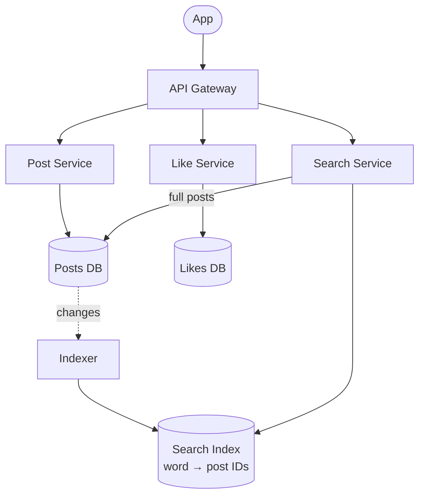
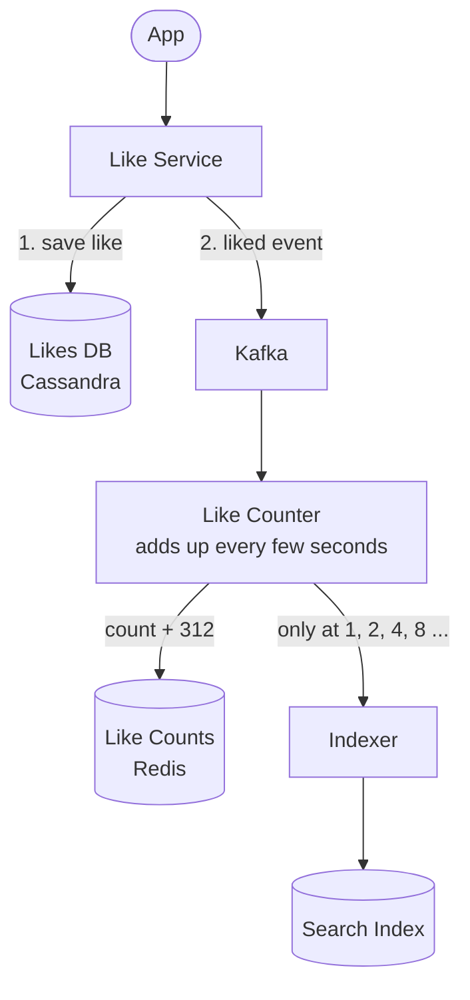
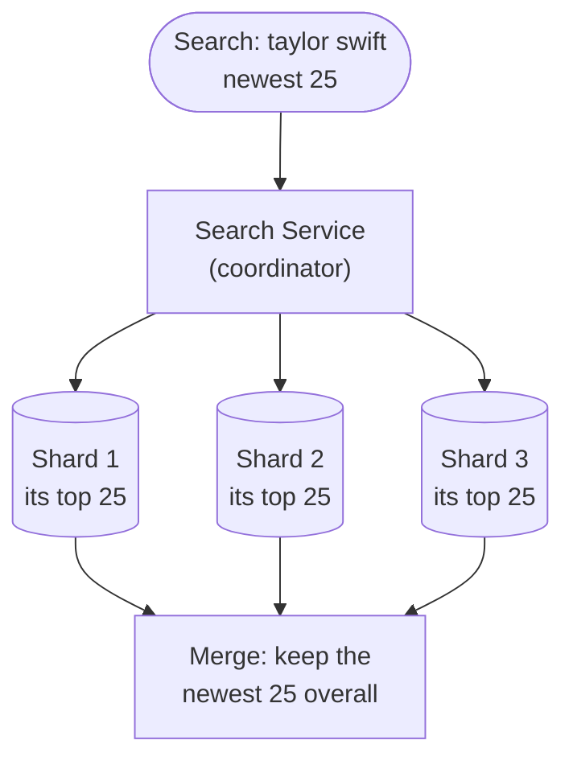
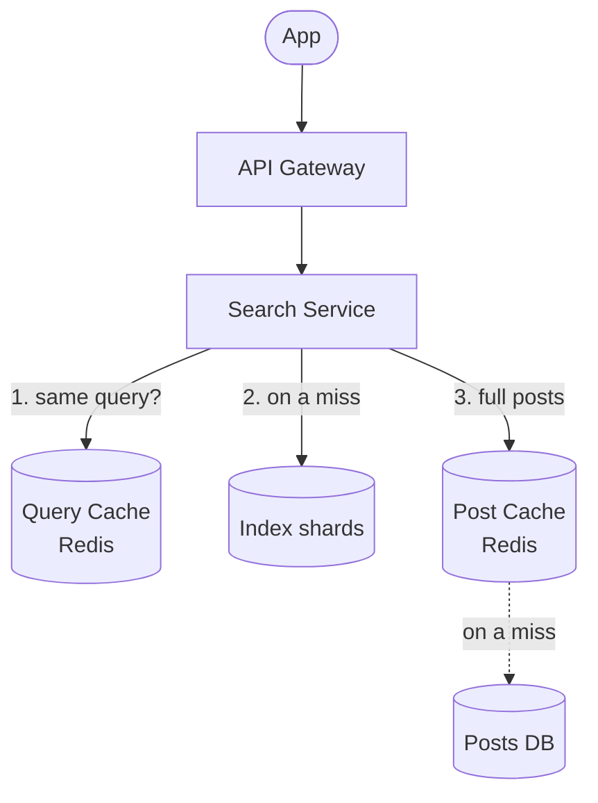
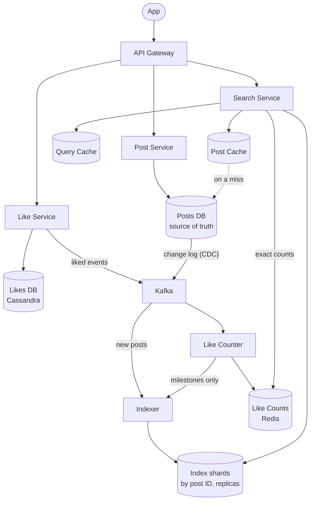

<Callout title="About this question">
  **Difficulty:** Medium. **Patterns used:** [Search and Inverted Indexes](../advanced-components/search.mdx),
  [Elasticsearch](../advanced-components/elasticsearch.mdx), [Change Data Capture](../distributed-systems/change-data-capture.mdx),
  [Scaling Writes](../hld-basics/scaling-writes.mdx), [Sharding](../databases/partitioning-sharding.mdx),
  [Cache Problems](../caching/cache-problems.mdx).
</Callout>

## Understand the problem

You type "taylor swift tickets" into the search box on Facebook. You see posts that contain those words, either **newest first** or **most liked first**. You scroll down for more.

Three things make it interesting:

- **Billions of posts.** `WHERE text LIKE '%swift%'` reads every row. We need an **inverted index**: a list from each word to the posts that contain it.
- **The index never stops changing.** Thousands of new posts arrive every second, and each one must be searchable within a minute.
- **Likes change even faster.** "Most liked first" depends on like counts, and likes arrive about 10 times faster than posts. If every like updated the index, the index would drown.

**Can I just say "Elasticsearch"?** Many interviewers ask you to build the index yourself, to see that you know how search works inside. So this page shows how the index works, and how to keep it fresh. If the interviewer lets you use Elasticsearch, it builds the index for you, but the like counts, sharding and caching deep dives still apply.

## Step 1: Requirements

### Functional requirements

1. Users can **create posts** and **like posts**. (These are the writes the index must follow.)
2. Users can **search posts by keywords**. A post matches when it contains **every** word of the query.
3. Results are sorted by **recency** (newest first) or by **likes** (most liked first), and paged with a cursor.

**Out of scope** (say this out loud): privacy (friends-only posts), typo fixing, personalized ranking, searching photos and videos, search suggestions while typing (see [Search Autocomplete](./search-autocomplete.mdx)).

### Non-functional requirements

1. **Fast search:** results in under 500 ms.
2. **Fresh:** a new post can be found within **1 minute**. Like counts in the results may be a little behind.
3. **Available over consistent:** a search that misses a post from 10 seconds ago is fine.
4. **Big:** 1 billion daily users, and every post ever written is searchable.

### Quick math

- **New posts:** 1 billion users × 1 post a day = 1 billion a day = about **12,000 per second**.
- **Likes:** 1 billion users × 10 likes a day = 10 billion a day = about **115,000 per second**, more at peak.
- **Searches:** 1 billion users × 1 search a day = about **12,000 per second**.
- So there are about **10 writes for every search**. Most systems are read-heavy. This one is **write-heavy**. **Decision:** the write path matters most, and we must never update the index on every like (deep dive 2).
- **Index size:** 1 billion posts a day × 365 days × 10 years = about **3.6 trillion posts**. Even at only 100 bytes of index per post, that is about **360 TB**. **Decision:** the index must be split across many machines (deep dive 3).

## Step 2: Core entities

- **Post:** post ID, author, text, created time. The post ID is a **Snowflake-style ID**, so IDs are sorted by time (see [Distributed ID Generation](../distributed-systems/distributed-id-generation.mdx)).
- **Like:** a user and a post. **One like per user per post.**
- **Like count:** how many likes a post has. Stored **apart from the index** (deep dive 2).
- **User:** the person posting, liking or searching.

The **search index** is not an entity the user sees. It is a copy of the posts, built for fast searching.

## Step 3: API

```http
POST /posts
{ "text": "Taylor Swift tickets sold out!" }

→ 201 Created
{ "postId": "p_103" }
```

```http
POST /posts/{postId}/like

→ 200 OK
```

Liking the same post twice changes nothing: one like per user per post. `DELETE /posts/{postId}/like` takes the like back. As always, the user ID comes from the **login token**, never from the request body.

```http
GET /search?q=taylor+swift&sort=recent&cursor=...

→ 200 OK
{
  "posts": [
    { "postId": "p_103", "author": "Ana", "text": "Taylor Swift tickets sold out!", "likes": 1290 }
  ],
  "nextCursor": "..."
}
```

`sort` is `recent` or `likes`. Results are paged with a **cursor**, not page numbers (see [API Pagination](../advanced-components/api-pagination-versioning.mdx)).

## Step 4: High-level design



**Create a post:**

1. The Post Service saves the post in the Posts DB.
2. A few seconds later, the change reaches the **Indexer**. It splits the text into words, and adds the post ID to each word's list (deep dive 1).

**Like a post:**

1. The Like Service saves the like, and the post's like count goes up (deep dive 2).

**Search:**

1. The Search Service splits the query into words, and asks the index for posts that have **all** of them, newest or most liked first.
2. The index returns post IDs only. The Search Service fetches the full posts for one page of results.

The **Posts DB** is the source of truth. The search index is a copy that can always be rebuilt from it.

## Step 5: Deep dives

### 1. How do we build the index, and keep it up to date with new posts?

An **inverted index** flips the normal direction. A post has a list of words. The index keeps, for each **word**, the list of **posts** that contain it (see [Search and Inverted Indexes](../advanced-components/search.mdx)).

| Post | Text |
| --- | --- |
| 101 | "Taylor Swift concert tonight!" |
| 102 | "Learning Swift for iOS" |
| 103 | "Taylor Swift tickets sold out" |

| Word | Posts |
| --- | --- |
| taylor | 101, 103 |
| swift | 101, 102, 103 |
| concert | 101 |
| tickets | 103 |

"taylor swift" means: posts in **both** lists = 101 and 103. Here is the idea in code, in three small steps.

**Step 1: Split text into words.** Lowercase it, and split on anything that is not a letter or a digit.

```js
// Turn text into a set of unique, lowercase words
function getWords(text) {
    const lowerText = text.toLowerCase();
    const parts = lowerText.split(/[^a-z0-9]+/);
    const words = new Set();

    for (const part of parts) {
        if (part !== "") {
            words.add(part);
        }
    }

    return words;
}
```

**Step 2: Add each post to the list of every word it has.** Posts arrive in time order, so each list stays oldest first.

```js
// The index: word -> list of post IDs, oldest first
const index = new Map();

function addPost(postId, text) {
    for (const word of getWords(text)) {
        if (!index.has(word)) {
            index.set(word, new Set());
        }

        index.get(word).add(postId);
    }
}

addPost(101, "Taylor Swift concert tonight!");
addPost(102, "Learning Swift for iOS");
addPost(103, "Taylor Swift tickets sold out");

console.log(index.get("swift")); // Set(3) { 101, 102, 103 }
```

**Step 3: Search, newest first.** Walk one word's list from the end, and keep posts that have every other word too.

```js
// Find posts that have every word in the query, newest first
function searchNewest(query, limit) {
    const words = Array.from(getWords(query));
    const firstWordPosts = index.get(words[0]);
    const results = [];

    if (firstWordPosts === undefined) {
        return results;
    }

    // Walk the first word's posts from the newest to the oldest
    const postIds = Array.from(firstWordPosts).reverse();

    for (const postId of postIds) {
        if (hasEveryWord(postId, words)) {
            results.push(postId);
        }

        // Stop as soon as we have one page of results
        if (results.length === limit) {
            break;
        }
    }

    return results;
}
```

The helper checks one post against every word's list.

```js
function hasEveryWord(postId, words) {
    for (const word of words) {
        const posts = index.get(word);

        if (posts === undefined || !posts.has(postId)) {
            return false;
        }
    }

    return true;
}

console.log(searchNewest("taylor swift", 10)); // [ 103, 101 ]
console.log(searchNewest("swift", 2)); // [ 103, 102 ]
```

How it works:

- **Adding a post is cheap.** A new post is always the newest, so it goes at the **end** of each list. No sorting.
- **Newest first is cheap too.** Post IDs are sorted by time, so we read each list from the end and **stop after one page**. We never touch old posts.
- A real index starts from the word with the **shortest** list ("tickets" before "swift"), so it checks fewer posts.
- **Most liked first** needs a **second list per word**, sorted by like count, for example a Redis sorted set with the like count as the score. Keeping it up to date is deep dive 2.

**Keeping the index in sync with new posts:**

<Callout title="Not great: search the Posts DB directly" type="error">
  `SELECT * FROM posts WHERE text LIKE '%swift%'` can't use a normal index, so it reads every row. With
  trillions of posts, one search would take hours.
</Callout>

<Callout title="Okay: the Post Service writes to the DB, then to the index" type="warn">
  Simple, and the post is searchable at once. **But** if the server crashes between the two writes, the post is
  saved but never searchable. And if the index is slow or down, creating a post gets slow or fails too, just
  because of search.
</Callout>

<Callout title="Best: Change Data Capture into Kafka, then an Indexer" type="success">
  The Post Service only writes to the Posts DB. A CDC tool like **Debezium** reads every change from the
  database's log, and sends it to **Kafka**. **Indexer** workers read Kafka and update the index. Creating a post
  never waits for search, and no change is ever skipped.
</Callout>


- **Many indexers at once.** Kafka splits the posts into partitions by post ID, and each indexer worker reads its own partitions. 12,000 posts per second is easy for a group of workers.
- **Retries are safe.** If a worker crashes and reads the same post again, adding post 103 to the "swift" list a second time changes nothing. The list is a **set**. So the work is **idempotent** (see [Idempotency](../messaging/idempotency.mdx)).
- **Edits.** A CDC event carries the row **before** and **after** the change. The indexer removes the post from words it no longer has, and adds it to the new ones.
- **Deletes.** The indexer removes the post from every word's list. As a safety net, the Search Service also skips any post that no longer exists when it fetches the full posts.
- **Fresh enough.** A new post is searchable a few seconds after it is saved. Our goal was 1 minute. See [Change Data Capture](../distributed-systems/change-data-capture.mdx).

With **Elasticsearch**, the indexer just sends each post to it. Elasticsearch builds the inverted index itself, and a new post is searchable after the next **refresh**, about 1 second later (see [Elasticsearch](../advanced-components/elasticsearch.mdx)).

### 2. Likes arrive 10 times faster than posts. How do we sort by likes?

Here is the trap. About 115,000 likes arrive per second. A post with 20 different words is in **20** "most liked" lists. If every like moved the post in all 20 lists, that is 20 × 115,000 = **2.3 million index writes per second**. And a viral post gets thousands of likes per second on **one** counter, a **hot row** (see [Hot Keys](../advanced-components/hot-keys-fan-out.mdx)).

<Callout title="Not great: update the index on every like" type="error">
  Every like rewrites the post's place in every word's list. That is millions of index writes per second, mostly
  for posts nobody is searching for. In Elasticsearch it is even worse: an update is a delete plus a whole new
  document.
</Callout>

<Callout title="Okay: keep counts out of the index, and sort at search time" type="warn">
  Store like counts in their own store, and leave them out of the index. At search time, find every matching post,
  look up each count, and sort. Writes are now cheap. **But** "swift" matches millions of posts. We can't fetch
  millions of counts for every search.
</Callout>

<Callout title="Best: exact counts on the side, approximate counts in the index" type="success">
  Keep the **exact** count in a separate store, updated in **batches**. Update the post's place in the index
  only when its count passes a **milestone**: 1, 2, 4, 8, 16 and so on (powers of 2). At search time, take the top
  1,000 posts from the index, fetch their exact counts, sort those again, and return the top 25.
</Callout>



**Step 1: Save the like, and count in batches.**

- The **Likes DB** is the record of who liked what. 115,000 writes per second is a lot for one SQL database, so we use a write-friendly database like Cassandra, split by user ID (see [Cassandra and DynamoDB](../databases/cassandra-dynamodb.mdx)). The key `(user_id, post_id)` gives one like per user per post. If the like already exists, nothing changes and no event is sent.
- The Like Service then sends a "liked" event to Kafka. The **Like Counter** adds up the events for a few seconds, then writes each post's total **once**: `count + 312` instead of 312 separate updates. The hot row is gone. This is the same idea as view counts in [Design YouTube](./youtube.mdx) (see also [Scaling Writes](../hld-basics/scaling-writes.mdx)).
- The **Like Counts** store (Redis here) can always be rebuilt by counting the Likes DB, so it is a copy, not the truth.

**Step 2: Move the post in the index only at milestones.** After each batch, the Like Counter checks whether the count passed a power of 2:

```js
// Has the like count passed a power of 2 (1, 2, 4, 8, 16, ...)?
function crossedMilestone(oldCount, newCount) {
    let milestone = 1;

    // Find the first power of 2 above the old count
    while (milestone <= oldCount) {
        milestone = milestone * 2;
    }

    return newCount >= milestone;
}

console.log(crossedMilestone(1000, 1010)); // false
console.log(crossedMilestone(1020, 1030)); // true
```

The second call passed 1,024, so the post moves up in the "most liked" lists, with a score of 1,024. A post that reaches **1 million likes** moves in the index only about **20 times** (2 to the power of 20 is 1,048,576). Most posts get a few likes, and touch the index a handful of times in their whole life.

**Step 3: At search time, sort the top candidates again with exact counts.**

1. The index returns the top **1,000** posts for "taylor swift" by their milestone score.
2. The Search Service fetches the exact counts of those 1,000 posts from Redis in **one** batch (`MGET`).
3. It sorts the 1,000 by exact count, and returns the top 25.

Why does this work? A post's milestone score is never more than **2 times off** from its real count. So a post that truly belongs in the top 25 almost always shows up somewhere in the top 1,000, and the exact sort puts it in the right place. The page shows the exact count from Redis, often rounded, like "1.2K".

### 3. The index is too big for one machine. How do we split it?

360 TB does not fit on one machine, so we split the index into **shards** (see [Sharding](../databases/partitioning-sharding.mdx)). There are two ways to split an inverted index:

| | Split by word | Split by post |
| --- | --- | --- |
| **A shard holds** | Every post for some words ("swift" lives on shard 7) | A full, small index for some posts |
| **A new post writes to** | About 20 shards, one per word | **1** shard |
| **A search asks** | 1 shard per word | **Every** shard |
| **"taylor swift"** | Send two huge lists over the network to compare them | Each shard compares its own lists locally |
| **Hot spots** | A trending word overloads its one shard | Load is spread evenly |

<Callout title="Okay: split by word" type="warn">
  A one-word search asks just one shard. **But** when "super bowl" trends, the shards that hold "super" and "bowl"
  get all the traffic while the rest sit idle. Common words have giant lists, and a multi-word search must move
  them across the network to compare them.
</Callout>

<Callout title="Best: split by post ID, and ask every shard (scatter-gather)" type="success">
  Each post goes to exactly one shard, chosen by its post ID. Each shard has a complete small index for its own
  posts. A search goes to **all** shards at once, each one returns its own top 25, and the Search Service merges
  them. This is what Elasticsearch does.
</Callout>



Asking every shard has costs, so we add three things:

- **Replicas.** Each shard has several copies. Any copy can answer a search, so more copies = more searches per second. If one copy is slow, the coordinator asks another copy of the same shard. The **slowest shard decides the speed** of the whole search.
- **Split by time too.** Most "newest first" searches only need recent posts. Keep a small **recent tier** (say, the last week) in memory, and older posts on cheaper disks. A "newest first" search asks the recent tier first, and goes to the older tiers only if it found fewer than 25 posts. Most searches never touch old data.
- **Cursors.** For "newest first", the cursor is the ID of the last post shown. Each shard returns its next posts **older** than that ID. No shard has to skip thousands of results.

### 4. How do we make popular searches fast?

Searches are not spread evenly. When big news breaks, millions of people search the **same words** in the same minutes. Each search fans out to every shard, so repeating the same work a million times is a waste.



- **Cache the first page of each popular query.** Use a clean key: lowercase, with the words sorted, so "Taylor Swift" and "swift taylor" share one entry: `search:recent:swift taylor`. Almost nobody goes past the first page or two, so cache only those.
- **Short TTLs.** New posts arrive all the time, so "newest first" results are cached for about **30 seconds**. "Most liked" changes slowly, so a few minutes is fine. See [Caching Strategies](../caching/caching-strategies.mdx).
- **Cache post IDs, not full posts.** The full posts come from a separate **Post Cache**, by ID. When a post is edited or deleted, we fix it in one place, not in every cached search.
- **Watch out for a stampede.** When a hot query's entry expires, thousands of requests miss at the same moment, and all of them hit every shard. Let **one** request rebuild the entry while the others wait for it, or keep serving the old entry for a few seconds while it refreshes. See [Cache Problems](../caching/cache-problems.mdx).
- **Why one cache entry works for everyone:** we left privacy out, so every user gets the same results for the same query. With friends-only posts, results differ per user (see the follow-up below).

### Final architecture



## In the real world

- **Facebook** built its own search system, **Unicorn**, and described it in a 2013 paper ("Unicorn: A System for Searching the Social Graph"). It keeps its inverted indexes **in memory**. It powered **Graph Search**, which Facebook launched in 2013.
- Facebook's **TAO** (described in a 2013 paper) stores the social graph: users, posts, and the links between them, such as likes. It can return **how many** links a list has, like the likes on a post, without counting them one by one.
- **Twitter** described its real-time search engine, **Earlybird**, in a 2012 paper. It is built on **Lucene** (the library inside Elasticsearch), keeps its index in memory, and makes a new tweet searchable within seconds.
- **Elasticsearch** places each document in a shard by its ID, so it splits by document, not by word. Updating one field rewrites the whole document. That is why numbers that change all the time, like like counts, are often kept outside the search index.

## Follow-up questions

<Accordions>
<Accordion title="How would you handle privacy, like friends-only posts?">

Store each post's audience in the index: `public` or `friends`. Public posts need no extra check. For friends-only posts, a match counts only if the author is a friend of the searcher. The Search Service loads the searcher's friend list once (a few hundred IDs) and passes it to the shards as a filter. Cache only the public part of results, because the friends part is different for every user.

</Accordion>
<Accordion title="How do you search for an exact phrase, like 'taylor swift' in that order?">

Store each word's **position** in the post along with the post ID: "taylor" at position 0, "swift" at position 1. A post matches the phrase only if "swift" comes right after "taylor". Elasticsearch does this with a `match_phrase` query. Another option is to also index common two-word pairs, like "taylor swift", as if they were one word.

</Accordion>
<Accordion title="We changed how words are split, or found a bug in the indexer. How do you rebuild the index?">

Build a **new** index next to the old one. A batch job reads every post from the Posts DB and indexes it, while the Indexer sends new changes to **both** indexes. When the new one has caught up, switch searches over to it, and delete the old one. In Elasticsearch, an **alias** makes the switch one step (see [Elasticsearch](../advanced-components/elasticsearch.mdx)). This only works because the Posts DB is the source of truth.

</Accordion>
<Accordion title="How do you handle word forms like 'running' and 'runs'?">

Run the same **analyzer** on posts and on queries. It lowercases the text, splits it into words, and cuts each word down to its root (**stemming**), so "running" and "runs" both become "run". Typos need fuzzy matching, which finds words that are one or two letters different. See [Search and Inverted Indexes](../advanced-components/search.mdx).

</Accordion>
<Accordion title="A post goes viral and gets 50,000 likes a minute. Does anything break?">

No. The Like Counter adds the likes up in batches, so the counter takes a few writes per minute, not 50,000. The post moves in the index only when it passes 32,768, 65,536 and so on. And the millions of people searching for it hit the **query cache**, not the shards.

</Accordion>
</Accordions>

## What the interviewer expects

<Tabs items={['Mid-level', 'Senior', 'Staff']}>
<Tab value="Mid-level">

- Clear requirements, entities and API, with cursor paging.
- Explain an inverted index: word → list of post IDs, and "posts in both lists" for two words.
- Keep the index separate from the main database, and update it in the background.
- Notice that likes are a big write stream.

</Tab>
<Tab value="Senior">

- Keep the index in sync with **CDC and Kafka**, not dual writes, and handle edits and deletes.
- Store like counts **outside** the index, count in batches, and avoid the hot row.
- Compare splitting by word and by post, and explain scatter-gather.
- Cache popular queries with short TTLs, and protect against a stampede.

</Tab>
<Tab value="Staff">

- Everything from senior, but faster.
- Milestone (power of 2) updates to the index, plus an exact re-sort of the top candidates at search time.
- Time tiers: a small recent index in memory, older posts on disk, and "newest first" that stops early.
- How to rebuild the whole index safely, and how privacy changes caching.

</Tab>
</Tabs>

<Callout title="Remember this" type="success">
  - **Write-heavy:** about 10 writes (posts and likes) for every search. Protect the write path.
  - **Inverted index:** word → list of post IDs. Time-sorted IDs make "newest first" an append and an early stop.
  - **Keep it in sync with CDC → Kafka → Indexer**, never with dual writes. Retries are safe because adding an ID
    to a set is idempotent.
  - **Never update the index on every like.** Exact counts live on the side, counted in batches. The index moves
    only at milestones (1, 2, 4, 8 ...), and search re-sorts the top 1,000 with exact counts.
  - **Split by post ID**, and ask every shard (scatter-gather). Splitting by word makes hot shards.
  - Add **replicas** for more searches, and a small **recent tier** so most searches skip old data.
  - **Cache popular queries** for about 30 seconds, keyed by sorted lowercase words, and guard against a stampede.
</Callout>
