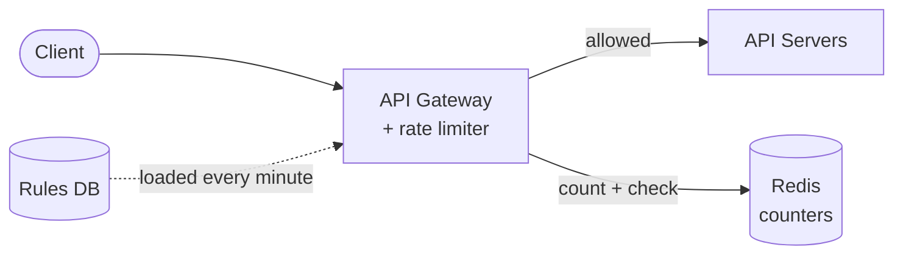
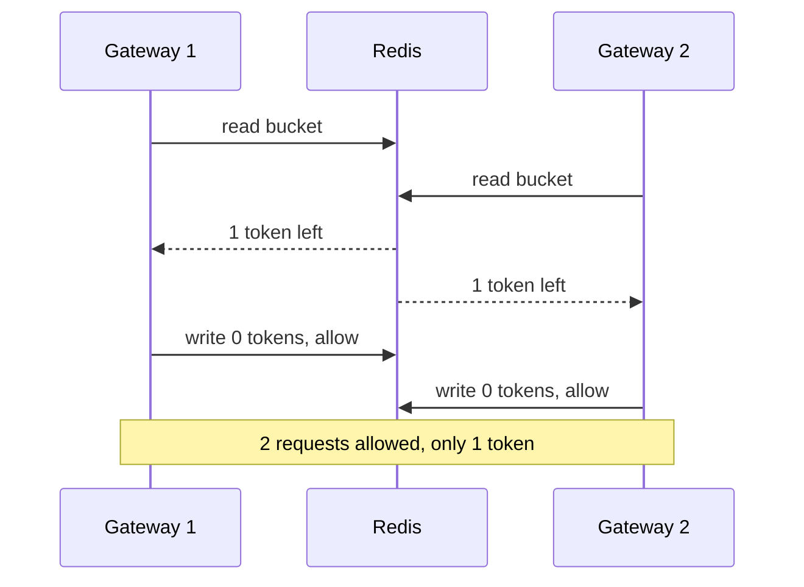
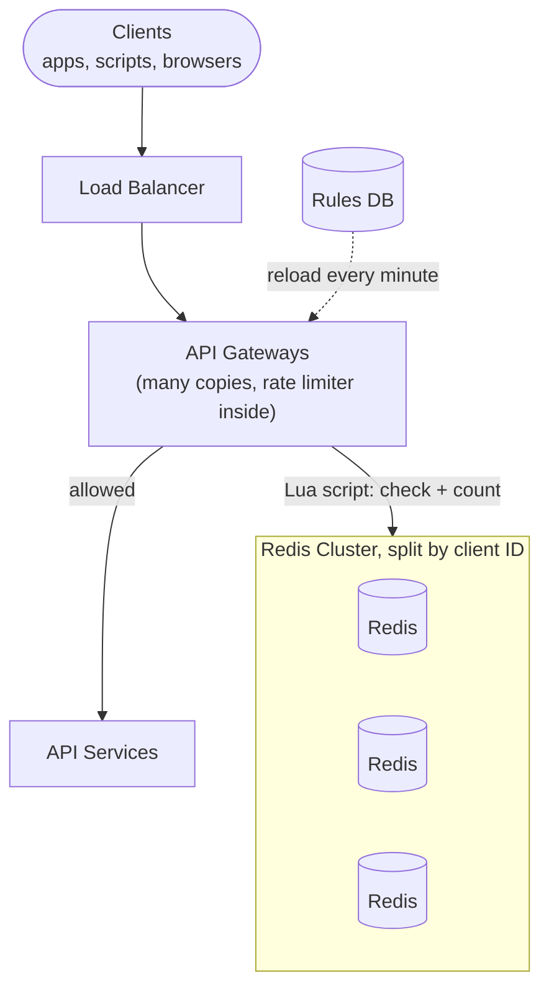

<Callout title="About this question">
  **Difficulty:** Easy. Short to explain, but full of good tradeoffs. **Patterns used:**
  [Rate Limiting](../reliability-security/rate-limiting.mdx), [Redis](../caching/redis.mdx),
  [API Gateway](../hld-basics/api-gateway.mdx), [Retries and Backoff](../messaging/retries-backoff-timeouts.mdx).
</Callout>

## Understand the problem

A **rate limiter** counts how many requests each user sends, and blocks the extra ones.

Example rule: **"Each user can make 100 requests per minute."** Request number 101 in the same minute gets an error instead of an answer. When the next minute starts, the user can send requests again.

Why do we need it?

- **Stop abuse:** a bot that sends 10,000 requests per second can slow the site down for everyone.
- **Be fair:** one very busy customer should not use up the servers that everyone shares.
- **Save money:** some requests cost us money, like sending an SMS or calling a paid outside API.

## Step 1: Requirements

### Functional requirements

1. Find out **who** sent each request: a user ID, an API key, or an IP address.
2. **Limit** each client with rules like "100 requests per minute".
3. A blocked request gets a clear error (`429 Too Many Requests`) that says when to try again.
4. (Optional) Different rules for different endpoints and plans. For example, free users get 100 requests per minute and paid users get 1,000.

**Out of scope** (say this out loud): a screen to edit rules, billing, and stopping **DDoS attacks**. A DDoS (distributed denial of service) attack is when thousands of machines flood a site at once. That is usually stopped earlier, by the CDN or the cloud provider's network.

### Non-functional requirements

1. **Fast:** the check runs on **every** request, so it must add less than 10 ms.
2. **Correct enough:** the limit must hold across many servers. Letting a few extra requests through is okay.
3. **Always up:** if the rate limiter breaks, the API must keep working.
4. **Big:** 100 million users, and up to 1 million requests per second at busy times.

### Quick math

- **Memory:** 100 million users × about 100 bytes per counter = about **10 GB**. That fits in memory, so **Redis** is a good fit.
- **Speed:** 1 million checks per second. One Redis server handles roughly 100,000 simple commands per second. So we need about **10 Redis servers**, and must split the counters between them.

## Step 2: Core entities

- **Client:** who sends the request. Found by user ID, API key or IP address.
- **Rule:** the limit. For example: "free plan, `/search`, 100 requests per 60 seconds".
- **Counter:** how many requests one client has made lately. This is the data we must store and update on every request.

## Step 3: API

A rate limiter is not a feature that users call. It is a **check** that sits in front of the real API. So there are two things to show.

**What the client sees when it is blocked:**

```http
GET /search?q=pizza

→ 429 Too Many Requests
Retry-After: 30
X-RateLimit-Limit: 100
X-RateLimit-Remaining: 0
X-RateLimit-Reset: 1795089600
```

- `429` is the standard HTTP code for "you sent too many requests".
- `Retry-After` tells the client how many seconds to wait.
- The `X-RateLimit-*` headers are a common habit, not an official standard. They show the limit, how many requests are left, and when the counter resets (as a Unix time: seconds since 1 January 1970).

Send the `X-RateLimit-*` headers on **successful** answers too. Then well-behaved clients can slow down before they hit the limit.

**The internal check** (only needed if the rate limiter is its own service):

```http
POST /check
{ "clientId": "user-42", "endpoint": "/search" }

→ 200 OK
{ "allowed": true, "remaining": 57, "retryAfterSeconds": 0 }
```

## Step 4: High-level design

### Where does the rate limiter sit?

- **In the client (the app or browser):** no. Anyone can change the app and skip the check.
- **Inside each API service:** possible, but every team must build the same code again.
- **In the API gateway:** the best default. An **API gateway** is the front door that every request passes through first. It already checks logins, so the limit check fits there naturally. One place, and every service behind it is protected.



**Every request:**

1. The request reaches the API gateway.
2. The gateway finds the client ID: the API key, the user ID from the login token, or else the IP address.
3. It finds the matching rule. Rules are kept in the gateway's memory, so this is instant.
4. It asks Redis: "add 1 to this client's counter, and tell me the new value".
5. If the value is within the limit, the request goes on to the API servers.
6. If not, the gateway returns `429` right away. The API servers never see the request.

**Changing a rule:**

1. An admin saves the new rule in the Rules DB.
2. Every gateway reloads the rules once a minute. Rules change rarely, so a minute of delay is fine.

## Step 5: Deep dives

### 1. Which algorithm should we use?

Every algorithm answers one question: "has this client sent too many requests **lately**?" They differ in what "lately" means.

<Callout title="Not great: sliding window log" type="error">
  Save the time of **every** request in a list. To check, drop the times older than 60 seconds and count what is left. It is exact. **But** a limit of 1,000 per minute means storing up to 1,000 timestamps per user, instead of one number. Memory and work grow with the limit.
</Callout>

<Callout title="Okay: fixed window counter" type="warn">
  Split time into fixed minutes: 12:00, 12:01, 12:02. Keep one counter per client per minute, and start again at 0 each minute. Simple and tiny. **But** bursts can sneak through at the edge: 100 requests at 12:00:59 and 100 more at 12:01:00 is 200 requests in 2 seconds.
</Callout>

<Callout title="Best: token bucket" type="success">
  Each client has a **bucket** that holds up to 100 **tokens**. Tokens drip back in at a fixed speed. For "100 requests per minute", that is 100 tokens per 60 seconds, about 1.7 per second. Each request takes one token. No token left means blocked. It **allows short bursts** (up to the bucket size) but keeps the average rate. It needs only **two numbers** per client: tokens left, and the last refill time.
</Callout>

Example with small numbers, to keep the math easy: bucket size 10, refill 1 token per second.

- The user sends 10 requests at once. All 10 are allowed, and the bucket is now empty.
- An 11th request right after is blocked.
- 3 seconds later the bucket has 3 tokens again, so 3 more requests are allowed.

```js
// One bucket per client: { tokens, lastRefill }
function allowRequest(bucket, capacity, refillPerSecond, now) {
  const secondsPassed = (now - bucket.lastRefill) / 1000;
  bucket.tokens = Math.min(capacity, bucket.tokens + secondsPassed * refillPerSecond);
  bucket.lastRefill = now;

  if (bucket.tokens >= 1) {
    bucket.tokens -= 1;
    return true; // allowed
  }
  return false; // blocked: send 429
}
```

Two more you should know by name:

- **Sliding window counter:** keep the counts for this minute and the last minute, and blend them. Say the limit is 100 per minute, and it is 12:01:15 (25% into the minute). Last minute had 80 requests, this minute has 30 so far. Estimate = 30 + 80 × 75% = **90**. Under 100, so allow. Two numbers per client, and no edge bursts.
- **Leaky bucket:** requests wait in a line and leave at a fixed speed. Traffic comes out perfectly smooth, but users may have to wait.

| Algorithm | Memory per client | Edge bursts? | Good for |
| --- | --- | --- | --- |
| Fixed window | 1 number | Yes | The simplest start |
| Sliding window log | 1 timestamp per request | No | Small limits that must be exact |
| Sliding window counter | 2 numbers | Almost none | Most APIs |
| Token bucket | 2 numbers | No, only planned bursts | Most APIs, a common default |

### 2. Where do we keep the counters?

<Callout title="Not great: in each server's memory" type="error">
  Very fast. But we run 10 gateway servers behind a load balancer, and each one counts on its own. A user whose requests are spread over all 10 gets **10 times** the limit. A restart also wipes all the counts.
</Callout>

<Callout title="Okay: in a normal database" type="warn">
  All servers share one count, so it is correct. But a disk write on every request is too slow, and 1 million writes per second would crush the database.
</Callout>

<Callout title="Best: in Redis" type="success">
  Redis keeps data in memory, so a check takes about a millisecond. Every gateway shares the same counters. Keys can **expire** on their own, so old counters clean themselves up.
</Callout>

A fixed window counter in Redis is just two commands, sent together:

```bash
# key = client + current minute
MULTI                                       # start a group of commands
INCR rate:{user-42}:2026-11-19T12:05        # adds 1 and returns the new count, e.g. 57
EXPIRE rate:{user-42}:2026-11-19T12:05 60   # delete the key after 60 seconds
EXEC                                        # run both together, as one step
```

Why `MULTI` and `EXEC`? If the gateway sent `INCR` alone and then crashed before `EXPIRE`, the key would never expire. With `MULTI` and `EXEC`, Redis runs both commands together, or neither. (A Lua script works too.) The curly braces in the key are explained in deep dive 3.

**Watch out for race conditions.** A **race condition** is a bug where two things happen at the same time and get in each other's way. The token bucket must read the bucket, do some math, then write it back. If two gateways do this at the same moment, both can use the same last token:



The fix: run the whole "read, math, write" as one **Lua script** inside Redis. Redis runs one command or script at a time, so nothing can sneak in between. (`INCR` on its own is already safe, for the same reason.)

### 3. How do we handle 1 million checks per second?

- **Split counters across Redis servers.** With **Redis Cluster**, each key lives on one of many servers, picked by a hash of the **whole** key name. So `rate:user-42:search` and `rate:user-42:upload` can land on different servers. A Lua script that touches both (say, a limit per endpoint plus an overall limit) then fails with a `CROSSSLOT` error. The fix is a **hash tag**: write the key as `rate:{user-42}:search`. Redis hashes only the part inside the curly braces, so all counters for `user-42` sit on the same server, and each check is still **one** call. See [Partitioning and Sharding](../databases/partitioning-sharding.mdx).
- **Keep Redis close.** Put Redis in the same data center as the gateways, so a round trip takes about 1 ms.
- **Copies for safety.** Each Redis server has a replica that takes over if it dies.
- **Even faster, a bit less exact:** each gateway counts in its own memory and sends the totals to Redis every 100 ms or so. Far fewer Redis calls. The cost is that a client can go a little over the limit.

<Callout title="What if Redis is down?" type="idea">
  **Fail open:** if the gateway can't reach Redis, allow the request. The API keeps working, just without protection for a while. **Fail closed:** block the request. Safer, but now the whole API is down. Most APIs **fail open**. A login endpoint might fail closed, because letting an attacker try millions of passwords is worse than a short outage.
</Callout>

### 4. What do we send back to the client?

- `429 Too Many Requests`, with `Retry-After` saying how long to wait.
- The `X-RateLimit-*` headers on **every** answer, so clients can slow down before they are blocked.
- Clients should wait before retrying, using **exponential backoff with jitter**: wait 1 s, then 2 s, then 4 s, plus a small random extra. The random part stops thousands of clients from retrying at the exact same moment. See [Retries, Backoff and Timeouts](../messaging/retries-backoff-timeouts.mdx).

### Final architecture



## In the real world

**Stripe** described its rate limiters in a well-known blog post, "Scaling your API with rate limiters" (2017). It uses the **token bucket** algorithm, with the buckets kept in **Redis**. Stripe also has a second limiter that caps how many requests one user can have **running at the same time**. That protects slow, expensive endpoints.

**GitHub's API** allows a logged-in user **5,000 requests per hour**, but only **60 per hour** for requests without a login (counted per IP address). Every answer includes headers like `x-ratelimit-remaining` and `x-ratelimit-reset`, just like the ones above.

**Amazon API Gateway** throttles requests with the **token bucket** algorithm. You set a "rate" and a "burst", which are exactly the refill speed and the bucket size.

**Cloudflare** explained (2017) that its rate limiting uses the **sliding window counter**: two counters per client, blended by time, the same math as the example above. It needs very little memory per client.

**NGINX**, a popular web server, has a built-in rate limiter (`limit_req`) that uses the **leaky bucket** method.

## Follow-up questions

<Accordions>
<Accordion title="How do you limit users who are not logged in?">

Use the IP address. But many people can share one IP address: everyone in an office, a school, or on the same mobile network. So set IP limits higher than user limits. Once the user logs in, switch to their user ID.

</Accordion>
<Accordion title="How do you give paid users higher limits?">

Put the plan in the rules: `free: 100 per minute`, `pro: 1,000 per minute`. The gateway reads the user's plan from the login token, picks the matching rule, and uses a counter key that includes the rule, like `rate:{user-42}:search`.

</Accordion>
<Accordion title="How do you limit across several regions?">

Each region has its own Redis and counts its own traffic. The simplest fix: give each region a share of the limit, like 50 per region when the limit is 100 and there are 2 regions. Or sync the counts between regions every few seconds and accept going a little over. A perfect global count would need a call to another continent on every request, which is far too slow.

</Accordion>
<Accordion title="A client keeps getting 429 and retries right away. What do you do?">

Retries count as requests too, so they stay blocked. Tell the client to use backoff. If a client keeps hammering, block it for longer (say, an hour), or block it at the CDN, so its requests cost us almost nothing.

</Accordion>
<Accordion title="Should the rate limiter be its own service?">

Inside the gateway is simplest and fastest: no extra network hop. A separate service makes sense when many different systems need the same limits, not only HTTP APIs. The cost is one extra network call on every request.

</Accordion>
</Accordions>

## What the interviewer expects

<Tabs items={['Mid-level', 'Senior', 'Staff']}>
<Tab value="Mid-level">

- Where the rate limiter sits, and why (the API gateway).
- One algorithm explained well, like fixed window or token bucket.
- Shared counters in Redis, not in each server's memory.
- Return `429` with `Retry-After`.

</Tab>
<Tab value="Senior">

- Compare the algorithms and their tradeoffs (memory, edge bursts).
- Spot the race condition, and fix it with atomic Redis commands or a Lua script.
- Scale Redis by splitting keys across servers, with hash tags so one client's keys stay together.
- Fail open vs fail closed, and when to pick each.

</Tab>
<Tab value="Staff">

- Limits across regions, and local counting with regular syncing.
- Layers of limits: per IP at the edge, per user at the gateway, per service inside.
- One huge client making one Redis server "hot", and how to spread that load.
- Knowing what the rate limiter **can't** do, like stopping a big DDoS attack.

</Tab>
</Tabs>

<Callout title="Remember this" type="success">
  - Put the limiter in the **API gateway**: one place, every request.
  - **Token bucket:** short bursts allowed, average rate kept, only two numbers per client.
  - Shared counters in **Redis**. Read and update in **one atomic step** (a Lua script, or `INCR` + `EXPIRE` inside
    `MULTI`/`EXEC`).
  - In Redis Cluster, use a **hash tag** like `rate:{user-42}:search`, so one client's keys sit on one server.
  - Return **429** + `Retry-After`. Clients back off with jitter.
  - If Redis is down, usually **fail open**.
  - 100 million users × 100 bytes = 10 GB. Memory is easy; **requests per second** is the hard part.
</Callout>
