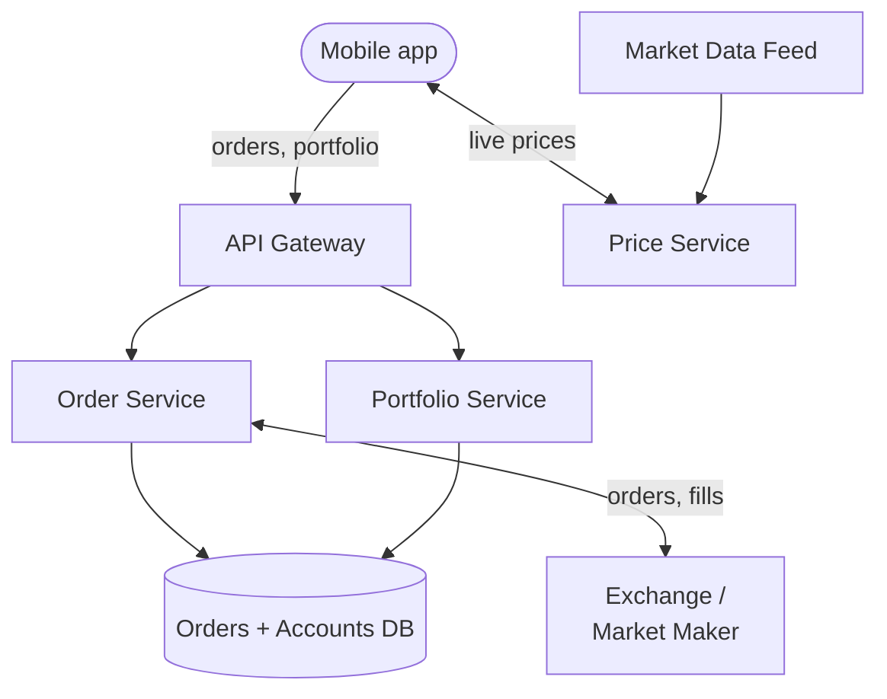
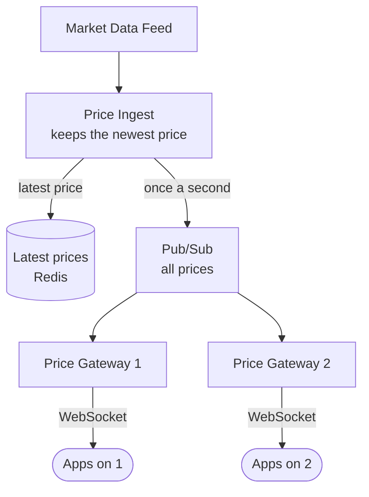
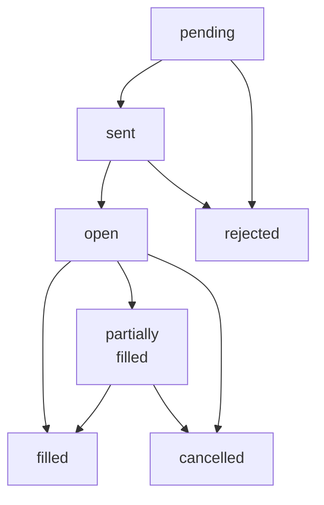
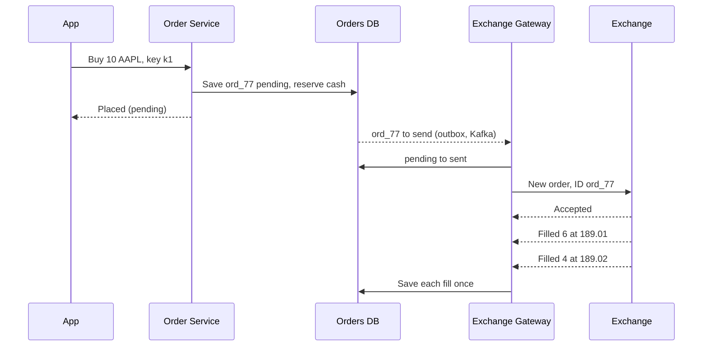
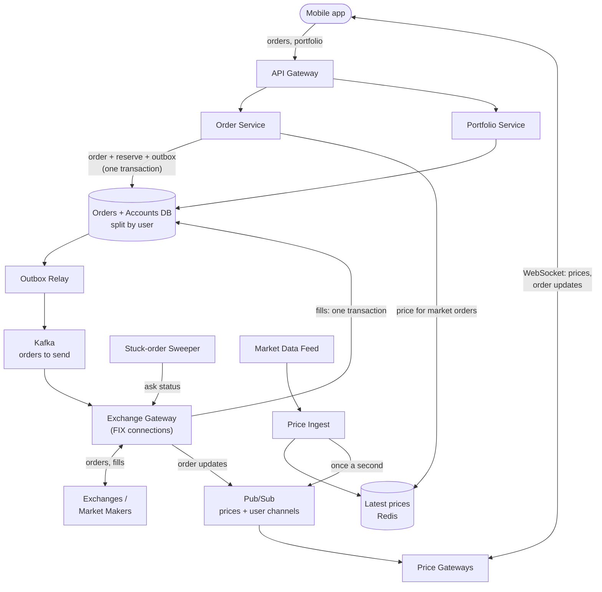

<Callout title="About this question">
  **Difficulty:** Hard. Real money, and an outside exchange that answers late. **Patterns used:**
  [Polling, WebSockets and SSE](../foundations/polling-websockets-sse.mdx), [Idempotency](../messaging/idempotency.mdx),
  [Multi-step Processes](../distributed-systems/multi-step-processes.mdx),
  [Dealing with Contention](../distributed-systems/dealing-with-contention.mdx),
  [Outbox Pattern](../distributed-systems/outbox-pattern.mdx), [Pub/Sub](../messaging/message-queues-pub-sub.mdx).
</Callout>

## Understand the problem

A stock trading app like Robinhood. Users open the app and see live prices for the stocks they follow. They tap "Buy 10 Apple shares", and a moment later the order is filled. They see their portfolio: cash, shares and open orders.

<Callout title="Robinhood does not match orders" type="idea">
  Robinhood is a **broker**. It does not pair buyers with sellers itself. It sends each order to an **exchange**
  (like Nasdaq or the New York Stock Exchange) or to a **market maker** (a big trading firm that is always ready to
  buy or sell). They make the trade and report back. So we design the app and the broker. Building an exchange's
  **matching engine** is a different question (see the follow-ups).
</Callout>

Three things make it hard:

- **Live prices for millions.** Prices change many times a second, and millions of phones want them now.
- **Orders are real money, and the exchange answers later.** We send an order, and the result ("filled") comes back later, sometimes in pieces. An order that is lost, or sent twice, costs real money.
- **Market open.** At 9:30 am New York time, the market opens, and everyone opens the app and trades in the same minute.

## Step 1: Requirements

### Functional requirements

1. Users can see live prices for stocks (their watchlist and a stock's page).
2. Users can buy and sell with **market orders** (buy now, at the current price) and **limit orders** (buy only at my price or lower, sell only at my price or higher).
3. Users can cancel an order that has not filled yet.
4. Users can see their portfolio: cash, shares they own, and open orders.

**Out of scope** (say this out loud): options and crypto, borrowing money (margin), fractional shares, sign-up and identity checks, moving money from the bank, price charts and news, and the exchange's matching engine.

### Non-functional requirements

1. **Correct orders:** every order reaches the exchange **once**. Never lost, never sent twice. Orders and balances need **strong consistency**.
2. **No spending money you don't have:** two orders at the same moment must not both use the same $1,000.
3. **Fresh prices:** a price change reaches the screen within about 1 second. Prices pick **availability**: missing one update is fine, because the next one replaces it.
4. **Scale:** 20 million users. About 2 million have the app open when the market opens.
5. **Fast feedback:** "Order placed" shows in under a second. The fill may take longer, because it depends on the exchange.

### Quick math

- **The price feed:** about 10,000 US stocks. At busy moments the market data feed sends **hundreds of thousands of updates per second** in total. A person can't read that, and a phone can't draw it. **Decision:** keep only the newest price of each stock, and pass it on at most once a second. The whole market is then at most **10,000 updates per second**. Small.
- **Connections:** 2 million open apps. One server holds about 100,000 open connections, so we need about **20 price servers**.
- **Pushes:** each app gets **one small batch per second** with the prices that changed on its screen. 2 million messages per second, about 100,000 per server. Fine.
- **Orders:** 5 million orders a day. The market is open 6.5 hours (about 23,400 seconds), so about **200 orders per second** on average. The first minutes after the open are 10 to 20 times busier: **a few thousand per second**. A SQL database split by user handles that. **Decision:** the hard part of orders is being correct, not volume.

## Step 2: Core entities

- **Account:** a user's cash, and how much of it is already **reserved** for open orders. Cash minus reserved is the **buying power**.
- **Stock:** a symbol like `AAPL`, and a name.
- **Quote:** the latest price of a stock, and its time. It lives **in memory**, not in the main database.
- **Order:** user, stock, side (`buy` or `sell`), type (`market` or `limit`), quantity, limit price, shares filled so far, and a **status** (deep dive 2).
- **Fill:** one piece of an order that traded: shares, price, time, and the exchange's **execution ID**. An order for 10 shares can fill as 6 + 4.
- **Position:** how many shares of one stock a user owns.
- **Ledger entry:** one line in the account's money book, like "−$1,134.06 for 6 AAPL".

## Step 3: API

```http
GET /quotes?symbols=AAPL,TSLA

→ 200 OK
{ "quotes": [{ "symbol": "AAPL", "priceCents": 18925, "time": "2027-03-01T14:30:01Z" }] }
```

Live prices come over one **WebSocket** per app (deep dive 1). The app says which stocks are on its screen:

```json
{ "type": "subscribe", "symbols": ["AAPL", "TSLA", "NVDA"] }
```

And the server pushes their new prices, about once a second:

```json
{ "type": "prices", "prices": { "AAPL": 18926, "TSLA": 24310 } }
```

The same connection also carries order updates, like `{ "type": "order", "orderId": "ord_77", "status": "filled" }`.

```http
POST /orders
Idempotency-Key: 8e1f42c0-buy-1
{ "symbol": "AAPL", "side": "buy", "type": "limit", "quantity": 10, "limitPriceCents": 19000 }

→ 201 Created
{ "orderId": "ord_77", "status": "pending" }
```

```http
DELETE /orders/{orderId}

→ 202 Accepted
{ "orderId": "ord_77", "status": "cancel_requested" }
```

```http
GET /portfolio

→ 200 OK
{ "cashCents": 500000, "buyingPowerCents": 310000,
  "positions": [{ "symbol": "AAPL", "quantity": 10 }], "openOrders": [{ "orderId": "ord_78", "status": "open" }] }
```

Notes:

- Prices are whole numbers of cents (`18925` = $189.25), never decimal numbers, so rounding never loses money.
- `POST /orders` answers as soon as the order is **saved**. It does not wait for the exchange. The fill comes later, as a message on the WebSocket.
- The **Idempotency-Key** is a random ID the app makes once per "Buy" tap. If the network drops and the app retries, the server sees the same key and returns the first order. So a retry never buys twice. See [Idempotency](../messaging/idempotency.mdx).
- Cancel returns **202 Accepted**, not 200: only the exchange can say if the cancel worked. The order may fill before the cancel arrives.
- Who is calling comes from the **login token**, never from the request body.

## Step 4: High-level design



**See live prices:**

1. The Price Service gets every price change from an outside **market data feed** (from the exchanges, or a data company).
2. It keeps the newest price of each stock in memory.
3. The app opens a connection and says which stocks it shows. The Price Service pushes their new prices.

**Place an order:**

1. The app sends `POST /orders` with an idempotency key.
2. The Order Service checks the buying power and **reserves** the money (deep dive 3). It saves the order as `pending` and answers "placed".
3. It sends the order to an exchange or market maker (deep dive 2).
4. The exchange answers "accepted". Later it reports one or more **fills**.
5. For each fill, we update the order, the shares and the cash in one transaction, and tell the app.

**See the portfolio:**

1. The Portfolio Service reads cash, positions and open orders from the database.
2. The app multiplies each position by the live price it already gets, so the total value moves on screen without any extra server work.

## Step 5: Deep dives

### 1. How do we stream live prices to millions of phones?

<Callout title="Not great: the app asks for prices every second" type="error">
  2 million apps ÷ 1 second = **2 million requests per second**, most of them asking for the same popular stocks.
  And a price can be up to a second old before the app even asks.
</Callout>

<Callout title="Okay: SSE, one stream per screen" type="warn">
  **SSE** (Server-Sent Events) is a one-way stream from server to app over plain HTTP. Prices only flow one way, so it
  **works**. **But** the list of stocks changes all the time: the user opens a stock, goes back, scrolls the
  watchlist. Each change means closing the stream and opening a new one with a new list.
</Callout>

<Callout title="Best: one WebSocket per app, with subscribe messages" type="success">
  A **WebSocket** is one connection that stays open, with messages both ways. The app sends "subscribe AAPL" or
  "unsubscribe TSLA" as the user moves around, on the same connection. The server pushes prices, and also "your
  order filled". See [Polling, WebSockets and SSE](../foundations/polling-websockets-sse.mdx).
</Callout>

Now, how does a price get from the feed to 2 million phones, spread over 20 servers?



How it works:

1. **Keep only the newest price.** The **Price Ingest** reads the feed. When AAPL changes 50 times in one second, it keeps only the last price. Once a second, it sends the newest price of each stock that changed. Throwing away old prices like this is called **conflation**. A price from half a second ago that has already been replaced is worth nothing.
2. **Every gateway gets every price.** After conflation, the whole market is at most 10,000 updates per second, about 1 MB per second. That is small, so every **Price Gateway** simply subscribes to all of it. No clever routing needed.
3. **Each gateway knows who watches what.** In memory it keeps `AAPL → [Alice's connection, Bob's connection, …]`. Once a second, it sends each app **one batch** with the changed prices of the stocks on its screen.
4. **New screens start with a price.** When the app subscribes to NVDA, the gateway sends NVDA's latest price right away, from its own memory or from the **Latest prices** copy in Redis. The app doesn't wait for the next change.

<Callout title="Missing a price update is fine" type="idea">
  A price is a **latest value**, not a list of events. If a gateway restarts and misses some updates, the next
  update fixes the screen. When the app reconnects, it gets the current prices again. Compare
  [Live Comments](./live-comments.mdx), where each comment matters and must be replayed after a drop.
</Callout>

**Order updates use the same connection.** When Alice connects, her gateway also subscribes to her own channel, `user:42`. When her order fills, the fill processor publishes to `user:42`, and the gateway holding her connection passes it on. If her app is closed, she gets a push notification instead.

### 2. How do we send an order to the exchange safely?

Alice taps "Buy 10 AAPL". Many things can go wrong between her phone and the exchange:

- Her network drops, and the app **retries** the request.
- Our server **crashes** right after saving the order, before sending it.
- We send the order, and the exchange's answer **never arrives** (a timeout). Did the exchange get it or not?

<Callout title="Not great: call the exchange inside the request, and retry on timeout" type="error">
  We send the order and wait. The call times out, so we send it again. **Problem:** the first one may have arrived.
  Now there are two orders, and Alice owns 20 shares instead of 10.
</Callout>

<Callout title="Okay: save the order first, send it once, never retry" type="warn">
  No more doubles. **But** if we crash between saving and sending, or the answer is lost, the order sits `pending`
  forever. Alice's money stays reserved, and nobody knows what happened.
</Callout>

<Callout title="Best: save first, send with our order ID, and when unsure, ask" type="success">
  Save the order before sending it. Send it with **our own order ID**, so every answer from the exchange points back to
  it. Move the order through clear **statuses**, only forward. If an answer goes missing, **ask the exchange about
  that ID** instead of sending again.
</Callout>

**Statuses only move forward.** Every order follows the same path. This is its **state machine**:



| Status | What it means |
| --- | --- |
| `pending` | Saved, money reserved. Not sent yet. |
| `sent` | Sent to the exchange. No answer yet. |
| `open` | The exchange accepted it. Waiting for a trade. |
| `partially_filled` | Some of the shares traded. |
| `filled` | All shares traded. Final. |
| `cancelled` | Cancelled. Shares that didn't trade never will. Final. |
| `rejected` | Refused, by us or by the exchange. Final. |

Every status change is a **conditional update**, like `UPDATE orders SET status = 'open' WHERE order_id = 'ord_77' AND status = 'sent'`. A late or repeated message from the exchange finds the order already further along, changes 0 rows, and is ignored.

**The steps:**

1. **Save first.** In one transaction, the Order Service inserts the order as `pending` (the idempotency key has a **unique** index, so a retry stops here and gets the first order back), reserves the money, and writes an **outbox** row: "send ord_77". It answers the app: "placed".
2. **Hand it over.** An Outbox Relay sends that row to Kafka (the [Outbox Pattern](../distributed-systems/outbox-pattern.mdx)). So if the Order Service crashes after saving, the order still gets sent.
3. **Send once.** The **Exchange Gateway** holds the long-lived connections to the exchanges. It runs `pending → sent` as a conditional update, and only if that changes 1 row does it send the order. If the relay delivered the same row twice, the second copy changes 0 rows and is skipped.
4. **Our ID travels with the order.** Brokers talk to exchanges in a standard message format called **FIX**. Each order carries an ID chosen by the broker. We use our order ID, `ord_77`. Every answer (accepted, filled, cancelled) carries `ord_77` back.



**When unsure, ask. Never send blindly again.** A **sweeper** runs every few seconds. It finds orders stuck in `sent` for more than about 10 seconds, and asks the exchange: "what is the status of ord_77?"

- The exchange knows it: we move the order to its real status (`open`, `filled`, …).
- The exchange has **never heard of it**: the order never arrived (maybe we crashed right after marking it `sent`). We mark it `rejected`, release the money, and tell Alice "Your order could not be placed". We don't send it again quietly: a market order sent a minute late would buy at a price she never saw.

**Fills arrive later, and sometimes twice.** The exchange reports each fill with its own **execution ID**. We save each fill in one transaction:

```sql
BEGIN;
-- 1. Save the fill. exec_id is unique, so a repeated report inserts 0 rows.
--    The app checks: 0 rows means we already have it. ROLLBACK and stop.
INSERT INTO fills (exec_id, order_id, quantity, price_cents)
VALUES ('E1', 'ord_77', 6, 18901)
ON CONFLICT (exec_id) DO NOTHING;

-- 2. Move the order forward. It can never fill more than it asked for.
UPDATE orders
SET filled_qty = filled_qty + 6,
    status = CASE WHEN filled_qty + 6 = quantity
                  THEN 'filled' ELSE 'partially_filled' END
WHERE order_id = 'ord_77' AND filled_qty + 6 <= quantity;

-- 3. Pay for the shares (deep dive 3), add 6 AAPL to Alice's position,
--    write the ledger lines, and an outbox row to tell her app.
COMMIT;
```

**Cancel is a request, not a fact.** When Alice taps "Cancel", we set a `cancel_requested` flag and send a cancel to the exchange. Two things can happen. The exchange cancels the rest of the order, and we release the money that is left. Or the order fills first, and the cancel comes back "too late". The exchange decides. Until it answers, the app shows "Cancel requested".

This whole flow (save, send, wait for an answer, handle a missing answer) is a classic multi-step process with an outside system. See [Multi-step Processes](../distributed-systems/multi-step-processes.mdx).

### 3. How do we keep buying power and the portfolio correct?

Alice has $1,000. At the same moment, she taps "Buy $800 of AAPL" on her phone and "Buy $800 of TSLA" on her tablet.

<Callout title="Not great: read the buying power, check it in code, then save" type="error">
  Both requests read "$1,000 free". Both pass the check. Both orders go out, and Alice has spent $1,600 she doesn't
  have. This is a **race condition**.
</Callout>

<Callout title="Okay: lock the account row while checking" type="warn">
  `SELECT ... FOR UPDATE` locks Alice's row, so the second request waits until the first one is done. **Correct.**
  **But** every code path that touches money must remember to take the lock, and any slow work done while holding
  it makes her other orders wait. See [Locks and Deadlocks](../databases/locking.mdx).
</Callout>

<Callout title="Best: check and reserve in one conditional update" type="success">
  One statement checks the buying power **and** reserves the money. The database runs it on one row at a time. If it
  changes 1 row, the money is held for this order. If it changes 0 rows, there isn't enough, and we reject the
  order.
</Callout>

```sql
-- Alice wants 10 AAPL with a limit of $190.00. Hold $1,900.00 of her cash.
UPDATE accounts
SET reserved_cents = reserved_cents + 190000
WHERE user_id = 'u_42'
  AND cash_cents - reserved_cents >= 190000;
-- 1 row changed: the money is held for this order.
-- 0 rows: not enough buying power. Reject the order.
```

In the $800 + $800 race, the first update changes 1 row and reserves $800. The second finds only $200 free, changes 0 rows, and that order is rejected.

How the money moves after that:

- **On each fill**, in the fill transaction: cash goes down by the **real cost**, and the reservation goes down by what we **held** for those shares. Fill 1 above: cash −$1,134.06 (6 × $189.01), reserved −$1,140.00 (6 × $190.00). After both fills, nothing is left reserved.
- **When the order ends** (filled, cancelled or rejected), we release whatever is still reserved.
- **Market orders** have no price. We reserve the **latest price plus a buffer**, like 5%, and send the order to the exchange as a limit order at that price. So it can never cost more than we reserved.
- **Selling** reserves **shares** instead of cash: `UPDATE positions SET reserved_qty = reserved_qty + 10 WHERE user_id = 'u_42' AND symbol = 'AAPL' AND quantity - reserved_qty >= 10`. So the same 10 shares can't be sold twice.

**A ledger, not just a number.** Every money movement is also written as **append-only ledger lines**: "−$1,134.06, fill E1 of ord_77". `cash_cents` is a running total kept in the same transaction, for speed, but the ledger lines are the truth. If a bug ever changes a balance, the history shows exactly what happened. See [Design a Payment System](./payment-system.mdx) for the double-entry ledger.

**Keep each user on one shard.** We split the database by user ID. Alice's account, orders, positions and fills all live on the same shard, so placing an order and saving a fill are each **one transaction on one machine**.

One user's account row is not a hot spot: a person places a few orders a minute at most, and the conditional update holds the row lock for well under a millisecond. The hot data in this system is the price of popular stocks, and it never touches the database. See [Dealing with Contention](../distributed-systems/dealing-with-contention.mdx).

### 4. Market open: the 9:30 rush

<Callout title="The rush is on the calendar" type="idea">
  A viral post is a surprise. The market open is not: it happens at 9:30 every weekday. So we get ready **before** it,
  instead of reacting after things break.
</Callout>

- **Scale up before 9:30.** Add Price Gateways, Order Service servers and database capacity at 9:00, on a schedule. Autoscaling reacts in minutes, and the rush arrives in seconds.
- **Orders placed overnight go out at a steady pace.** An order placed while the market is closed stays `pending`, with the money already reserved. At 9:30 a job puts them all on the Kafka queue, and the Exchange Gateway sends them as fast as its exchange connections allow. The queue gets long for a minute, and nothing is lost, because every order was saved hours ago.
- **No reconnect storms.** If a Price Gateway dies, its 100,000 apps all reconnect. If they reconnect at the same instant, they can knock over the next server too. So apps wait a **random** short time before reconnecting, and longer after each failure. See [Retries, Backoff and Timeouts](../messaging/retries-backoff-timeouts.mdx).
- **Protect what matters most.** Placing and cancelling orders come first. News, charts and history can slow down or switch off under load ([Graceful Degradation](../reliability-security/graceful-degradation.mdx)). Give orders their own servers and connection pools, so a flood of chart views can't starve them ([Bulkhead](../reliability-security/bulkhead.mdx)).
- **Prices never touch the database.** The price path is the feed, memory and WebSockets. However many people open the app, they don't add load to the orders database.

### Final architecture



## In the real world

- **Robinhood is a broker.** It sends most stock orders to **market makers** such as Citadel Securities and Virtu, which pay Robinhood for that order flow. This is called **payment for order flow**. The market makers do the trading.
- **On 2 March 2020**, one of the busiest trading days in years, Robinhood was **down for most of the day**. Its founders said its systems struggled with record load, and a "thundering herd" effect brought down its DNS system. It shows why the market-open rush must be planned for.
- **In January 2021**, during the GameStop rush, Robinhood **stopped users from buying** some stocks for a while. Its clearing house had suddenly asked it to put down a deposit of about **$3 billion**. Brokers must keep money aside for trades that haven't settled yet.
- **FIX** (Financial Information eXchange) is the standard message format that brokers, exchanges and market makers use to send orders and receive fills. Each order carries an ID chosen by the broker.
- US stock trades **settle one business day later** (called **T+1**, since May 2024). The shares and money officially change hands the next day, even though the app shows the trade right away.

## Follow-up questions

<Accordions>
<Accordion title="How would you build the matching engine of an exchange?">

The exchange keeps an **order book** for each stock: buy orders sorted by price (highest first), and sell orders sorted by price (lowest first). Orders at the same price wait in arrival order. This is called **price-time priority**. A new buy order trades with the cheapest sell orders, as long as their price is at or below its limit. What is left waits in the book.

To be fast and fair, one stock's book lives **in memory** and is handled by **one thread**, one order at a time, so it needs no locks. Every incoming order is first written to a log, so the book can be rebuilt after a crash by replaying the log ([Event Sourcing](../distributed-systems/event-sourcing.mdx)). Different stocks are spread over different machines.

</Accordion>
<Accordion title="Alice taps Cancel just as her order fills. What happens?">

The exchange decides. Our cancel is only a request. If the fill happened first, the exchange answers "too late to cancel", and the fill is saved as normal. If the cancel arrived first, the rest of the order is cancelled, and we release the reserved money that is left. Until the answer comes, the app shows "Cancel requested", not "Cancelled".

</Accordion>
<Accordion title="How do you know your records match the exchange's?">

The fills we saved should match what really traded. Every night, a **reconciliation** job compares our fills with the trade report from the clearing firm, line by line. Known differences (a fill we missed) are fixed by adding it. Strange ones go to a person. See the reconciliation part of [Design a Payment System](./payment-system.mdx).

</Accordion>
<Accordion title="How would you add price alerts, like 'tell me when TSLA goes above $300'?">

Keep the alerts for each stock in a **Redis sorted set**, with the trigger price as the score: `ZADD alerts:TSLA:above 30000 alert_9`. On each new price (say $301.50), fetch every alert at or below it: `ZRANGEBYSCORE alerts:TSLA:above 0 30150`. Send those alerts as push notifications, and remove them. Each price update costs one quick lookup, however many alerts exist.

</Accordion>
<Accordion title="The market data feed goes down. What do users see?">

Prices freeze. Each price carries its time, so the app can show "Prices delayed" when the newest one is more than a few seconds old. Use two feeds from different providers, and switch to the second when the first goes quiet. Orders still work, because the exchange uses its own live prices, not ours.

</Accordion>
</Accordions>

## What the interviewer expects

<Tabs items={['Mid-level', 'Senior', 'Staff']}>
<Tab value="Mid-level">

- Clear requirements, entities and API, with an idempotency key on `POST /orders`.
- A design with a price service, an order service, and the exchange as an **outside** system.
- Push prices over WebSockets or SSE instead of polling.
- Check buying power before sending an order.

</Tab>
<Tab value="Senior">

- Know that the broker doesn't match orders: it sends them out and waits for fills.
- Price math: conflate to the newest price, one batch per app per second, every gateway gets every price.
- An order **state machine** with forward-only, conditional updates. Save before sending.
- On a timeout, **ask** the exchange about the order ID instead of sending again.
- Fills de-duplicated by execution ID. Partial fills, and the cancel-versus-fill race.
- Reserve buying power with one conditional update.

</Tab>
<Tab value="Staff">

- Everything from senior, but faster.
- Outbox plus a stuck-order sweeper, so no order is lost or stuck between steps.
- An append-only ledger, and nightly reconciliation with the clearing firm.
- Market-open planning: scale up on a schedule, random reconnect delays, and protecting orders from less important traffic.
- Can sketch an exchange's matching engine when asked.

</Tab>
</Tabs>

<Callout title="Remember this" type="success">
  - Robinhood is a **broker**: it sends orders to exchanges and market makers, and they report fills later.
  - **Prices:** keep only the newest price (conflation), at most once a second. The whole market is then about
    10,000 updates a second, so **every gateway gets every price**. Each app gets one batch per second.
  - One **WebSocket** per app, with subscribe messages. It also carries "your order filled".
  - A missed price is fine: **the next price replaces it**.
  - **Orders:** save first (with an Idempotency-Key), then send with **our order ID**. Statuses only move forward,
    with conditional updates.
  - **Never resend on a timeout.** A sweeper **asks** the exchange about the order ID.
  - Fills are saved once per **execution ID**, and an order can never fill more than it asked for.
  - **Buying power:** check and reserve in one conditional update. Selling reserves shares.
  - **Market open is on the calendar:** scale up before 9:30, queue overnight orders, and reconnect with random delays.
</Callout>
