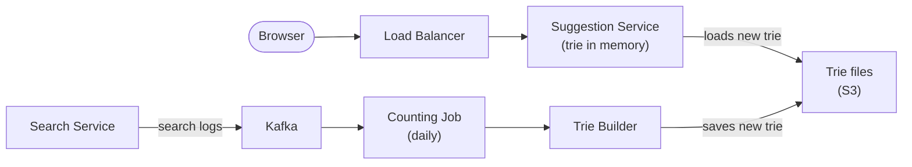
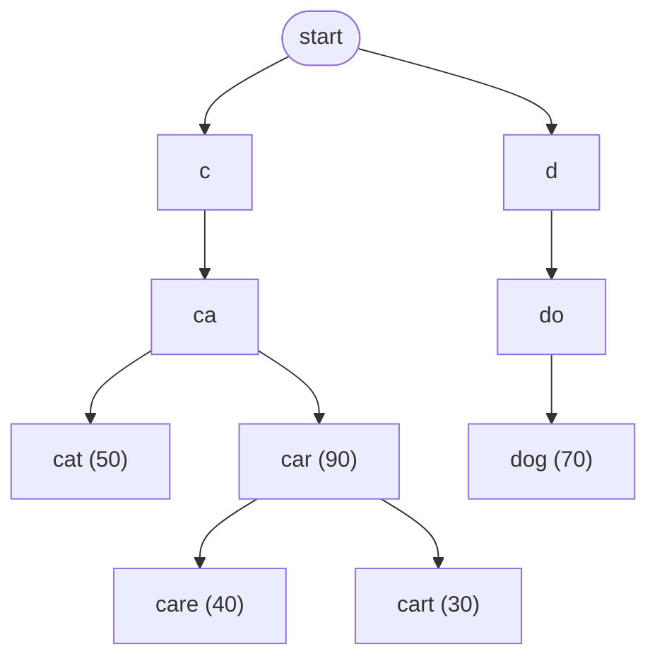
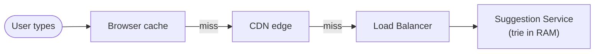
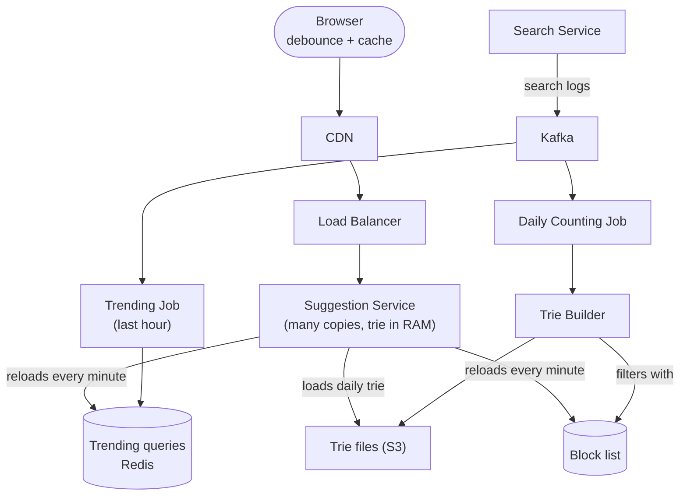

<Callout title="About this question">
  **Difficulty:** Medium. **Patterns used:** [Caching](../caching/what-is-caching.mdx), [CDN](../caching/cdn.mdx),
  [Batch vs Stream Processing](../advanced-components/batch-vs-stream.mdx),
  [Count-Min Sketch](../advanced-components/probabilistic-data-structures.mdx),
  [Partitioning and Sharding](../databases/partitioning-sharding.mdx).
</Callout>

## Understand the problem

When you type "piz" into a search box, a list drops down: "pizza near me", "pizza hut", "pizza dough recipe". This is **autocomplete** (also called **typeahead**). It saves typing, and helps people spell.

The challenge: a new request on almost **every key press**, and the answer must appear **before the user types the next letter**. That gives us about 100 ms.

## Step 1: Requirements

### Functional requirements

1. As the user types, show the **top 5 suggestions** that start with the typed text. The typed text is called the **prefix**.
2. Suggestions are **ranked by popularity**: how often people searched for them.
3. Suggestions **update** as search trends change. New popular searches appear within a day. (Optional: breaking news within minutes.)

**Out of scope** (say this out loud): spelling correction, personal suggestions, many languages, and the search results page itself.

### Non-functional requirements

1. **Very fast:** suggestions appear in under 100 ms.
2. **Always up:** slightly old suggestions are fine, so we pick **availability** over consistency.
3. **Big:** 100 million searches per day.
4. **Safe:** never suggest offensive or harmful text.

### Quick math

- **Requests:** we only send a request when the user pauses typing, so say **5 requests per search**. 100 million × 5 = 500 million a day = about **6,000 per second**, maybe 20,000 at peak. Almost all of them are reads, so **caching** will help a lot.
- **Data:** we don't need every query ever typed, only the popular ones. Say the top **100 million** queries × about 30 bytes = about **3 GB**. With counts and ready-made top 5 lists, maybe a few tens of GB. That **fits in the memory of one large server**. So we don't need to split the data at first. We just run **many copies** for speed and safety.

## Step 2: Core entities

- **Query:** a search text, like "pizza near me", and how many times it was searched.
- **Suggestion list:** for a prefix like "piz", the top 5 queries.
- **Search log:** one record per search: the text and the time. We count these.

## Step 3: API

```http
GET /suggestions?prefix=piz&limit=5

→ 200 OK
Cache-Control: public, max-age=60, s-maxage=300
{
  "prefix": "piz",
  "suggestions": ["pizza near me", "pizza hut", "pizza dough recipe", "pizza delivery", "pizzeria"]
}
```

`Cache-Control` lets the browser keep this answer for 1 minute (`max-age=60`), and shared caches like the CDN for 5 minutes (`s-maxage=300`). Both are kept short on purpose, so a bad suggestion can be removed fast (deep dive 4).

We don't need an API to log searches. The **search** service already logs every search that users submit, and we read those logs.

## Step 4: High-level design

The system has two halves:

1. **Serving path:** answer `GET /suggestions` very fast.
2. **Data path:** count searches and build fresh suggestions in the background.



**Get suggestions:**

1. The user types "piz". The browser waits for a short pause in typing, then calls `GET /suggestions?prefix=piz`.
2. The Suggestion Service walks its in-memory trie (explained below): `p` → `i` → `z`.
3. The "piz" node already holds its top 5 list. The service returns it.

**Update suggestions (once a day):**

1. Every search that people submit is written to a log in Kafka.
2. A counting job adds up how often each query was searched, for example over the last 7 days.
3. The Trie Builder builds a new trie with the top 5 saved at every node, and stores it as a file in S3.
4. Each Suggestion Service server loads the new file and switches to it.

## Step 5: Deep dives

### 1. How do we find matches fast? The trie

A **trie** (say "try"), also called a **prefix tree**, is a tree where each step down adds one letter. All searches that start with "ca" live under the "ca" node.

Example with five past searches and their counts: car (90), dog (70), cat (50), care (40), cart (30).



Typing "ca" means: go down to the `ca` node, then find the most popular searches below it: car, cat, care, cart.

<Callout title="Not great: a SQL query" type="error">
  `SELECT query FROM searches WHERE query LIKE 'ca%' ORDER BY count DESC LIMIT 5`. For a short prefix like "a", millions of rows match, and the database must sort all of them. On every key press. Far too slow.
</Callout>

<Callout title="Okay: a plain trie" type="warn">
  Walking down to the "ca" node is fast: only 2 steps. But then we must visit **every** search below it to find the top 5. Under "a" there are millions. Still too slow for short prefixes.
</Callout>

<Callout title="Best: a trie with the top 5 saved at every node" type="success">
  When we build the trie, we save the top 5 list at **each** node. Node "ca" stores `[car, cat, care, cart]`. A lookup is now "walk down a few letters, read the list". The cost is more memory and more work when building. Both are fine: we build once a day, and read 20,000 times a second.
</Callout>

Two more tricks:

- **You can even skip the trie when serving.** Since every list is ready-made, a plain key-value map works too: `ca → [car, cat, care, cart]`, in memory or in Redis. The trie is still the easiest way to **build** those lists.
- **Only store prefixes up to about 20 letters.** Longer prefixes are rare, and by then the user has almost finished typing.

### 2. Ranking suggestions by popularity

The simplest score is "how many times was this searched". But we want **recent** popularity: "world cup final" should fade after the match is over.

So use **time decay**: recent searches count more. For example, today's searches count fully, yesterday's count 90%, the day before 81%, and so on:

```js
// counts[0] = searches today, counts[1] = yesterday, ...
function score(counts) {
    let total = 0;

    for (let daysAgo = 0; daysAgo < counts.length; daysAgo++) {
        // Today counts 1, yesterday 0.9, the day before 0.81, ...
        const weight = Math.pow(0.9, daysAgo);
        total += counts[daysAgo] * weight;
    }

    return total;
}

console.log(score([1000, 0, 0])); // 1000  (searched a lot today)
console.log(score([0, 0, 2000])); // 1620  (searched more, but 2 days ago)
```

**Filter** what we suggest:

- Remove offensive, hateful or dangerous suggestions with a **block list**. Check it when building, and again when serving.
- Only suggest queries that **many different people** searched. A rare query could leak private information, like someone's name and address.
- Count **people**, not raw searches, so one bot searching the same thing a million times can't push it to the top.

**Counting at huge scale.** In the daily batch job, an exact count per query is easy (tools like Spark do this well). For a **real-time** counter (deep dive 3), an exact counter for every query in memory is too much. A **Count-Min Sketch** gives an approximate count using a small, fixed amount of memory. See [Count-Min Sketch](../advanced-components/probabilistic-data-structures.mdx).

### 3. Updating suggestions

<Callout title="Not great: update the trie on every search" type="error">
  Thousands of searches per second would each change the trie, while 20,000 reads per second are using it. The trie needs locks, and the top 5 lists all the way up the tree must be fixed on each change. Reads slow down.
</Callout>

<Callout title="Okay: rebuild once a day, then swap" type="warn">
  A batch job rebuilds the whole trie from the last few days of logs, and the servers switch to the new one. Simple and safe. **But** a sudden trend, like breaking news, won't show up until tomorrow.
</Callout>

<Callout title="Best: daily rebuild + a small trending layer" type="success">
  Keep the daily rebuild for the main trie. Add a **stream job** that counts searches in the last hour, and finds queries that suddenly jumped. The Suggestion Service loads this small trending list into memory every minute, and mixes it into its answers. Fresh within minutes, while the big trie stays simple.
</Callout>

**Swapping without downtime:** a server loads the new trie into memory **next to** the old one, then switches one pointer. Requests already running finish on the old trie, and then the old one is freed. Roll the new trie out server by server, so a bad trie can be stopped early.

### 4. Caching and serving fast

Most requests should never reach our servers. Four layers help:

1. **Debounce in the browser.** Debounce means: wait until the user stops typing for a moment (about 100 ms) before sending a request. Someone typing "pizza" quickly sends 1 or 2 requests instead of 5.
2. **Browser cache.** The answer for "piz" is kept for 1 minute (`max-age=60`). If the user deletes a letter and types it again, no request is sent. Keep this time **short**: we can clear the CDN, but we can't reach into users' browsers. A harmful suggestion stays in a browser until its cache time runs out.
3. **CDN cache.** Suggestions are the same for everyone, so a **CDN** (servers spread around the world, close to users) can keep them, here for 5 minutes (`s-maxage=300`). Short prefixes like "a" or "pi" are asked millions of times, so even 5 minutes in the CDN saves a lot. A short time also lets trending queries show up within minutes. And if we must remove a suggestion, we can clear the CDN right away.
4. **Trie in memory.** Requests that do reach us are answered from RAM in well under a millisecond. The trending list and the block list are in memory too (reloaded every minute), so no database or Redis call is on this path.



**When the trie no longer fits on one server**, split it by prefix. Letters are not equal: "s" has far more searches than "x". So split by **data size**, not by alphabet. For example, server group A holds "a" to "c", group B holds "d" to "k", and so on. A small routing table tells the load balancer which group owns which prefix. See [Partitioning and Sharding](../databases/partitioning-sharding.mdx).

### Final architecture



## In the real world

**Google's autocomplete.** Google calls its suggestions **predictions**, not suggestions. In a 2018 blog post, Google explained that they are based on **real searches**, show common and trending queries, and can depend on your language and location. Google also removes predictions that break its rules, such as violent, sexually explicit or hateful ones.

**Facebook's typeahead.** In a 2010 engineering post, Facebook explained that when you click into the search box, the browser loads your friends and other close connections **in advance**. Many results can then be shown instantly from the browser, without asking the server on every key press.

**Elasticsearch** has a "completion suggester" built for autocomplete. Its documentation says it is made for speed: the data is kept **in memory** in a structure that is fast to read but costly to build. That is the same tradeoff as the "top 5 at every node" trie.

## Follow-up questions

<Accordions>
<Accordion title="How would you add personal suggestions?">

Keep each user's recent searches (a short list per user, in a key-value store). When serving, show the user's own matching searches first, then the global top 5. These answers are private, so mark them `Cache-Control: private`: the browser may keep them, but the CDN must not.

</Accordion>
<Accordion title="How do you handle typos like 'pizaa'?">

Use **fuzzy matching**: find queries that are within one or two letter changes of what was typed. It is much more expensive than a prefix lookup, so it is often a separate spelling-correction step, used only when the normal lookup finds little.

</Accordion>
<Accordion title="How do you support many countries and languages?">

Build a separate trie per language or region, from that region's own search logs. Route each request to the right trie using the user's language and location.

</Accordion>
<Accordion title="A harmful suggestion is trending right now. How do you remove it fast?">

Add it to the **block list**. Every server checks the block list when serving and reloads it every minute, so the suggestion disappears without waiting for the daily rebuild. Also clear the CDN cache for the prefixes that showed it. Browsers may still show the old answer for up to 1 minute, which is why the browser cache time is kept short.

</Accordion>
</Accordions>

## What the interviewer expects

<Tabs items={['Mid-level', 'Senior', 'Staff']}>
<Tab value="Mid-level">

- A clear API.
- Explain the trie and how a prefix lookup works.
- Save the top 5 at each node.
- Add caching for speed.

</Tab>
<Tab value="Senior">

- Tradeoffs of saving the top 5 at each node (memory, build time).
- Build offline, then swap the new trie in with no downtime.
- Ranking with time decay, and filtering bad suggestions.
- Caching layers: debounce, browser, CDN, memory. Sharding by prefix with uneven data.

</Tab>
<Tab value="Staff">

- A trending pipeline with stream processing and approximate counting.
- Safety and privacy: block lists, only suggesting queries many people searched.
- Personal suggestions without breaking CDN caching.
- Rolling out a new trie safely across many servers and regions.

</Tab>
</Tabs>

<Callout title="Remember this" type="success">
  - A **trie** with the **top 5 saved at every node**: walk a few letters, read a list.
  - **Build offline, then swap** the new trie in memory. Don't update it on every search.
  - Rank by **popularity with time decay**. Filter offensive and rare queries.
  - A small **trending layer** (a stream job) for fresh trends.
  - **Debounce + browser cache + CDN + RAM:** most requests never reach a server. Keep cache times short (1 minute
    in the browser, 5 minutes in the CDN), so a bad suggestion can be removed fast.
  - The popular queries are about 3 GB, a few tens of GB with the top 5 lists. That **fits in memory**: make copies,
    don't shard at first.
</Callout>
