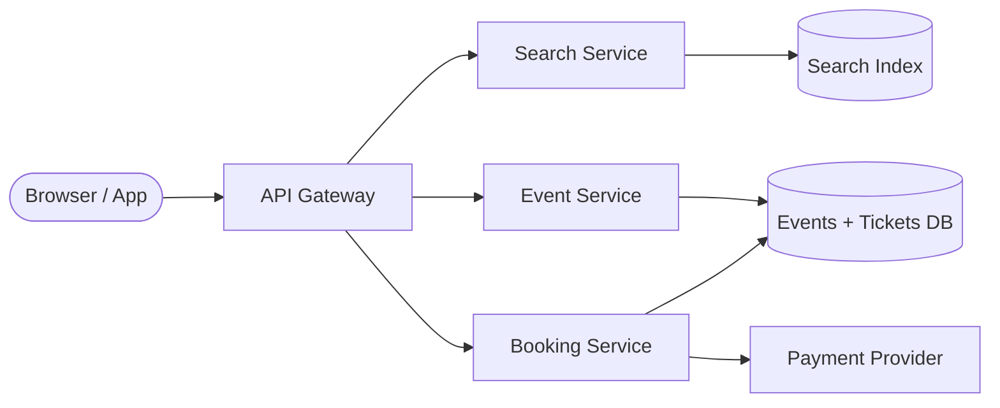
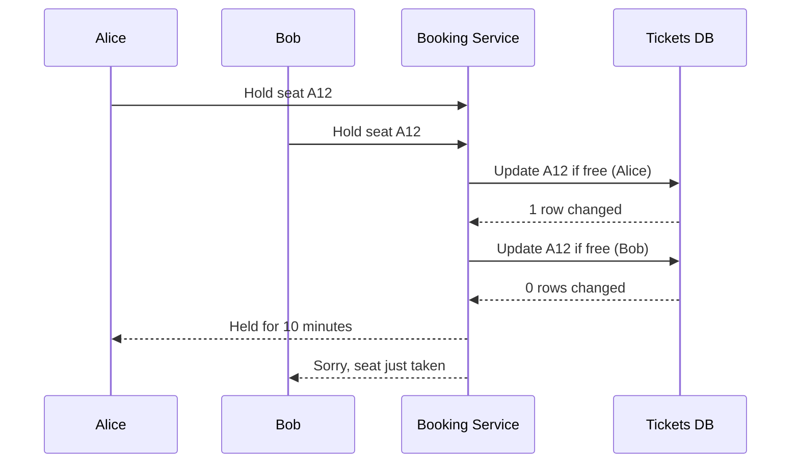
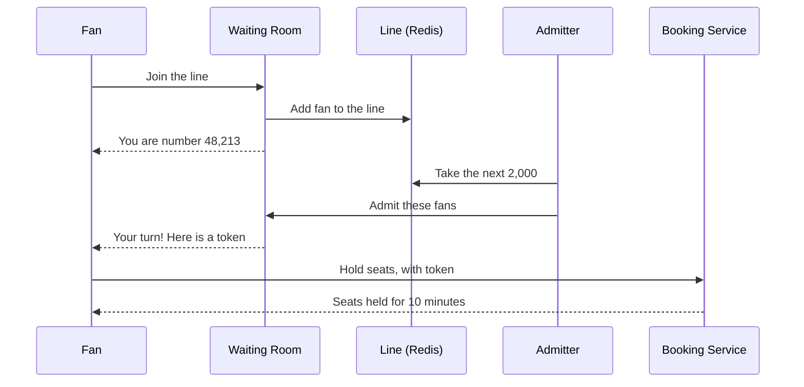
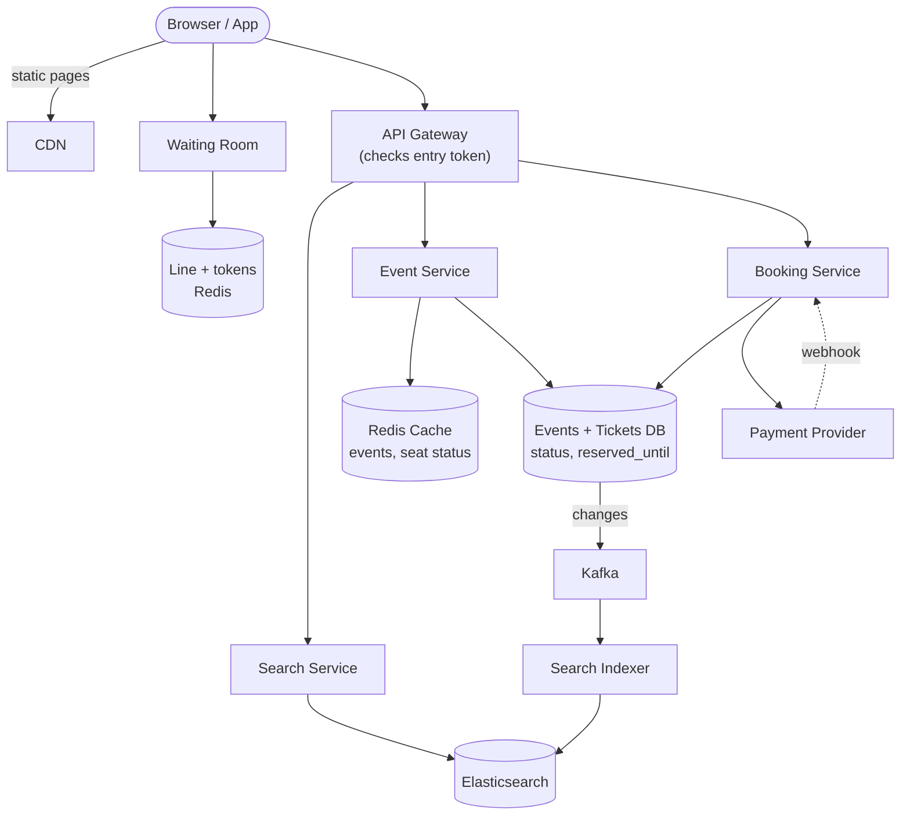

<Callout title="About this question">
  **Difficulty:** Medium. A very common question. **Patterns used:** [Locks and Deadlocks](../databases/locking.mdx),
  [Distributed Locking](../distributed-systems/distributed-locking.mdx), [Search](../advanced-components/search.mdx),
  [Caching](../caching/what-is-caching.mdx), [Backpressure](../reliability-security/backpressure.mdx).
</Callout>

## Understand the problem

A site like Ticketmaster or BookMyShow. Users find an event, pick seats on a seat map, pay, and get tickets.

Two things make it hard:

- **No double booking.** Seat A12 can be sold to only one person, even if two people click it at the same second.
- **Huge rushes.** When a famous singer's tour goes on sale, millions of fans arrive in the same minute for maybe 50,000 seats.

## Step 1: Requirements

### Functional requirements

1. Users can search for events.
2. Users can view an event and see which seats are free.
3. Users can book seats: pick them, **hold** them for a few minutes, and pay.

**Out of scope** (say this out loud): adding events (admin tools), reselling tickets, refunds, seat recommendations.

### Non-functional requirements

1. **No double booking:** booking needs **strong consistency**. Two people can never both get seat A12.
2. **Fast browsing:** search and event pages in under 500 ms. A seat map that is a second old is fine, so browsing picks **availability**.
3. **Huge rushes:** a popular event gets **10 million users** in the first minutes, for 50,000 seats.
4. **Fair:** real fans should have a fair chance. Bots should not win just by being fastest.
5. **Read-heavy:** people look at events about 100 times more than they book.

### Quick math

- **The rush:** 10 million users, each refreshing the seat map every few seconds = **millions of requests per second** on **one** event. All its seats live in one place in the database. No database can take that. **Decision:** we need a cache for viewing, and a **waiting room** that lets people in slowly.
- **Holds:** 50,000 seats, each held for up to 10 minutes. Small numbers, so holds can live in the database.

## Step 2: Core entities

- **Event:** name, date, venue, performer.
- **Venue:** the place, and its seat map.
- **Ticket:** one seat at one event. Has a seat number, a price and a **status**: `available`, `reserved` or `booked`. A ticket is found by the event ID **plus** the seat (like `ev_42` + `A12`), because seat A12 exists at every event in that venue.
- **Booking:** a user, the tickets they bought, the total price and a status.

## Step 3: API

```http
GET /events/search?q=coldplay&city=london&date=2027-06-01

→ 200 OK
{ "events": [{ "eventId": "ev_42", "name": "Coldplay Live", "date": "2027-06-01" }] }
```

```http
GET /events/{eventId}

→ 200 OK
{ "event": { ... }, "venue": { ... }, "seats": [{ "ticketId": "A12", "price": 120, "status": "available" }] }
```

```http
POST /bookings
Idempotency-Key: 5b2d81e0-hold-1
{ "eventId": "ev_42", "ticketIds": ["A12", "A13"] }

→ 201 Created
{ "bookingId": "bk_9", "status": "reserved", "expiresAt": "2027-03-01T10:10:00Z" }
```

```http
POST /bookings/{bookingId}/confirm
Idempotency-Key: 5b2d81e0-pay-1
{ "paymentMethodId": "pm_123" }

→ 200 OK
{ "bookingId": "bk_9", "status": "confirmed" }
```

Booking is **two steps**: first **hold** the seats, then **pay**. Paying takes the user a few minutes, and nobody else should grab the seats during that time.

Both calls carry an **Idempotency-Key**: a random ID the app makes once per action. If the user double-clicks "Pay", or the app retries after a timeout, the server sees the same key and returns the first result. So a retry never holds seats twice, and never charges the card twice. See [Idempotency](../messaging/idempotency.mdx).

## Step 4: High-level design



**Search for events:**

1. The Search Service looks up the words in a search index like Elasticsearch, which is kept in sync with the database.

**View an event:**

1. The Event Service reads the event, the venue and the status of every ticket.
2. The app draws the seat map: free seats in color, taken seats in grey.

**Book seats:**

1. The user picks seats. The app sends `POST /bookings`.
2. The Booking Service **holds** the seats for 10 minutes (deep dive 1), and creates a booking with status `reserved`.
3. The user sees a 10-minute timer and enters card details in the payment provider's form.
4. The app sends `confirm`. The Booking Service charges the card. If it works, the tickets become `booked` and the booking `confirmed`.
5. If the user never pays, the hold ends after 10 minutes and the seats are free again.

## Step 5: Deep dives

### 1. How do we never sell one seat twice?

Alice and Bob both click **seat A12** at 10:00:00. We must give it to one of them, hold it while they pay, and free it if they leave.

<Callout title="Not great: lock the row in the database until payment is done" type="error">
  Open a transaction, lock the ticket row with `SELECT ... FOR UPDATE`, and keep it open while the user types
  their card number. **Problem:** that is several minutes. Each open transaction ties up a database connection,
  and if the user closes the tab, the lock stays until a timeout. Database transactions should last
  milliseconds, not minutes.
</Callout>

<Callout title="Okay: a lock in Redis that expires" type="warn">
  Hold the seat with a Redis key that expires by itself: `SET lock:A12 user-42 NX EX 600`. `NX` means "only if
  nobody else has it", and `EX 600` means "delete it after 600 seconds". **Works**, and expiry is automatic.
  **But** now the truth lives in two places. If Redis goes down, all holds are lost, and two users may reach
  the payment page for the same seat. See [Distributed Locking](../distributed-systems/distributed-locking.mdx).
</Callout>

<Callout title="Best: a reservation with an expiry time, in the database" type="success">
  Give each ticket a `status` and a `reserved_until` time. Holding a seat is **one atomic update** with a check.
  If it changes 1 row, the seat is yours. If it changes 0 rows, someone else has it. An **expired** hold counts as
  free, so nothing needs to clean up holds on time.
</Callout>

```sql
-- Hold seat A12 at event ev_42 for Alice for 10 minutes.
UPDATE tickets
SET status = 'reserved', reserved_by = 'alice', reserved_until = NOW() + INTERVAL '10 minutes'
WHERE event_id = 'ev_42' AND ticket_id = 'A12'
  AND (status = 'available'
       OR (status = 'reserved' AND reserved_until < NOW()));
-- 1 row changed: Alice holds the seat. 0 rows: someone else has it.
```

The database runs this update on one row at a time. So when Alice and Bob race, one update changes the row and the other finds nothing to change:



**A retry must not fail on Alice's own hold.** Say Alice's hold worked, but the answer got lost, and her app sends the hold again. Now A12 is `reserved` by Alice, so the update changes 0 rows, and she would be told "someone else has it". The `Idempotency-Key` stops this. The key is saved with the booking, **in the same transaction** as the hold. A retry with the same key finds it and returns the first booking (`bk_9`) instead of running the update again.

**Many seats at once:** run all the updates in **one transaction**, always in the same order, sorted by seat (`ticket_id`). If any seat fails, roll back. Alice gets all 4 seats she picked, or none. Why sorted? Say Alice wants A12 and A13, and Bob wants A13 and A12. If Alice locks A12 first and Bob locks A13 first, each then waits for the other's row. This is a **deadlock**: the database notices it and cancels one of the two. When everyone goes in the same order, both start with A12, and one simply waits for the other. See [Locks and Deadlocks](../databases/locking.mdx).

**When Alice pays**, one more check makes it final:

```sql
UPDATE tickets SET status = 'booked', booking_id = 'bk_9'
WHERE event_id = 'ev_42' AND ticket_id = 'A12'
  AND reserved_by = 'alice' AND reserved_until > NOW();
```

**What if her payment finishes just after the hold ran out, and Bob already took the seat?** The update above changes 0 rows, so we **refund** Alice right away. To make this rare, show the user a 9-minute timer while the real hold is 10 minutes.

A background job can still reset old `reserved` rows to `available` now and then, but only to keep the table tidy. Correctness never depends on it.

### 2. How do we show events and seat maps fast?

- **Search:** event changes flow from the database to Elasticsearch. Cache the answers to popular searches ("concerts in London this weekend") for a minute.
- **Event details** (name, date, venue, seat layout) almost never change. Cache them in Redis, and even on a [CDN](../caching/cdn.mdx).
- **Seat status** changes all the time during a sale. Cache it for only **1 to 2 seconds**. For a hot event, the server can **push** seat changes to open pages with SSE (a one-way live connection from server to browser). See [Polling, WebSockets and SSE](../foundations/polling-websockets-sse.mdx).

The seat map is allowed to be a little behind. The **truth** is the atomic update at hold time. If a user clicks a seat that was taken a second ago, they see "Sorry, just taken" and pick another.

### 3. How do we handle a huge rush? The virtual waiting room

10 million fans arrive at 10:00 for 50,000 seats. If they all hit the Booking Service, the database melts, the site goes down, and **nobody** gets a ticket.

<Callout title="Not great: just add more servers" type="error">
  Autoscaling takes minutes, and the rush takes seconds. Even with more servers, all 50,000 seats of this event
  sit in one place in the database. That one spot becomes the bottleneck.
</Callout>

<Callout title="Okay: rate limit each user" type="warn">
  Reject requests over a limit with `429 Too Many Requests`. The servers survive. **But** users get random
  errors, they press refresh even harder, and it feels unfair: luck decides who gets in.
</Callout>

<Callout title="Best: a virtual waiting room" type="success">
  Put everyone in an online **queue** before they reach the booking pages. Let people in at a steady speed that
  the system can handle, like 2,000 per minute. Everyone else sees their place in line and how long they will
  wait.
</Callout>



How it works:

1. Fans who arrive **before** the sale wait on a simple waiting page. At 10:00, they all get a **random** place in line. So arriving at 9:59 or at 9:30 gives the same chance, and bots gain nothing by being fast. People who arrive after 10:00 join at the back.
2. The line is a **Redis sorted set**: `ZADD line:ev_42 <place> user-42`. `ZRANK` gives a user's position.
3. The **Admitter** lets in the next 2,000 users every minute (`ZPOPMIN line:ev_42 2000`). It speeds up or slows down based on how fast seats are selling and how busy the Booking Service is.
4. Each admitted user gets a **signed token** that is valid for 15 minutes. "Signed" means it is made with a secret key, so nobody can fake one. The Booking Service rejects any request without a valid token.
5. Waiting users see their position, updated every few seconds.
6. When the event sells out, **everyone still in line is told right away**, so they don't wait for nothing.

The waiting room is a tiny, separate system: a static page and a small Redis. It can take millions of users because it does almost nothing. The real booking system behind it only ever sees a steady, safe flow of users. This idea of slowing input to match what the system can handle is called [backpressure](../reliability-security/backpressure.mdx).

### Final architecture



## In the real world

- **Ticketmaster** puts buyers in an online **queue** for big sales, and lets them in a group at a time.
- Ticketmaster also runs **Verified Fan**: fans sign up before the sale, Ticketmaster checks the accounts, and selected fans get an access code. The goal is to keep out bots and people who buy only to resell.
- In **November 2022**, the presale for **Taylor Swift's Eras Tour** on Ticketmaster drew far more traffic than the site could handle. Many fans got errors or waited for hours, and Ticketmaster **cancelled the general public sale**. It is the best-known example of why the rush is the real problem in this question.
- **Queue-it** and **Cloudflare Waiting Room** are ready-made waiting room products. Ticket sites and online stores use them for big launches, instead of building their own.

## Follow-up questions

<Accordions>
<Accordion title="A user holds 8 seats and walks away. What happens?">

After 10 minutes the hold expires and the seats are free again, with no extra work. To limit the damage, cap the number of tickets per user per event (for example, 6), and stop one account from holding seats in many tabs at once.

</Accordion>
<Accordion title="How do you stop bots?">

Several layers: the **waiting room** with random places (being fast gives no advantage), **pre-registration** like Verified Fan, a **CAPTCHA** before entering the line, a **limit per account and per card**, and [rate limits](../reliability-security/rate-limiting.mdx) by account and device.

</Accordion>
<Accordion title="The tickets table is too busy. How do you split it?">

[Shard](../databases/partitioning-sharding.mdx) by **event ID**. All tickets for one event stay on one shard, so holding 4 seats is still one transaction on one machine. A hot event makes its shard busy, which is exactly why the waiting room controls how many people reach it.

</Accordion>
<Accordion title="What about events with no seat numbers, like standing tickets?">

There are no seats to pick, just a count. Use a counter with a check: `UPDATE events SET sold = sold + 2 WHERE event_id = 'ev_42' AND sold + 2 <= capacity`. 1 row changed means the user got 2 tickets.

</Accordion>
<Accordion title="Payment succeeds but our server crashes before marking the seat booked. Then what?">

The payment provider sends a **webhook** ("payment for `bk_9` succeeded"). When it arrives, we run the final update. If the hold is still Alice's, the seat becomes booked. If not, we refund. Pass the booking ID as an [idempotency key](../messaging/idempotency.mdx) when charging, so a retry never charges twice.

</Accordion>
</Accordions>

## What the interviewer expects

<Tabs items={['Mid-level', 'Senior', 'Staff']}>
<Tab value="Mid-level">

- Clear requirements, entities and API, with booking in two steps: hold, then pay.
- A simple design with search, event and booking services.
- Spot the double booking problem and fix it with a lock or an atomic update.
- Holds that expire after a few minutes.

</Tab>
<Tab value="Senior">

- Compare long database locks, Redis locks and reservations with expiry, with tradeoffs.
- Strong consistency for booking, but cached, slightly stale seat maps for viewing.
- Bring up the rush yourself and propose a waiting room.
- Handle the "payment done, hold expired" case.
- Idempotency keys on hold and on confirm, and multi-seat holds in sorted order (no deadlocks).

</Tab>
<Tab value="Staff">

- Everything from senior, but faster.
- Waiting room details: random order, admission rate tied to system load, signed tokens.
- Fairness and bots, beyond pure technology.
- Sharding by event, and why hot events need the waiting room even after sharding.

</Tab>
</Tabs>

<Callout title="Remember this" type="success">
  - Booking = **hold** (a few minutes) + **pay**.
  - **No double booking:** one atomic update, `WHERE status = 'available' OR the hold has expired`. 0 rows = taken.
  - Hold many seats in **one transaction, sorted by seat**, so two buyers can't deadlock.
  - Hold and confirm both take an **Idempotency-Key**, so a retry never fails on your own hold or charges twice.
  - **Expired holds count as free**, so correctness never depends on a cleanup job.
  - Never hold a database lock while a human types a card number.
  - Seat maps can be a second old. **The truth is the atomic update.**
  - **Huge rush → virtual waiting room:** random places, steady admission, signed entry tokens.
</Callout>
