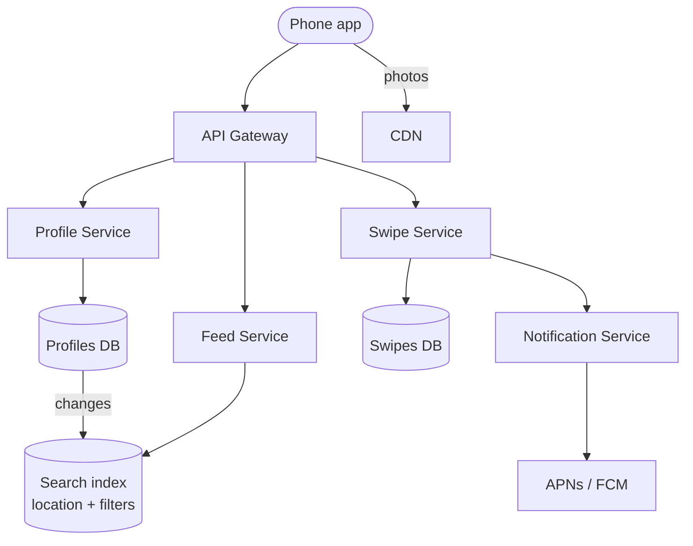
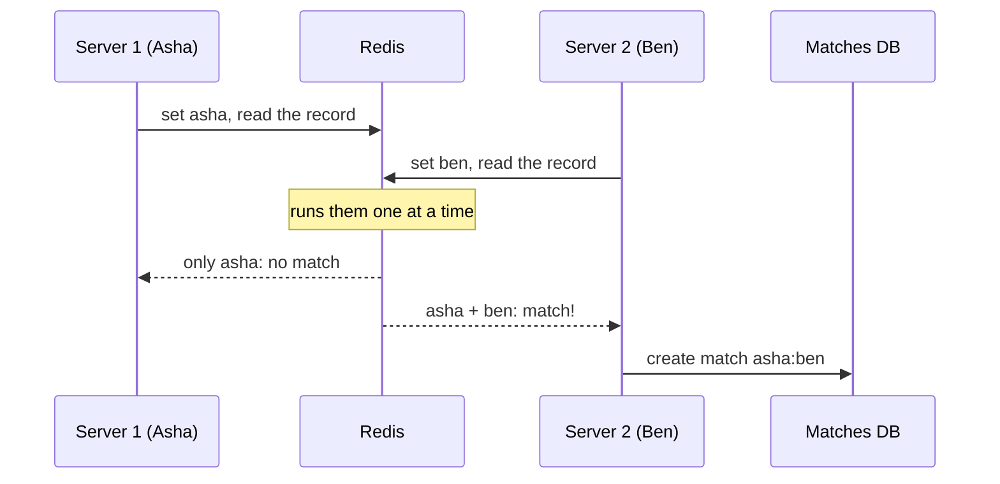
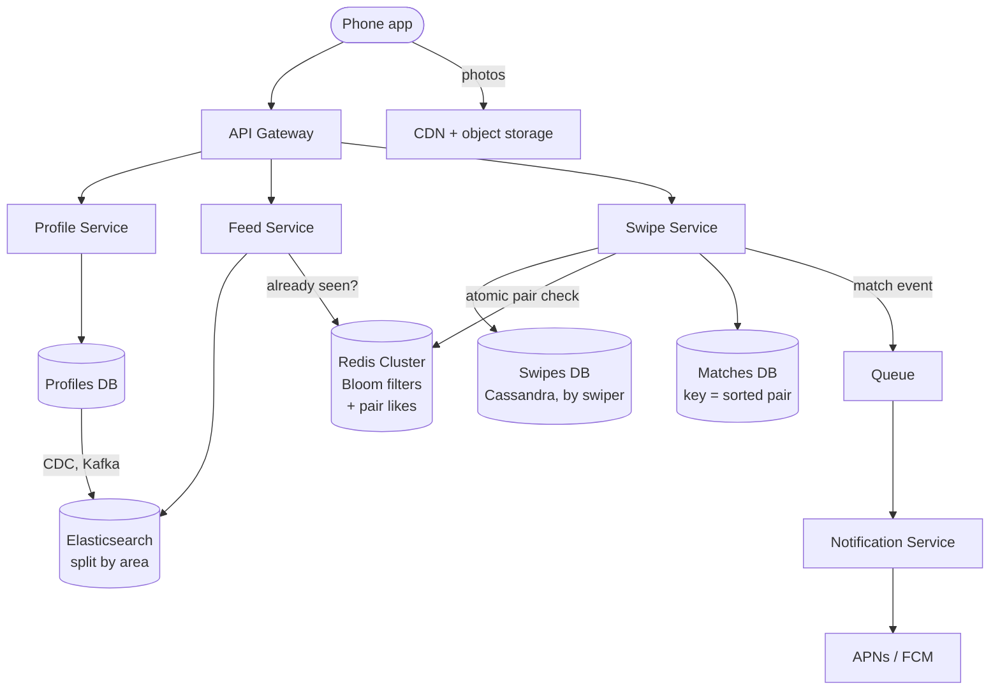

<Callout title="About this question">
  **Difficulty:** Medium. **Patterns used:** [Geospatial Indexing](../advanced-components/geospatial-indexing.mdx),
  [Bloom Filters](../advanced-components/probabilistic-data-structures.mdx), [Redis](../caching/redis.mdx),
  [Scaling Writes](../hld-basics/scaling-writes.mdx), [Search](../advanced-components/search.mdx).
</Callout>

## Understand the problem

A dating app. Each user makes a profile (photos, age, a short bio) and sets who they want to see (age range, distance, gender). The app shows a stack of nearby profiles, one at a time. **Swipe right** means "I like you". **Swipe left** means "no thanks". When two people both swipe right on each other, it's a **match**: both are told, and they can start chatting.

Four things make it hard:

- **"People near me who fit what I want"**, answered fast, out of 100 million users.
- **A flood of swipes.** Billions per day, and every one must be saved.
- **Never miss a match.** If Asha and Ben swipe right on each other at the very same second, exactly one match must be made. Not zero, not two.
- **Never show someone twice.** Once you swiped on a person, they should not come back.

## Step 1: Requirements

### Functional requirements

1. Users can create a profile and set their preferences (age range, maximum distance, who they want to see).
2. Users see a stack of nearby profiles that fit their preferences.
3. Users can swipe right (like) or left (pass) on a profile.
4. When two users like each other, both are told about the match right away.

**Out of scope** (say this out loud): chatting after the match (see [Design WhatsApp](./whatsapp.mdx)), photo upload details, paid features like "see who liked you" (see the follow-ups), and the details of the ranking model.

### Non-functional requirements

1. **Fast stack:** the next profiles load in under 300 ms, so swiping never waits.
2. **No missed or double matches:** deciding a match needs **strong consistency** for each pair of users.
3. **No repeats:** a profile you already swiped on should not appear again.
4. **Big:** 20 million daily users, about 100 swipes each per day.
5. **Availability for the stack:** if a new profile or a changed photo shows up a minute late, that is fine.

### Quick math

- **Swipes:** 20 million × 100 = **2 billion swipes per day** ÷ 86,400 seconds = about 23,000 per second. Evenings are busier: about **70,000 per second** at peak. Too many writes for one SQL database. **Decision:** a database built for writes, spread over many machines.
- **Swipe storage:** 2 billion × about 50 bytes = **100 GB per day**, about 36 TB per year. It keeps growing, so it must be split across machines.
- **Profiles:** 100 million users × about 2 KB = **200 GB**. Fits in a normal database. Photos go in object storage behind a CDN.
- **Stack requests:** the app loads about 50 profiles at a time. 2 billion swipes ÷ 50 = 40 million requests per day = about **500 per second**. Not many, but each one is a heavy search (location plus filters).

## Step 2: Core entities

- **User / Profile:** ID, name, age, gender, bio, photo links, last location, and **preferences** (age range, max distance, gender they want to see).
- **Swipe:** who swiped, on whom, the decision (`like` or `pass`), and when.
- **Match:** the two users, and when they matched.

## Step 3: API

```http
PUT /profile
{ "name": "Asha", "age": 27, "bio": "Coffee and mountains",
  "preferences": { "minAge": 25, "maxAge": 32, "maxDistanceKm": 15, "showMe": "men" } }

POST /location
{ "lat": 12.9716, "lng": 77.5946 }
```

```http
GET /feed?limit=50

→ 200 OK
{ "profiles": [{ "userId": "u-88", "name": "Ben", "age": 29, "distanceKm": 3, "photos": ["https://cdn.../ben1.jpg"] }] }
```

```http
POST /swipes
{ "targetId": "u-88", "decision": "like" }

→ 200 OK
{ "matched": true, "matchId": "m-u17-u88" }
```

The swipe answer says if it made a match, so the person who swiped second sees "It's a Match!" right away. The other person gets a push notification (deep dive 5).

Who is swiping comes from the **login token**, never the body. A swipe is naturally safe to retry: the pair (me, target) is its key, so sending the same swipe twice just writes the same row again.

## Step 4: High-level design



**Update profile and location:**

1. The app sends its location when it opens, and again if the user moves more than about 1 km.
2. The Profile Service saves it. The change flows into the search index within a second or two.

**Get the stack:**

1. The app asks `GET /feed`.
2. The Feed Service searches for people **near me who fit my preferences, and whose preferences I fit** (deep dive 1).
3. It drops people I already swiped on (deep dive 4), ranks the rest, and returns 50.
4. When only about 10 profiles are left on the phone, the app asks for the next 50. So swiping never waits for the network.

**Swipe:**

1. The app sends `POST /swipes`. The Swipe Service saves the swipe.
2. If it is a like, it checks: **has the other person already liked me?** (deep dive 3).
3. If yes, it creates a match, answers `matched: true`, and asks the Notification Service to tell the other person.

## Step 5: Deep dives

### 1. How do we find people near me who fit my preferences?

Asha is in Bangalore. She wants men aged 25 to 32, within 15 km. The search must also check the other side: Ben must want women, and Asha's age (27) must be in **his** age range. Otherwise Asha could like Ben forever, and he would never even see her profile. We call this a **two-way filter**.

<Callout title="Not great: latitude and longitude ranges in SQL" type="error">
  `WHERE lat BETWEEN ... AND lng BETWEEN ... AND age BETWEEN ...` with normal indexes. An index on latitude finds a thin
  strip around the whole world, and the database must combine huge lists. Slow, and it gets worse as we grow. See
  [Geospatial Indexing](../advanced-components/geospatial-indexing.mdx).
</Callout>

<Callout title="Okay: Postgres with PostGIS" type="warn">
  PostGIS adds a real location index to Postgres, and the age and gender filters go in the same query. **Works.**
  **But** one database now holds 100 million profiles, takes every profile edit, and also runs every heavy search.
  Splitting it across machines is left to us.
</Callout>

<Callout title="Best: a search index with a location field, split by area" type="success">
  A search engine like [Elasticsearch](../advanced-components/elasticsearch.mdx) stores each profile with a location field. One query does it all: distance,
  age range, gender, and the two-way filter. The index is **split by area** (geosharding), so a search in Bangalore
  only touches the Bangalore shard. The Profiles DB stays the source of truth, and changes flow into the index.
</Callout>

The search for Asha looks like this. Every part is a **filter**, so the search engine can use its indexes for each one:

```json
{
  "query": {
    "bool": {
      "filter": [
        { "geo_distance": { "distance": "15km", "location": { "lat": 12.97, "lon": 77.59 } } },
        { "range": { "age": { "gte": 25, "lte": 32 } } },
        { "term": { "gender": "man" } },
        { "term": { "wants_gender": "woman" } },
        { "range": { "wants_min_age": { "lte": 27 } } },
        { "range": { "wants_max_age": { "gte": 27 } } }
      ]
    }
  },
  "size": 200
}
```

The first three lines are **what Asha wants**. The last three are **what Ben wants**: he must want women, and his age range must include 27. Ben's own distance limit is checked on the 200 results, because it is different for every person.

**Why not Redis GEO, like in [Design Uber](./uber.mdx)?** Uber only needs "free and nearby". Redis GEO knows positions and nothing else, so every age and preference check would happen in our code, on thousands of nearby people. Also, Uber drivers move every 5 seconds, but dating users update their location a few times a day. A search index that shows changes within a second is fast enough.

**Getting changes into the index.** The Profile Service writes to the Profiles DB. Each change flows through [Change Data Capture](../distributed-systems/change-data-capture.mdx) and Kafka to an indexer, which updates the search index. If the indexer falls behind for a minute, someone's new photo shows up a minute late. That is fine.

**Ranking the results.** From the 200 candidates, show people who were **active recently** first (a like for someone who left the app months ago is wasted), then closer people. Real apps use a learned model here, but that is outside our scope.

### 2. How do we store 70,000 swipes per second?

<Callout title="Not great: one SQL table on one database" type="error">
  70,000 inserts per second at peak, and 36 TB more every year. One machine can't keep up with either.
</Callout>

<Callout title="Okay: SQL, split by user ID" type="warn">
  [Shard](../databases/partitioning-sharding.mdx) the swipes table across many SQL machines by the swiper's ID.
  **Works.** **But** your team must build and run the sharding, and move data by hand when you add machines.
</Callout>

<Callout title="Best: a wide-column database like Cassandra" type="success">
  [Cassandra](../databases/cassandra-dynamodb.mdx) is built for **huge amounts of writes**, spread over many machines, and adding machines is routine. Every
  swipe is a small, fast write. With the swiper's ID as the **partition key**, all of one person's swipes sit
  together on one machine.
</Callout>

```sql
CREATE TABLE swipes (
  swiper_id  text,
  target_id  text,
  decision   text,       -- 'like' or 'pass'
  created_at timestamp,
  PRIMARY KEY (swiper_id, target_id)
);
```

This one table answers two questions with a single key lookup each:

- "Did Asha swipe on Ben?" → partition `asha`, row `ben`.
- "Did Ben like Asha?" → partition `ben`, row `asha`.

So why not just use the second lookup to find matches? Because of the race in the next deep dive.

### 3. Detecting a match without race conditions

Asha and Ben swipe right on each other at the **same second**. Their swipes land on two different Swipe Service servers.

<Callout title="Not great: save my like, then check theirs" type="error">
  Server 1 saves "Asha likes Ben", then reads "does Ben like Asha?". Server 2 does the same for Ben, at the same
  moment. Cassandra copies each write to several machines, and a read can hit a copy that doesn't have the other
  write yet. So **both** can read "no": **no match, ever**. With other timing, **both** read "yes", and we create two
  matches and send two notifications.
</Callout>

<Callout title="Okay: lock the pair while checking" type="warn">
  Take a [distributed lock](../distributed-systems/distributed-locking.mdx) on the pair `asha:ben`, then save and
  check, then release the lock. **Correct.** **But** every like now pays for a lock and an unlock in a separate
  system, tens of thousands of times a second. And a server that dies while holding the lock blocks the pair until
  the lock expires.
</Callout>

<Callout title="Best: one record per pair, changed in one atomic step" type="success">
  Put both people's likes in **one record**, named after the pair with the IDs **sorted**: `likes:asha:ben`. Asha's
  swipe and Ben's swipe always land on the **same record**. Each swipe sets its own flag and reads the whole record in
  **one atomic step**. Exactly one of the two swipes sees both flags.
</Callout>

In Redis, `MULTI` ... `EXEC` runs a group of commands as **one step**: no other client's commands can run in between. (We use names to keep it readable. Real keys use user IDs, like `likes:u-17:u-88`.)

```bash
# Asha likes Ben. The key has both IDs, sorted, so Ben's swipe uses the same key.
MULTI
HSET likes:asha:ben asha 1
HGETALL likes:asha:ben
EXEC
# → only "asha" is set. Ben has not liked Asha yet. No match.

# Later, Ben likes Asha. Same key.
MULTI
HSET likes:asha:ben ben 1
HGETALL likes:asha:ben
EXEC
# → "asha" and "ben" are both set. It's a match!
```

When both swipes arrive at the same moment, Redis still runs them **one after the other**:



Details that make it solid:

- **The match is keyed by the pair too.** The Matches table uses `asha:ben` as its key, and the insert is "only if it does not exist yet". If a retry, or an unlucky timing, makes both servers think they found the match, the second insert does nothing. Only the server whose insert actually worked sends the notifications.
- **Save the swipe first.** The Swipe Service writes the swipe to Cassandra (the permanent record), then updates the pair record. If the pair step fails, the app retries the swipe. Writing the same swipe twice is harmless.
- **Only likes touch Redis.** A pass can never make a match, so it only goes to Cassandra.
- **Redis must not forget.** Turn on saving to disk (AOF, every second) and a replica. Redis Cluster spreads the pair keys over many shards by hash, so 70,000 swipes per second is easy. For an even stronger promise, use a database with atomic single-row updates, like DynamoDB (an update can return the row's new values). Same idea: one record per pair.

### 4. Never showing someone you already swiped on

Long-time users have swiped on thousands of people. Many of the 200 nearby candidates from the search were already swiped.

<Callout title="Not great: send every swiped ID to the search" type="error">
  Add `NOT IN (all 20,000 IDs I ever swiped)` to the search query. The query becomes huge, and it is slow on every
  single stack request.
</Callout>

<Callout title="Okay: check each candidate in the Swipes table" type="warn">
  After the search, look up the 200 candidates in my partition:
  `WHERE swiper_id = 'asha' AND target_id IN (...)`. **Correct.** **But** every stack request now waits for a
  200-key database read, and heavy users need several rounds to find 50 new faces.
</Callout>

<Callout title="Best: a Bloom filter per user, in Redis" type="success">
  A **Bloom filter** answers "have I seen this?" with **"definitely not"** or **"maybe"**, using a few bits per item
  (see [Bloom Filters](../advanced-components/probabilistic-data-structures.mdx)). Each user gets one, holding everyone
  they swiped on. The Feed Service checks all 200 candidates in **one** in-memory call.
</Callout>

```bash
# Asha swipes on Ben: add him to her filter.
BF.ADD seen:asha u-88

# Check many candidates at once. 1 = maybe seen, 0 = definitely not.
BF.MEXISTS seen:asha u-88 u-91 u-95
# → 1, 0, 0  (drop u-88, keep the other two)
```

Why a Bloom filter fits so well here:

- **Its one mistake is harmless.** A Bloom filter never says "no" by mistake, so a swiped person is **never shown again**. It can say "maybe" by mistake (about 1% of the time with 10 bits per item). Then we skip someone Asha never saw. She will never notice.
- **It is small.** A user with 5,000 swipes × 10 bits = 50,000 bits, about **6 KB**. For 20 million daily users that is about 120 GB, spread over a Redis cluster. Filters for users who stopped using the app can be dropped, and rebuilt from the Swipes table when they come back.
- **It can't delete.** If passed profiles should come back after, say, 90 days (a product choice that gives people a second chance), rebuild each filter from the Swipes table now and then.
- **The phone helps too.** The next page may have been loaded before the last few swipes were sent. So the app also skips any profile it already showed in this session.

### 5. Telling both people about the match

- **The second swiper** learns from the swipe answer itself: `matched: true`. The app shows "It's a Match!" at once.
- **The first swiper** (Asha, who liked Ben yesterday) is not looking. The Swipe Service puts a "match created" event on a queue, and the [Notification Service](./notification-service.mdx) sends a push through **APNs** (Apple) or **FCM** (Google). If her app is open, it also gets an in-app message over its open connection.
- **Why a queue?** The swipe answers in milliseconds. Push providers can be slow or down, and retries happen in the background without the user waiting.
- **No double notifications.** The match ID is the dedupe key: a retry finds it was already sent. To make sure the event is never lost if the server crashes right after saving the match, save the match and the event in one step with the [Outbox Pattern](../distributed-systems/outbox-pattern.mdx).

### Final architecture



## In the real world

- **Tinder launched in 2012** and made the swipe famous: right to like, left to pass. A chat opens only when both people swipe right, so nobody gets messages from people they didn't like back.
- **Tinder's engineering blog (2019) described "geosharding"** its recommendations. The map is split into cells with Google's **S2** library, and nearby cells are grouped into shards that hold roughly the same number of users. A search near you only touches the shard (or the few shards) that cover your area. A big city gets small shards, and empty countryside gets big ones.
- **Bloom filters** for "already seen" are a common trick in recommendation systems. Since Redis 8, Bloom filters are built in (`BF.ADD`, `BF.MEXISTS`). Older versions needed the RedisBloom module.
- Match alerts reach phones through **APNs** and **FCM**, the push systems of Apple and Google, like almost every other app's notifications.

## Follow-up questions

<Accordions>
<Accordion title="How do you build 'See who liked you'?">

The Swipes table is split by **swiper**, so "who liked me?" would mean searching every partition. Keep a second table split by **target**: `likes_received (target_id, swiper_id, created_at)`. The Swipe Service writes both rows for each like. Writing data twice, once for each way you read it, is normal in Cassandra.

</Accordion>
<Accordion title="A very popular user gets a million likes a day. Any problem?">

The pair records are fine: every pair is a different key, so they spread over all Redis shards. But her partition in `likes_received` grows huge. Add a time bucket to its key, like `(target_id, day)`. Also, she should not appear in every stack in the city: the ranking shows each profile to a limited number of people per day. See [Hot Keys](../advanced-components/hot-keys-fan-out.mdx).

</Accordion>
<Accordion title="What happens on unmatch or block?">

Delete the match, and add each person to the other's **block list**. The Feed Service always removes blocked people, in both directions, and the chat is closed. A block must be reliable, so it is checked from a real list, never from a Bloom filter.

</Accordion>
<Accordion title="A user flies to another city. What changes?">

The app sends the new location. The profile is re-indexed in the new area's shard, so people there can see it. Their Bloom filter still works, because it is keyed by user, not by city. Any cached stack for the old city is thrown away.

</Accordion>
</Accordions>

## What the interviewer expects

<Tabs items={['Mid-level', 'Senior', 'Staff']}>
<Tab value="Mid-level">

- Clear requirements, entities and API, with the match result in the swipe answer.
- A geo index for "near me" (PostGIS, geohash or a search engine), not plain SQL ranges.
- A swipes table, and a match when both people liked each other.
- Push notifications for the other person.

</Tab>
<Tab value="Senior">

- The two-way filter: I fit their preferences, and they fit mine.
- Swipe math (70,000 per second) and a write-friendly database partitioned by swiper.
- Spot the **race condition** in "save, then check" and fix it with one atomic record per pair.
- A Bloom filter for "already seen", and why its false positives are harmless.

</Tab>
<Tab value="Staff">

- Everything from senior, but faster.
- Geosharding the search index by area, and dense cities vs countryside.
- Durability of the pair records (Redis with AOF vs a database with atomic updates).
- Exactly one match and one notification: pair-keyed matches table, dedupe, outbox.
- Popular users, hot partitions, and limiting how often one profile is shown.

</Tab>
</Tabs>

<Callout title="Remember this" type="success">
  - **Near me + filters** → a search index with a location field (Elasticsearch), **split by area**. Use a
    **two-way filter**: I fit what they want, and they fit what I want.
  - Redis GEO fits Uber (only "nearby and free"). Dating needs many filters, and locations change rarely.
  - **2 billion swipes a day** (about 70,000 per second at peak) → **Cassandra**, partitioned by swiper.
  - **Save, then check** has a race: both can miss the match, or both can create it.
  - **Fix:** one record per pair with **sorted IDs** (`likes:asha:ben`). Set my flag and read both flags in **one
    atomic step** (Redis `MULTI`/`EXEC`).
  - Matches are keyed by the pair and inserted "only if new", so there is never a second match.
  - **Already swiped** → a **Bloom filter** per user. No false negatives, so no repeats. A false positive only hides
    one profile.
  - Match alerts go through a **queue** to APNs/FCM, deduped by match ID.
</Callout>
