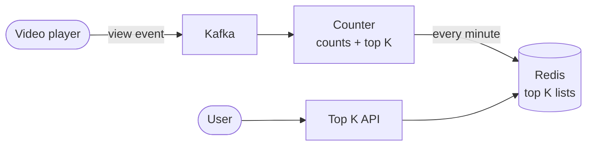
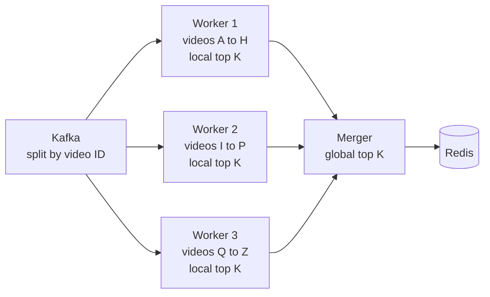
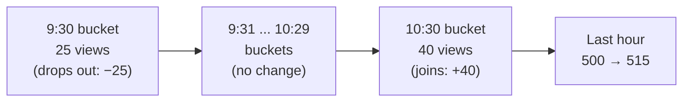
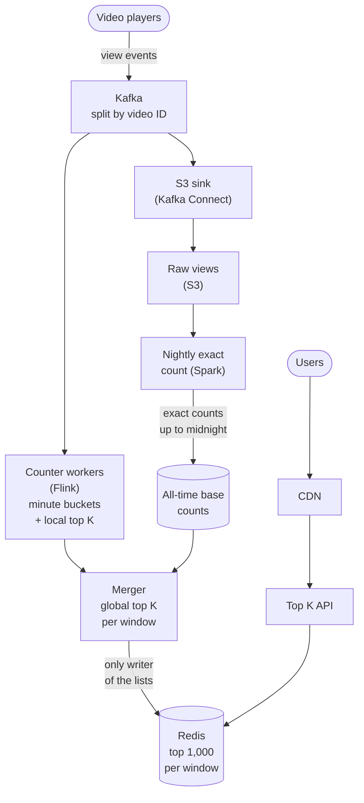

<Callout title="About this question">
  **Difficulty:** Hard. A simple question with a huge stream of events behind it. **Patterns used:**
  [Batch vs Stream Processing](../advanced-components/batch-vs-stream.mdx),
  [Probabilistic Data Structures](../advanced-components/probabilistic-data-structures.mdx),
  [Kafka](../messaging/kafka.mdx), [Redis](../caching/redis.mdx), [Hot Keys](../advanced-components/hot-keys-fan-out.mdx).
</Callout>

## Understand the problem

A video site wants to show "**Top 100 most-watched videos in the last hour**", and also for the last day and all time.

**K** is just the size of the list: top 10, top 100, top 1,000. Finding the top K of a small list is easy: sort it. The hard part is that views pour in **all the time**, there are **a billion videos**, and the list must always be fresh.

## Step 1: Requirements

### Functional requirements

1. Users can get the top K most-viewed videos for a time window: **last hour**, **last day** or **all time**.
2. K can be up to 1,000.

**Out of scope** (say this out loud): lists per country or per user, checking views for bots, the video player.

### Non-functional requirements

1. **Scale:** 1 billion videos. About 10 billion views a day, which is about **100,000 views per second**.
2. **Fresh:** the list is at most **1 minute** old.
3. **Fast reads:** getting the list takes under 100 ms.
4. **Accuracy:** correct, or very close. No money depends on it, so a tiny error is okay. **Ask the interviewer**: this choice changes the design.

### Quick math

- **Memory for exact counts:** 1 billion videos × about 16 bytes (an ID and a count) = about **16 GB** per window, before any overhead. We have three windows.
- **Sorting:** sorting 1 billion numbers every minute is far too slow.
- **Decision:** we can't count everything on one machine and sort it. We will **split the counting** across machines and keep only the **top K**, not a full sorted list. If a small error is okay, we can also **count approximately** with much less memory.

## Step 2: Core entities

- **View event:** video ID, time.
- **Count:** video ID, time bucket (like "10:05"), number of views.
- **Top K list:** the window, the list of videos with their view counts, and when it was computed.

## Step 3: API

```http
GET /top-videos?window=1h&k=100

→ 200 OK
{
  "window": "1h",
  "updatedAt": "2026-11-19T10:31:00Z",
  "videos": [
    { "videoId": "v_981", "views": 1203344 },
    { "videoId": "v_17",  "views": 1189020 }
  ]
}
```

There is only one read endpoint. Views come in from the video player as events, not through this API.

## Step 4: Data flow

1. A user watches a video. A view event goes into Kafka.
2. Counter workers read the views and count them per video, per minute.
3. Each worker finds the top K among **its own** videos.
4. A merger combines all the workers' lists into **one** top K list per window.
5. The final lists are saved in a cache. The API just reads them.

## Step 5: High-level design

Start simple: one counter that keeps everything in memory.



**Count views:**

1. The video player sends a view event, like `{ videoId: "v_981", time: "10:05:12" }`, into Kafka.
2. The Counter reads it and adds 1 to that video's count in a **hash map** (video ID → count).
3. Every minute, the Counter finds the top K and saves the list in Redis.

**Read the list:**

1. The user calls `GET /top-videos?window=1h&k=100`.
2. The API reads the saved list from Redis and returns it. No counting happens at read time.

**How do we find the top K without sorting everything?** Use a **min-heap** of size K. A min-heap is a structure that always tells you its **smallest** item instantly. Go through the counts one by one. If a count is bigger than the smallest item in the heap, swap them.

Example with K = 3 and these counts: A = 50, B = 20, C = 70, D = 10, E = 60.

| Step | Heap (smallest first) | Why |
| --- | --- | --- |
| Add A, B, C | B 20, A 50, C 70 | The heap has room |
| See D = 10 | B 20, A 50, C 70 | 10 is smaller than the smallest (20). Skip it |
| See E = 60 | A 50, E 60, C 70 | 60 beats 20. Remove B, add E |

Result: **C, E, A**. We only ever kept 3 items in the heap, no matter how many videos there are.

This design works for a small site. At 100,000 views per second and a billion videos, one Counter can't keep up, and "last hour" is not handled yet.

## Step 6: Deep dives

### 1. How do we count 100,000 views per second?

<Callout title="Not great: a database row per video" type="error">
  Run `UPDATE videos SET views = views + 1` for every view. That is 100,000 writes per second, many of them on
  the same few popular rows. And `ORDER BY views DESC LIMIT 100` needs an index that changes on every single
  write.
</Callout>

<Callout title="Okay: a Redis sorted set" type="warn">
  A **sorted set** keeps items ordered by a score. `ZINCRBY views 1 v_981` adds a view, and
  `ZRANGE views 0 99 REV WITHSCORES` gives the top 100. Simple and fast for a medium site. **But** one key holding
  a billion videos lives on **one** Redis machine, which becomes the limit.
</Callout>

<Callout title="Best: split by video ID, then merge" type="success">
  Kafka splits view events **by video ID**, so all views of one video go to the same worker. Each worker counts
  its own videos and keeps its **own top K**. A merger combines the small lists into the global top K.
</Callout>



**Why is merging correct?** Because each video is counted by **only one** worker. A video in the global top 100 must be in its own worker's top 100. So the merger only needs each worker's top 100, not all their counts.

<Callout title="The trap: splitting views randomly" type="warn">
  If views of the same video were spread over many workers, a video could be number 101 on every worker, and
  never appear in any local list, even though it is number 1 overall. Always split **by video ID**.
</Callout>

Two small wins: workers add up views **in memory** and update their counts in batches, and they only send their top K to the merger, never all their counts.

**What about one very hot video?** Splitting by video ID means a viral video's views all land on **one** Kafka partition and **one** worker. Say it gets 5% of all views: 5,000 views per second. That sounds scary, but here it is fine. Each view event is tiny (about 100 bytes, so about 0.5 MB per second), and counting is just adding 1 to a number in memory, which one worker can do millions of times per second. If one video ever got too much even for that, we would **pre-count** before Kafka: the servers that receive view events add up views per video for one second and send a single event like `v_981: +350`. We still never spread one video's views over several workers: that is the trap above. (See [Hot Keys](../advanced-components/hot-keys-fan-out.mdx).)

### 2. How do we handle "last hour" and "last day"?

"Last hour" at 10:30 means 9:30 to 10:30. At 10:31 it means 9:31 to 10:31. The window **slides** forward every minute. This is a **sliding window**.

<Callout title="Not great: keep every view and recount" type="error">
  Store each view with its time, and every minute count the views from the last 60 minutes. That re-reads
  hundreds of millions of events every minute.
</Callout>

<Callout title="Best: minute buckets and a running total" type="success">
  Count views per video per **minute**. Keep a running total for the last hour. Each minute, **add** the newest
  minute and **subtract** the minute that just fell out of the window.
</Callout>

Example for video A at 10:31. Its total for the last hour was 500. In the minute 10:30 it got 40 views. The minute 9:30, which just left the window, had 25 views.

New total = 500 + 40 − 25 = **515**. Two small steps, no recounting.



For longer windows, use **bigger buckets**:

| Window | Bucket size | Buckets to keep |
| --- | --- | --- |
| Last hour | 1 minute | 60 |
| Last day | 1 hour | 24 |
| All time | No buckets | One running total |

Stream processors like Apache Flink support these windows directly, so we don't have to build the bucket logic ourselves.

### 3. Exact or approximate counting?

**Exact** means a real counter for every video. Correct, but it needs lots of memory and more machines.

**Approximate** uses a **Count-Min Sketch**: a small, fixed-size table of counters that gives "almost right" counts. (See [Probabilistic Data Structures](../advanced-components/probabilistic-data-structures.mdx).)

How it works, with a tiny table of **3 rows × 5 columns**. Each row has its own hash function, which turns a video ID into a column number.

- **Add a view:** in every row, add 1 to the column that row's hash picks.
- **Read a count:** look at the video's cell in every row, and take the **smallest** number.

Video A maps to columns (2, 4, 1). Video B maps to columns (2, 0, 3). A got 5 views and B got 3 views:

| | col 0 | col 1 | col 2 | col 3 | col 4 |
| --- | --- | --- | --- | --- | --- |
| Row 1 | 0 | 0 | **8** | 0 | 0 |
| Row 2 | 3 | 0 | 0 | 0 | 5 |
| Row 3 | 0 | 5 | 0 | 3 | 0 |

- Count for A = smallest of (8, 5, 5) = **5**. Correct.
- Count for B = smallest of (8, 3, 3) = **3**. Correct.

Row 1 alone says 8 for both, because A and B **share** that cell. Taking the smallest across rows hides most of these clashes. A Count-Min Sketch **never counts too low**, and only sometimes counts a little too high. Its size stays the same whether there are a thousand videos or a billion.

The sketch can answer "how many views does video X have?", but it can't list videos. So we pair it with a **min-heap of size K**: after each view, ask the sketch for that video's count, and update the heap.

**Careful: that heap trick only works when counts only go up.** That is true for "all time". It is not true for "last hour": as old minutes drop out of the window, counts go **down**. The heap only hears about a video when it gets a new view. So a video that was hot at 9:40 and then went quiet would stay in the heap with its old, high count. For sliding windows we do it a little differently:

- Keep **one small sketch per minute bucket**, all with the same hash functions. Sketches like that can be added and subtracted cell by cell. So the last-hour sketch is a running total, just like in deep dive 2: add the newest minute's sketch, subtract the one that dropped out. (We subtract exactly what that minute added, so it still never counts too low.)
- Keep a list of **candidates**: the top few thousand videos of each recent minute.
- Every minute, **rebuild the heap from scratch**: look up each candidate in the last-hour sketch, and keep the top K.

<Callout title="Okay: exact counts on many machines" type="warn">
  Always correct. Needs much more memory, and more workers as the number of videos grows.
</Callout>

<Callout title="Best when small errors are okay: Count-Min Sketch + heap" type="success">
  Tiny, fixed memory and very fast. Add a **nightly batch job** that counts exactly from the raw views in S3.
  It gives the all-time list an exact base, so the sketch's small errors never pile up for more than a day.
</Callout>

**The raw views in S3** get there through an **S3 sink** (for example Kafka Connect's S3 connector): a second Kafka consumer that writes every view event to S3 in big files. Kafka does not copy to S3 by itself.

**Batch and stream must not fight over the same lists.** If the nightly batch wrote the all-time list into Redis, the merger would overwrite it a minute later with its own numbers, and the batch would overwrite those again the next night. So each list has **one writer**: only the merger writes the lists people read. The batch job writes something else into its own table: the **exact all-time count of each video up to midnight**, plus the top 10,000 videos by that count. The merger then builds the all-time list as "exact count up to midnight + stream count since midnight", over those 10,000 videos plus today's top videos from the stream. Every night the base becomes exact again, and the stream adds today on top.

### 4. How do reads stay fast?

Reads never count anything. The merger writes the top 1,000 for each window to Redis every minute, as one small value per window. A request for `k=100` just takes the first 100. Since the list changes only once a minute, a CDN or a short cache in front of the API can serve almost every request.

### Final architecture



## In the real world

**Trending is more than raw views.** YouTube has explained that its Trending list was not based on view count alone. It also looked at how quickly a video was gaining views, where the views came from, and how new the video was. The counting pipeline on this page is the base. A "trending score" is a formula on top of it.

**Redis sorted sets** are a common way to build leaderboards. Redis also offers built-in **Count-Min Sketch** and **Top-K** data types (from its RedisBloom module), for exactly this kind of problem.

**The Count-Min Sketch** was described by Graham Cormode and S. Muthukrishnan in the 2000s, and is widely used for counting in large data streams.

**Apache Flink** supports tumbling and sliding windows on event time, and is often used for streaming counts like these.

## Follow-up questions

<Accordions>
<Accordion title="How do you show top K per country?">

Make the count key `(country, videoId)` instead of just `videoId`, and keep one top K list per country. It is the same pipeline. Small countries have small lists, so this adds less work than it sounds.

</Accordion>
<Accordion title="How do you stop bots from pushing a video to the top?">

Clean the views **before** counting: count one view per user per video in a short time, ignore very short plays, and limit views per IP address. A fraud system can remove bad views later, and the nightly batch job leaves them out of the exact all-time counts.

</Accordion>
<Accordion title="What is the difference between 'most viewed' and 'trending'?">

"Most viewed" is just the biggest counts. "Trending" is about **growth**: a video with 50,000 views this hour that normally gets 500 is trending, even if a music video has more views. Compute a score like "views this hour ÷ usual views per hour" and rank by that.

</Accordion>
<Accordion title="What happens if a counter worker crashes?">

Flink saves its counts and its Kafka position together in **checkpoints**. A new worker loads the last checkpoint and re-reads Kafka from there. The list may be a minute late, but it stays correct.

</Accordion>
</Accordions>

## What the interviewer expects

<Tabs items={['Mid-level', 'Senior', 'Staff']}>
<Tab value="Mid-level">

- A hash map of counts and a min-heap of size K.
- Precompute the lists. Reads only fetch them.
- Know that one machine can't count everything.

</Tab>
<Tab value="Senior">

- Split by video ID, local top K, then merge, and explain why that is correct.
- Sliding windows with minute buckets and a running total.
- Exact vs Count-Min Sketch, with the tradeoffs, and why the heap must be rebuilt for sliding windows.
- Hot videos: why one worker per video is still fine.
- Kafka plus a stream processor.

</Tab>
<Tab value="Staff">

- Everything from senior, but faster.
- Stream for fresh lists plus a nightly batch for an exact all-time base, with one writer per list.
- Trending scores, per-country lists, and bot filtering.
- Failure recovery with checkpoints, and cost.

</Tab>
</Tabs>

<Callout title="Remember this" type="success">
  - **Min-heap of size K** finds the top K without sorting everything.
  - **Split by video ID**, keep a local top K per worker, then **merge**. Never split one video's views randomly.
  - **Sliding windows:** minute buckets, add the newest, subtract the oldest.
  - **Bigger buckets for longer windows:** minutes for an hour, hours for a day.
  - **Count-Min Sketch:** fixed memory, never counts too low. Pair it with a heap. For sliding windows: one sketch per bucket, and rebuild the heap every minute.
  - **Batch + stream:** the batch gives an exact base, the merger is the only writer of the lists.
  - **Precompute lists into Redis.** Reads never count.
</Callout>
