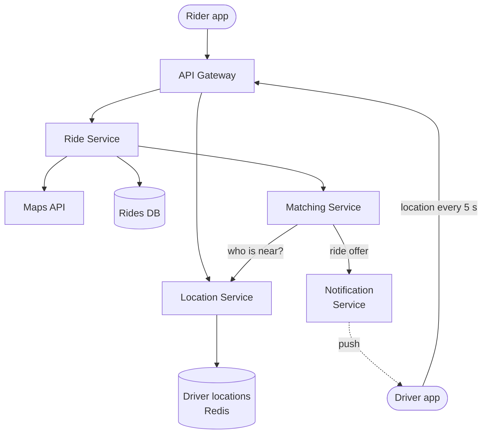
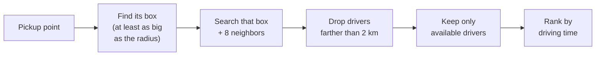
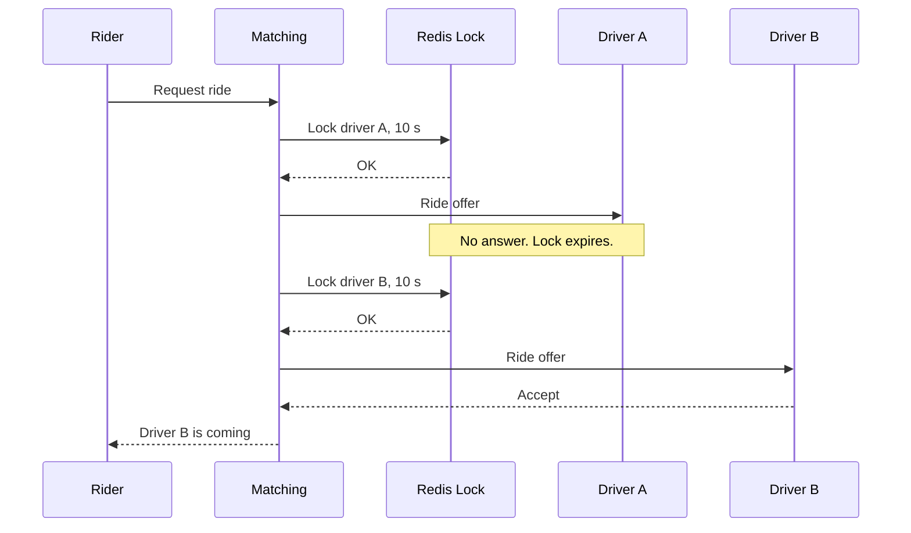
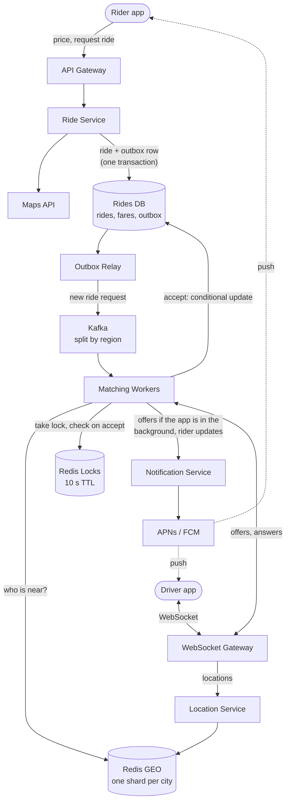

<Callout title="About this question">
  **Difficulty:** Hard. **Patterns used:** [Geospatial Indexing](../advanced-components/geospatial-indexing.mdx),
  [Redis](../caching/redis.mdx), [Polling, WebSockets and SSE](../foundations/polling-websockets-sse.mdx),
  [Distributed Locking](../distributed-systems/distributed-locking.mdx), [Partitioning and Sharding](../databases/partitioning-sharding.mdx).
</Callout>

## Understand the problem

A rider opens the app, enters where they want to go, and sees a price. They press "Request". The system finds a nearby free driver and sends them the ride. The driver accepts, and drives to the rider.

Three things make it hard:

- **Drivers move all the time.** Every driver's phone sends its location every few seconds. That is a flood of writes.
- **"Who is near me?"** must be answered fast, out of millions of moving drivers.
- **One driver, one ride.** Two riders must never be matched with the same driver at the same moment.

## Step 1: Requirements

### Functional requirements

1. Riders can enter a pickup and a destination, and get a price estimate.
2. Riders can request a ride and get matched with a nearby, available driver.
3. Drivers can share their location, and accept or decline ride requests.

**Out of scope** (say this out loud): payments, ratings, shared rides, booking rides for later, turn-by-turn navigation (we use an outside maps service), signing up drivers.

### Non-functional requirements

1. **Fast matching:** a rider is matched within about 1 minute, or told that no car is free. Finding nearby drivers takes less than 100 ms.
2. **No double booking:** a driver gets **one** ride offer at a time, and a ride gets **one** driver. Matching needs **strong consistency**.
3. **Many location updates:** 2 million drivers online at peak, each sending its location every 5 seconds.
4. **Always up:** 99.99% uptime. A driver's location being a few seconds old is fine (**eventual consistency** for locations).
5. **Busy peaks:** Friday nights, New Year's Eve, a stadium after a concert.

### Quick math

- **Location updates:** 2 million drivers ÷ 5 seconds = **400,000 updates per second**. That is far too many writes for a normal database. **Decision:** keep live locations **in memory**.
- **Memory:** 2 million drivers × about 100 bytes = **200 MB**. Tiny! The problem is how **often** the data changes, not how big it is.
- **Rides:** 10 million rides per day = about **115 per second**. A normal SQL database handles that easily.

## Step 2: Core entities

- **Rider:** the person who wants a ride.
- **Driver:** a driver, their car, and their **status**: `offline`, `available` or `on_trip`.
- **Location:** a driver's latest latitude and longitude, and when it was sent.
- **Fare:** the price estimate for one trip.
- **Ride:** rider, driver, pickup, destination, price and **status** (`matching`, `driver_on_the_way`, `in_progress`, `done`, or `cancelled`).

## Step 3: API

```http
POST /fares
{ "pickup": { "lat": 37.7749, "lng": -122.4194 }, "destination": { "lat": 37.7955, "lng": -122.3937 } }

→ 200 OK
{ "fareId": "fare_1", "priceCents": 1850, "etaMinutes": 4 }
```

```http
POST /rides
Idempotency-Key: 3f9a1c7e-2b4d-4e6f-8a1b-9c0d2e3f4a5b
{ "fareId": "fare_1" }

→ 201 Created
{ "rideId": "ride_789", "status": "matching" }
```

The price is a whole number of cents (`1850` = $18.50), never a decimal number, so rounding never loses money. The rider sends the `fareId`, not the price. So nobody can change the price on their phone.

The **`Idempotency-Key`** is a unique ID the app makes once per "Request" tap and sends again on every retry. Phones often lose the network for a moment. Without the key, a retried request would create a second ride, and two drivers would drive to the same rider. With it, the Ride Service sees the key it already saved and returns the first ride (see [Idempotency](../messaging/idempotency.mdx)).

```http
POST /drivers/location
{ "lat": 37.7751, "lng": -122.4180 }

→ 204 No Content
```

```http
PATCH /rides/{rideId}
{ "action": "accept" }

→ 200 OK
{ "rideId": "ride_789", "status": "driver_on_the_way" }
```

As always, who is calling (rider or driver ID) comes from the **login token**, never from the request body.

## Step 4: High-level design



**Get a price:**

1. The rider sends the pickup and destination.
2. The Ride Service asks an outside **Maps API** for the distance and driving time.
3. It works out the price, saves it as a **Fare**, and returns it.

**Request a ride:**

1. The rider sends `POST /rides` with an idempotency key. The Ride Service saves a ride with status `matching` (or returns the saved ride if the key was seen before) and passes it to the Matching Service. (Deep dive 4 makes this hand-off safe if the service crashes in the middle.)
2. The Matching Service asks the Location Service for **available drivers near the pickup**.
3. It picks the best one and sends them a **ride offer** through the Notification Service (a push notification, or a message on the driver's open connection).
4. The driver has 10 seconds to accept. If they accept, the ride becomes `driver_on_the_way`, and the rider is told. If they decline or don't answer, the next driver gets the offer.

**Share location:**

1. Every 5 seconds, the driver's app sends its location (a parked driver less often, see deep dive 1).
2. The Location Service saves it in the in-memory location index.

## Step 5: Deep dives

### 1. How do we handle 400,000 location updates per second?

<Callout title="Not great: write every update to the main SQL database" type="error">
  Each update writes to disk and updates the indexes. 400,000 of these per second is far beyond one database,
  and we would be storing a long history of positions we don't need.
</Callout>

<Callout title="Okay: a database built for many writes, like Cassandra" type="warn">
  It can take the writes if we add enough machines. **But** "find drivers near this point" is still hard and slow
  to ask, and we keep paying to store old positions.
</Callout>

<Callout title="Best: only the latest position, in memory, in Redis" type="success">
  We only need **where each driver is now**. Keep that in a Redis **geo index**, split by city. Every update simply
  replaces the old position. 200 MB fits easily in memory, and Redis handles a huge number of small writes per
  second.
</Callout>

```bash
# Driver 42 is here. (Redis wants longitude first, then latitude.)
GEOADD drivers:sf -122.4194 37.7749 "driver:42"

# The 10 closest drivers within 2 km of the pickup, nearest first.
GEOSEARCH drivers:sf FROMLONLAT -122.4183 37.7755 BYRADIUS 2 km ASC COUNT 10
```

Nice details:

- **What if Redis crashes?** We lose almost nothing. Every moving driver sends a fresh location within 5 seconds (a parked one within 15), so the index **fills itself up again** within about 15 seconds. Old positions were never worth saving.
- **Keep one connection open.** The driver's app uses a **WebSocket**: one connection that stays open, so each update is a tiny message, not a whole new HTTP request.
- **Drivers who go silent:** we also store when each driver last sent a location. Drivers not heard from in 30 seconds (app closed, tunnel) are ignored, and a cleanup job removes them.
- **Send less when it does not matter:** a parked driver can send every 15 seconds, not every 5. Not every 30: then one late update would push a parked driver past the 30-second cut-off, and they would blink out of the index.

### 2. How do we find nearby drivers fast?

A normal index does not work well for locations. An index on **latitude** finds every place at about the right latitude: a thin strip that goes **all around the world**. Same for longitude. The database must then combine two huge lists.

The fix is to turn two numbers (latitude and longitude) into **one** value that keeps nearby places close together. The common way is a **geohash**:

1. Split the world map into 32 boxes. Give each box a character.
2. Split each box into 32 smaller boxes, and add one more character. Repeat.
3. A box's code **starts with its parent's code**. For example, box `9q8y` contains the smaller boxes `9q8y0`, `9q8y1`, and so on.

So places that are close usually share the same first characters, and a normal sorted index can find "everything in box `9q8y`" fast.

One catch: two drivers can be 10 meters apart but on **opposite sides of a box border**, so their codes differ. That is why we always search the pickup's box **and the 8 boxes around it**.

Two more rules make this correct:

- **The box must be at least as big as the search radius.** The 8 neighbors reach only one box past the pickup's own box. For a 2 km search, a 5-character geohash box (about 4.9 km wide) is big enough. A smaller box would miss a driver 2 km away, two boxes over.
- **Then filter by real distance.** The 9 boxes cover much more than the 2 km circle, so we drop every driver farther than 2 km.

Redis `GEOSEARCH` does both steps for us: it picks the box size from the radius, and returns only drivers inside it.



<Callout title="Not great: latitude and longitude ranges with normal indexes" type="error">
  `WHERE lat BETWEEN ... AND lng BETWEEN ...` reads two long strips of the map and combines them. Slow, and it
  gets worse as we grow.
</Callout>

<Callout title="Okay: PostGIS" type="warn">
  PostGIS adds real location indexes to Postgres. Location queries are fast and powerful. **But** it is still a
  disk-based database, and it cannot take 400,000 updates per second.
</Callout>

<Callout title="Best: a geohash index in memory (Redis GEO)" type="success">
  Redis GEO stores each driver in a **sorted set**, with a geohash as the sort score. `GEOSEARCH` finds nearby
  drivers in well under a millisecond, and updates are just as fast.
</Callout>

Another option you can name is a **quadtree**: split a square into 4 smaller squares only when it has too many drivers. Busy downtown areas get tiny squares, empty countryside gets big ones. It handles uneven crowds well, but it is harder to keep up to date when drivers move every few seconds.

**Closest is not always best.** A driver 300 meters away on the other side of a river may need 15 minutes to reach you. So we take the 10 closest drivers and ask the Maps API for the real **driving time** (ETA) of each, then offer the ride to the best one.

### 3. How do we match without double-booking a driver?

Two Matching Service servers handle two riders on the same street. Both find **driver 42** as the best choice, at the same moment. Only one should get them.

<Callout title="Not great: check the driver's status, then send the offer" type="error">
  Both servers read "driver 42 is available", and both send an offer. This is a **race condition**. Driver 42
  gets two rides.
</Callout>

<Callout title="Okay: an atomic status update in the database" type="warn">
  `UPDATE drivers SET status = 'offered' WHERE id = 42 AND status = 'available'`. Only one server changes the
  row. **Correct.** **But** if the driver never answers, something must set them back to `available`, so we need
  a cleanup job with timers. And we add a lot of busy writes to the main database.
</Callout>

<Callout title="Best: a lock in Redis that expires after 10 seconds" type="success">
  Before sending an offer, take a lock: `SET lock:driver:42 ride_789 NX EX 10`. `NX` means only one server can
  get it. `EX 10` means it **disappears by itself after 10 seconds**. So "the driver did not answer" handles
  itself: the lock expires, and the driver is free for the next offer.
</Callout>



When a driver **accepts**, we must check that the offer is still good. The answer may come late: the lock may have expired, and the ride may already have gone to another driver.

1. **Is the offer still alive?** The lock must still hold this ride: `GET lock:driver:42` must return `ride_789`. If it returns nothing or another ride, the driver answered too late, and we tell them "this ride is no longer available".
2. **Make it final in the Rides DB**, in one transaction, with two **conditional** updates:

```sql
BEGIN;
UPDATE rides SET driver_id = 42, status = 'driver_on_the_way'
  WHERE id = 'ride_789' AND status = 'matching';   -- the ride has no driver yet
UPDATE drivers SET status = 'on_trip'
  WHERE id = 42 AND status = 'available';          -- the driver is still free
-- The app checks both row counts. If either update changed 0 rows,
-- it runs ROLLBACK and tells the driver the ride is gone.
COMMIT;
```

The Redis lock only decides **who gets the offer**. It can expire between step 1 and step 2, so it can't be the final guard. The two `WHERE` conditions make sure that a ride gets one driver, and a driver gets one ride, even if a late answer slips past the lock check. The Matching Service also skips drivers who are locked or `on_trip` when it searches. See [Distributed Locking](../distributed-systems/distributed-locking.mdx).

### 4. Busy areas and peak times

- **Split by city.** Each city (or region) gets its own Redis shard, or several for a big city like New York. Cities don't share drivers, so they never need to talk to each other. A pickup near a border searches both sides.
- **Put ride requests in a queue.** Ride requests go into **Kafka**, split by region, and matching workers pull from it. At midnight on New Year's Eve, the queue gets longer instead of requests being dropped. If a matching worker crashes, another one picks up its requests.
- **Save the ride and queue it in one step.** "Save the ride, then send it to Kafka" is two writes. If the Ride Service crashes between them, the ride stays `matching` forever, and the rider's retry just returns that stuck ride. So the Ride Service saves the ride **and** a "new ride request" row in an **outbox** table, in one transaction. An Outbox Relay reads that table and sends the rows to Kafka (the [Outbox Pattern](../distributed-systems/outbox-pattern.mdx)). The relay may send a request twice after a crash. That is fine: a matching worker skips rides that are no longer `matching`, and the conditional accept still gives each ride one driver.
- **Raise prices when demand is high.** When many more riders than drivers are in one area, the price goes up. Some riders wait, and more drivers drive to that area. This is a **business** fix for a scaling problem, and it works.
- **Match in small batches.** Instead of giving each rider the closest driver right away, wait 1 to 2 seconds and match a group of riders and drivers together. The total waiting time for everyone gets shorter.
- **Hot spots** like a stadium or an airport: use smaller cells there, or a simple line where the driver who has waited longest gets the next ride.

### Final architecture



## In the real world

- **Uber built H3**, a grid system that covers the whole world with **hexagons**, and made it open source in 2018. With hexagons, all six neighbors are the same distance from the center, which makes "what is around here?" questions simpler. Uber uses it to study supply and demand in each area, for example for pricing.
- Uber's earlier dispatch system split the map into cells using Google's **S2** library, and spread the work across servers with **Ringpop**, an open-source library Uber built.
- Uber raises prices when demand is high in an area. It calls this **surge pricing**.
- **Redis GEO** commands (`GEOADD`, `GEOSEARCH`) store locations in a **sorted set**, using a geohash as the score. It is a common, simple choice for "find things near me".
- Ride apps send ride offers and updates through the phone's push systems: **APNs** (Apple) and **FCM** (Google), plus their own open connection while the app is running.

## Follow-up questions

<Accordions>
<Accordion title="No driver accepts the ride. What then?">

After each decline or timeout, offer the ride to the next best driver. After a few tries, make the search circle bigger. If nobody is found in about a minute, tell the rider "No cars available" and mark the ride `cancelled`.

</Accordion>
<Accordion title="How does the rider see the driver's car moving on the map?">

Once matched, the driver's location updates are also sent to the rider's app, over a WebSocket (or SSE), every few seconds. The app **animates** the car smoothly between two updates, so it does not jump.

</Accordion>
<Accordion title="We want the full route of every trip, for receipts and disputes. Where does it go?">

Not in Redis, and not on the hot path. The Location Service also sends each update to Kafka. A separate worker writes trip routes to cheap storage, like Cassandra or object storage. If it falls behind, nothing in matching slows down.

</Accordion>
<Accordion title="The Matching Service crashes in the middle of a match. What happens?">

The ride request is still in Kafka (and the ride is still `matching` in the Rides DB), so another worker picks it up. Any driver lock it was holding expires by itself after 10 seconds. Nothing is stuck.

</Accordion>
<Accordion title="Why not use the Rides DB for locks too?">

You can, with the atomic update from deep dive 3. But offers happen many times per ride (declines, timeouts), and most of them never become rides. Keeping this short-lived, high-traffic state in Redis keeps the main database calm. The final "accept" still goes to the database, with its two conditional updates.

</Accordion>
</Accordions>

## What the interviewer expects

<Tabs items={['Mid-level', 'Senior', 'Staff']}>
<Tab value="Mid-level">

- Clear requirements, entities and API, with an idempotency key on `POST /rides`.
- A design with ride, location and matching services.
- Know that normal indexes are bad for "near me", and name a geo index (geohash, Redis GEO or PostGIS).
- Send offers to one driver at a time.

</Tab>
<Tab value="Senior">

- Do the location math (400,000 per second) and keep locations in memory.
- Explain geohash, the 8 neighbors, and ranking by driving time.
- Prevent double booking with a lock that expires for offers, and a conditional update when the driver accepts.
- WebSockets for drivers, and handling drivers who go silent.

</Tab>
<Tab value="Staff">

- Everything from senior, but faster.
- Splitting by city, queues for peaks, and what happens when each part fails.
- Surge pricing and batch matching as tools for busy times.
- Tradeoffs between geohash, quadtrees and hexagons (H3).

</Tab>
</Tabs>

<Callout title="Remember this" type="success">
  - **400,000 location updates per second** → keep only the **latest** location, **in memory** (Redis GEO).
  - If Redis is lost, the index **refills itself** within about 15 seconds (moving drivers send every 5 s, parked ones every 15 s). Silent for 30 s = ignored.
  - **Geohash** turns latitude and longitude into one code. Pick a cell at least as big as the search radius, search the cell **plus its 8 neighbors**, then drop drivers outside the radius.
  - Rank nearby drivers by **driving time**, not straight-line distance.
  - **No double booking:** a Redis lock with a **10-second TTL** per driver. No answer = the lock expires = next driver.
  - **Accept is conditional:** the lock must still hold this ride, the ride must still be `matching`, and the driver must still be `available`.
  - **Peaks:** split by city, queue the requests (through an **outbox**, so a saved ride is always queued), and use surge pricing.
</Callout>
