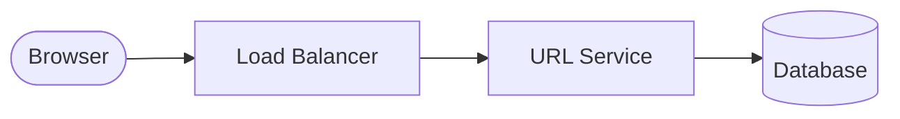
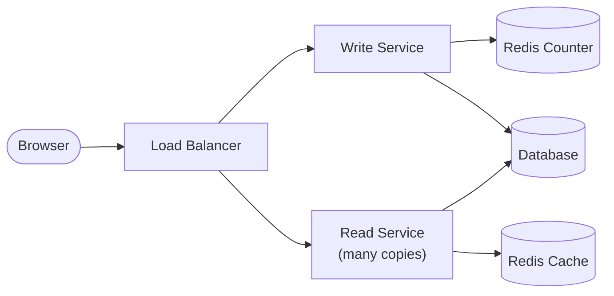

<Callout title="About this question">
  **Difficulty:** Easy. A great first question. **Patterns used:** [Scaling Reads](../hld-basics/scaling-reads.mdx),
  unique IDs, [Caching](../caching/what-is-caching.mdx).
</Callout>

## Understand the problem

A URL shortener turns a long link like `https://www.example.com/blog/2026/how-to-learn-system-design?ref=newsletter` into a short one like `https://short.ly/aB3x9Kq`.

When someone opens the short link, they are sent to the long link.

## Step 1: Requirements

### Functional requirements

1. Users can create a short link from a long link.
2. Users can open a short link and be sent to the long link.
3. (Optional) Users can choose their own short link, like `short.ly/my-blog`.
4. (Optional) Links can have an expiry date.

**Out of scope** (say this out loud): user accounts, click analytics, editing links.

### Non-functional requirements

1. **Unique:** two long links must never get the same short code.
2. **Fast:** opening a short link takes less than 100 ms.
3. **Always up:** 99.99% uptime. If a new link takes a second to work everywhere, that is okay. So we pick **availability** over consistency.
4. **Big:** 1 billion links and 100 million users per day.

### Quick math

- **Storage:** 1 billion links × about 500 bytes = about **500 GB**. This fits on one database. No need to split the data just for size.
- **Reads:** 100 million users × about 10 opens = 1 billion opens per day. That is about **12,000 opens per second** on average, and more at busy times. Too much for one database alone, so we will need a **cache**.

## Step 2: Core entities

- **Link:** short code, long URL, created date, expiry date.

There is no User entity, because user accounts are out of scope.

## Step 3: API

```http
POST /urls
{
  "longUrl": "https://www.example.com/blog/how-to-learn",
  "customAlias": "my-blog",
  "expiresAt": "2027-01-01"
}

→ 201 Created
{ "shortUrl": "https://short.ly/my-blog" }
```

```http
GET /{shortCode}

→ 302 Found
Location: https://www.example.com/blog/how-to-learn
```

<Callout title="301 or 302?" type="idea">
  **301** means "moved forever". The browser remembers it and next time skips our server. That is faster, but we
  can't count clicks or expire the link anymore. **302** means "moved for now". Every click comes to our server.
  Pick **302** if you need expiry or analytics.
</Callout>

## Step 4: High-level design



**Create a short link:**

1. The browser sends `POST /urls` with the long URL.
2. The URL Service makes a new unique short code.
3. It saves `short code → long URL` in the database. The insert fails if the code is already taken. It never overwrites a row.
4. It returns the short link.

**Open a short link:**

1. The browser asks for `GET /aB3x9Kq`.
2. The URL Service finds `aB3x9Kq` in the database.
3. It returns a `302` redirect to the long URL.

**Links table:**

| Column | Example |
| --- | --- |
| `shortCode` (primary key) | `aB3x9Kq` |
| `longUrl` | `https://www.example.com/...` |
| `createdAt` | `2026-11-19` |
| `expiresAt` | `2027-01-01` |

## Step 5: Deep dives

### 1. How do we make short codes unique?

<Callout title="Not great: hash the long URL" type="error">
  Hash the long URL (for example with MD5) and keep the first 7 characters. **Problem:** two different URLs can
  give the same first 7 characters. This is called a **collision**. You must check the database and handle it
  every time.
</Callout>

<Callout title="Okay: random code + check" type="warn">
  Make a random 7-character code. Check the database. If it is already used, try again. **Works**, because
  collisions are rare. **But** every create needs an extra database read.
</Callout>

<Callout title="Best: a counter + base62" type="success">
  Keep one shared counter in Redis. Every new link gets the next number with `INCR`: 1, 2, 3, and so on. Then turn
  the number into a short code with **base62**. Numbers never repeat, so counter codes **never collide with each
  other**.
</Callout>

<Callout title="Watch out: custom aliases" type="warn">
  A user can pick an alias like `aB3x9Kq` that the counter will reach later. Then the counter makes a code that is
  already taken. Two simple fixes: (1) the insert fails on a taken code (the primary key does this), and we skip to
  the next number; or (2) keep aliases in their own space, so they can never look like a counter code. For example, an
  alias must have 8 or more characters, or contain a `-` like `my-blog`. Counter codes have at most 7 characters, and
  never contain `-`, because `-` is not a base62 character. Either way, a code is never given out twice.
</Callout>

**Base62** uses 62 characters: `0-9`, `a-z` and `A-Z`. With 7 characters you get 62⁷ = about **3.5 trillion** codes. That is far more than 1 billion.

```js
const ALPHABET = '0123456789abcdefghijklmnopqrstuvwxyzABCDEFGHIJKLMNOPQRSTUVWXYZ';

function toBase62(num) {
  if (num === 0) return ALPHABET[0];
  let code = '';
  while (num > 0) {
    code = ALPHABET[num % 62] + code;
    num = Math.floor(num / 62);
  }
  return code;
}

toBase62(125); // "21"  (2 × 62 + 1)
```

Two small improvements:

- **Fewer calls to Redis:** each server takes a block of 1,000 numbers at once, and uses them one by one.
- **Hard to guess:** counter codes are easy to guess (the next one is +1). If that matters, scramble the number first with a fixed formula that can be reversed.

**What if Redis loses the counter?** If Redis restarts without its saved data, the counter can start again from an old number and hand out codes that already exist. To stop this:

- Turn on Redis **persistence** (saving to disk), so the counter survives a restart.
- On start-up, set the counter **above** the biggest number already used in the database, plus a safety gap.
- The insert still fails on a taken code, so even a wrong counter can never overwrite an existing link.

### 2. How do we make redirects fast?

- The `shortCode` is the **primary key**, so the database already has an **index** on it. An index lets the database find a row without reading every row.
- Add a **Redis cache** in front of the database. Popular links stay in memory, so most opens never reach the database. Use a TTL, and delete the key when a link is deleted.

### 3. How do we handle 100 million users a day?

- **Run many copies of the service** behind the load balancer. The service is **stateless**: it keeps nothing in its own memory between requests. So adding more copies is easy.
- **Split reads and writes** into two services. Opens are about 100 times more than creates, so we can run many more read servers.
- **Database:** 500 GB fits on one machine. Add **read replicas** so the database stays up if one machine dies.



## In the real world

**Twitter (now X) runs its own shortener, t.co.** Every link posted on X is wrapped in a `t.co` link. This gives X one place to check links against lists of harmful sites, and to count clicks.

**Snowflake IDs.** Twitter also built **Snowflake** (2010), a way to make unique IDs on many machines **without** one shared counter. Each 64-bit ID is made of the current time, the machine's number, and a small counter on that machine. It is a good answer if the interviewer asks: "what if the Redis counter goes down?" See [Distributed ID Generation](../distributed-systems/distributed-id-generation.mdx).

**Short links must keep working for years.** Google stopped making new goo.gl links in 2019. In 2025 it also turned off the old links, and kept only the ones people were still clicking. Short links end up printed in books, papers and posters, so when they stop working, those links break for good. People expect short links to work for a very long time. That is why "always up" is a key requirement.

## Follow-up questions

<Accordions>
<Accordion title="Two users ask for the same custom alias at the same time. What happens?">

The `shortCode` column is the primary key, so it must be unique. The first insert works. The second one fails, and we return `409 Conflict`. The user picks another alias.

</Accordion>
<Accordion title="How do you remove expired links?">

When someone opens a link, check `expiresAt`. If it has passed, return `410 Gone`. It means "this link existed, but is gone for good" (`404` also works). A background job deletes old rows once a day. Keep the cache TTL shorter than the time left before the link expires.

</Accordion>
<Accordion title="How would you add click counts?">

Don't slow down the redirect. Send a small "clicked" event to a queue like Kafka, and return the redirect right away. A separate worker reads the queue and updates the counts.

</Accordion>
</Accordions>

## What the interviewer expects

<Tabs items={['Mid-level', 'Senior', 'Staff']}>
<Tab value="Mid-level">

- Clear requirements and API.
- A simple high-level design that works.
- One good way to make unique codes, like counter + base62.
- Add a cache when the interviewer asks about speed.

</Tab>
<Tab value="Senior">

- Lead the deep dives yourself.
- Compare hash vs random vs counter, with tradeoffs.
- Explain 301 vs 302.
- Scale with stateless services, separate read and write services, and counter batching.

</Tab>
<Tab value="Staff">

- Everything from senior, but faster.
- Running in many regions, and what happens if the Redis counter fails.
- Stopping abuse: rate limits and checking for harmful links.
- Knowing when **not** to add more complexity.

</Tab>
</Tabs>

<Callout title="Remember this" type="success">
  - **Read-heavy** → add a cache.
  - **Unique codes** → counter + base62. 7 characters = about 3.5 trillion codes. Custom aliases can take a future
    counter code, so the insert must fail on a taken code.
  - **302** if you need expiry or analytics. **301** is faster, but browsers remember it.
  - **Stateless services** behind a load balancer. Scale reads and writes separately.
  - 1 billion links × 500 bytes = **500 GB**. No need to split the database at first.
</Callout>
