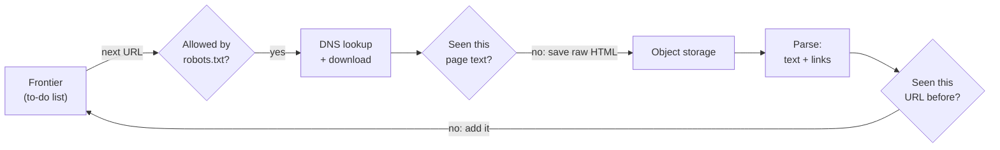
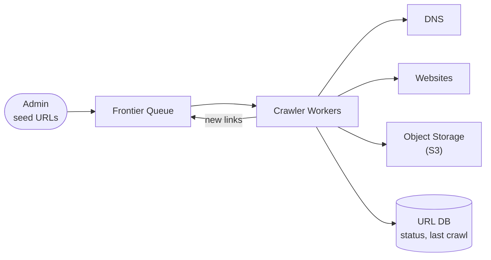
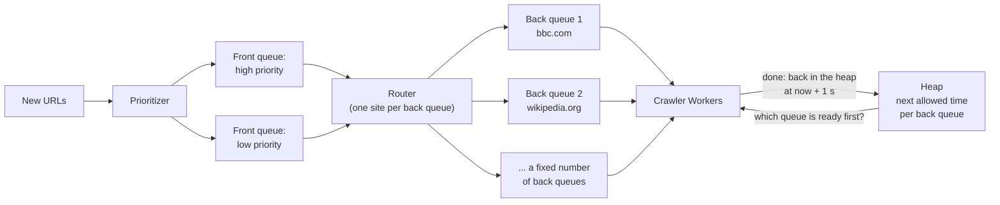
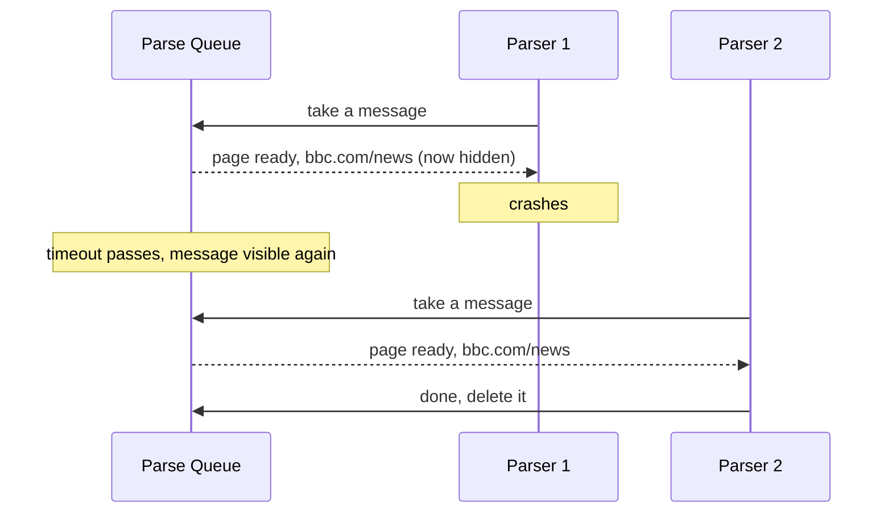
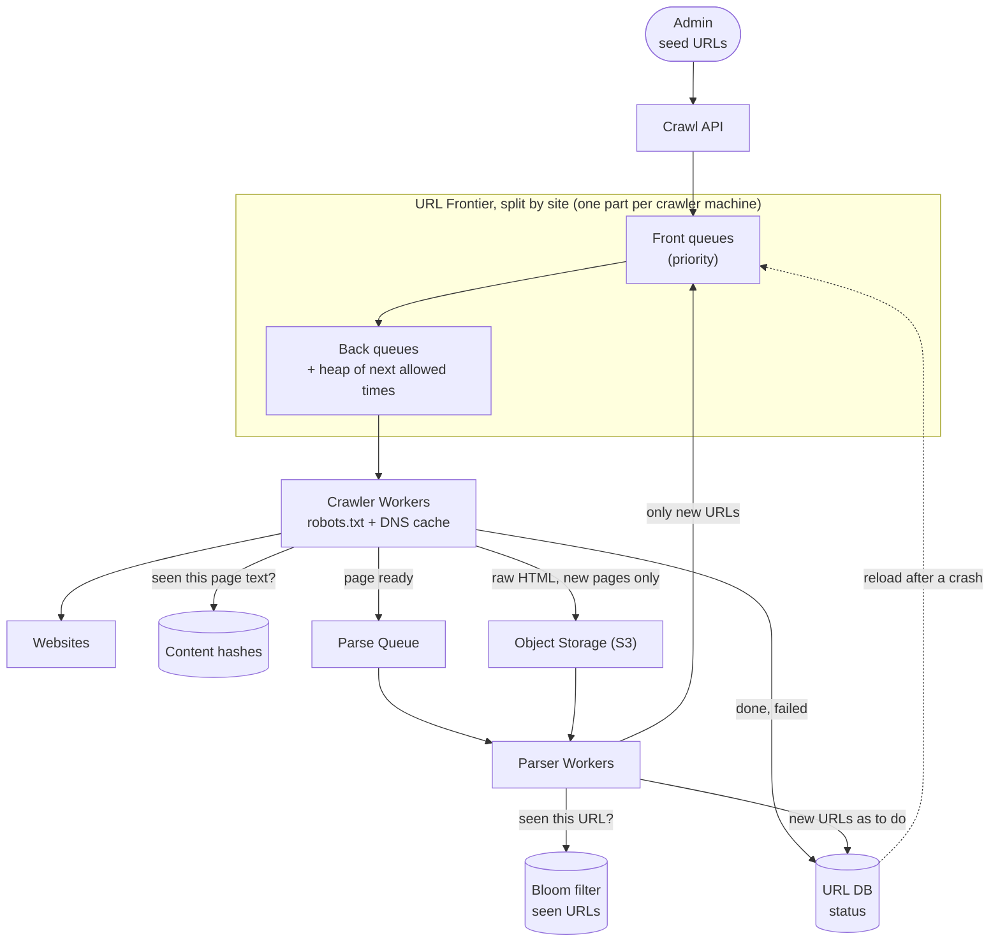

<Callout title="About this question">
  **Difficulty:** Medium. This question uses the optional **Data Flow** step of the [framework](../interview-framework.mdx).
  **Patterns used:** [Message Queues](../messaging/message-queues-pub-sub.mdx), [Bloom Filter](../advanced-components/probabilistic-data-structures.mdx),
  [Rate Limiting](../reliability-security/rate-limiting.mdx), [Retries and Backoff](../messaging/retries-backoff-timeouts.mdx),
  [Object Storage](../advanced-components/storage-types.mdx).
</Callout>

## Understand the problem

A **web crawler** (also called a spider or a bot) is a program that visits web pages on its own. It starts with a few pages, finds the links on them, visits those pages, finds more links, and so on.

Search engines like Google use crawlers to find pages for their search results. Others use them to collect text, for example to train AI models.

It sounds simple. It is hard at scale, because:

- The web is **huge**: billions of pages.
- Sites can be slow, broken, or **tricky** (pages that create endless links).
- We must be **polite**. If we send 1,000 requests a second to a small site, we take it down.

## Step 1: Requirements

### Functional requirements

1. Start from a list of **seed URLs**: starting pages, like `https://en.wikipedia.org`.
2. **Download** each page and **save** it.
3. Find the **links** in each page, and crawl those pages too.

**Out of scope** (say this out loud): building the search index, ranking pages, images and videos, pages behind a login, and pages that only show their content after running JavaScript.

### Non-functional requirements

1. **Polite:** follow each site's `robots.txt` rules, and send at most about **1 request per second** to any one site.
2. **Big:** crawl **10 billion pages in 5 days**.
3. **No repeats:** don't download the same URL twice, and don't store the same page twice.
4. **Fault tolerant:** if a server crashes, no work is lost and the crawl continues.
5. **Safe from traps:** never get stuck following endless links.

### Quick math

- **Speed:** 10 billion pages ÷ 5 days (about 430,000 seconds) = about **23,000 pages per second**. One machine can't do that. We need **many crawler servers**, so the to-do list of URLs must be **shared** between them.
- **Storage:** say an average page is 100 KB of HTML. 10 billion × 100 KB = **1 PB** (1,000 TB). That belongs in cheap **object storage** like Amazon S3, not in a database. Object storage keeps files ("objects") by name, with almost no size limit.

## Step 2: Core entities

- **URL:** the address to crawl, its site (domain), its priority, and its status (`to do`, `done`, `failed`).
- **Page:** the downloaded HTML, where it is stored, a fingerprint (hash) of its text, and when it was crawled.
- **Domain:** a website like `bbc.com`, with its `robots.txt` rules and the time we last visited it.

## Step 3: API

A crawler is mostly a **background system**. Nobody calls it page by page. Its API is small: start a crawl, and check how it is going.

```http
POST /crawls
{ "seedUrls": ["https://en.wikipedia.org/", "https://www.bbc.com/"], "maxDepth": 15 }

→ 202 Accepted
{ "crawlId": "crawl-1" }
```

```http
GET /crawls/crawl-1

→ 200 OK
{ "status": "running", "pagesDone": 1840000000, "pagesFailed": 21000000 }
```

The real **output** is the saved pages in object storage, ready for the next system, such as a search indexer.

## Step 4: Data flow

A crawler is a **loop**. Every page goes through the same steps:

1. **Take** the next URL from the **frontier**. The frontier is the crawler's to-do list of URLs.
2. **Check `robots.txt`** for that site. Skip the URL if the site doesn't allow it.
3. **Look up** the site's IP address with [DNS](../foundations/dns.mdx).
4. **Download** the page.
5. **Check** a fingerprint of the page text. If we already have this exact page (from another URL), stop here.
6. **Save** the raw HTML in object storage.
7. **Parse** the page: pull out the text and all the links.
8. **Clean and filter** the links: make them full URLs, and drop the ones we have already seen.
9. **Add** the new links to the frontier, and go back to step 1.



## Step 5: High-level design



**Start a crawl:** `POST /crawls` puts the seed URLs into the frontier queue. The workers do the rest.

**Crawl one page:**

1. A crawler worker takes a URL from the frontier queue.
2. It checks the site's `robots.txt` rules. These are cached, so they are downloaded once per site, not once per page.
3. It asks DNS for the IP address, then downloads the page.
4. It checks the page's fingerprint (deep dive 2). If the page is new, it saves the HTML in S3. Either way, it writes `done` in the URL DB (plus the S3 location for a new page).
5. It parses the page, cleans the links, and adds the new ones to the frontier.

Things to fix next: one site can get flooded, we will see many duplicates, and things will fail. Those are the deep dives.

## Step 6: Deep dives

### 1. The URL frontier: priority and politeness

The frontier has two jobs:

- **Priority:** crawl important pages first, like a news homepage before an old forum post.
- **Politeness:** never hit one site too fast.

**robots.txt** is a file at the root of a website, like `https://example.com/robots.txt`. The owner uses it to tell crawlers which pages they must not visit:

```bash
User-agent: *        # these rules are for every crawler
Disallow: /admin/    # don't crawl anything under /admin/
Crawl-delay: 5       # wait 5 seconds between requests
```

We download `robots.txt` once per site, keep it in a cache for about a day, and check every URL against it.

<Callout title="Not great: one big first-in, first-out queue" type="error">
  Links come in bunches. A Wikipedia page has hundreds of links to other Wikipedia pages. They all sit next to each other in the queue, so 100 workers grab them at the same time and **flood** Wikipedia. There is also no priority.
</Callout>

<Callout title="Okay: check the last visit, and put the URL back if it is too soon" type="warn">
  Before downloading, a worker checks in Redis when we last hit that site. If it was less than a second ago, it puts the URL back in the queue with a short delay. **Works**, but workers waste a lot of time picking up URLs they can't use yet.
</Callout>

<Callout title="Best: front queues for priority, back queues and a heap for politeness" type="success">
  This is the **Mercator** design. **Front queues** sort URLs by priority. A router then moves URLs into a **fixed number of back queues**. Each back queue holds URLs of **one site only**, like all `bbc.com` URLs. A **heap** (a structure that always hands out its smallest item fast) keeps one entry per back queue: the **next time** that site may be visited. A worker takes the top of the heap, which is the site that is ready soonest, and waits until that time if needed. It downloads one URL from that site's back queue, then puts the queue back into the heap with "now + 1 second" (or the site's `Crawl-delay`).
</Callout>

Why not simply one queue for every site? The web has hundreds of millions of sites. That would be hundreds of millions of queues, and workers would waste their time searching them for one that is ready. With Mercator, the number of back queues stays fixed (a few times the number of downloads running at once), and the heap tells a worker **directly** which queue is ready next.

- A small table remembers which site is in which back queue. A new URL for `bbc.com` goes into the `bbc.com` back queue.
- When a back queue runs empty, the router fills it with URLs of a **new** site from the front queues.
- While a site's URL is downloading, its queue is out of the heap. So one site never gets two requests at once, and no work is wasted.



### 2. Finding duplicates

There are two kinds of duplicates.

**The same URL again.** Many pages link to the same page. First **normalize** the URL, so different spellings of one address become the same text. For example, `https://BBC.com/news?utm_source=twitter#top` becomes `https://bbc.com/news`: lowercase the site name, drop the `#` part, and drop tracking extras like `utm_source`. Then ask: "have we seen this URL before?"

<Callout title="Okay: a set of seen URLs in a database" type="warn">
  Save every URL we have seen, and look it up each time. Exact, but 10 billion URLs × about 100 bytes = **1 TB**. And with about 50 links per page, that is over a million lookups per second.
</Callout>

<Callout title="Best: a Bloom filter" type="success">
  A **Bloom filter** is a small, clever structure that answers "have I seen this?" with **"definitely not"** or **"probably yes"**. For 10 billion URLs with a 1% mistake rate, it needs only about **12 GB**, small enough to keep in memory. The cost: 1% of new URLs are wrongly called "seen" and skipped. For a crawler, missing 1% of pages is fine. See [Bloom Filter](../advanced-components/probabilistic-data-structures.mdx).
</Callout>

**The same page at a different URL.** One article can live at `http://`, `https://`, `www.` and `?ref=` addresses, or be copied to other sites. The fix: compute a **hash** of the page text. A hash is a short fingerprint, like `9f86d081...`. The same text always gives the same hash. The **crawler worker** checks it right after the download, **before** it saves anything: it adds the hash to a set of content hashes in one "add if new" step (like Redis `SADD`, which tells you whether the item was new). If the hash was already there, the worker doesn't save or parse the page. One step means two workers can't both decide the same page is new.

An exact hash misses pages that are **almost** the same, where only a date or an ad changed. For those, search engines use **SimHash**: similar pages get similar fingerprints, so near-copies can be found too.

### 3. Failures and traps

**Failed downloads.** Sites time out, return `500` errors, or disappear.

- Retry with **backoff**: wait longer each time, like 1 minute, then 10 minutes, then an hour.
- After 3 failures, mark the URL `failed` and move on.
- Use a **timeout** (like 30 seconds) and a **maximum page size** (like 10 MB), so one slow or giant page can't block a worker.

**Split download and parse.** Downloading is slow network work. Parsing is CPU work. Make them **two stages** with a queue between them. Crawler workers save the HTML to S3 and put a "page ready" message on a parse queue. Parser workers read the HTML from S3. If the parser has a bug, we fix it and parse again from S3, without downloading anything again. And we can add more workers to whichever stage is slower.

**Crashed workers.** Two places hold work in progress:

- **The frontier.** Each crawler machine owns a few parts of the frontier (see deep dive 4), and keeps their queues and heap in memory. That is only a working copy. Every new URL is also saved in the URL DB as `to do`, and becomes `done` only after its page is handled. If a machine crashes, another machine takes over its parts, and reloads their `to do` URLs from the URL DB. No work is lost. At worst, a few pages are downloaded twice.
- **The parse queue.** Use a queue with a **visibility timeout**, like Amazon SQS. When a parser takes a "page ready" message, the queue hides it but keeps it. The parser deletes it only when it is done. If the parser crashes, the message **appears again** after the timeout, and another parser picks it up.



**Crawler traps.** Some sites create **endless** URLs, by accident or on purpose:

- A calendar with a "next month" link that never ends: `/calendar?month=2026-12`, then `2027-01`, and so on forever.
- Links that add a folder each time: `/a/b/a/b/a/b/...`
- A new session ID in every link: `?session=8f3a...`

Defenses: a **maximum depth** (stop after following, say, 15 links from a seed), a **maximum URL length**, a **page limit per site**, and skipping URLs where the same folder repeats many times.

### 4. Scaling to 23,000 pages per second

- **Many workers, many downloads each.** Most of a download is waiting on the network, so each worker keeps hundreds of downloads going at once.
- **Split the frontier by site.** Hash the site name to pick a frontier partition. All `bbc.com` URLs always land in the same partition, owned by one crawler machine. That machine runs the front queues, back queues and heap from deep dive 1 for its own sites, so it alone controls the speed for them, which makes politeness easy. If it crashes, another machine takes over its partitions (deep dive 3). See [Consistent Hashing](../databases/consistent-hashing.mdx).
- **Cache DNS.** Every download needs an IP address. Asking DNS 23,000 times a second is slow and can overload the DNS servers. Each worker keeps its own DNS cache.

### Final architecture



## In the real world

**Google's first crawler.** The 1998 paper that introduced Google described a crawler split into parts: a **URL server** that handed out lists of URLs, and several crawler machines that downloaded the pages. The paper names DNS lookups as a big slowdown, so each crawler kept its **own DNS cache**.

**Mercator**, a research crawler from 1999, made the frontier design from deep dive 1 famous: front queues for priority, and back queues with one site each, picked with a heap of next allowed times. Textbooks on search engines still teach it.

**robots.txt became an official internet standard in 2022** (RFC 9309), after almost 30 years as an informal habit. Google's crawler, **Googlebot**, follows it, but ignores the `Crawl-delay` line. Google decides its own crawl speed for each site.

**SimHash at Google.** A 2007 paper by Google researchers described using SimHash to find near-duplicate pages in a crawl of billions of pages.

**Common Crawl** is a non-profit that crawls the web and gives the data away for free. Each crawl holds billions of pages, stored on Amazon S3 in **WARC** files, a format made for saved web pages. Many AI language models were trained partly on Common Crawl data.

## Follow-up questions

<Accordions>
<Accordion title="How do you keep pages fresh?">

Crawl again based on how often a page changes: a news homepage every hour, an old blog post once a month. When you crawl again, send the `If-Modified-Since` header. If nothing changed, the site answers `304 Not Modified` with no body, which saves time and bandwidth for both sides.

</Accordion>
<Accordion title="What about pages that need JavaScript to show their content?">

Use a **headless browser**: a real browser with no screen, run by code. It runs the JavaScript, then you read the page. This is much slower and more expensive than a plain download, so only do it for pages that need it, in a separate queue.

</Accordion>
<Accordion title="How do you decide which pages are important?">

Use signals like: how many other pages link to it, how good the site is overall, how often it changes, and how many links deep it is from a seed. These set the URL's priority in the front queues.

</Accordion>
<Accordion title="A site owner complains. How do you make the crawler a good citizen?">

Always follow `robots.txt`. Send a clear **User-Agent** name with a link to a page that explains your crawler and how to contact you. Keep a block list of sites that asked you to stop. And slow down automatically when a site starts answering slowly or with errors.

</Accordion>
</Accordions>

## What the interviewer expects

<Tabs items={['Mid-level', 'Senior', 'Staff']}>
<Tab value="Mid-level">

- The crawl loop, explained clearly (the data flow).
- A shared frontier queue and many workers.
- Raw pages in object storage like S3.
- Following `robots.txt`, and skipping URLs already seen.

</Tab>
<Tab value="Senior">

- A polite frontier: front queues for priority, back queues (one site each) and a heap for politeness.
- URL normalizing, a Bloom filter with its math, and content hashes.
- Retries, visibility timeouts, and splitting download from parse.
- Crawler traps and how to avoid them.

</Tab>
<Tab value="Staff">

- Splitting the frontier by site across machines, and taking over a crashed machine's part.
- DNS as a hidden bottleneck.
- Freshness: when to crawl again, and `304 Not Modified`.
- Cost, JavaScript rendering, and being a good citizen on the web.

</Tab>
</Tabs>

<Callout title="Remember this" type="success">
  - **The loop:** take URL → robots.txt → DNS → download → check hash → save → parse → filter → add new links.
  - **Politeness:** cache robots.txt. Front queues for priority, a fixed number of **back queues** (one site each),
    and a **heap** of next allowed times (about 1 request per second per site).
  - **Same URL:** normalize it, then check a **Bloom filter** (about 12 GB for 10 billion URLs at 1%).
  - **Same page:** compare a **hash** of the text, **before** saving it.
  - **No lost work:** URLs stay `to do` in the URL DB until handled, a parse queue with a visibility timeout, raw HTML
    in S3, separate download and parse.
  - **Traps:** maximum depth, maximum URL length, page limit per site.
  - 10 billion pages in 5 days = **23,000 pages per second**. 1 PB of HTML → **object storage**.
</Callout>
