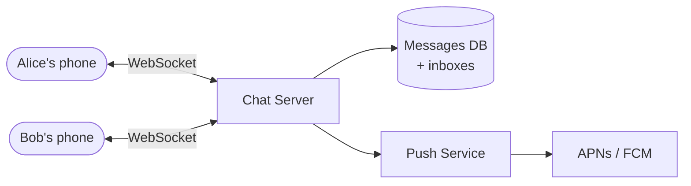
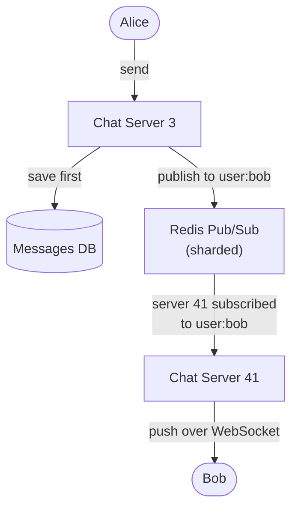
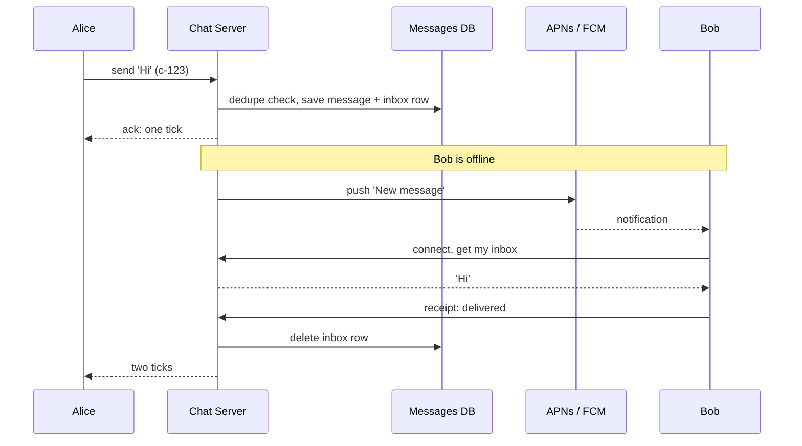
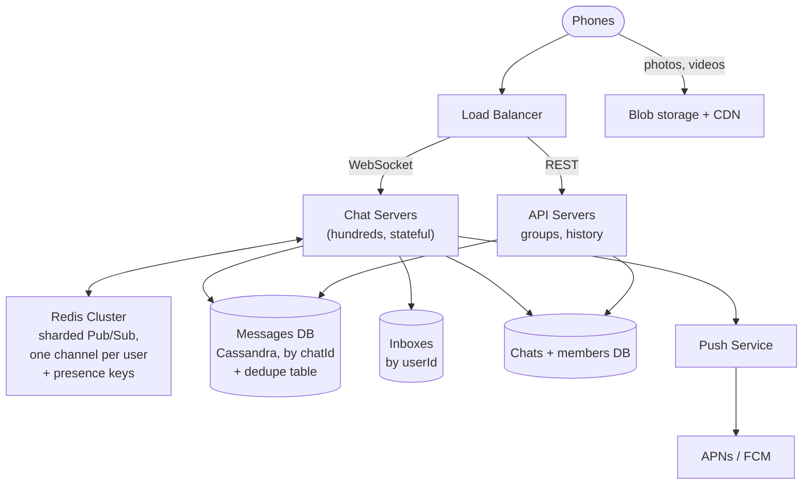

<Callout title="About this question">
  **Difficulty:** Medium. **Patterns used:** [WebSockets](../foundations/polling-websockets-sse.mdx),
  [Pub/Sub](../messaging/message-queues-pub-sub.mdx), [Stateless vs Stateful Servers](../hld-basics/stateless-vs-stateful.mdx),
  [Partitioning and Sharding](../databases/partitioning-sharding.mdx), [Delivery Guarantees](../messaging/delivery-guarantees.mdx).
</Callout>

## Understand the problem

WhatsApp lets people send messages to one person or to a group. If the other person is online, the message should arrive **instantly**. If they are offline (phone off, no signal), the message must **wait** and arrive when they come back. Under each message you see ticks: one tick when the server has it, two ticks when it reached the other phone, and two blue ticks when it was read.

The hard part: a normal website only **answers** requests. Here the **server must push** messages to phones at any moment, to hundreds of millions of phones that are connected at the same time.

## Step 1: Requirements

### Functional requirements

1. Users can send a message to **one person**.
2. Users can chat in **groups** (say, up to 100 members).
3. Users get the messages sent while they were **offline**, when they come back online.
4. Users see **sent, delivered and read** status.

**Out of scope** (say this out loud): voice and video calls, photos and videos (see the follow-ups), stories, and the details of encryption.

### Non-functional requirements

1. **Fast:** a message reaches an online user in under 500 ms.
2. **Never lose a message:** once the sender sees one tick, the message is safe.
3. **In order:** messages in a chat appear in the order they were sent.
4. **Big:** 1 billion daily users, each sending about 20 messages a day.

### Quick math

- **Messages:** 1 billion × 20 = 20 billion per day ÷ 86,400 seconds = about **230,000 messages per second**. More at peak times, like New Year's Eve.
- **Storage:** 20 billion × about 100 bytes = **2 TB per day**, about 700 TB per year. Far too much for one database. We need a database that **spreads data over many machines**.
- **Connections:** if 300 million phones are online at once, and one server can hold about 500,000 open connections, we need about **600 chat servers**. So Alice and Bob are almost never on the same server. We need a way to pass messages **between servers**.

## Step 2: Core entities

- **User:** a person with a phone number.
- **Chat:** a one-to-one chat or a group, with a list of members.
- **Message:** ID, chat ID, sender, text, time.
- **Inbox:** the messages a user has not received yet.
- **Connection:** which chat server a user's phone is connected to right now.

## Step 3: API

For live chat, phones don't use normal request and response. Each phone opens one **WebSocket**: a connection that **stays open**, so both the phone and the server can send data at any time. (See [Polling, WebSockets and SSE](../foundations/polling-websockets-sse.mdx).)

```http
GET /chat
Upgrade: websocket
Authorization: Bearer <login token>
```

Over this open connection, the phone and server send small events:

| Event | Direction | Meaning |
| --- | --- | --- |
| `send_message` | phone → server | "Please send this text to chat X." |
| `ack` | server → phone | "Saved as message `m-5001`." The sender sees one tick. |
| `new_message` | server → phone | "Here is a new message for you." |
| `receipt` | phone → server | "I got it" or "I read it." |

```json
{
  "type": "send_message",
  "clientMsgId": "c-123",
  "chatId": "chat-9",
  "text": "Hi Bob!"
}
```

`clientMsgId` is an ID made by the phone. If the phone sends the same message twice (for example after a bad connection), the server finds this ID in a small **dedupe table** and answers with the first message's ID, instead of saving a second copy (deep dive 2).

Things that are not live use plain REST:

```http
POST /chats
{ "name": "Family", "members": ["u-1", "u-2", "u-3"] }
→ 201 Created
{ "chatId": "chat-9" }

GET /chats/chat-9/messages?before=m-5001&limit=50
→ 200 OK  (50 older messages, for scrolling up)
```

## Step 4: High-level design

Start simple, with just one chat server.



**Send a message (Bob is online):**

1. Alice's phone sends `send_message` over its WebSocket.
2. The Chat Server saves the message in the Messages DB, and adds it to Bob's **inbox**. Every message goes into the inbox, even when Bob is online. The inbox row is the proof that Bob still needs this message.
3. It sends `ack` back to Alice. **One tick.**
4. It finds Bob's open connection and sends him `new_message`.
5. Bob's phone sends back a `receipt` saying "delivered". The server deletes the inbox row and passes the receipt on to Alice. **Two ticks.**

**Send a message (Bob is offline):**

1. Steps 1 to 3 are the same. The message is now waiting in Bob's **inbox**.
2. The server asks the Push Service to send a notification through Apple's APNs or Google's FCM: "New message from Alice".
3. When Bob opens the app, his phone connects and asks for his inbox.
4. The server sends all waiting messages. Bob's phone sends receipts, and the server removes them from his inbox.

**Group message:** the server looks up the members of the group. For **each** member it does the same as above: add the message to their inbox, then deliver it now if they are online, or send a push notification if not.

## Step 5: Deep dives

### 1. Alice and Bob are on different servers. How does the message get there?

With 600 chat servers, Alice may be connected to server 3 and Bob to server 41. Chat servers are **stateful**: each one holds the open connections of its own users (see [Stateless vs Stateful Servers](../hld-basics/stateless-vs-stateful.mdx)). Server 3 can't write to Bob's connection. It must pass the message to server 41.

<Callout title="Not great: send it to every server" type="error">
  Server 3 sends the message to all 600 servers, and the one with Bob delivers it. Every server now does 600 times the work. At 230,000 messages per second, everything melts.
</Callout>

<Callout title="Okay: a directory of who is where" type="warn">
  Keep a map in Redis: `user → server`, like `bob → chat-41`. When Bob connects, server 41 writes this entry. Server 3 looks it up and calls server 41 directly. **Works**, but the map must always be correct. If server 41 crashes, the map is wrong until its entries expire.
</Callout>

<Callout title="Best: Redis Pub/Sub, one channel per user" type="success">
  **Pub/Sub** means publish and subscribe: senders publish to a named channel, and everyone subscribed to that channel gets the message. When Bob connects to server 41, it **subscribes** to the channel `user:bob`. Server 3 just **publishes** to `user:bob`, and Redis delivers it to server 41. No lookups. When Bob disconnects, server 41 unsubscribes.
</Callout>

**One Redis server is not enough.** 230,000 messages per second, plus receipts, is too much for one Redis server, so we use a **Redis Cluster** of many servers. But plain Pub/Sub in a Redis Cluster sends every message to **every** server in the cluster, so adding servers doesn't help. Use **sharded Pub/Sub** instead (Redis 7 and newer, with `SSUBSCRIBE` and `SPUBLISH`). Each channel lives on one shard, picked by a hash of its name, just like a key. So each message goes to one shard only, and adding shards adds capacity.



<Callout title="Pub/Sub can drop messages, and that is fine" type="idea">
  Redis Pub/Sub does not store messages. If nobody is subscribed, the message is simply gone. That is okay here, because we **saved the message and Bob's inbox row in the database first**. If the fast path fails, Bob still gets the message from his inbox. The database is the source of truth. Pub/Sub is only the fast path.
</Callout>

Three details close the gaps between the fast path and the inbox:

- **Subscribe first, then read the inbox.** When Bob connects, server 41 first subscribes to `user:bob`, and only then reads his inbox. In the other order, a message published between the two steps would reach nobody, and would wait until Bob's next reconnect. Our order can deliver a message twice (once from the inbox, once from Pub/Sub). That is fine: the phone drops duplicates by message ID.
- **Resend what was not confirmed.** Each chat server keeps, in memory, a short list of the messages it pushed on each connection. If one still has no `delivered` receipt after a short time (say 30 seconds), the server pushes it again. This catches a connection that silently dropped. It is cheap, because each server checks only its own list. Scanning every online user's inbox every 30 seconds would be 300 million ÷ 30 s = 10 million reads per second, about 40 times the message rate.
- **Catch what never arrived.** If a publish failed, server 41 never saw the message, so it is not on that list. But it is still in Bob's inbox. When Bob's phone reconnects, it reads its inbox and gets the message then.

**Who sends the push notification?** With Pub/Sub, server 3 can't see whether anyone got the message. So each chat server keeps a **presence key** for its users in Redis, like `online:bob`, with a 60-second expiry. Bob's phone sends a small heartbeat every 30 seconds, and each heartbeat resets the expiry (see the follow-ups). Before it publishes, server 3 checks `online:bob`. If the key is missing, Bob is offline, so server 3 asks the Push Service to wake his phone. The message is in his inbox either way.

One more detail: WebSocket connections stay open for hours, so the load balancer should send each **new** connection to the server with the **fewest** connections. If a server restarts, its phones simply reconnect to other servers.

### 2. Offline users, and never losing a message

Three rules make sure no message is lost:

1. **Save first, then ack.** The server sends the one-tick `ack` only after the message is safely stored. So one tick means "safe".
2. **The phone retries.** If Alice's phone gets no `ack` (maybe the network dropped), it keeps the message on the phone and sends it again later with the **same** `clientMsgId`. The server spots the repeat with a dedupe table (below) and doesn't save it twice.
3. **The inbox.** For every message, we add an inbox row for each person who has not received it yet. The row is deleted only when their phone says "delivered".



**How the server spots a repeat.** The message ID is made by the server, so a retry would get a new ID and a second row. So the server keeps a small **dedupe table** keyed by `(sender_id, client_msg_id)`, which stores the `message_id` it gave out. When `send_message` arrives, the server makes a new message ID and tries to add it:

```sql
INSERT INTO client_msg_ids (sender_id, client_msg_id, message_id)
VALUES ('alice', 'c-123', 5001)
IF NOT EXISTS USING TTL 604800;  -- forget it after 7 days
-- [applied] = true:  a new message, its ID is 5001.
-- [applied] = false: a repeat. The answer holds the first message_id.
```

Either way, the server then saves the message and the inbox row under that `message_id`, and sends the `ack` with it. What if the server crashed after this insert, before it saved the message? The retry finds the dedupe row and saves the message then. Saving twice is safe, because a Cassandra write with the same key just overwrites the same row. So a retry never makes a second copy, and a crash never loses the message. (Redis `SET ... NX` with an expiry also works, and is cheaper. But Redis can lose a key in a failover, and then a retry makes a duplicate.)

In our design, the push notification only **wakes up** the phone ("you have new messages"). The messages themselves still come through the chat server. The inbox is a simple table keyed by `userId`, holding the IDs of the waiting messages.

### 3. Sent, delivered and read ticks

- **One tick (sent):** the server saved the message.
- **Two ticks (delivered):** Bob's phone got it, and sent a `delivered` receipt.
- **Two blue ticks (read):** Bob opened the chat, and his phone sent a `read` receipt.

A receipt is just a tiny message going the other way. It uses the same path as normal messages: Bob's server publishes it to `user:alice`. If Alice is offline, the receipt waits in her inbox, like any message.

Two tricks keep receipts cheap:

- **One receipt for many messages.** If Bob opens a chat with 20 new messages, his phone sends one receipt: "read everything up to `m-5020`". Not 20 receipts.
- **Groups keep a "read up to" marker per member**, instead of a status for every message and every member. A message shows blue ticks when all members' markers have passed it.

**Keeping the order.** Phone clocks can be wrong, so the **server** decides the order. Each new message gets an ID that grows over time, like a [Snowflake ID](../distributed-systems/distributed-id-generation.mdx): the time comes first, then the machine's number, then a counter. Every phone sorts the chat by this ID, so everyone sees the same order. One catch: server clocks differ by a few milliseconds, so two messages sent at almost the same moment through different servers can swap places. If a chat needs strict order, give each chat its own **sequence number** that goes up by 1 for each message (for example, Redis `INCR seq:chat-9`), and sort by that.

### 4. Storing billions of messages

We store 2 TB a day. The two main reads are "give me the newest 50 messages of chat 9" and "give me Bob's inbox".

<Callout title="Not great: one SQL database" type="error">
  Simple, but 2 TB a day fills it within days, and 230,000 writes per second is far more than one machine can take.
</Callout>

<Callout title="Okay: SQL, split by chat ID" type="warn">
  **Shard** the data: split it across many SQL machines by `chatId`. This works, but your team must build and run the sharding, and add machines by hand as the data grows.
</Callout>

<Callout title="Best: a wide-column database like Cassandra" type="success">
  Cassandra is built for **huge amounts of writes**, spread over many machines. You choose a **partition key**, which decides which machine stores a row. With `chatId` as the partition key, all messages of one chat sit together, already **sorted by message ID**. "Newest 50 messages of chat 9" becomes one fast read.
</Callout>

```sql
CREATE TABLE messages (
  chat_id    text,
  message_id bigint,     -- grows over time, so it sorts by time
  sender_id  text,
  body       text,
  PRIMARY KEY (chat_id, message_id)
) WITH CLUSTERING ORDER BY (message_id DESC);
```

Watch out: a **very busy chat** can make one partition huge. The fix is to add a time bucket to the key, like `(chat_id, month)`, so each partition holds only one month of messages.

**Keep messages forever, or delete them after delivery?** A product choice with a big effect on cost. **Delete after delivery:** the server only holds the inboxes, and history lives on the phones. Much less storage, but a new phone has no history without a backup. **Keep forever:** history on every device, and server-side search works, but storage grows without end.

### Final architecture



## In the real world

**WhatsApp's servers are written in Erlang**, a language first made for telephone systems that must run millions of small tasks at once and never stop. Its chat server started from **ejabberd**, an open-source chat server, which the team changed heavily. In 2012 the WhatsApp team wrote on its blog that it had reached about **2 million** open connections on a single server.

**The ticks work as described here.** WhatsApp's help pages say: one grey tick means sent, two grey ticks mean delivered, two blue ticks mean read. In a group, the ticks turn blue only when **every** member has read the message.

**End-to-end encryption.** Since 2016, every WhatsApp message is encrypted on the sender's phone and only decrypted on the receiver's phone, using the **Signal Protocol**. The servers pass along data they **cannot read**. So the server can store and forward messages, but it can't search them.

**Messages wait on the server only until delivery.** WhatsApp says that delivered messages are not kept on its servers. Undelivered messages are kept, encrypted, for up to 30 days while it tries to deliver them. This is the "delete after delivery" choice from deep dive 4.

**Discord** has written about storing **trillions** of messages. It moved from Cassandra to **ScyllaDB** (a database that works like Cassandra) in 2022, and wrote about the move in 2023. Its messages are partitioned by **channel ID plus a time bucket**: the same "busy chat" fix as above.

## Follow-up questions

<Accordions>
<Accordion title="How do you send photos and videos?">

The phone uploads the file straight to blob storage (like Amazon S3), using a **pre-signed URL**: a link that allows one upload for a short time. The chat message only carries the file's link. Receivers download the file through a CDN. See [File Upload and Download](../advanced-components/file-upload-download.mdx).

</Accordion>
<Accordion title="How do you show 'online' and 'last seen'?">

The phone sends a small **heartbeat** ("I'm still here") every 30 seconds or so. The server resets the expiry of the presence key `online:bob` in Redis (the same key that decides whether to send a push notification), and saves Bob's `lastSeen` time. Only send presence updates to people who have the chat **open right now**. Sending them to all contacts would turn one person coming online into thousands of messages.

</Accordion>
<Accordion title="A chat server crashes. What happens?">

Its phones lose their connections and reconnect through the load balancer to other servers, which subscribe to their channels. Each phone pulls its inbox to catch up. Nothing is lost, because every message was saved before the `ack`. To avoid half a million phones reconnecting in the same second, phones wait a short **random** time before reconnecting.

</Accordion>
<Accordion title="How do you handle a group with thousands of members?">

One message becomes thousands of deliveries. Store the message **once**, and keep a "read up to" marker per member instead of one inbox row per member. For very big groups or broadcast channels, phones can **pull** new messages when they open the chat, instead of the server pushing to everyone.

</Accordion>
</Accordions>

## What the interviewer expects

<Tabs items={['Mid-level', 'Senior', 'Staff']}>
<Tab value="Mid-level">

- WebSockets, and why plain HTTP is not enough.
- Save the message, then deliver it.
- An inbox row for every message until it is delivered, plus a push notification for offline users.
- A simple messages table.

</Tab>
<Tab value="Senior">

- Routing between chat servers (Pub/Sub vs a directory), with tradeoffs. Subscribe first, then read the inbox.
- At-least-once delivery: phone retries with `clientMsgId`, and a dedupe table `(sender, clientMsgId) → messageId` stops duplicates.
- How receipts work, and how to keep them cheap.
- Partitioning messages by `chatId` in a database like Cassandra, and keeping order.

</Tab>
<Tab value="Staff">

- Millions of connections, and reconnect storms after a crash.
- Multiple devices per user (each device gets its own connection and receipts), and many regions.
- What end-to-end encryption changes (no server search, history on phones).
- The cost of "keep forever" vs "delete after delivery".

</Tab>
</Tabs>

<Callout title="Remember this" type="success">
  - **WebSockets** let the server push messages to phones at any time.
  - **Save first, then ack.** One tick = safe in the database.
  - Every message gets an **inbox** row, deleted on the `delivered` receipt. A push notification wakes offline phones.
  - Route between chat servers with **sharded Redis Pub/Sub, one channel per user**. The database stays the source of
    truth. On connect: subscribe first, then read the inbox.
  - The phone retries with the same **clientMsgId**. A dedupe table `(sender, clientMsgId) → messageId` returns the
    first ID, so a retry never makes a second copy.
  - No presence key in Redis → the user is offline → send a push notification.
  - Store messages by **chatId**, sorted by a time-ordered message ID.
  - Receipts are tiny messages. Batch them: "read up to X".
</Callout>
