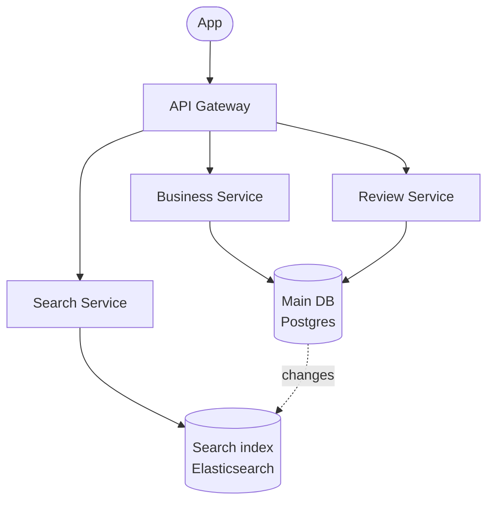
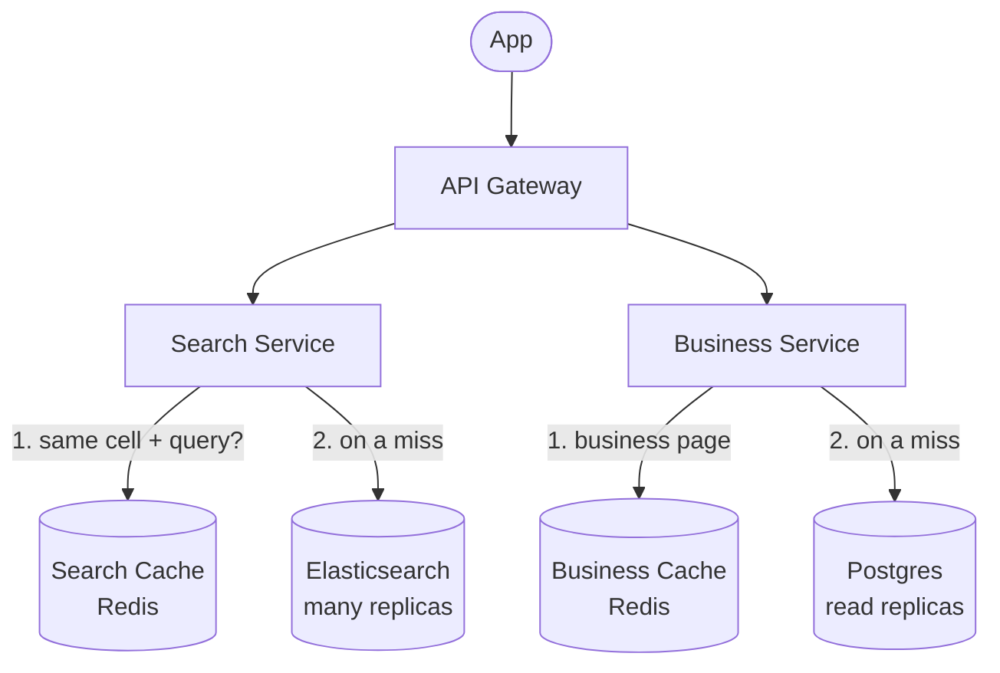
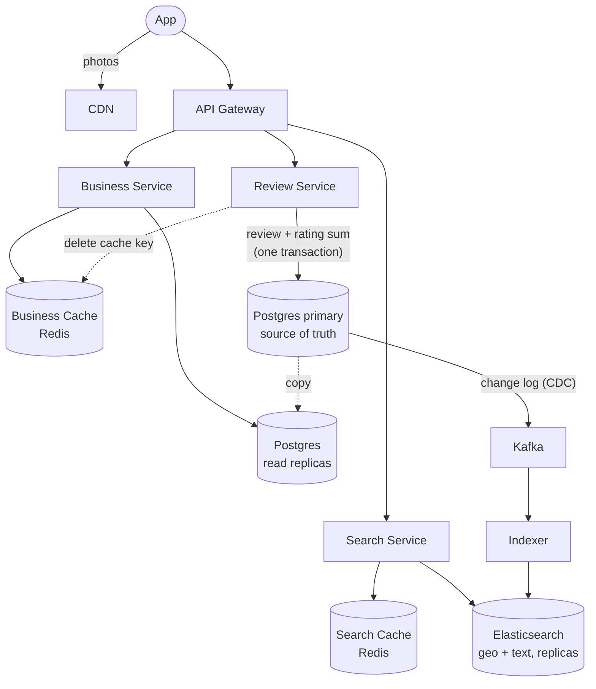

<Callout title="About this question">
  **Difficulty:** Medium. **Patterns used:** [Geospatial Indexing](../advanced-components/geospatial-indexing.mdx),
  [Search and Inverted Indexes](../advanced-components/search.mdx), [Change Data Capture](../distributed-systems/change-data-capture.mdx),
  [Scaling Reads](../hld-basics/scaling-reads.mdx), [Caching Strategies](../caching/caching-strategies.mdx).
</Callout>

## Understand the problem

You are hungry. You open Yelp (or Google Maps) and type "sushi". The app shows sushi places **near you**, with their star rating and number of reviews. You tap one, read what people said, and later leave your own review with 1 to 5 stars.

Three things make it interesting:

- **"Near me" is a location search.** A normal database index can't answer "within 5 km of this point" fast.
- **Search mixes many things at once:** text ("sushi"), location, category, "4 stars and up", "open now".
- **Ratings must be right.** Two reviews saved at the same moment must both count. A place with one 5-star review should not rank above a place with 2,000 reviews averaging 4.8.

## Step 1: Requirements

### Functional requirements

1. Users can **search** for businesses near a location, by name, category or plain text, and with filters like minimum rating.
2. Users can **view a business**: address, hours, photos, average rating and reviews.
3. Users can **leave a review**: a star rating from 1 to 5, plus optional text. **One review per user per business.**

**Out of scope** (say this out loud): adding and editing businesses (an admin tool), booking tables, ordering food, ads, uploading photos, maps and directions (an outside maps service).

### Non-functional requirements

1. **Fast search:** results in under 500 ms.
2. **Available over consistent:** a new review may take a few seconds to show up in search results. That is fine.
3. **Read-heavy:** people search and read far more than they write reviews.
4. **Big:** 100 million daily users and 10 million businesses.

### Quick math

- **Searches:** 100 million users × 5 searches a day = 500 million a day = about **6,000 per second**, and about 3 times that at dinner time.
- **Business pages:** 100 million × 10 views a day = 1 billion a day = about **12,000 per second**.
- **New reviews:** about 1 million a day = about **12 per second**. Reads outnumber writes by about **1,000 to 1**. **Decision:** spend our effort on fast reads. A normal SQL database handles 12 writes per second easily.
- **Data:** 10 million businesses × about 1 KB = **10 GB**. That fits on one machine, even in memory. The hard part is not the size. It is answering "sushi near me, 4 stars and up" thousands of times per second.

## Step 2: Core entities

- **Business:** name, address, **location** (latitude and longitude), category, opening hours, plus `rating_sum` and `review_count` (deep dive 2 explains why we store these and not just the average).
- **User:** the person searching or writing reviews.
- **Review:** business, user, rating (a whole number from 1 to 5), text, time.

## Step 3: API

```http
GET /businesses/search?lat=37.7749&lng=-122.4194&radius=5km&q=sushi&minRating=4&cursor=...

→ 200 OK
{
  "businesses": [
    { "businessId": "b_123", "name": "Ocean Sushi", "rating": 4.6, "reviewCount": 1290, "distanceKm": 0.8 }
  ],
  "nextCursor": "..."
}
```

Search results are **partial** business objects: just enough to show the list. The full details come from the next call.

```http
GET /businesses/{businessId}

→ 200 OK
{ "businessId": "b_123", "name": "Ocean Sushi", "address": "...", "hours": [...], "rating": 4.6, "reviewCount": 1290 }
```

```http
GET /businesses/{businessId}/reviews?sort=newest&cursor=...

→ 200 OK
{ "reviews": [ { "reviewId": "r_9", "rating": 5, "text": "Best salmon in town." } ], "nextCursor": "..." }
```

```http
POST /businesses/{businessId}/reviews
{ "rating": 4, "text": "Great sushi, slow service." }

→ 201 Created
{ "reviewId": "r_10" }
```

If this user already reviewed this business, the answer is **`409 Conflict`**: they should edit their old review instead. As always, the user ID comes from the **login token**, never from the request body. Reviews are paged with a **cursor**, not page numbers (see [API Pagination](../advanced-components/api-pagination-versioning.mdx)).

## Step 4: High-level design



**Search:**

1. The app sends the user's location, the text and the filters.
2. The Search Service asks the **search index** for matching businesses within the radius, closest or best first.
3. It returns the first page of results.

**View a business:**

1. The Business Service reads the business from the main database.
2. The app loads the first page of reviews with a second call.

**Leave a review:**

1. The Review Service saves the review **and** updates the business's rating numbers, in one transaction (deep dive 2).
2. The change flows from the main database into the search index a few seconds later (deep dive 1).

The **main database** is the source of truth. The search index is a copy, built for fast searching.

## Step 5: Deep dives

### 1. How do we find businesses near a location fast?

A normal index on `lat` finds a thin strip of the map that goes **all around the world**. An index on `lng` finds another strip. The database must then combine two huge lists. We need an index that understands **"close in both directions at once"**. See [Geospatial Indexing](../advanced-components/geospatial-indexing.mdx) for how each option works inside.

**This is not Uber.** Uber's drivers move every 5 seconds, so the index takes a flood of writes. Businesses **almost never move**. A new restaurant opens a few times a day per city. So we can pick an index that is built for **reading**, even if updates are slow.

| Option | How it finds "near me" | Text search ("sushi")? | Good fit when |
| --- | --- | --- | --- |
| **Geohash column** | Turn each location into a string. Search your cell and its 8 neighbors with a normal index | No | You want something simple in any database |
| **Quadtree** | A tree in memory. Squares split into 4 when they hold too many places | No | Density is very uneven (Manhattan vs. a desert) |
| **PostGIS** | A location index (GiST, like an R-tree) inside Postgres | Basic (Postgres full-text search) | The data fits in one Postgres, and you want fewer systems |
| **Elasticsearch geo** | A `geo_point` field and a `geo_distance` filter | Yes, with typo handling and ranking | You need text, location and filters in one query |

<Callout title="Not great: latitude and longitude ranges with normal indexes" type="error">
  `WHERE lat BETWEEN ... AND lng BETWEEN ...` reads two long strips of the map and combines them. Slow, and it
  gets worse as we add businesses.
</Callout>

<Callout title="Okay: a geohash column, or a quadtree service" type="warn">
  Both answer "what is near me?" fast. A quadtree is easy here, because businesses rarely move: build it once a
  night and keep it in memory (10 million places × about 50 bytes = 500 MB). **But** users also type "sushi" and
  want "4 stars and up, open now". Neither gives us text search, so we would glue two systems together.
</Callout>

<Callout title="Best: Elasticsearch, filled from Postgres" type="success">
  One query does it all: text match, distance, category, minimum rating, and ranking. Postgres stays the source
  of truth, and every change is copied into Elasticsearch a few seconds later.
</Callout>

The Search Service sends Elasticsearch one query like this: "sushi places, rated 4 or more, within 5 km, closest first".

```json
{
  "query": {
    "bool": {
      "must": [
        { "match": { "name": "sushi" } }
      ],
      "filter": [
        { "range": { "rating": { "gte": 4 } } },
        {
          "geo_distance": {
            "distance": "5km",
            "location": { "lat": 37.7749, "lon": -122.4194 }
          }
        }
      ]
    }
  },
  "sort": [
    { "_geo_distance": { "location": { "lat": 37.7749, "lon": -122.4194 }, "order": "asc" } }
  ]
}
```

Here we sort by distance only. Real apps mix **distance, rating and how well the text matches** into one score.

**Few results?** In the countryside, 5 km may hold nothing. If a search returns fewer than 10 places, try again with 10 km, then 25 km.

**PostGIS is a fine answer too.** At 10 GB, Postgres with PostGIS and its built-in full-text search can do all of this in **one** database, with nothing to keep in sync. Say the tradeoff out loud: weaker text search (typos, ranking), and the main database takes all the search traffic.

**Keeping Elasticsearch up to date.** If the Review Service wrote to Postgres and then to Elasticsearch, a crash between the two writes would leave them different forever. Instead, we use **CDC** (Change Data Capture): a tool like Debezium reads every change from Postgres's log and sends it through Kafka. An indexer writes it into Elasticsearch.


Search is now a few seconds behind the database. For "a new review changed the rating from 4.5 to 4.6", nobody minds. See [Change Data Capture](../distributed-systems/change-data-capture.mdx) and [Search and Inverted Indexes](../advanced-components/search.mdx).

### 2. How do we keep the average rating correct?

Every search result and every business page shows the average rating. Search also **filters** by it ("4 stars and up"). So the average must be a **stored number**, ready to read.

<Callout title="Not great: compute AVG(rating) every time" type="error">
  `SELECT AVG(rating) FROM reviews WHERE business_id = 'b_123'` on every page view. A popular place has thousands
  of reviews, and we get 12,000 page views per second. And Elasticsearch can't filter by a number that is only
  computed on the fly.
</Callout>

<Callout title="Okay: a nightly job recomputes every average" type="warn">
  Cheap and simple. **But** a new review takes up to a day to count. A new restaurant shows "no rating" all day,
  even after ten great reviews. Users notice.
</Callout>

<Callout title="Best: store the sum and the count, and update them with the review" type="success">
  Keep `rating_sum` and `review_count` on the business row. In **one transaction**, insert the review and add to
  both numbers. The average is simply `rating_sum / review_count`. Only 12 reviews arrive per second, so this
  is no load at all.
</Callout>

**Careful: don't read the average, change it in the app, and write it back.** Say a place has an average of 4.0 from 100 reviews. Alice gives 5 stars and Bob gives 1 star, at the same moment:

1. Both servers read "4.0 from 100 reviews".
2. Alice's server writes (400 + 5) ÷ 101 = **4.01**, count 101.
3. Bob's server writes (400 + 1) ÷ 101 = **3.97**, count 101.

The last write wins. Alice's review is **lost** from the average. The right answer was (400 + 5 + 1) ÷ 102 = **3.98** from 102 reviews. This is a **lost update** (see [Locking](../databases/locking.mdx)).

The fix is to let the database do the adding:

```sql
BEGIN;
INSERT INTO reviews (business_id, user_id, rating, text)
  VALUES ('b_123', 'u_42', 4, 'Great sushi, slow service.');
-- UNIQUE (business_id, user_id): a second review from u_42 fails here
UPDATE businesses
  SET rating_sum = rating_sum + 4,
      review_count = review_count + 1
  WHERE id = 'b_123';
COMMIT;
```

How it works:

- `rating_sum = rating_sum + 4` is **atomic**. The database locks the row for a moment. A second update waits, then adds on top of the new value. Nothing is lost.
- The **unique constraint** on `(business_id, user_id)` gives us "one review per user per business" for free. A retry or a double tap fails the insert, and the transaction rolls back, so the rating is not added twice either.
- We store a **whole-number sum**, not a decimal average. Adding whole numbers never builds up rounding errors, even after millions of updates.
- **Edits and deletes are easy.** A user changes 2 stars to 5: add 3 to the sum, the count stays the same. A review is deleted (or hidden as spam): subtract its rating, and subtract 1 from the count. Always in the same transaction as the review change.
- A small **nightly check** recomputes `SUM` and `COUNT` from the reviews table and fixes any business that drifted, for example after a bug.

**Ranking fairly by rating.** A new place with **one** 5-star review has an average of 5.0. Should it rank above a place with 2,000 reviews averaging 4.8? No. The common fix is a **Bayesian average**: pretend every place starts with a few reviews at the site's overall average. Places with few reviews stay close to the middle. Places with many reviews show their real average.

```js
// The ranking score for one business. Used only to sort results.
function rankingScore(ratingSum, reviewCount) {
    // The average rating of all businesses on the site
    const siteAverage = 3.8;

    // Every business starts with 10 "pretend" reviews at the site average
    const pretendReviews = 10;

    const totalStars = ratingSum + siteAverage * pretendReviews;
    const totalReviews = reviewCount + pretendReviews;

    return totalStars / totalReviews;
}

// A new place with one 5-star review
console.log(rankingScore(5, 1).toFixed(2)); // 3.91

// A place with 2,000 reviews and an average of 4.8
console.log(rankingScore(9600, 2000).toFixed(2)); // 4.80
```

The page still **shows** the real average (5.0 from 1 review). The Bayesian score is only used to **sort** results.

### 3. How do we handle so many reads?

Reads outnumber writes 1,000 to 1. So we put copies and caches in front of everything (see [Scaling Reads](../hld-basics/scaling-reads.mdx)).



- **Cache business pages.** Cache-aside in Redis, key `business:b_123`, for 5 minutes. After a new review, the Review Service deletes the key, so the next view shows the new rating. See [Caching Strategies](../caching/caching-strategies.mdx).
- **Cache popular searches.** At lunchtime, thousands of people downtown search "coffee". Round the user's location to a small geohash cell (6 characters, about 1 km) and cache the results by **cell + query + filters** for a couple of minutes. Nearby users share one cached answer. The Search Service then works out the real distance from each user's exact spot, and sorts again.
- **Many copies, not many pieces.** The data is only 10 GB, so Elasticsearch needs just one or two **shards** (pieces). What we need is many **replicas** (copies) on many machines. Every copy can answer searches. Twice the machines, twice the searches.
- **Postgres read replicas** serve business pages and review lists. The primary only takes writes, and 12 per second is nothing. Right after a user posts a review, read **their own** view from the primary, so they never see their review missing because a replica is a second behind (see [Replication](../databases/replication.mdx)).
- **Reviews by business, newest first:** an index on `(business_id, created_at)` makes each page of reviews one quick index read.
- **Photos** come from a [CDN](../caching/cdn.mdx), never through our servers.

### Final architecture



## In the real world

- **Yelp** was founded in **2004** in San Francisco. Its engineering blog describes moving its core business search to **Elasticsearch** in 2017, away from an older search system it had built itself.
- Yelp runs automated **recommendation software** over reviews. Reviews it does not recommend are shown in a separate section, and they **don't count** toward the business's overall star rating. So "keeping the average correct" also means deciding which reviews count.
- **IMDb** has used a **weighted rating** formula for its Top 250 movies list, of the same kind as the Bayesian average above. A movie needs many votes before its score can climb near the top.
- **Elasticsearch** (`geo_point`, `geo_distance`) and **PostGIS** (`ST_DWithin`) are the common tools for "places near me". **Redis GEO** is more often used for things that move, like drivers.

## Follow-up questions

<Accordions>
<Accordion title="How do you search by a place name, like 'pizza in SoHo'?">

Store the shape (a polygon) of each city and neighborhood. When a business is added, work out which neighborhood and city it is in, and save those names on its search document. Then "pizza in SoHo" is a simple filter on `neighborhood = "SoHo"`. Elasticsearch can also search inside a polygon directly (`geo_shape`).

</Accordion>
<Accordion title="How does the 'open now' filter work?">

Store opening hours as time ranges in the business's own time zone, for each day of the week. At search time, work out the current day and time where the business is, and filter on it. Most searches cover one city, so usually there is just one time zone to handle.

</Accordion>
<Accordion title="How do you stop fake reviews?">

Limit how many reviews a new account can post. Run a spam model in the background, using signals like account age, the device, and many reviews for one business in a short time. A review it flags is hidden, and its stars are **subtracted** from `rating_sum` and `review_count`, the same way as a delete.

</Accordion>
<Accordion title="A famous restaurant gets many reviews at once. Is the rating row a hot row?">

Not at our numbers. Even a very popular place gets a few reviews a minute, and each update holds the row lock for a moment. If it ever became a problem (say, a "rate this concert" button for 1 million people), send rating events through Kafka and add them up in batches, like view counts in [Design YouTube](./youtube.mdx).

</Accordion>
<Accordion title="Why not just use Postgres for everything?">

You can. At 10 GB, PostGIS plus Postgres full-text search is a valid design, with nothing to keep in sync. Elasticsearch wins when search needs typo handling, better ranking and many filters, and when you want to add search capacity without touching the main database.

</Accordion>
</Accordions>

## What the interviewer expects

<Tabs items={['Mid-level', 'Senior', 'Staff']}>
<Tab value="Mid-level">

- Clear requirements, entities and API, with cursor paging for reviews.
- Know that normal indexes are bad for "near me", and name a geo index (geohash, PostGIS or Elasticsearch).
- One review per user per business, with a unique constraint.
- A stored average rating, not `AVG()` on every view.

</Tab>
<Tab value="Senior">

- Compare geohash, quadtree, PostGIS and Elasticsearch, and explain why businesses (rarely moving) differ from drivers.
- Keep the search index in sync with CDC, not dual writes.
- Store `rating_sum` and `review_count`, update them atomically with the review, and explain the lost update.
- Caches and replicas for a read-heavy system.

</Tab>
<Tab value="Staff">

- Everything from senior, but faster.
- Fair ranking with a Bayesian average, and handling edits, deletes and hidden spam reviews.
- Cache searches by geohash cell, and size Elasticsearch with few shards but many replicas.
- When a single Postgres with PostGIS is the simpler, better answer.

</Tab>
</Tabs>

<Callout title="Remember this" type="success">
  - **Read-heavy:** about 1,000 reads for every review written. Optimize for reads.
  - Businesses **rarely move**, unlike drivers. Read-friendly geo indexes are fine.
  - **Elasticsearch** does text + location + filters in one query. Keep it in sync from Postgres with **CDC**. PostGIS is the simpler choice when the data is small.
  - Store **`rating_sum` and `review_count`**, and update them with `+` **in the same transaction** as the review. Never read, change and write back the average.
  - **One review per user:** a unique constraint on `(business_id, user_id)`.
  - Rank with a **Bayesian average**, so one 5-star review can't beat 2,000 reviews at 4.8.
  - Scale reads with **caches** (business pages, popular searches by geohash cell) and **replicas**.
</Callout>
