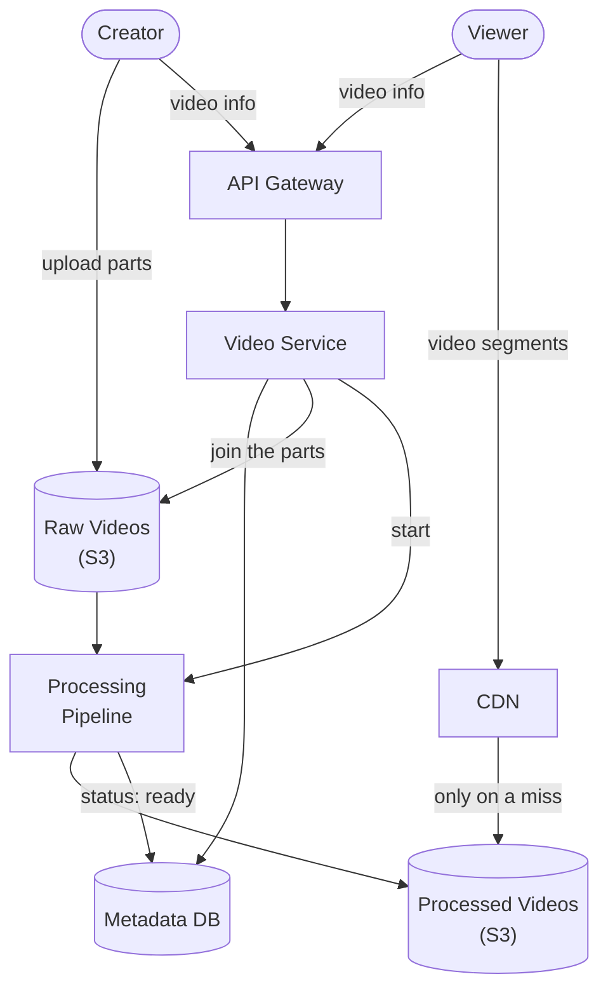
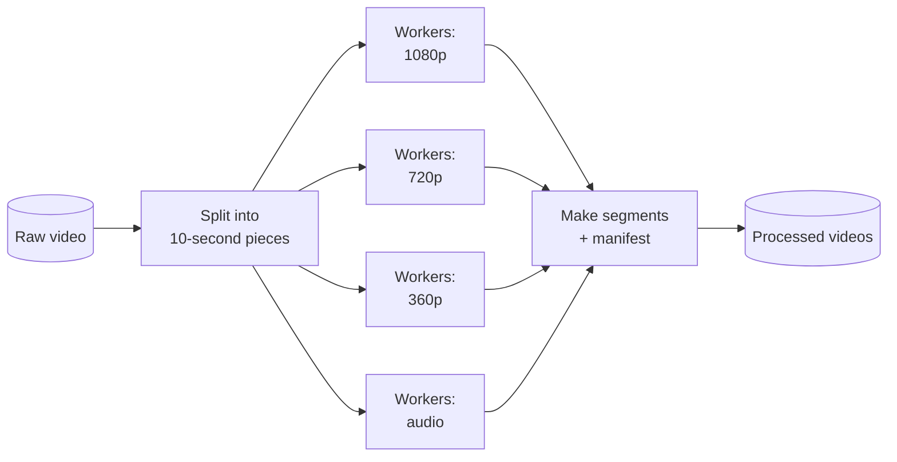
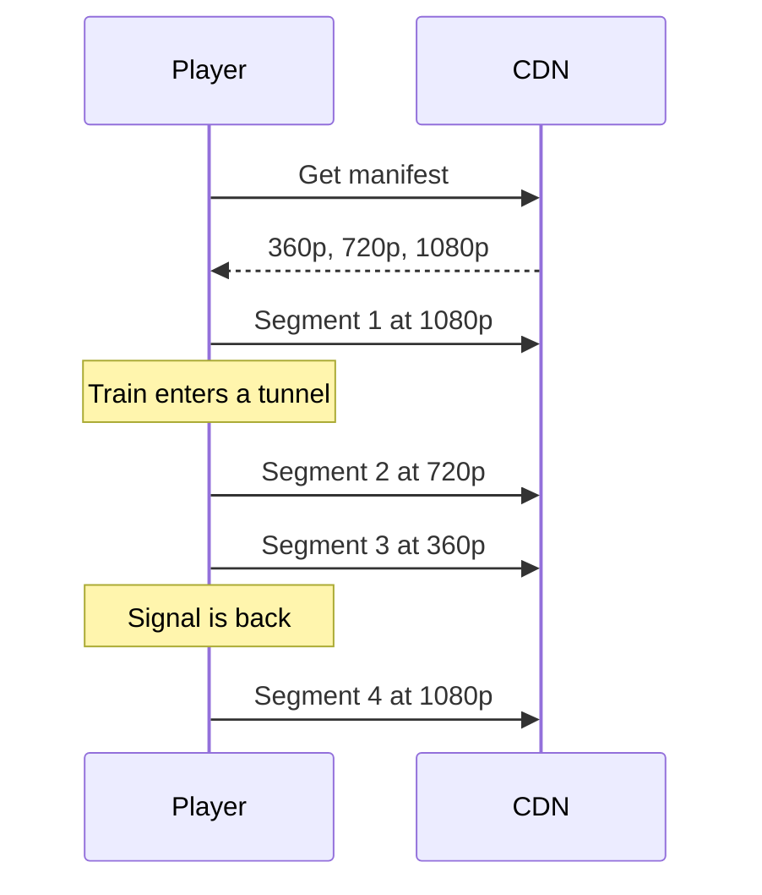
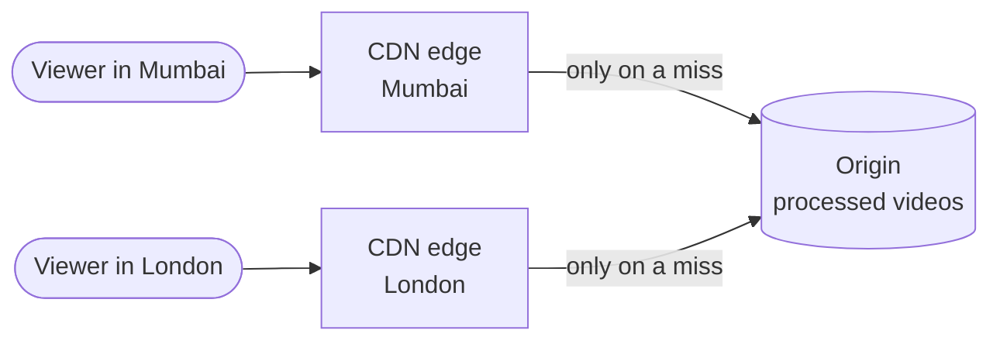
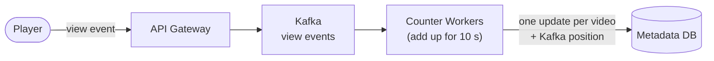
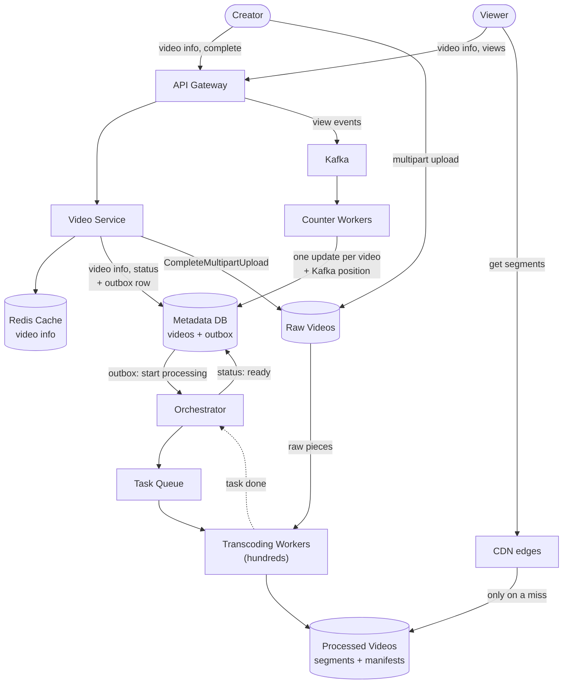

<Callout title="About this question">
  **Difficulty:** Hard. **Patterns used:** [File Upload and Download](../advanced-components/file-upload-download.mdx),
  [Background Jobs](../advanced-components/background-jobs.mdx), [CDN and Edge Caching](../caching/cdn.mdx),
  [Message Queues](../messaging/message-queues-pub-sub.mdx), [Hot Keys](../advanced-components/hot-keys-fan-out.mdx).
</Callout>

## Understand the problem

Creators upload videos. Viewers watch them on phones, laptops and TVs, on fast home Wi-Fi and on slow mobile networks.

The video bytes are the whole challenge:

- **Uploads are huge:** a single video can be tens of GB.
- **One file does not fit every viewer:** a 4K file is too big for a phone on a train. We must make many versions.
- **Watching moves enormous amounts of data**, all over the world, and must never stop to buffer.

## Step 1: Requirements

### Functional requirements

1. Users can upload videos.
2. Users can watch videos, with smooth playback on any device and network.
3. Users can see video info: title, description and view count.

**Out of scope** (say this out loud): comments, likes, search, recommendations, live streaming, ads, subscriptions.

### Non-functional requirements

1. **Smooth playback:** a video starts in about 2 seconds, and rarely stops to buffer, even on slow networks.
2. **Never lose an upload:** once uploaded, a video is stored safely.
3. **Available over consistent:** a new video can take a few minutes to be ready, and the view count can be a little behind. Both are fine.
4. **Big:** 1 million uploads per day, and 10 million people watching at the same time at peak.
5. **Read-heavy:** each video is watched many, many times more than it is uploaded.

### Quick math

- **Uploads:** 1 million videos × about 1 GB = **1 PB per day** of raw video. That goes in **object storage** (like S3), not a database.
- **Watching:** 10 million viewers × about 5 Mbps (megabits per second, roughly HD video) = **50 Tbps** (terabits per second). No single data center can send that much. **Decision:** we must serve video from a **CDN**, close to viewers.

## Step 2: Core entities

- **User:** the creator or the viewer.
- **Video:** title, description, uploader, status (`uploading`, `processing`, `ready`).
- **Video files:** the raw upload, plus the processed versions. Each version is cut into small **segments**, and a **manifest** file lists them all (deep dive 2).
- **View count:** how many times the video was watched.

## Step 3: API

```http
POST /videos
Idempotency-Key: 9e4d2b7a-3c1f-4e8b-a6d5-0f2c8b1e7a93
{ "title": "My trip to Japan", "description": "Two weeks in Tokyo and Kyoto" }

→ 201 Created
{ "videoId": "v_abc", "uploadUrls": ["https://storage.example.com/raw/v_abc/part-1?signature=...", "..."] }
```

The app makes the **`Idempotency-Key`** once and sends it again on every retry. If the reply is lost, the retry gets the same `videoId` back, not a second, empty video.

```http
POST /videos/{videoId}/complete
{ "parts": [{ "part": 1, "etag": "a1b2c3..." }, { "part": 2, "etag": "d4e5f6..." }] }

→ 202 Accepted
{ "videoId": "v_abc", "status": "processing" }
```

Each part upload returns an **ETag**: a fingerprint of that part, from storage. The app sends the list of parts and ETags here. The Video Service passes it to storage, which joins the parts into one file (deep dive 1). `202 Accepted` means "I got it, and I will finish the work later".

```http
GET /videos/{videoId}

→ 200 OK
{
  "title": "My trip to Japan",
  "views": 1048576,
  "status": "ready",
  "manifestUrl": "https://cdn.example.com/v_abc/master.m3u8"
}
```

```http
POST /videos/{videoId}/views

→ 202 Accepted
```

Notice that our API never sends video bytes. Uploads go **straight to storage**, and the player downloads video **from the CDN**, using the `manifestUrl`.

## Step 4: High-level design



**Upload a video:**

1. The creator's app sends `POST /videos`. The Video Service saves the info with status `uploading`, and returns **presigned URLs** (links that allow uploading to storage for a short time).
2. The app uploads the video in parts, **straight to raw storage**.
3. When all parts are uploaded, the app calls `POST /videos/{videoId}/complete`. The Video Service asks storage to **join the parts** into one file, marks the video `processing`, and starts the **processing pipeline** (deep dive 1 makes this safe if the service crashes in the middle).
4. The pipeline makes all the versions and the manifest, and saves them in processed storage.
5. The pipeline marks the video `ready` in the Metadata DB.

**Watch a video:**

1. The player calls `GET /videos/{videoId}` and gets the title, the view count and the manifest URL.
2. The player downloads the manifest from the CDN, then downloads the video **segment by segment**, picking a quality that fits the network (deep dive 2).
3. The CDN serves segments from a server near the viewer. Only on a miss does it fetch them from processed storage.

**Count a view:** the player sends a view event. It is added up in the background (deep dive 4).

## Step 5: Deep dives

### 1. Uploading and processing videos

**Uploading.** This works like [Design Google Drive](./google-drive.mdx): never send the bytes through our servers.

<Callout title="Best: multipart upload with presigned URLs" type="success">
  Split the video into parts (say 10 MB each) and upload them straight to object storage, several at a time. If
  the network drops, upload only the missing parts. Amazon S3 has this built in, called **multipart upload**. For
  big videos it is a must anyway: one S3 upload request can carry at most 5 GB.
</Callout>

**Storage does not join the parts by itself.** Uploaded parts just sit there until someone says "the upload is finished". With S3, that is a call named `CompleteMultipartUpload`, with the list of part numbers and their ETags. In our design:

1. The app uploads every part and keeps each part's ETag.
2. The app calls `POST /videos/{videoId}/complete` with that list.
3. The **Video Service** calls `CompleteMultipartUpload`. S3 joins the parts into one raw file.
4. Only after that succeeds, the Video Service marks the video `processing` and tells the **orchestrator** (below) to start. So it is always clear who starts processing: the Video Service, after the file is whole.

**Careful: "mark `processing`, then tell the orchestrator" is two writes.** If the Video Service crashes between them, the video is stuck: a retried `complete` sees `processing` and does nothing, and no job ever starts. So the Video Service writes both in **one transaction**: the status `processing`, and a "start processing `v_abc`" row in an **outbox** table in the same database. The orchestrator reads new outbox rows and starts a job for each (the [Outbox Pattern](../distributed-systems/outbox-pattern.mdx)). It may read a row twice after a crash, so it keeps **one job per video** and ignores a second start.

**A retry gets the first answer.** If the app retries `complete`, the Video Service sees the video is already `processing` and answers `202` again, without starting anything. (If an earlier try already joined the parts but crashed before marking `processing`, the Video Service just checks that the raw file is there, and goes on.)

If the app never calls `complete` (it crashed, or the user gave up), the parts are never joined. A storage cleanup rule deletes unfinished uploads after a few days, so we don't pay for them forever.

**Processing.** The raw upload is one big file in whatever format the creator's camera used. Before anyone can watch it, we must **transcode** it: convert it into the formats and sizes that players need. A few words first:

- **Resolution:** how many pixels tall the picture is: 360p, 720p, 1080p, 4K.
- **Bitrate:** how many bits of data one second of video uses. Higher bitrate = sharper picture, but a bigger download.
- **Codec:** the method used to compress video, like H.264, VP9 or AV1. Newer codecs give the same picture with fewer bits.

For every video we make a **ladder** of versions, for example 360p, 480p, 720p, 1080p and 4K. We also make thumbnails and an audio track.

<Callout title="Not great: one machine transcodes the whole video" type="error">
  One worker makes each version, one after another, for the whole video. A long 4K video can take **hours**. If
  the machine dies at 90%, it starts again from the beginning.
</Callout>

<Callout title="Best: split into pieces, and transcode them in parallel" type="success">
  Cut the raw video into short pieces (say 10 seconds each). Turn "transcode piece 7 into 720p" into a small task
  on a queue, and let **hundreds of workers** do the tasks at the same time. A failed task is simply retried. A
  video that would take hours on one machine is ready in minutes.
</Callout>



The steps form a **DAG** (a directed acyclic graph): a set of steps where some steps wait for others, and nothing loops back. "Make manifest" waits for all the transcoding steps. A small **orchestrator** service keeps the state of each task in a database, puts ready tasks on the queue, and starts the next step when a step is done. Workers tell it when each task is done.

A nice trick: **publish the low qualities first**. When 360p and 720p are ready, mark the video watchable. 4K can arrive a little later, and is then added to the master manifest.

### 2. Smooth playback: adaptive bitrate streaming

<Callout title="Not great: one big video file at one quality" type="error">
  A 1080p file stutters on a slow phone network. A 360p file looks bad on a big TV. And if the viewer leaves
  after 10 seconds, we may have sent megabytes they never watched.
</Callout>

<Callout title="Best: adaptive bitrate streaming (HLS or DASH)" type="success">
  Each version is cut into small **segments** of a few seconds each. Before each segment, the player checks how
  fast the last downloads were, and how many seconds of video it already has saved up (the **buffer**). Then it
  picks the best quality the network can handle **right now**.
</Callout>

The player learns about the versions from the **manifest**: a small text file that lists every quality, its bitrate, and where its segments are. For example:

| Quality | Bitrate (example) | Segment list |
| --- | --- | --- |
| 360p | 0.7 Mbps | `360p/index.m3u8` |
| 720p | 2.5 Mbps | `720p/index.m3u8` |
| 1080p | 5 Mbps | `1080p/index.m3u8` |

Here is a viewer on a train:



The picture gets softer in the tunnel for a few seconds, but it **never stops**. That is the whole point. Players also often start with a lower quality, so the video begins fast, and then step up.

The two common standards are **HLS** (made by Apple, manifest files end in `.m3u8`) and **MPEG-DASH** (an open standard, manifest files end in `.mpd`).

Segments also make **jumping ahead** easy: to start at minute 30, the player just fetches the segment for minute 30.

### 3. Serving videos worldwide with a CDN

50 Tbps cannot come from one place. A [CDN](../caching/cdn.mdx) (content delivery network) is many servers spread around the world, called **edge servers**. Each one keeps copies of popular files. A viewer in Mumbai gets the video from a server in Mumbai, not from the US.



- **Cache hit:** the edge has the segment and sends it right away. **Cache miss:** the edge fetches it once from the **origin** (our processed storage), keeps a copy, and serves everyone after that.
- **Segments never change** once made. So edges can keep them for a long time, and we never need to clear them.
- **The master manifest can change.** When 4K is added later, `master.m3u8` gets a new line. So it gets a **short** cache time, like a minute, and viewers see the new quality soon.
- **Popular videos** end up on almost every edge. **Old videos that few people watch** (the "long tail") often miss. That is fine: they are served from the origin, or from a middle layer of regional caches.
- For a video that is clearly about to be huge (a new trailer), we can **push** it to the edges before people ask for it.

The CDN carries the bytes. **Video info** (`GET /videos/{videoId}`: title, view count, manifest URL) is small, but every play asks for it. So the Video Service keeps it in a **Redis cache** for a few seconds, and most of these reads never reach the Metadata DB.

### 4. Counting views

A viral video can get thousands of views every second, all for **one** video.

<Callout title="Not great: one database update per view" type="error">
  `UPDATE videos SET views = views + 1` for every view. All those updates hit **the same row**, and they wait for
  each other's locks. This is a **hot row**, and it slows the whole database.
</Callout>

<Callout title="Okay: a Redis counter" type="warn">
  `INCR views:v_abc` is very fast. **But** one key still lives on one Redis machine, and we still need to copy the
  numbers into the database safely.
</Callout>

<Callout title="Best: send view events to Kafka, and add them up in batches" type="success">
  The player sends a "view" event. Events go into **Kafka** (a durable log of events). Counter workers add up the
  views for each video for about 10 seconds, then write **one** update: `views = views + 5234`. Thousands of
  writes become one. The worker saves its Kafka position in the same transaction, so a crash never adds a batch
  twice.
</Callout>



**Careful: "add" is not safe to repeat.** Say a worker writes `views = views + 5234`, then crashes before it tells Kafka "I'm done up to here". On restart it reads the same events again and adds 5234 a **second** time. The fix is to save the Kafka position (the **offset**) in the **same database transaction** as the counts:

```sql
BEGIN;
UPDATE videos SET views = views + 5234 WHERE id = 'v_abc';
UPDATE videos SET views = views + 87   WHERE id = 'v_xyz';
-- Move this partition's saved position forward, only from where we started.
UPDATE counter_progress SET next_offset = 91000
  WHERE kafka_partition = 7 AND next_offset = 88000;
-- 0 rows changed: this batch was already saved. ROLLBACK.
COMMIT;
```

The counts and the position are saved together, or not at all. On restart, the worker reads `next_offset` from the database and asks Kafka for events from there. Each batch is added exactly once.

Before counting, the workers also drop views that look fake: the same user replaying again and again, or bots. The number on the page is a few seconds behind, and nobody minds.

### Final architecture



## In the real world

- **YouTube** has said that **more than 500 hours** of video are uploaded to it **every minute**.
- YouTube serves video with newer codecs such as **VP9** and **AV1**, not only the older H.264, to get the same picture with fewer bits.
- **Google built its own chip** for video transcoding, the **Video Coding Unit** (VCU, also called Argos), to process YouTube uploads faster and more cheaply.
- In **2014**, the music video **"Gangnam Style"** got close to **2,147,483,647 views**, the largest number a 32-bit signed counter can hold. YouTube said it had to upgrade its view counter to a **64-bit** number. A small reminder to size counters for success.
- YouTube built **Vitess** to split its MySQL databases across many machines. It is now open source and used by other companies.
- YouTube runs **Content ID**: uploads are compared with reference files from music and film companies, to find copyrighted content. It is one more step in the processing pipeline.
- **Netflix** runs its own CDN, called **Open Connect**. It places Netflix servers **inside internet providers' networks**, and fills them with the shows people are likely to watch during quiet, off-peak hours.
- Netflix uses **per-title encoding**: each show gets its own bitrate ladder. A simple cartoon needs far fewer bits than a fast action movie to look good.

## Follow-up questions

<Accordions>
<Accordion title="A video suddenly goes viral. What breaks?">

The CDN copes well: after the first misses, every edge has the segments. Video info is served from the Redis cache. View counts are batched, so the hot row is gone. The only new load is a short burst of cache misses at the start, which regional caches absorb.

</Accordion>
<Accordion title="Storage costs too much. How do you save money?">

Most old videos are rarely watched. Move them to **cheaper, colder storage**, keep fewer versions of them (and make a missing version again if someone asks), and move the raw upload to the coldest storage once processing is done. Don't delete it: making a version again, or re-encoding with a newer codec, needs the original. Re-encode **popular** videos with a newer codec, because saving bits on a popular video saves the most bandwidth.

</Accordion>
<Accordion title="How does 'continue watching' work?">

Every 10 seconds or so, the player sends the current position. Store `userId + videoId → position` in a key-value store. When the user opens the video again, the player asks for that position and fetches the matching segment.

</Accordion>
<Accordion title="How do you stop fake views?">

Count a view only after some seconds of real watching. Drop repeats from the same user or device within a time window. Detect bots by their patterns. YouTube-scale systems also check views again later and remove the fake ones.

</Accordion>
<Accordion title="How is live streaming different?">

There is no time for a big processing pipeline. The stream is transcoded **as it arrives**, segments are made every few seconds, and the manifest keeps growing. Shorter segments mean less delay, but more requests. The CDN still does the heavy lifting.

</Accordion>
</Accordions>

## What the interviewer expects

<Tabs items={['Mid-level', 'Senior', 'Staff']}>
<Tab value="Mid-level">

- Clear requirements and API.
- Video bytes in object storage, video info in a database.
- A processing step that makes several qualities.
- A CDN for watching.

</Tab>
<Tab value="Senior">

- Presigned, multipart, resumable uploads, and who finishes them (`CompleteMultipartUpload`) and starts processing, with an outbox so a crash can't leave a video stuck.
- A parallel transcoding pipeline: split, transcode on many workers, retry failed tasks.
- Explain adaptive bitrate streaming: segments, manifest, the player choosing quality.
- Batch view counts to avoid a hot row, without double counting after a crash.

</Tab>
<Tab value="Staff">

- Everything from senior, but faster.
- Cost: storage tiers, which versions to keep, codec choices.
- CDN strategy: long tail, regional caches, pushing popular videos early.
- Pipeline reliability: orchestration, retries, and publishing low qualities first.

</Tab>
</Tabs>

<Callout title="Remember this" type="success">
  - **Bytes never go through our API.** Upload straight to storage, watch straight from the CDN.
  - **Multipart parts are joined only when we call `CompleteMultipartUpload`.** The Video Service does it, then marks `processing` and writes a "start" **outbox** row in one transaction, so a crash can't leave the video stuck.
  - **Transcode in parallel:** split the video into pieces and give them to many workers.
  - **Adaptive bitrate streaming:** small segments + a manifest. The player picks the quality before each segment.
  - **HLS** (`.m3u8`) and **MPEG-DASH** (`.mpd`) are the two common standards.
  - **CDN is a must:** 10 million viewers × 5 Mbps = 50 Tbps. Segments never change, so they cache well.
  - **View counts:** events → Kafka → add up in batches. Avoid one hot database row. Save the Kafka offset in the same transaction, so no batch is added twice.
</Callout>
