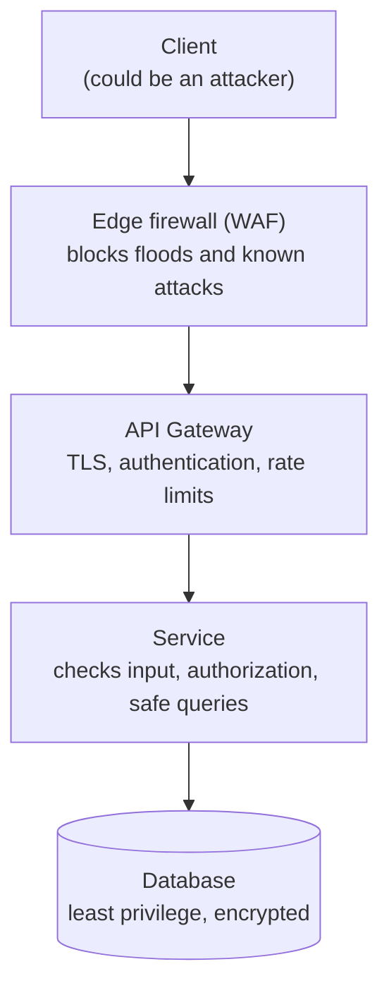

## What is it?

A bank teller checks every form before acting on it. Is the amount a real number? Does the account exist? Is this person allowed to take money from it? If someone writes "also give me the vault keys" at the bottom of the form, the teller ignores it.

An API must act like that teller. **Never trust anything that comes from the client**: the body, the URL, the headers, the cookies. Anyone can send anything to your API with a tool like curl, skipping your app completely.

## Why do we need it?

- **An API is a public door.** Your app's screens are not the boundary. The API is. Anyone can call it directly, with any input, any ID and any number of times.
- **Bots scan the internet all day** for open APIs, leaked keys and known bugs. You don't need to be famous to be attacked.
- **APIs hand out data directly**, as neat JSON. One missing check can leak millions of records, as the stories below show.
- **One bug is enough.** An attacker needs only one hole. Breaches cost money, fines and users' trust.

## How it works inside

### Layers of defense

Good protection comes in **layers**, so one missed check is not the end:



A **WAF (web application firewall)** is a filter in front of your app that blocks requests that look like known attacks.

### Checking every input

Check every input **on the server**. Checks in the browser only make the app nicer to use. They don't protect anything.

What to check:

- **Type:** is `quantity` really a number?
- **Range and length:** quantity between 1 and 10, a name of at most 100 characters.
- **Format:** an email looks like an email, an ID looks like an ID.
- **Allowed values:** `status` must be one of `pending`, `shipped` or `delivered`. Prefer an **allowlist** (accept only what you expect) over a blocklist (try to reject the bad things). Attackers are good at finding what you forgot to block.
- **Size:** limit the request body, file uploads and page size. A request like `?limit=1000000` should not be allowed.

A schema library makes this short. Here with zod in TypeScript:

```ts
import { z } from "zod";

// strictObject: reject any field we didn't list
const CreateOrder = z.strictObject({
    // Must be a UUID
    productId: z.uuid(),

    // A whole number from 1 to 10
    quantity: z.number().int().min(1).max(10),

    // Text of at most 200 characters. optional() means it can be left out.
    note: z.string().max(200).optional(),
});

// parse() throws an error if anything is wrong. Then we answer 400.
const input = CreateOrder.parse(req.body);
```

**Why `strictObject` matters: mass assignment.** Say your "update my profile" endpoint copies the whole request body into the user's record. An attacker adds `"role": "admin"` to the body and makes themselves an admin. Only accept the fields you listed.

The same goes for what you send back. Don't return the whole user record, with its password hash and internal flags, and hope the app hides them. Choose the fields you return.

### SQL injection

**SQL injection** happens when user input is pasted into a SQL query as text, so the input can change the query itself.

```js
// BAD: the input becomes part of the SQL
const sql = "SELECT * FROM users WHERE email = '" + email + "'";
```

If an attacker sends the email `' OR '1'='1`, the query becomes:

```sql
SELECT * FROM users WHERE email = '' OR '1'='1'
```

`'1'='1'` is always true, so this returns **every user**. Other inputs can change data or delete whole tables.

**The fix: parameterized queries** (also called prepared statements). The query and the data are sent separately, so the data can never become part of the SQL:

```js
// GOOD: $1 is a placeholder. The database treats email only as a value.
const result = await db.query("SELECT * FROM users WHERE email = $1", [email]);
```

**ORMs**, libraries that write the SQL for you, do this by default. Be careful with their "raw query" functions. The same idea applies to anything built by gluing strings together: shell commands, NoSQL queries and file paths.

### XSS (cross-site scripting)

**XSS** happens when an attacker gets their own JavaScript to run in other people's browsers, on your site. For example, they post a comment with a `<script>` tag in it that sends the reader's session cookie to the attacker. Everyone who views the comment runs that script.

The fixes:

- **Escape output.** When you show user content, turn special characters like `<` into harmless text (`&lt;`), so the browser shows them instead of running them. React and most modern frameworks do this by default. Be careful with features that skip it, like `dangerouslySetInnerHTML`.
- **HttpOnly cookies.** JavaScript can't read these cookies, so a script can't steal the session (see [Cookies, Sessions and JWT](../foundations/cookies-sessions-jwt.mdx)).
- **Content-Security-Policy (CSP).** A response header that tells the browser which scripts are allowed to run, so injected scripts are blocked.

For a related attack, where another website makes the user's browser call your API with the user's cookies, see [CSRF and CORS](./csrf-cors.mdx).

### Rate limits and abuse

Attackers don't only break in. They also overuse. Put limits on:

- **Login and password reset.** Limit attempts per account and per IP. This stops **brute force** (guessing passwords one after another) and **credential stuffing** (trying email and password pairs leaked from other sites). Add MFA, and a CAPTCHA after several failures.
- **Expensive endpoints** like search, exports and sending SMS. Each call costs you money or CPU.
- **Business flows.** Bots buying all the concert tickets, or creating thousands of fake accounts. Limit per account, per card and per device.
- **Every list endpoint.** Set a maximum page size.

How to count and where to put the limits: [Rate Limiting](./rate-limiting.mdx).

### Secrets and API keys

A **secret** is anything that grants access: database passwords, API keys for services like Stripe or AWS, the keys used to sign tokens.

The rules:

- **Never put secrets in code or git.** Once pushed, treat a secret as leaked, even in a private repo, and even if you delete the commit later. It stays in the history.
- Keep them in a **secrets manager** like AWS Secrets Manager or HashiCorp Vault, and load them when the app starts.
- **Least privilege.** A key that only needs to read one folder should not be able to delete everything.
- **Rotate** keys regularly, and right away if one leaks.
- **Scan for leaks.** GitHub's secret scanning and open-source tools like gitleaks find keys pushed by mistake.

When **you** give API keys to your customers:

- An API key identifies **an app**, not a person. For actions on behalf of a user, use OAuth tokens (see [OAuth 2.0 and OpenID Connect](./oauth-oidc.mdx)).
- Send it in a header, never in the URL. URLs end up in logs and browser history.
- Store only a **hash** of each key, never the key itself. Show the full key to the customer once, when it is created. Unlike passwords, keys don't need a slow hash like bcrypt (see [Encryption](./encryption.mdx)). A long random key can't be guessed, so a fast hash like **SHA-256** is safe, and it keeps the check fast on every API call.
- Give keys a clear prefix, like Stripe's `sk_live_`, so leak scanners can spot them.
- Let customers create several keys, limit what each can do, and cancel them.

## The OWASP API top risks, in short

**OWASP** (the Open Worldwide Application Security Project) is a non-profit that publishes lists of the most common security risks. Its **API Security Top 10** from 2023:

| # | Risk | In plain words | Fix |
| --- | --- | --- | --- |
| 1 | **Broken Object Level Authorization** (BOLA) | Change `/orders/42` to `/orders/43` and see someone else's order | Check the user may access **this exact** object ([AuthN vs AuthZ](./authn-vs-authz.mdx)) |
| 2 | **Broken Authentication** | Weak login, tokens that never expire, unlimited password guesses | A proven login provider, MFA, rate limits |
| 3 | **Broken Object Property Level Authorization** | The API returns or accepts fields it shouldn't, like a password hash or `role` | Return and accept only listed fields |
| 4 | **Unrestricted Resource Consumption** | No limits on requests, page size or upload size | Rate limits, size limits, timeouts |
| 5 | **Broken Function Level Authorization** | A normal user can call admin endpoints | Check roles on every endpoint ([RBAC](./rbac.mdx)) |
| 6 | **Unrestricted Access to Sensitive Business Flows** | Bots buy all the tickets or make fake accounts | Limits per account and device, bot detection |
| 7 | **Server Side Request Forgery** (SSRF) | The API fetches a URL the user gives it, and the attacker points it at internal systems | Allow only known addresses to be fetched |
| 8 | **Security Misconfiguration** | Debug mode left on, default passwords, missing TLS, detailed error messages | Safe defaults, automatic checks |
| 9 | **Improper Inventory Management** | Old, forgotten API versions still running without the new protections | Keep a list of every API and version, and shut down old ones |
| 10 | **Unsafe Consumption of APIs** | Trusting data from other companies' APIs without checking it | Check their data like user input |

Numbers 1, 3 and 5 are all authorization mistakes: three of the top five come down to a missing "is this user allowed to do this?" check.

## When to use it

Every API needs the basics. What to stress depends on the API:

- **Public APIs:** all the layers. WAF, gateway, rate limits, input checks, authorization on every object.
- **Internal APIs between services:** still check who is calling (mTLS or service tokens) and check input. Don't trust a call just because it comes from inside.
- **Partner APIs:** API keys with limited rights, quotas per partner, and logs of every call.
- **APIs that fetch URLs or accept files:** guard against SSRF, and limit file size and type.

**Don't use:**

- **A blocklist, when an allowlist is possible.** Attackers find what you forgot to block.
- **A WAF instead of fixing the code.** It blocks known patterns only. It is a shield, not a fix.
- **API keys inside browser or mobile app code.** Anyone can read them there. Use a user login token instead.

## Alternatives

There is no substitute for securing an API. The real choice is **where** each protection lives:

| Option | What it is | Pick it when |
| --- | --- | --- |
| **Keep it private** | The API is reachable only inside a private network, over a VPN, or from known IP addresses | Only your own services or a few partners call it. Still check input and identity |
| **A managed API gateway** (AWS API Gateway, Kong, Apigee) | A ready-made gateway that handles TLS, tokens, API keys and rate limits | You'd rather not build those layers yourself. See [API Gateway](../hld-basics/api-gateway.mdx) |
| **A managed WAF and bot protection** (Cloudflare, AWS WAF) | Filters at the edge for floods, known attacks and bots | The API is public and a target. Use it on top of safe code |
| **Security testing** | Scanners, code checks and paid testers who try to break in | Before launch and regularly after, to find holes before attackers do |

## In the real world

**Uber, 2016.** Attackers found cloud access keys in code that Uber engineers kept in a private GitHub repository. With those keys they downloaded data on about 57 million riders and drivers. Uber paid the attackers $100,000 to delete the data and didn't make the breach public for about a year.

**Capital One, 2019.** An attacker tricked a badly configured web application firewall into calling an internal AWS address that hands out temporary access keys. This is an **SSRF** attack. With those keys, the attacker read data on about 100 million people from S3.

**Equifax, 2017.** Attackers used a known bug in Apache Struts, a web framework, on one of Equifax's public websites. A fix for the bug had been out for about two months, but it hadn't been applied. Personal data of about 147 million people was stolen.

## In the interview

Security usually gets one or two minutes. Go through the layers:

> "Every request goes through the gateway for TLS, token checks and rate limits. Each service checks its input against a schema, uses parameterized queries, and checks that the user owns the object. Secrets live in a secrets manager, never in code."

<Callout title="Remember this" type="success">
  - **Never trust the client.** Check type, range, format and size on the server, with an allowlist.
  - **Why:** the API is the real door. Anyone can call it directly, bots scan for holes all day, and one missing check can leak everything.
  - **SQL injection:** use parameterized queries. **XSS:** escape output, add CSP, use HttpOnly cookies.
  - Accept and return **only the fields you list**.
  - **Rate limit** logins, expensive calls and business flows. Cap page sizes.
  - **Secrets** go in a secrets manager, never in git. Give least privilege and rotate.
  - OWASP API risk number 1 is **BOLA**: always check the user may access this exact object.
  - **Inside:** layers: WAF at the edge, gateway (TLS, tokens, rate limits), service (input checks, authorization, safe queries), database (least privilege).
  - **Alternatives:** no substitute. Choose where each layer lives: private network, managed gateway, managed WAF, plus security testing.
</Callout>
