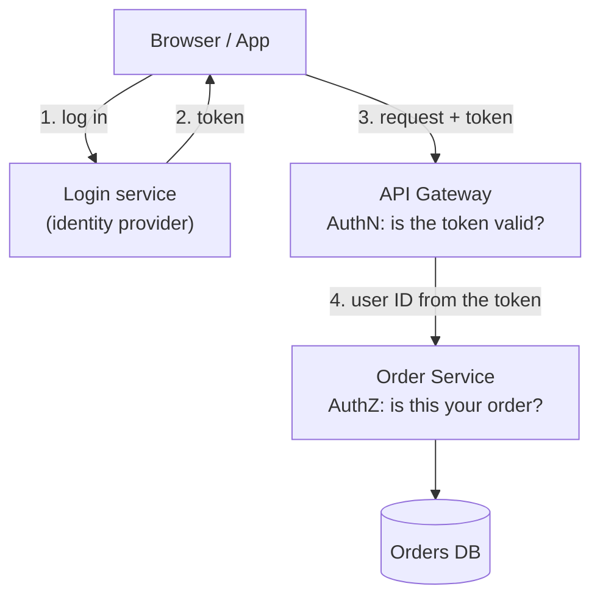

## What is it?

At a hotel, you check in at the front desk. The clerk looks at your ID card and finds your booking. Now the hotel knows **who you are**. That is **authentication**.

Then you get a key card. It opens **your** room, the gym and the pool. It doesn't open other guests' rooms or the staff office. That is **authorization**: **what you are allowed to do**.

- **Authentication (AuthN):** "Who are you?" Proving your identity.
- **Authorization (AuthZ):** "What can you do?" Checking your permissions.

Authentication always comes first. You can't decide what someone may do until you know who they are.

## Why do we need it?

**A server can't see who is on the other side.** A request is just text sent over the internet. Anyone can send any URL, any body, any user ID. And HTTP is **stateless**: each request arrives on its own, with no memory of the last one.

- **Without authentication**, the server can't tell users apart. It can't show "my orders", keep data private, or record who did what.
- **Without authorization**, every logged-in user can do everything: read other people's orders, delete accounts, change prices.

They are two separate steps because they change at different times. **Who you are** is proved once at login. **What you may do** must be checked on every action, against data that only the owning service knows.

## How it works inside

### Authentication

The user proves who they are with one or more **factors**:

| Factor | Examples |
| --- | --- |
| Something you **know** | Password, PIN |
| Something you **have** | A phone that gets a code, a security key |
| Something you **are** | Fingerprint, face |

**MFA (multi-factor authentication)** asks for two or more different kinds. Then a stolen password alone is not enough to get in.

The server never stores the password itself, only a slow **hash** of it. At login it hashes what you typed and compares the two (see [Encryption](./encryption.mdx)).

You can also let someone else check the password. "Log in with Google" uses [OAuth and OpenID Connect](./oauth-oidc.mdx): Google checks who you are and tells the app.

After login, the user doesn't send their password with every request. The server gives them a **session cookie** or a **token** (often a JWT), and they send that with each request to prove it is still them. See [Cookies, Sessions and JWT](../foundations/cookies-sessions-jwt.mdx).

If authentication fails, the server returns `401 Unauthorized`. The name is confusing: it really means "not authenticated".

### Authorization

Once we know this is user 7, the question is: may user 7 do **this action** on **this thing**?

Common kinds of rules:

- **Role:** only admins can delete users. See [RBAC](./rbac.mdx).
- **Ownership:** you can only see your own orders.
- **Sharing:** you can edit a document if its owner shared it with you.
- **Attributes:** managers can approve expenses up to 1,000 dollars.

If authorization fails, the server returns `403 Forbidden`. Some APIs return `404 Not Found` instead, so a stranger can't even learn that the thing exists.

| | Authentication | Authorization |
| --- | --- | --- |
| **Question** | Who are you? | What can you do? |
| **When** | First. At login, and on each request (check the token) | After authentication, on every action |
| **Checks** | Password, MFA code, token signature | Roles, ownership, sharing, permissions |
| **Fails with** | `401` | `403` (or `404`) |
| **At the hotel** | Showing your ID at the front desk | Which doors your key card opens |

### Where each check happens



An **identity provider (IdP)** is the service that handles login and gives out tokens. It can be your own login service, or a product like Auth0, Okta, AWS Cognito or Google.

- **Authentication is usually checked once, at the edge**, in the [API gateway](../hld-basics/api-gateway.mdx): is the token real, and not expired? The gateway then passes the user's ID **from that checked token** to the services behind it, for example in a header like `X-User-Id`. It must remove any such header the client sent, or a user could fake it. Requests without a valid token never reach your services.
- **Simple authorization** can also happen at the gateway, like "only admins may call anything under `/admin`".
- **Detailed authorization** ("is order 42 yours?") must happen **in the service** that owns the data, because only that service can answer it.

Services also need to prove who they are to each other: "is this really the payment service calling me?" This is often done with **mTLS**, where both sides show a certificate (see [Encryption](./encryption.mdx)), or with tokens for services. Don't assume a call is safe just because it comes from inside your network. This idea is called **zero trust**.

### Step by step on one request

1. **Read the proof:** the token in the `Authorization` header, or the session cookie.
2. **AuthN.** For a JWT: check its **signature** with the identity provider's key, its **expiry time**, and who issued it. For a session cookie: look the session ID up in the session store. Fails: `401`.
3. **Get the user** (ID, and sometimes roles) from the token or the session.
4. **AuthZ.** Load the thing being asked for, and check the rule: role, owner, or sharing. Fails: `403` (or `404`).
5. **Do the action.**

## Common mistakes

**1. Checking who, but not what.** The user is logged in, so the API returns any order they ask for:

```js
// BAD: any logged-in user can read any order by changing the number
app.get("/orders/:id", requireLogin, async (req, res) => {
    const order = await db.orders.findById(req.params.id);
    res.json(order);
});

// GOOD: check that the order belongs to this user
app.get("/orders/:id", requireLogin, async (req, res) => {
    const order = await db.orders.findById(req.params.id);

    // No such order, or it is someone else's: answer 404 for both,
    // so a stranger can't even learn that the order exists
    if (!order || order.userId !== req.user.id) {
        return res.status(404).json({ error: "Order not found" });
    }

    res.json(order);
});
```

An attacker just changes `/orders/42` to `/orders/43`. This mistake is called **IDOR** (insecure direct object reference) or **BOLA** (broken object level authorization). It is number one on the OWASP API Security Top 10 (see [API Security Basics](./api-security.mdx)).

**2. Only hiding the button.** Hiding the "Delete" button from normal users is good design, but it is not security. Anyone can call the API directly with a tool like curl. Every check must happen on the server.

**3. Trusting the user ID in the request.** Take the user's ID from the checked token or session (or from the header the gateway filled in from that token). Never take it from the request body or from something like `?userId=7` in the URL.

**4. Only checking at the front door.** If the gateway checks everything and the services behind it trust any request, one gap in the network gives an attacker everything. Each service checks what it is responsible for.

**5. Telling attackers too much.** "No account with this email" and "Wrong password" are two different messages, so an attacker can find out which emails have accounts. Show "Email or password is wrong" for both.

**6. Old permissions that live on.** Someone is removed from the admin role, but their token still says "admin" for the next 24 hours. Keep tokens short-lived, or look up important permissions fresh.

## When to use which

You almost always need **both**. The question is which checks:

| Situation | What you need |
| --- | --- |
| Public page, the same for everyone | Neither. Maybe a rate limit per IP |
| Personal data ("my orders") | AuthN, plus an **ownership** check |
| Admin tools | AuthN with **MFA**, plus a **role** check |
| Shared documents | AuthN, plus **sharing** rules |
| One service calling another | AuthN of the **service** (mTLS or a service token), plus which service may call what |

## Alternatives

Beyond the two checks themselves, there are different ways to build each one:

| Option | What it is | Pick it when |
| --- | --- | --- |
| **An identity provider** (Auth0, Okta, Cognito) | A service that runs login, MFA and tokens for you | You don't want to build and secure login yourself |
| **Social login** | "Log in with Google or Apple", using OpenID Connect | Consumer apps. Users don't need a new password. See [OAuth and OIDC](./oauth-oidc.mdx) |
| **Passwordless** (passkeys, magic links) | Prove who you are with a key on your device, or a link sent by email | You want no passwords to steal or reuse |
| **RBAC / ABAC** | Permission rules by role, or by attributes | Most apps. See [RBAC](./rbac.mdx) |
| **Relationship-based (ReBAC)** | Permissions come from links: "user is an editor of the folder that holds this doc". Google's Zanzibar system works this way | Apps built around sharing, like Docs or Drive |
| **A policy engine** (Open Policy Agent) | Rules written once, in a separate policy language, that every service asks | Many services must follow the same rules |

## In the real world

**USPS, 2018.** An API behind the US Postal Service website let any logged-in user look up the account details of other users, about 60 million accounts in total. Users were authenticated, but the API didn't check whether they were authorized to see someone else's data. Security journalist Brian Krebs reported it, and it was then fixed.

**First American Financial, 2019.** About 885 million documents from home sales, some with bank account and Social Security numbers, could be opened by anyone who changed a number in a document's web address. No check made sure the viewer was allowed to see that document.

## In the interview

Say clearly where each check happens:

> "The gateway authenticates every request by checking the JWT, then passes the user ID from that token to the services. Services use only that ID, never one from the request body. Each service does its own authorization. For example, the order service checks that the order belongs to the user, and returns 404 if it doesn't."

<Callout title="Remember this" type="success">
  - **Authentication** = who are you (`401`). **Authorization** = what can you do (`403`).
  - **Why:** a request is just text, and anyone can send anything. The server must prove **who** sent it, and check **what** they may do.
  - Authentication comes first: password and MFA, then a session or token on each request.
  - Check **authentication at the gateway**. Check detailed **authorization in the service** that owns the data.
  - Always check that the user may access **this exact object** (IDOR / BOLA).
  - Take the user ID from the checked token, never from the request body or URL. Hiding a button is not security.
  - **Inside:** read the token, check its **signature and expiry** (`401`), load the object, check the rule (`403`).
  - **Alternatives:** an identity provider, social login, passwordless, RBAC/ABAC, ReBAC, a policy engine.
</Callout>
