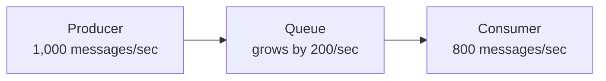
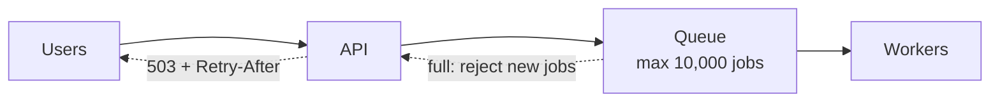

## What is it?

A restaurant kitchen can cook 20 meals an hour. On a Friday night, 40 groups walk in. A good host doesn't seat everyone and send 40 orders to the kitchen at once. The food would take hours and every table would be angry. Instead, the host says "there's a 30-minute wait", or "sorry, we're full tonight". The kitchen's limit **pushes back** all the way to the front door.

**Backpressure** is when the part of a system that can't keep up tells the part sending it work to **slow down or stop**. The name comes from pipes: when a pipe gets narrow, the water pushes back against the flow.

Without backpressure, the fast sender keeps sending. The work piles up somewhere until something breaks.

## Why do we need it?

**Queues that grow forever.** A **producer** creates work. A **consumer** does the work. A queue sits between them to soak up short bursts (see [Message Queues and Pub/Sub](../messaging/message-queues-pub-sub.mdx)).



If the producer is faster than the consumer, the queue grows every second.

**Worked example:**

- In: 1,000 messages per second. Out: 800 per second.
- So the queue grows by **200 every second**.
- After one hour: 200 × 3,600 = **720,000** messages waiting.
- A new message must wait for all of them: 720,000 ÷ 800 = 900 seconds = **15 minutes**.

Two things go wrong:

1. **The delay keeps growing.** By the time a message is handled, it may be useless. A login code that arrives 15 minutes late has already expired. Work done for a user who gave up is wasted work.
2. **Memory runs out.** If the queue lives in memory, the process finally crashes, and every message in it is lost at once.

An unlimited queue doesn't fix overload. It only **hides** it for a while, and then everything fails at once. So **every queue needs a size limit**, and a plan for what happens when it is full.

## How it works inside

### How the busy part knows it is busy

It watches a simple number and compares it with a limit:

- **Queue length.** The queue has a maximum size. Full means push back.
- **Requests in flight.** A counter goes up when a request starts and down when it ends. Over the cap means push back.
- **Waiting time.** How long the oldest item has waited. If it already waited longer than the client's timeout, the client has given up, and doing the work is a waste.

When the number crosses the limit, the busy part pushes back in one of three ways.

### 1. Reject

Say "no" to new work, right away. A web server returns `503 Service Unavailable` (or `429`) with a `Retry-After` header. The client tries again later, waiting a bit longer each time (see [Retries, Backoff and Timeouts](../messaging/retries-backoff-timeouts.mdx)).

Rejecting work on purpose to stay healthy is called **load shedding**. It is better to serve 800 users quickly than to accept 1,000 and make all of them time out. Smart load shedding drops the least important work first: checkout and payments get through, background syncs are turned away.

### 2. Slow down the sender

Make the producer wait until there is room:

- **Blocking queue.** When the queue is full, the producer's "add" call simply waits until a slot frees up.
- **Pull instead of push.** The consumer asks for work only when it is ready. A [Kafka](../messaging/kafka.mdx) consumer pulls messages at its own speed, so it can never be flooded. It just falls behind.
- **Credits.** The consumer says "send me 10 more", and the sender sends at most 10. TCP and HTTP/2 control their flow this way.

### 3. Drop

Throw some messages away, on purpose. This is only OK when losing some data is fine:

- **Drop the oldest.** For live stock prices or a player's position in a game, only the newest value matters.
- **Drop the newest.** Keep what you already have, ignore what comes in.
- **Sample.** Keep 1 in 10. Fine for metrics and debug logs.

### Side by side

| Way | What happens | Good for | Cost |
| --- | --- | --- | --- |
| **Reject** | New work gets an error. The client retries later. | Web APIs, user requests | Some users see "try again" |
| **Slow down** | The sender waits | Pipelines inside your own system, file copies | The sender gets slower too, and may push back on its own sender |
| **Drop** | Some data is thrown away | Metrics, logs, live video, prices | Lost data |
| **Add consumers** | Start more workers when the queue grows | A real rise in traffic that lasts | Takes minutes, costs money, and the database behind the workers may become the next bottleneck |

The last row is not backpressure, but it is the usual partner. Backpressure keeps you alive in the moment, and adding consumers fixes a lasting rise in traffic.

Here is a full chain with backpressure. The queue has a limit, and "full" travels back to the user:



## Examples

**TCP flow control.** Every TCP connection has backpressure built in (see [TCP vs UDP](../foundations/tcp-vs-udp.mdx)). The receiver keeps telling the sender how much free buffer space it has, called the **receive window**. If the receiver is slow and its buffer fills up, the window drops to zero, and the sender stops until there is room again.

**Node.js streams.** When you write to a stream faster than it can flush the data, `write()` returns `false`. That is the signal to stop and wait for the `drain` event:

```js
// Copy everything from one stream to another, without filling up memory
function copy(source, destination) {
    // Runs each time a piece of data (a chunk) is read
    source.on("data", (chunk) => {
        const hasRoom = destination.write(chunk);

        // The destination is full: stop reading for now
        if (!hasRoom) {
            source.pause();

            // "drain" fires once there is room again: go on reading
            destination.once("drain", () => {
                source.resume();
            });
        }
    });

    // All data is read: close the destination
    source.on("end", () => {
        destination.end();
    });
}
```

In real code, use Node's `stream.pipeline()`, for example `await pipeline(source, destination)` from `node:stream/promises`. It handles backpressure for you, and unlike plain `source.pipe(destination)`, it also passes on errors and closes all the streams if one of them fails.

**Kafka consumers.** Kafka consumers pull. If a consumer is slow, the messages wait safely on Kafka's disks, not in the consumer's memory. The gap between the newest message and the last one the consumer read is called **consumer lag**. It is the number to watch and alert on.

**A log shipper.** An agent on each server sends logs to a central log system. It keeps a buffer with a size limit. If the log system is down long enough to fill the buffer, the agent drops logs instead of using up all the memory on the server. Losing some debug logs is much better than crashing the app.

## When to use it

- **Every queue or buffer** between two parts that run at different speeds.
- **APIs that can be overloaded** by a spike: reject early with `503` instead of timing out for everyone.
- **Data pipelines and streams**: file copies, uploads, log and metric shipping.
- **Workers that call a slower database or partner API.** Let them pull work only as fast as the slow part can take it.

**Don't use it when:**

- **The overload lasts.** Backpressure only buys time. Add consumers or capacity.
- **Data must not be lost and the sender can't retry.** Don't drop or reject. Write it to a durable log with plenty of disk (like Kafka) and catch up later.
- **Blocking would freeze something more important.** Don't make a user's request thread wait on a full internal queue. Reject fast instead.

## Alternatives

| Option | What it is | Pick it when |
| --- | --- | --- |
| **A durable buffer** | A queue on disk (Kafka, SQS) that can hold hours of work | Bursts are short, and late work is still useful |
| **Add consumers (autoscaling)** | Start more workers when the queue grows | Traffic really went up and will stay up |
| **Batching** | The consumer handles many items per trip, like one insert of 100 rows | The consumer is slow because of the cost per item, not the work itself |
| **Rate limiting** | A fixed limit per user, set in advance | You need fairness between users. See [Rate Limiting](./rate-limiting.mdx) |
| **Circuit breaker** | The caller stops calling a service that keeps failing | You are the caller, and the other side is down. See [Circuit Breaker](./circuit-breaker.mdx) |

## Rate limiting vs backpressure

| | [Rate limiting](./rate-limiting.mdx) | Backpressure |
| --- | --- | --- |
| **Based on** | A fixed rule set in advance: "100 per minute per user" | How busy the system is right now |
| **Main goal** | Fairness and stopping abuse | Surviving overload |
| **Example** | User 42 gets `429` after 100 requests | Everyone gets `503` because the queue is full |

## In the real world

**Amazon's load shedding.** In the Amazon Builders' Library, AWS engineers describe load shedding: when a server is overloaded, it quickly rejects the extra requests, so the requests it does accept still finish on time. A server that accepts everything gets slow for everyone. Clients time out anyway, and the server ends up doing work that no one is waiting for.

**Kafka's pull design.** Kafka's design documents explain that consumers pull data from Kafka, instead of Kafka pushing it to them. That way a consumer that falls behind can catch up at its own speed, instead of being flooded.

**TCP.** The receive window has been part of TCP from the start. Every web page you load uses it.

## In the interview

Whenever you add a queue to a design, say how big it can get and what happens when it is full:

> "The queue has a size limit. If the workers fall behind and it fills up, the API returns 503 with Retry-After, instead of accepting work we can't finish. We alert on consumer lag and add workers when it keeps growing."

<Callout title="Remember this" type="success">
  - **Backpressure** = the slow part tells the fast part to slow down.
  - **Why:** if the sender is faster, work piles up. Delay grows, memory runs out, and everything fails at once.
  - **Inside:** watch **queue length**, **requests in flight** or **waiting time** against a limit.
  - An **unlimited queue** only hides overload. The delay grows, then memory runs out.
  - **Every queue needs a limit**, and a plan for when it is full.
  - Three ways: **reject** (503 or 429), **slow down** the sender (blocking, pull, credits), or **drop** (only when losing data is OK).
  - Watch **queue length** and **consumer lag**.
  - Rate limiting is a fixed rule per user. Backpressure reacts to load right now.
  - **Alternatives:** a durable buffer, more consumers, batching, rate limiting, circuit breaker.
</Callout>
