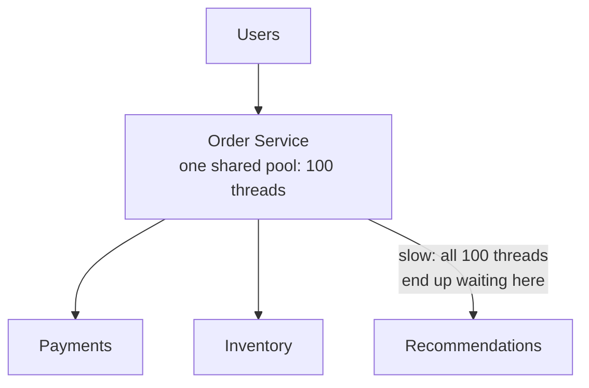
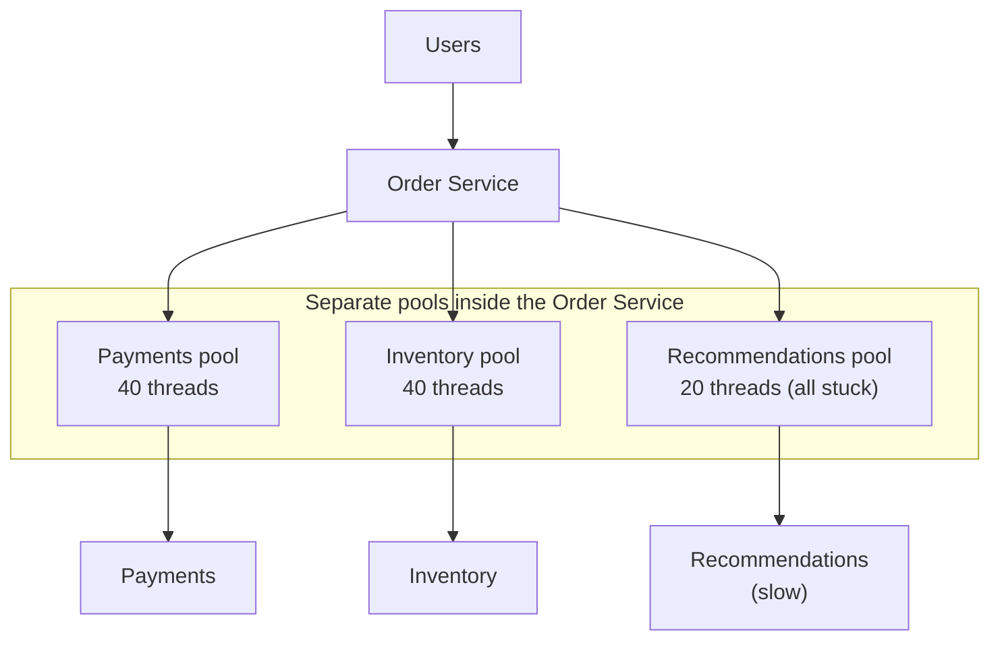
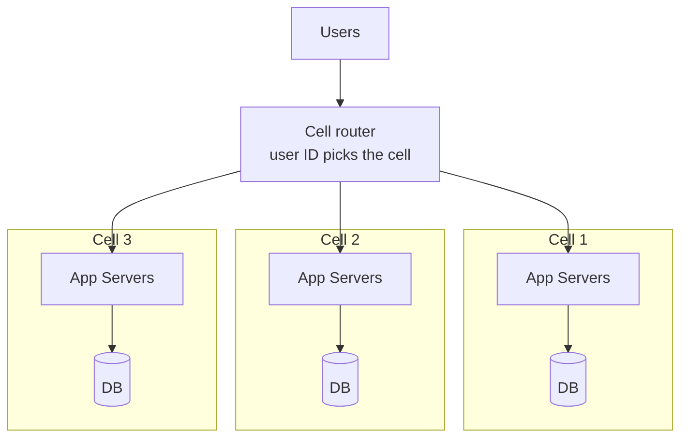

## What is it?

The inside of a ship is split into separate rooms by strong walls called **bulkheads**. If the ship hits a rock and water comes into one room, the walls keep the water there. That room floods, but the rest of the ship stays dry and it keeps floating.

The **bulkhead pattern** does the same with your system's resources: threads, connections, servers. You split them into **separate pools**, so a problem in one part can only use up its own pool. Everything else keeps working.

### Where the name comes from

The Titanic is the famous lesson. It had watertight rooms, but the walls between them didn't go all the way up. As the front rooms filled, the ship tipped forward, and water spilled over the top of each wall into the next room.

The same is true in software. A bulkhead only works if the parts are **really** separate. Two "separate" thread pools that still share one database connection pool are not separate.

## Why do we need it?

**One slow dependency can use up a shared pool.** An **Order Service** calls three other services. It handles those calls with one shared **thread pool**: a fixed group of worker threads, here 100, that each run one call at a time.



Recommendations gets slow. Each call to it holds a thread for many seconds. One by one, all 100 threads end up stuck waiting on it. Now calls to Payments and Inventory can't get a thread either. The whole Order Service is down because of a feature nobody needs to place an order.

## How it works inside

### Separate pools of threads or connections

Give each service you call **its own pool**:



Now Recommendations can only ever hold its own 20 threads. When they are all busy, new calls to it are **rejected right away** and get a fallback, such as hiding the "you may also like" box. Payments and Inventory still have their 80 threads, and orders keep going through.

There are two common ways to build this:

| Type | How it works | Good for |
| --- | --- | --- |
| **Thread pool bulkhead** | Each service you call gets its own pool of threads. Calls run on that pool. | Strong separation. A stuck call can be given up on. |
| **Semaphore bulkhead** | A simple counter of free slots (a **semaphore**): "at most 20 calls to Recommendations at the same time." The call runs on the caller's own thread. | Lighter and simpler. A common default. |

With the Resilience4j library in a Java app, a semaphore bulkhead is just a few lines of config:

```yaml
resilience4j.bulkhead:
  instances:
    recommendations:
      maxConcurrentCalls: 20   # at most 20 calls at the same time
      maxWaitDuration: 0ms     # if all 20 are busy, fail right away
    payments:
      maxConcurrentCalls: 40
```

The same idea works for **database connections** (see [Connection Pooling](../databases/connection-pooling.mdx)). Give user requests one connection pool, and slow reports a separate small one. Then a huge report can't take every connection and freeze the website.

### What happens on each call

1. **Take a slot.** The call asks its pool for a free thread or a free permit.
2. **None free?** Wait a very short time (often zero). Still none: **reject** the call right away and use the fallback.
3. **Run the call** on the slot.
4. **Give the slot back**, always, even when the call fails (in a `finally` block). A slot that is never returned is lost for good, and the pool slowly shrinks to nothing.

A thread pool bulkhead usually has a small, **bounded** queue in front of its threads. Calls wait there briefly, and when the queue is full, new calls are rejected. An unbounded queue would just move the pile-up somewhere else (see [Backpressure](./backpressure.mdx)).

### Bulkheads at every size

| Size | Example |
| --- | --- |
| **Threads in one service** | A separate pool for each service you call (above) |
| **Database connections** | One pool for user requests, a small separate one for reports |
| **Queues and workers** | Password-reset emails get their own queue and workers, so a huge marketing email blast can't delay them |
| **Servers** | Separate server groups for paying and free customers, or for the public API and internal tools |
| **Cells** | Split users into groups, each served by its own full copy of the system |

A **cell** is the biggest bulkhead: a complete, independent copy of the system (servers, database, cache) that serves only some of the users. A small router in front sends each user to their cell. A bad deploy, an overload or a broken database hits **one cell**, not everyone.



In a system shared by many companies, this also stops one very busy customer (a **noisy neighbor**) from slowing everyone else down (see [Multi-Tenancy](../advanced-components/multi-tenancy.mdx)).

## When to use it

- **One service calls several others** of different importance. Keep the important calls (payments) safe from the optional ones (recommendations).
- **Slow background work shares resources with user requests:** reports, exports, batch jobs.
- **Many customers share one system.** Separate pools or cells stop a noisy neighbor.
- **A critical path** like login or checkout must keep working no matter what else breaks.

**Don't use it when:**

- **Every request needs the same one dependency.** Splitting the pool doesn't help if all calls fail without it.
- **The resources are already small.** Splitting 10 connections into five pools of 2 rejects calls on a normal day.
- **You can't size and watch the pools.** Badly sized pools cause rejections that look like outages.

## Alternatives

| Option | What it is | Pick it when |
| --- | --- | --- |
| **Circuit breaker** | Stop calling a dependency after too many failures | The dependency is clearly down. Best used together with a bulkhead. See [Circuit Breaker](./circuit-breaker.mdx) |
| **Short timeouts** | Give up on each call quickly, so threads are freed sooner | Slowness is mild. Cheap, but a very slow service can still fill the pool |
| **Rate limiting per client** | Cap how many requests each user or customer can send | The danger is one client sending too much. See [Rate Limiting](./rate-limiting.mdx) |
| **Autoscaling** | Add more servers when load goes up | The problem is real extra traffic, not one stuck dependency. A stuck dependency fills any number of threads |
| **Non-blocking I/O** | An event loop waits on many calls without one thread each (Node.js, Netty) | Threads are the bottleneck. You still need a cap on calls in flight, or memory and connections pile up |

## Bulkhead vs circuit breaker

| | Bulkhead | Circuit breaker |
| --- | --- | --- |
| **Question** | How much of my resources can this one dependency use? | Should I call this dependency at all right now? |
| **How** | A cap on threads, connections or servers | Stops calls after too many failures |
| **Protects** | The rest of your service | You, and the failing service (it gets a rest) |

They work best together. The bulkhead limits the damage in the first seconds, while the [circuit breaker](./circuit-breaker.mdx) is still counting failures. Then the breaker opens and the calls stop.

The cost: pools must be sized well. Too small, and calls are rejected even on a normal day. Too big, and the separation means little. Size them from real traffic, and watch how often each pool rejects calls.

## In the real world

**Netflix Hystrix.** Netflix's Hystrix library gave every backend dependency its own small thread pool by default. If one dependency got slow, only its pool filled up, and calls to all the other dependencies kept working. The Hystrix documentation calls this the bulkhead pattern.

**AWS cells.** AWS has written publicly about building many of its own services as **cells**, so that one failure only reaches the customers in one cell. It now publishes guidance on cell-based architecture for its customers too.

**Kubernetes limits.** In Kubernetes, each container can be given a CPU and memory limit. A container with a memory leak is stopped and restarted when it goes over its limit, instead of eating all the memory on the machine and hurting the containers next to it.

## In the interview

Mention it when one service calls several others, or when slow background work could hurt user requests:

> "The order service calls payments, inventory and recommendations through separate connection pools. If recommendations gets slow, it can only use its own 20 connections. Payments has its own pool, so orders keep going through."

<Callout title="Remember this" type="success">
  - Named after the walls in a ship that stop one leak from sinking it.
  - **Why:** with one shared pool, one slow dependency holds every thread, and the whole service goes down.
  - Give each dependency its **own pool** of threads or connections.
  - When a pool is full, **fail fast** and use a fallback. Don't wait.
  - **Inside:** take a slot, reject if none is free, run the call, **always give the slot back**.
  - It works at every size: threads, connection pools, queues, server groups, **cells**.
  - Pair it with a **circuit breaker**: the bulkhead limits the damage, the breaker stops the calls.
  - **Alternatives:** circuit breaker, short timeouts, rate limiting per client, autoscaling, non-blocking I/O.
</Callout>
