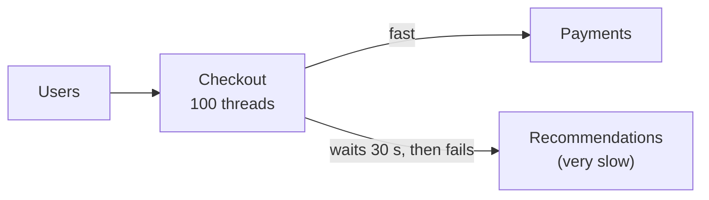
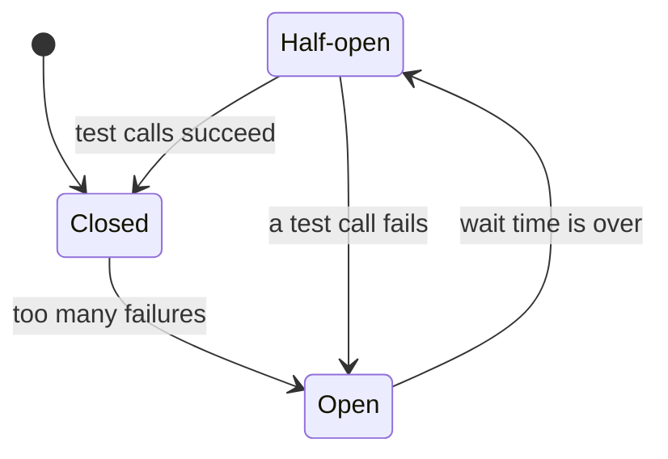

## The idea

Your house has a **fuse box**. If a heater goes wrong and pulls too much electricity, the breaker **trips** and cuts power to that circuit. The wires don't overheat and the house doesn't catch fire. When the problem is fixed, you flip the switch back on.

A software **circuit breaker** does the same for calls between services. It sits in front of the calls to another service and watches the results. If that service keeps failing, the breaker trips: for a while it **stops calling it** and fails right away instead. After a short rest, it lets a few test calls through. If they work, normal calls start again.

The goal: one broken service should not drag the services that call it down with it.

## The problem: one slow service slows everyone

An online shop. The **Checkout** service calls **Payments**, and also **Recommendations** (the "you may also like" box).



Now Recommendations gets very slow. Every call to it hangs for 30 seconds before it times out.

1. Checkout has a fixed number of **threads** (workers that each handle one request at a time), say 100.
2. Every checkout request now waits 30 seconds on Recommendations. Threads pile up, all waiting.
3. Soon all 100 threads are stuck. New checkout requests find no free thread.
4. Checkout is now down too, even though Payments is fine. Next, the services that call Checkout start to fail.

This chain reaction is called a **cascading failure**. Retries make it worse: every failed call is sent again, so the sick service gets **more** traffic just when it needs less (see [Retries, Backoff and Timeouts](../messaging/retries-backoff-timeouts.mdx)).

A shorter timeout helps (wait 1 second, not 30), but you still pay that second on every single call. A circuit breaker stops making the call at all.

## Closed, open and half-open

A circuit breaker is always in one of three states:



| State | What happens to calls | In the fuse box |
| --- | --- | --- |
| **Closed** (normal) | All calls go through. The breaker counts failures. | Switch on, power flows |
| **Open** (tripped) | No calls go through. Every call **fails fast**, right away, and a fallback answer is used. | Switch off, no power |
| **Half-open** (testing) | A few test calls go through. The rest still fail fast. | Flip it back on carefully, to see if the problem is fixed |

"Closed" means **working**, which feels backwards. It comes from electricity: a closed circuit lets power flow.

### A worked example

The settings:

- **Open** the breaker if **50% or more** of the last **20 calls** failed. A timeout counts as a failure.
- Stay open for **30 seconds**.
- In half-open, allow **3 test calls**.

| Time | What happens | State |
| --- | --- | --- |
| 10:00:00 | Recommendations starts timing out. 12 of the last 20 calls failed (60%). | Closed → **Open** |
| 10:00:00 to 10:00:30 | Calls get the fallback in under a millisecond. Recommendations gets no traffic, so it has time to recover. | Open |
| 10:00:30 | The wait is over. 3 test calls go through. One times out. | Half-open → **Open** again |
| 10:01:00 | 3 more test calls. All succeed. | Half-open → **Closed** |

### In code

A tiny version, to show the idea:

```js
class CircuitBreaker {
  constructor(callService, { failureLimit = 5, openMs = 30000 } = {}) {
    this.callService = callService;
    this.failureLimit = failureLimit;
    this.openMs = openMs;
    this.state = "CLOSED";
    this.failures = 0;
    this.openedAt = 0;
  }

  async call(...args) {
    if (this.state === "OPEN") {
      if (Date.now() - this.openedAt < this.openMs) {
        throw new Error("Circuit open: failing fast"); // don't even try
      }
      this.state = "HALF_OPEN"; // wait is over: let a test call through
    }
    try {
      const result = await this.callService(...args);
      this.state = "CLOSED"; // it worked: back to normal
      this.failures = 0;
      return result;
    } catch (err) {
      this.failures++;
      if (this.state === "HALF_OPEN" || this.failures >= this.failureLimit) {
        this.state = "OPEN"; // trip the breaker
        this.openedAt = Date.now();
      }
      throw err;
    }
  }
}
```

This one counts failures in a row. Real libraries look at a **failure rate** over a sliding window (the last N calls, or the last N seconds), count **slow** calls as failures too, and allow only a few calls at once in half-open.

## Fallbacks

When the breaker is open, what does the caller get? A **fallback**: a backup answer.

| Fallback | Example |
| --- | --- |
| **Cached data** | Show the recommendations saved from the last good call |
| **A safe default** | Show "popular items" instead of personal picks |
| **Hide the feature** | Leave the "you may also like" box off the page |
| **Do it later** | Put the request in a queue and finish it when the service is back |
| **A clear error** | "Payments are slow right now. Please try again in a minute." |

Choose the fallback by how important the feature is. For recommendations, hiding the box is fine. For payments, you can never fake a success: show a clear error, or queue the payment and tell the user it is being processed. More on this in [Graceful Degradation](./graceful-degradation.mdx).

## Working with other patterns

A call to another service usually gets several protections at once:

| Pattern | Protects against |
| --- | --- |
| **Timeout** | Waiting forever on one call |
| **Retry with backoff** | Short blips that fix themselves within a second |
| **Circuit breaker** | A service that is down for longer: stop calling it |
| **[Bulkhead](./bulkhead.mdx)** | One slow service using up all your threads |
| **Fallback** | Users seeing an error page |

The retry goes **outside** the breaker and wraps it: `retry(() => breaker.call(...))`. Then every single try passes through the breaker, so each failed try counts toward tripping it. Once the breaker is open, the next try fails fast with "circuit open". The retry should treat that error as final and stop, instead of retrying a call that can't go through.

## Tools

You rarely write your own:

| Tool | Language or place |
| --- | --- |
| **Resilience4j** | Java. Circuit breaker, retry, bulkhead and rate limiter. |
| **Hystrix** | Java, from Netflix. Made the pattern famous, but in maintenance mode since 2018. |
| **Polly** | .NET |
| **opossum** | Node.js |
| **Istio / Envoy** | A **service mesh**: a small proxy runs next to each service and handles timeouts, retries and breaking outside your code. Envoy stops sending traffic to a server that keeps failing (it calls this "outlier detection"). |

## In the real world

**Netflix and Hystrix.** The Netflix API calls dozens of backend services to answer requests. In 2012 Netflix open-sourced **Hystrix**, a library that wrapped every call with a timeout, a circuit breaker, its own small thread pool and a fallback. It made circuit breakers well known. In 2018 Netflix stopped adding features to Hystrix and pointed new projects to Resilience4j.

**Where the name comes from.** Michael Nygard described the pattern in his 2007 book *Release It!*. Martin Fowler's short 2014 article "CircuitBreaker" spread it widely.

## In the interview

Bring it up whenever one service calls another that may be slow or down, especially third-party APIs like payments, maps or SMS:

> "Checkout calls the recommendation service through a circuit breaker with a 500 ms timeout. If half or more of the calls fail, the breaker opens and we just hide the recommendations box. Checkout keeps working."

<Callout title="Remember this" type="success">
  - One slow service can use up all of its callers' threads: a **cascading failure**.
  - **Closed** = normal. **Open** = fail fast, don't call. **Half-open** = let a few test calls through.
  - It opens on a **failure rate** (errors and timeouts), and closes when the test calls succeed.
  - Always pair it with a **fallback**: cached data, a default, or hide the feature.
  - Use it with **timeouts**, **retries with backoff** (the retry wraps the breaker) and **bulkheads**.
  - Tools: **Resilience4j**, Polly, opossum, or a service mesh like Istio.
</Callout>
