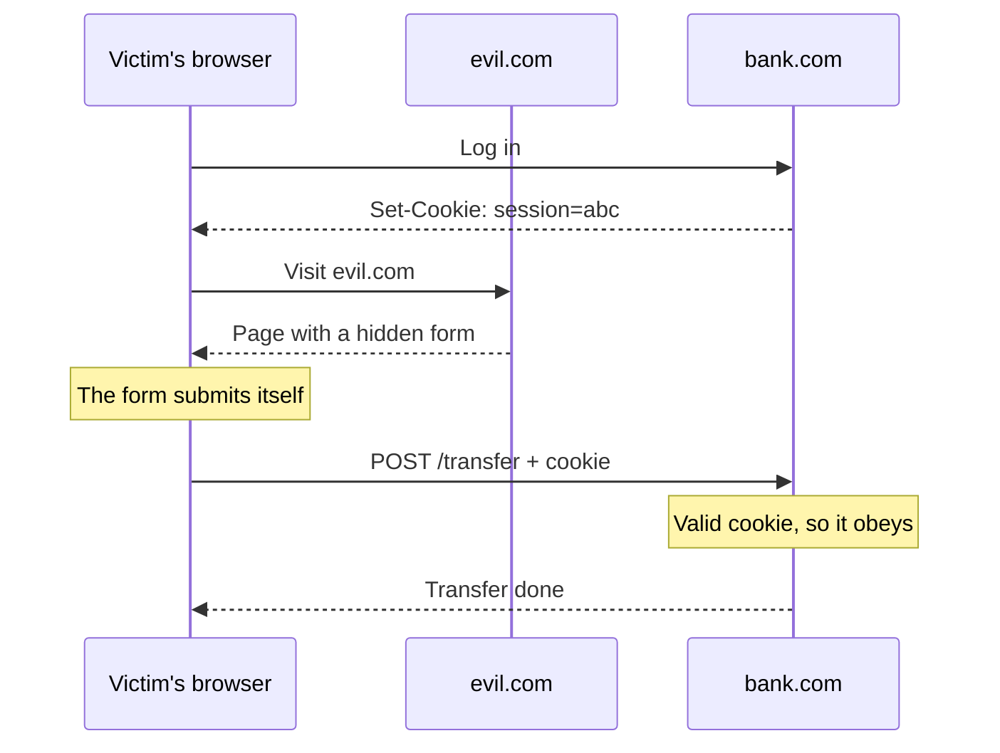
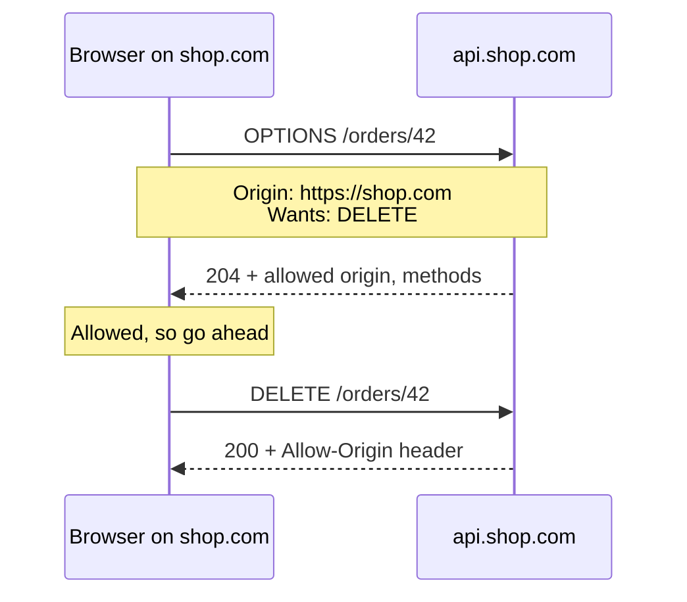

## The idea

Your browser is like a personal assistant who carries your ID badges. Whenever a letter goes to your bank, the assistant clips your bank badge to it, **no matter who wrote the letter**. So a stranger can hand the assistant a letter that says "send ₹10,000 to me", addressed to your bank, and the badge gets clipped on. That is **CSRF**.

But the assistant won't show the bank's **reply** to the stranger. Strangers can send letters in your name, but they can't read your mail. Unless the bank says "this other company may read my replies". That permission is **CORS**.

So the two names sound alike, but they are different things. CSRF is an **attack**. CORS is a way for a server to **relax a browser rule**. The rule underneath both is the **same-origin policy**.

## Origins and the same-origin policy

An **origin** is three things together: the **scheme** (`https`), the **host** (`shop.com`) and the **port** (`443`, the default for https). Two URLs have the same origin only if all three match.

| Compared with `https://shop.com` | Same origin? | Why |
| --- | --- | --- |
| `https://shop.com/cart` | Yes | Only the path is different |
| `http://shop.com` | No | Different scheme |
| `https://api.shop.com` | No | Different host |
| `https://shop.com:8443` | No | Different port |

The browser's **same-origin policy** keeps origins apart:

- A page **can send** requests to other origins: with forms, images, scripts or `fetch`.
- But its JavaScript **can't read the responses** from another origin, unless that origin allows it (with CORS).

So `evil.com` can make your browser send a request to `bank.com`. It just can't see what comes back.

A **site** is looser than an origin. `shop.com` and `api.shop.com` are different origins, but the **same site**, because they share the main domain `shop.com`. The `SameSite` cookie setting, below, works by site. So it can't protect you from a sibling subdomain. If users can upload pages to `user-content.shop.com`, those pages are same-site with `shop.com`, and their requests to it carry even `Strict` cookies. Put content that users upload on a separate domain.

## CSRF: cross-site request forgery

**CSRF** (cross-site request forgery) tricks a logged-in user's browser into sending a request the user never meant to send.

It works because of one cookie rule: the browser adds a site's cookies to **requests to that site**, even when **another site** started the request, unless the cookie's `SameSite` setting says not to (see [Cookies, Sessions and JWT](../foundations/cookies-sessions-jwt.mdx)).

The attack, step by step:



The hidden form on `evil.com` can be this short:

```html
<form action="https://bank.com/transfer" method="POST">
  <input type="hidden" name="to" value="attacker" />
  <input type="hidden" name="amount" value="10000" />
</form>
<script>document.forms[0].submit();</script>
```

The bank sees a valid session cookie and moves the money. The attacker never sees the bank's reply, and doesn't need to. The damage is done.

### Defenses

**1. SameSite cookies.** The `SameSite` setting on a cookie tells the browser whether to send it on requests that **another site** started:

| Setting | Sent when another site starts the request? | Good for |
| --- | --- | --- |
| `Strict` | Never. Even a link to `bank.com` on another site opens it without the cookie, so the user looks logged out at first | Very sensitive sites and actions |
| `Lax` | Only when the user **goes to** the site with a `GET`, like clicking a link. Not for form `POST`s, images, iframes or `fetch` | A good default for login cookies |
| `None` | Yes. The cookie must also be marked `Secure` | Widgets embedded on other sites |

**2. CSRF tokens.** The server puts a random, secret token, tied to the user's session, into its own pages, for example in a hidden form field. Every request that changes data must send the token back. `evil.com` can't read `bank.com`'s pages (the same-origin policy), so it can't learn the token, and its forged request is rejected. Most web frameworks, like Django, Rails, Laravel and Spring Security, have this built in.

**3. Check the `Origin` header.** Browsers add an `Origin` header to every request that isn't a `GET` or `HEAD`, and to cross-origin `fetch` calls. It names the origin that started the request, and JavaScript can't change it. On every request that changes data, the server checks: is this my own origin, or one I trust? If not, or if `Origin` is missing or set to `null`, it rejects the request. Modern browsers also send `Sec-Fetch-Site`, which says directly whether a request is `same-origin`, `same-site` or `cross-site`.

**4. Never change data with `GET`.** `GET` should only read (see [HTTP Methods, Status Codes and Headers](../foundations/http-methods-status-codes-headers.mdx)). `Lax` cookies are still sent when a user follows a link. So if `GET /transfer?to=attacker&amount=10000` moved money, one link on `evil.com` would be an attack.

Use them in layers: `SameSite=Lax` (or `Strict`) cookies, plus CSRF tokens or an `Origin` check on everything that changes data.

### APIs that use bearer tokens

Some apps don't log in with cookies. The app keeps the token itself and sends it in a header: `Authorization: Bearer <token>`. The browser **never adds a bearer token by itself**, and `evil.com` can't read the token, because it is stored under your site's origin. A forged request arrives without the token and fails. **No CSRF.**

The catch: your own JavaScript must be able to read the token to put it in the header. So if an attacker gets a script running on your page (**XSS**, see [API Security Basics](./api-security.mdx)), that script can steal the token. An `HttpOnly` cookie can't be read by scripts, but it is sent automatically, so it needs CSRF defenses. Each choice moves the risk somewhere else. More in [Cookies, Sessions and JWT](../foundations/cookies-sessions-jwt.mdx).

## CORS: letting other origins read responses

**CORS** (cross-origin resource sharing) is how a server tells the browser: "this other origin may read my responses."

Example: your shop's front end runs at `https://shop.com`, and your API at `https://api.shop.com`. Those are different origins, so by default the front end's JavaScript can't read the API's responses. Say the front end sends a plain `GET` to the API. The API must allow it:

1. The browser adds `Origin: https://shop.com` to the request.
2. The API replies with `Access-Control-Allow-Origin: https://shop.com`.
3. The browser checks that they match, and only then gives the response to the JavaScript.

If that header is missing, the `GET` still reached the server. The browser just hides the response and shows a CORS error in the console.

`Access-Control-Allow-Origin: *` allows **any** origin. That is fine for public data, like a public weather API. The header holds **one** origin or `*`, not a list. To allow several origins, the server checks the request's `Origin` against its own allowlist and sends back the one that matched. It also sends `Vary: Origin`, so caches don't mix up the answers for different origins.

### The preflight request

Some requests are **simple**: a `GET`, `HEAD` or `POST` with only basic headers, and a body type a plain HTML form could send. The browser sends these straight away.

Anything else needs permission **first**: a `PUT` or `DELETE`, a `Content-Type: application/json` body, or an extra header like `Authorization`. The browser first sends a **preflight**: an `OPTIONS` request that asks "may I?"



- The preflight asks with `Access-Control-Request-Method` and `Access-Control-Request-Headers`.
- The server answers with `Access-Control-Allow-Origin`, `Access-Control-Allow-Methods` and `Access-Control-Allow-Headers`. `Access-Control-Max-Age` lets the browser remember the answer for a while, so it doesn't ask before every request.
- If the answer doesn't allow the request, the browser **never sends** the real one.
- A preflight carries no cookies and no `Authorization` header, so your login check must let `OPTIONS` requests through.

### Credentials

By default, a cross-origin `fetch` doesn't send cookies. To send them, the JavaScript must ask with `credentials: "include"`, and the server must reply with **both**:

- `Access-Control-Allow-Credentials: true`
- `Access-Control-Allow-Origin` set to the **exact** origin, like `https://shop.com`

With credentials, `*` is **not allowed**: the browser refuses the response. Why? `*` plus cookies would let **any website in the world** read a logged-in user's private data from your API, using the user's own cookies.

### Common mistakes

- **Sending back any `Origin`, with credentials allowed.** Some servers copy whatever `Origin` arrives into `Access-Control-Allow-Origin`, and also send `Access-Control-Allow-Credentials: true`. Now every site, `evil.com` included, can read your users' data. Use an exact allowlist. Watch out for loose checks like "ends with `shop.com`", which also matches `evilshop.com`.
- **Thinking CORS protects the server.** It doesn't. The **browser** enforces CORS, to protect **users' data** inside the browser. Simple requests still reach your server, CORS or not. And curl, mobile apps and other servers ignore CORS completely. Your API still needs authentication and authorization on every request.
- **"Fixing" a CORS error with `*` everywhere.** Allow only the origins that need access.

## CSRF vs CORS

| | CSRF | CORS |
| --- | --- | --- |
| **What it is** | An **attack** | A **browser rule** that a server uses to allow access |
| **The question** | Can another site make the user's browser **send** a request, with the user's cookies? | Can another site's JavaScript **read** my response? |
| **Who checks** | Your server, plus the cookie's `SameSite` setting | The browser, using the server's headers |
| **Main tools** | `SameSite` cookies, CSRF tokens, `Origin` check | `Access-Control-Allow-*` headers, preflight |
| **Is the request sent?** | Yes. That is the attack | Simple requests: yes. Others: only if the preflight allows it |

**Why CORS is not a CSRF defense.** A CSRF attack doesn't need to **read** anything. The hidden form from `evil.com` is a simple request: no preflight. It goes straight to `bank.com` with the cookies, and the money moves. CORS only hides the bank's reply from `evil.com`, and the attacker never wanted the reply. Strict CORS headers don't stop it.

There is one partial exception. An API that accepts **only** `Content-Type: application/json` forces a preflight, so a plain form can't call it. Don't rely on that alone: one endpoint that also accepts form data opens the door again.

## In the real world

**Chrome made `SameSite=Lax` the default (2020).** Chrome started treating cookies with no `SameSite` setting as `Lax`, and started requiring `Secure` on cookies marked `SameSite=None`. This blocked many classic CSRF attacks by default. Still, don't rely on browser defaults: set `SameSite` yourself on every cookie.

**CSRF left the OWASP Top 10 in 2017.** It was on the list in 2007, 2010 and 2013. It was dropped in 2017, partly because so many web frameworks now include CSRF defenses.

**ING Direct (2008).** Researchers at Princeton, William Zeller and Edward Felten, found CSRF bugs on several popular websites. On ING Direct's banking site, an attacker could move money out of a logged-in customer's account to the attacker's own account.

## In the interview

Bring it up when your design has a web front end that logs in with cookies, or a front end and an API on different domains:

> "Users log in with a session cookie marked `HttpOnly`, `Secure` and `SameSite=Lax`, and every request that changes data also needs a CSRF token. The web app on shop.com calls api.shop.com, so the API sends CORS headers that allow only shop.com, with credentials. CORS isn't a CSRF defense, so we need both."

<Callout title="Remember this" type="success">
  - **Origin** = scheme + host + port. Pages can **send** requests to other origins, but can't **read** the responses unless the server allows it.
  - **CSRF:** another site makes the user's browser send a request, and the browser adds the user's cookies by itself.
  - CSRF defenses: **`SameSite` cookies**, **CSRF tokens**, an **`Origin` check**, and **no data changes with `GET`**.
  - `Authorization: Bearer` tokens aren't sent automatically, so no CSRF. But scripts can read them, so watch for **XSS**.
  - **CORS:** the server says which origins may **read** its responses. Non-simple requests get an `OPTIONS` **preflight** first.
  - With credentials, `Access-Control-Allow-Origin` must be an **exact origin**, never `*`. Never echo back whatever `Origin` arrives.
  - **CORS protects users' data in the browser, not your server**, and it does **not** stop CSRF.
</Callout>
