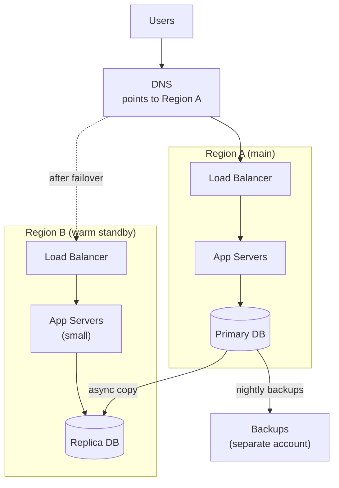

## The idea

You are writing a long report on your laptop, and the laptop dies. Two questions matter:

1. **How much work did I lose?** Everything since you last saved. If you saved 10 minutes ago, you lost 10 minutes of work.
2. **How long until I can work again?** Getting another laptop and opening your saved copy might take an hour.

These two questions are exactly **RPO** and **RTO**.

**Disaster recovery (DR)** is the plan for getting back after a big failure: a whole data center loses power, a cloud region goes down, someone deletes the production database by mistake, or ransomware locks your files. [Redundancy](./redundancy-failover.mdx) handles one server dying. Disaster recovery is for when a whole site, or the data itself, is gone.

## RPO and RTO

- **RPO (Recovery Point Objective)** is the most data you can afford to lose, measured in time. "RPO = 1 hour" means losing up to the last hour of data is acceptable. It decides **how often you copy your data**.
- **RTO (Recovery Time Objective)** is the longest you can be down. "RTO = 4 hours" means you must be serving users again within 4 hours. It decides **how ready your spare system must be**.

"Objective" just means goal. These are targets the business agrees on. Some examples of what different systems might choose:

| System | RPO | RTO | Why |
| --- | --- | --- | --- |
| Bank payments | Close to zero | Minutes | A lost payment is not OK, and people need to pay |
| Online shop orders | Seconds | Under an hour | Lost orders and downtime are lost money |
| Company wiki | 24 hours | A day | Annoying, but not costly |
| Analytics reports | 24 hours | A few days | Can be rebuilt from the raw data |

Lower RPO and RTO cost more. Zero data loss with zero downtime is the most expensive thing you can build. So ask: what does one hour of downtime cost us, and what does one hour of lost data cost us?

## Backups

**Replication is not a backup.** If someone runs `DELETE FROM orders` by mistake, every replica copies the delete within a second. You now have several copies of the mistake. You also need **backups**: copies from the past that you can go back to.

| Type | What it is |
| --- | --- |
| **Full backup** | A complete copy of everything. Big and slow, so maybe once a day or once a week. |
| **Incremental backup** | Only what changed since the last backup. Small and fast. |
| **Snapshot** | A quick copy of a whole disk at one moment, made by the cloud provider. |
| **Point-in-time recovery** | A full backup plus a log of every change since then. You can restore to any second, like 10:41:59, just before the bad `DELETE`. |

Point-in-time recovery works because databases write every change to a log first, called the **write-ahead log (WAL)**. Keep those logs, and you can replay the changes up to the exact moment you want. Managed databases like AWS RDS offer it with one setting.

Where to keep backups:

- In **another region**. A fire that destroys a data center also destroys the backups stored inside it.
- In **another account**, with different logins. Then an attacker, or a bad script, that gets into production can't delete the backups too.
- **Locked against changes** for a set time, so even an admin can't delete them. Amazon S3 calls this Object Lock. It protects against ransomware.
- Follow the **3-2-1 rule**: 3 copies of the data, on 2 different kinds of storage, with 1 copy in another place.

## Multi-region setups

To survive losing a whole region, you need something ready in a second region. There are four common strategies, from cheapest and slowest to most expensive and fastest. AWS's disaster recovery guide uses the same four, and calls the last one **multi-site active/active**.

| Strategy | What runs in the second region | Time to recover | Cost |
| --- | --- | --- | --- |
| **Backup and restore** | Only backups. You build everything after the disaster. | Hours or more | Lowest |
| **Pilot light** | Data is copied there all the time, but the servers are off, ready to start | Tens of minutes | Low |
| **Warm standby** | A small, running copy of the whole system. Scale it up when needed. | Minutes | Medium |
| **Active-active** | A full copy that takes real traffic all the time | Close to zero | Highest |

"Pilot light" is named after the small flame in a gas heater that always stays lit, so the full burner can start quickly.

Here is a **warm standby**:

The copy between regions is usually **asynchronous**: the primary doesn't wait for the far-away region to confirm each write, because that would make every write slow. So after a failover, the last few seconds of writes may be missing. That is your RPO. See [Replication](../databases/replication.mdx).

To fail over, you promote the replica database, scale up the app servers, and point DNS at Region B (see [DNS](../foundations/dns.mdx)).

## Testing your recovery

A backup you have never restored is only a hope. Teams that recover well do this:

- **Restore drills.** Regularly restore a backup into a test environment and check that the data is all there. Time it: that is your **real** RTO.
- **Failover drills.** On a planned day, move traffic to the second region on purpose, and see what breaks.
- **Runbooks.** A written, step-by-step recovery guide, so whoever is on call at 3 a.m. doesn't have to invent the steps.
- **Chaos engineering.** Break things on purpose, in a controlled way, to find weak spots before a real disaster does.
- **Watch the backup jobs.** Alert when a backup fails, or when no backup has run for too long.

## In the real world

**GitLab, January 2017.** While fighting a database problem late at night, an engineer deleted the data folder on the main production database, thinking he was on another server. When the team went to restore, they found that several of their backup methods had not been working. They recovered from a copy that happened to have been made about six hours earlier, so about six hours of data, such as issues, merge requests and comments, was lost. GitLab streamed the recovery live and published a detailed write-up.

**OVHcloud fire, March 2021.** A fire destroyed one of OVHcloud's data centers in Strasbourg, France. Customers who kept their backups in the same data center lost their backups along with their servers, and some lost their data for good.

**Netflix region drills.** Netflix runs in several AWS regions and practices moving all its traffic out of one. Its "Chaos Kong" exercises pretend that a whole region has failed.

## In the interview

When asked "what if a whole region goes down?", or when the system is critical (payments, banking, health), state the RPO and RTO first, then pick a strategy:

> "Lost orders cost money, so our RPO is a few seconds: if a whole region goes down, we may lose the last few seconds of orders, but no more. The database copies to a second region all the time, and we keep point-in-time backups in a separate account. Our RTO is 15 minutes with a warm standby. We fail over by switching DNS, and we practice it every quarter."

<Callout title="Remember this" type="success">
  - **RPO** = how much data you can lose. It sets how often you copy data.
  - **RTO** = how long you can be down. It sets how ready the spare must be.
  - Lower RPO and RTO cost more. Choose based on what downtime and lost data cost.
  - **Replication is not a backup**: it copies mistakes too. Keep point-in-time backups.
  - Keep backups in **another region** and **another account**, locked against deletes.
  - Strategies: backup and restore, pilot light, warm standby, active-active.
  - **Practice restores and failovers.** An untested backup is only a hope.
</Callout>
