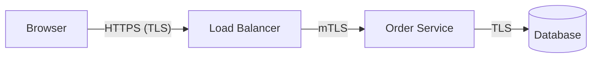
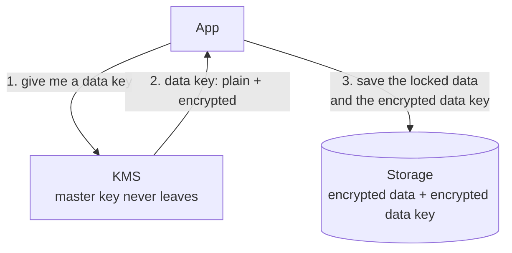

## The idea

Think about how you protect valuables:

- When you **send** them, you put them in a locked box, so the courier and anyone on the way can't open it. That is **encryption in transit**.
- When you **keep** them at home, you put them in a safe, so a burglar who gets in still can't take them. That is **encryption at rest**.

Either way, the lock is only as good as **where you keep the key**. A safe with the key taped to the top is useless. That is why managing keys matters as much as the encryption itself.

Passwords are different again. Nobody, not even you, should be able to unlock them. For passwords you use **hashing**.

## A few words first

- **Plaintext** is data you can read. **Ciphertext** is the scrambled version.
- To **encrypt** is to turn plaintext into ciphertext using a **key**. To **decrypt** is to turn it back, with the right key.
- **Symmetric** encryption uses **one key** for both. It is fast. The common one is **AES**.
- **Asymmetric** encryption uses a **pair of keys**: a **public key** that anyone may have, and a **private key** that only the owner has. What one locks, only the other can unlock. It is slower. Examples: RSA and elliptic-curve keys.

Real systems use both: asymmetric keys to agree on a shared secret key safely, then fast symmetric encryption for the actual data. TLS works this way.

## Encryption in transit (TLS)

Data moving over a network should always be encrypted with **TLS**, the same thing that puts the "S" in HTTPS. It stops anyone on the way from reading or changing the data. How TLS works is in [HTTP and HTTPS](../foundations/http-and-https.mdx).



Where to use it:

- **From users to you:** HTTPS everywhere. Also send the `Strict-Transport-Security` header (**HSTS**). It tells browsers to always use HTTPS for your site, even if someone types `http://`.
- **Inside your network:** TLS often ends at the load balancer, and traffic inside the private network may be plain. For sensitive data, encrypt inside too. More and more companies do this everywhere, because "inside the network" is no longer treated as safe.
- **Between services: mTLS** (mutual TLS). In normal TLS, only the server shows a certificate. In mTLS **both sides** show one, so each service knows exactly who is calling it. Service meshes like Istio can set this up for every service automatically.
- **To databases and caches:** most databases, and Redis, support TLS connections. Turn it on.

## Encryption at rest

Data stored on disks, in databases, in backups and in file storage like S3 should be encrypted too. It can happen at different levels:

| Level | What is encrypted | Protects against |
| --- | --- | --- |
| **Disk** | The whole disk | A stolen or thrown-away disk |
| **Database** | The database's files, done by the database itself | Someone copying the database files or backups |
| **File storage** | Each file in S3 or similar | Leaks at the storage level |
| **Field level** | Single fields, like card numbers, encrypted by your code before saving | Even a database admin, or a leaked copy of the database, can't read them |

Database-level encryption is often called **TDE (transparent data encryption)**. "Transparent" means the app doesn't notice it: the database decrypts the data automatically when it reads it.

That is also the catch. Disk and database encryption are invisible to the app, so an attacker who breaks **into the app**, or steals its database password, reads everything as plaintext, just like the app does. These levels protect against stolen hardware and copied files, not against a hacked app. For the most sensitive fields, add **field-level** encryption, so the data stays locked even inside the database. The cost: you can't easily search or sort by an encrypted field.

The good news is that cloud providers make the first levels easy, and some turn them on by default (see Amazon S3, below).

## Who holds the keys (KMS)

Encryption moves the problem: now you must protect the **key**. The rules:

- Never put keys in code, config files or git.
- Never store a key next to the data it protects.
- Limit who and what can use each key, and log every use.
- **Rotate** keys: replace them with new ones from time to time.

A **KMS (Key Management Service)** does this for you. Examples are AWS KMS, Google Cloud KMS, Azure Key Vault and HashiCorp Vault. The most important keys live inside special tamper-proof hardware called an **HSM (hardware security module)**, and they **never leave it**. You send data to the KMS and ask it to encrypt or decrypt.

### Envelope encryption

Sending gigabytes of data to the KMS would be slow. So systems use **envelope encryption**:

1. Ask the KMS for a new **data key**. It returns the key twice: once in plaintext, and once encrypted with the **master key**, which never leaves the KMS.
2. Encrypt your data locally with the plaintext data key. This is fast. Then throw the plaintext data key away.
3. Store the **encrypted data key next to the encrypted data**.
4. To read the data, send the encrypted data key to the KMS, get the plaintext data key back, and decrypt.



It is like locking a letter in a box with a small key, then locking that small key in a bank safe that only the bank can open.

A bonus is **crypto-shredding**. If each customer's data has its own key, deleting that one key makes all their data unreadable at once, even in old backups. This helps with "delete my data" requests.

## Hashing passwords

Never store passwords as plain text. Don't encrypt them either: anyone who gets the key could decrypt them all. Store a **hash**.

A **hash** is a one-way function. It is like a meat grinder: you can turn a steak into mince, but you can't turn mince back into a steak. The same password always gives the same hash, so to check a login you hash what the user typed and compare the two hashes.

Two more things make it safe:

- **Salt:** a random value, different for each user, mixed in before hashing. Two users with the password `sunshine1` get different hashes. It also defeats **rainbow tables**, huge ready-made lists that map hashes back to common passwords.
- **Slow on purpose:** normal hashes like SHA-256 and MD5 are built to be fast, which lets an attacker with graphics cards try billions of guesses per second. Password hashes like **bcrypt**, **scrypt** and **Argon2** are built to be slow, with a cost setting you raise as computers get faster.

```js
import bcrypt from "bcrypt";

// Sign up: bcrypt makes a random salt and keeps it inside the hash.
// 12 is the cost. Higher is slower.
const passwordHash = await bcrypt.hash(password, 12);
await db.users.insert({ email: email, passwordHash: passwordHash });

// Log in: hash what they typed, with the same salt, and compare.
// isCorrect is true if the passwords match.
const isCorrect = await bcrypt.compare(typedPassword, user.passwordHash);
```

| | Encryption | Hashing |
| --- | --- | --- |
| **Can you get the original back?** | Yes, with the key | No, it is one-way |
| **Use it for** | Data you need to read later: messages, files, card numbers | Checking without storing: passwords |
| **Examples** | AES, RSA, TLS | bcrypt and Argon2 for passwords. SHA-256 for checking a file wasn't changed. |

## In the real world

**LinkedIn, 2012.** About 6.5 million LinkedIn password hashes were posted online. They were plain SHA-1 hashes with **no salt**, so attackers cracked a large share of them quickly. Years later it turned out that the breach had been much bigger.

**Adobe, 2013.** Adobe stored passwords **encrypted** with one key instead of hashed, so the same password always gave the same ciphertext. The leak also had users' password hints in plain text. By reading the hints of everyone who shared the same ciphertext, people could guess many passwords.

**Amazon S3, 2023.** Since January 2023, S3 encrypts all new files at rest by default, at no extra cost.

## In the interview

Say it in one breath when you talk about security:

> "All traffic uses TLS: HTTPS from users, mTLS between services. Data at rest is encrypted with keys kept in KMS, and card numbers get field-level encryption on top. Passwords are hashed with bcrypt, with a salt for each user."

<Callout title="Remember this" type="success">
  - **In transit = TLS** everywhere: HTTPS for users, **mTLS** between services, TLS to databases.
  - **At rest:** disk, database and S3 encryption protect stolen files, not a hacked app. Add **field-level** encryption for the most sensitive data.
  - Keys live in a **KMS**, never in code or next to the data.
  - **Envelope encryption:** a data key locks the data, and the master key locks the data key.
  - **Passwords: hash, never encrypt.** Use bcrypt or Argon2, with a **salt**.
  - Symmetric (AES) is fast. Asymmetric (public and private keys) is used to agree on keys.
</Callout>
