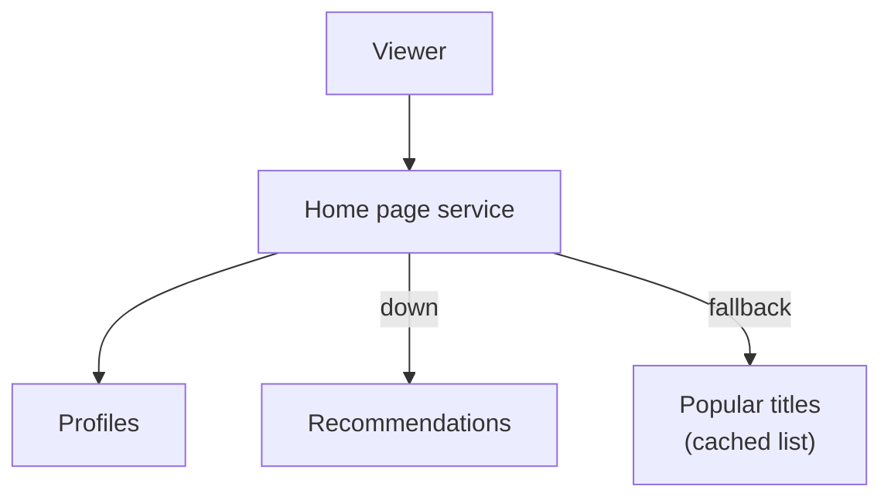

## What is it?

When a café's card machine breaks, the café doesn't close. It puts up a sign: "Cash only today". There are fewer options, but customers still get their coffee.

**Graceful degradation** means that when part of a system breaks or gets overloaded, the system keeps doing its **most important job**, and switches off or simplifies the rest. Users get a slightly worse experience instead of an error page.

The opposite is a system where any one broken part shows the user a blank page.

### The Netflix example

The Netflix home page shows rows of shows picked just for you. A **recommendations** system picks them. Netflix has written that if this system is down, the home page still loads: it shows **popular titles** instead of personal picks. And if search is slow, playing a video should still work perfectly.



The viewer gets a less personal home page, but can still press play. Watching is the core job. Perfect suggestions are nice to have.

## Why do we need it?

**A page depends on many services, and the chances of failure add up.** Say a page needs 20 services, and each is up 99.9% of the time. If the page fails when **any** of them fails, it is up only about 98% of the time (0.999 multiplied by itself 20 times). That is about a week of errors a year, even though every single service looks healthy.

**Load spikes come too.** A big sale or a viral post can bring more traffic than you planned for. Without a plan, every feature slows down at once, including checkout.

Graceful degradation breaks the chain: only the **core** features must work for the page to work. The rest can fail without the user seeing an error page.

## How it works inside

### Decide what is critical

Graceful degradation doesn't happen by accident. You decide **in advance** which features must work, and what each of the others does when it fails. Example: the product page of an online shop.

| Feature | Critical? | If its service fails |
| --- | --- | --- |
| Name, photos, price | Yes | Show an error. This is the core of the page. |
| Add to cart, checkout | Yes | Show an error and let the user try again |
| Stock count ("only 3 left") | Somewhat | Show "In stock" without the number |
| Reviews | No | Hide the reviews section |
| "Customers also bought" | No | Show best sellers, or hide the box |
| Recently viewed | No | Hide it |

The page calls each nice-to-have service with a short timeout and a fallback, often through a [circuit breaker](./circuit-breaker.mdx). A slow reviews service then can't hold up the whole page.

### What happens on one request

1. The page service calls its dependencies **in parallel**, each with its own short timeout.
2. **Critical** calls (price, cart) must succeed. If one fails, return an error.
3. A **nice-to-have** call that fails, times out, or has its breaker open gets its **fallback**.
4. Build the page from what came back. Log which fallbacks were used, so you can alert when they fire often.

### Turning off features that are not critical

Sometimes nothing is broken, but the load is too high: a big sale, a viral post, a breaking news story. Then you can switch off expensive extras **on purpose**, to save capacity for the core:

- Turn off search suggestions as you type.
- Show fewer items per page.
- Stop updating live counters like views and likes, or update them every minute instead of every second.
- Lower image or video quality.
- Pause background work that can wait, like reports and newsletters.
- Go **read-only**: users can browse but can't post or edit for a while, with a banner explaining why. This helps when the main database is in trouble but the read copies still work.

It helps to write the plan down as **levels**, so nobody has to invent it during an outage. An example plan:

| Level | What is turned off | What still works |
| --- | --- | --- |
| **Normal** | Nothing | Everything |
| **Level 1** | Recommendations, live counters | Everything else |
| **Level 2** | Also search suggestions and reviews. Smaller images. | Browsing, search, cart, checkout |
| **Level 3** | Everything except the core | Browse products and check out |

### Showing cached or default data

When the real data can't be fetched, older data is often better than nothing.

| Fallback | Example |
| --- | --- |
| **Stale cache** | Show the product list cached 5 minutes ago. **Stale** means old, but still useful. |
| **Default value** | Show popular items instead of personal picks. Show a default profile picture. |
| **Last known value** | A weather app shows the last forecast with "updated 20 minutes ago" |
| **Empty but working** | Show the page with the comments section hidden |

HTTP even has a standard way to say this. The response header `Cache-Control: stale-if-error=86400` tells a cache that, if the server returns an error, it may serve its old copy for up to a day (86,400 seconds). See [What is Caching](../caching/what-is-caching.mdx).

Two rules:

- **Be honest.** If data may be old, say so: "Prices may have changed."
- **Never fake critical results.** Don't show "Payment successful" when the payment service is down. Don't show a bank balance as current when it isn't. For those, show a clear error or "we're processing it".

### Feature flags

A **feature flag** is an on/off switch for a feature, stored in config that the app reads while it runs. Flip the switch, and the feature turns off within seconds, with **no new deploy**. A flag used to turn something off in an emergency is often called a **kill switch**.

```js
const isOn = await flags.isOn("recommendations");

if (isOn) {
    page.recommendations = await getRecommendations(userId);
} else {
    // The switch is off: show a cached default list instead
    page.recommendations = popularItems;
}
```

Flags can live in a simple database table or in Redis, or in a flag tool like **LaunchDarkly**, **Unleash** or **Flagsmith**. The same tools are used to turn a new feature on for 1% of users first (see [Deployment Strategies](../production/deployment-strategies.mdx)).

**Automatic and manual work together.** A circuit breaker degrades **on its own** when a service fails. A feature flag lets a person, or an alert, switch features off when the load is too high.

Watch out for two things:

- **Test the "off" path.** A fallback that is never used often breaks without anyone noticing, and you only find out during the outage.
- **Clean up old flags.** Hundreds of forgotten flags make the code hard to understand.

## When to use it

- **Pages built from many services**: home pages, product pages, feeds, dashboards.
- **Known peaks**, like a big sale or a launch. Plan the levels before the day.
- **Any system with a clear core job** (watch, buy, send) and many extras around it.
- **Slow or busy networks**: lower the video or image quality instead of failing.

**Don't use it when:**

- **The result must be exact**: payments, bank balances, medical data. A partial or old answer is worse than a clear error.
- **The feature is the core.** You can't "degrade" checkout on a checkout page. Protect it with spares instead.
- **The system is one small service.** There are no separate parts to switch off.

## Alternatives

| Option | What it is | Pick it when |
| --- | --- | --- |
| **Fail with a clear error** | Show an error and let the user try again | A partial answer would mislead the user |
| **Redundancy and failover** | Spares that keep the full feature working | The feature is critical and must not degrade. See [Redundancy and Failover](./redundancy-failover.mdx) |
| **More capacity** | Autoscaling, or extra servers ready before a peak | Peaks are predictable, and paying for capacity is cheaper than losing features |
| **A static fallback page** | A simple page served from the CDN when the whole site is down | Nothing works at all. Better than a browser error. See [CDN](../caching/cdn.mdx) |
| **Queue the work** | Accept the request now, do it later ("we're processing your order") | Writes that don't need to finish right away |

## In the real world

**Netflix, 2010.** The recommendations example above comes from a Netflix post about lessons learned from moving to AWS.

**Streaming in the 2020 lockdowns.** In March 2020, with much of Europe at home, the European Union asked streaming services to lower the load on internet networks. Netflix and YouTube lowered their default video quality in Europe. Videos still played, just less sharply.

**Video quality that adapts.** YouTube and Netflix change the video quality while you watch, based on your internet speed. On a slow connection you get a blurrier picture instead of endless buffering.

**Facebook's Gatekeeper.** Facebook built an internal system called Gatekeeper to turn features on or off for chosen groups of users while the site runs, without a new deploy.

## In the interview

When a design has many services, say which ones are critical and what happens when the others fail:

> "If the recommendations service is slow or down, the circuit breaker opens and the home page shows a cached list of popular items. Users can still search and buy. The core flow never depends on a nice-to-have service."

<Callout title="Remember this" type="success">
  - Keep the **core job** working. Switch off or simplify the rest.
  - **Why:** a page that needs 20 services fails whenever **any** one fails. Degrading breaks that chain.
  - **Inside:** call services in parallel with short timeouts. Critical calls must succeed, the rest get a fallback.
  - Decide **in advance** what is critical, and what each fallback is.
  - Fallbacks: **stale cache**, **default data**, **hide the feature**, **read-only mode**.
  - **Feature flags** and **kill switches** turn features off in seconds, without a deploy.
  - Never fake critical results like payments. Tell users when data may be old.
  - **Test the fallback path**, or it won't work when you need it.
  - **Alternatives:** a clear error, redundancy, more capacity, a static fallback page, a queue.
</Callout>
