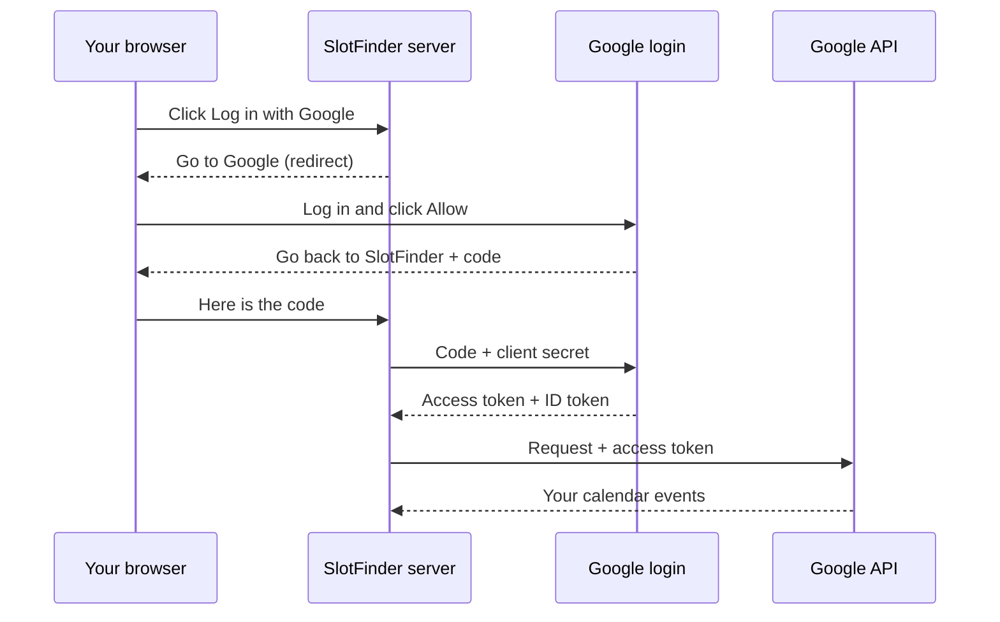

## The idea

Some cars come with a **valet key**. You give it to the parking attendant. It starts the car and drives it, but it can't open the boot or the glove box. You never hand over your main key.

**OAuth 2.0** is a valet key for your online accounts. It lets an app get **limited access** to your data on another service, without ever seeing your password. For example, a meeting planner app called SlotFinder can get permission to **read** your Google Calendar, to find times when you are free, but not to read your email or delete anything.

**OpenID Connect (OIDC)** is a thin layer on top of OAuth that adds **login**: it tells the app **who you are**. Together they power every "Log in with Google" button.

## The problem OAuth solves

Before OAuth, if an app wanted your contacts from your email account, it asked for your **email password** and logged in as you. This was a bad idea:

- The app could do **anything**: read all your mail, send mail as you, even change your password.
- The app **stored your password**. If the app got hacked, so did your email.
- To stop one app, you had to **change your password**, which broke every other app too.

With OAuth, you log in **on Google's own page**. Google asks "SlotFinder wants to see your calendar. Allow?" Then it gives the app a **token** that can only do that. You can take it back any time in your Google account settings, without changing your password.

## The four roles

| Role | What it is | In our example |
| --- | --- | --- |
| **Resource owner** | The user who owns the data | You |
| **Client** | The app that wants access | SlotFinder |
| **Authorization server** | Logs you in, asks your permission, gives out tokens | Google's login server |
| **Resource server** | The API that holds the data | The Google Calendar API |

**Scopes** are the exact permissions the app asks for, like "read your calendar" or "see your email address". The user sees them on the **consent screen**, the "Allow?" page. A good app asks for as few as it can.

## The authorization code flow, step by step

This is the flow almost every web and mobile app uses. Example: you click **"Log in with Google"** on SlotFinder.



<Steps>
<Step>

**You click the button.** SlotFinder sends your browser to Google with a link like this (split over lines so it is easy to read):

```http
GET https://accounts.google.com/o/oauth2/v2/auth
  ?client_id=slotfinder-123
  &redirect_uri=https://slotfinder.com/callback
  &response_type=code
  &scope=openid+email+profile+calendar.readonly
  &state=k8Jd02
```

- `client_id`: which app is asking. SlotFinder registered with Google earlier and got this ID, plus a secret.
- `redirect_uri`: where to send you back. Google only accepts addresses that were registered in advance, so an attacker can't have the code sent to their own site.
- `scope`: what access the app wants. `openid email profile` is for logging you in. `calendar.readonly` is for reading your calendar. (Each provider names its scopes its own way, and Google's real ones are long URLs. The name here is shortened to keep the example readable.)
- `state`: a random value. When you come back, SlotFinder checks it is the same one. This stops an attacker from tricking your browser into finishing a login they started (a **CSRF** attack).

</Step>
<Step>

**You log in at Google and click Allow.** Your password goes only to Google. SlotFinder never sees it.

</Step>
<Step>

**Google sends you back** to `https://slotfinder.com/callback?code=4xT9...&state=k8Jd02`. The **authorization code** is a one-time ticket. It works only once, and only for a short time.

</Step>
<Step>

**SlotFinder's server swaps the code for tokens.** It calls Google directly, server to server, and sends the code plus its **client secret** (a password for the app itself).

</Step>
<Step>

**Google returns the tokens**: an **access token**, often a **refresh token**, and, because the `openid` scope was asked for, an **ID token**.

</Step>
<Step>

**SlotFinder calls the API** with the header `Authorization: Bearer <access token>`.

</Step>
</Steps>

**Why the extra step with the code?** The browser's address bar is not a safe place for secrets: web addresses end up in browser history and server logs. So only the short-lived, one-time code passes through the browser. The real token is fetched **server to server**, and getting it needs the client secret, which an attacker doesn't have.

### PKCE: for apps that can't keep a secret

A mobile app, or a website that runs fully in the browser, can't keep a client secret: anyone can download the app and look inside. These apps use **PKCE** ("pixy", short for Proof Key for Code Exchange):

1. The app makes up a random secret, the **code verifier**, and keeps it.
2. In the first step, it sends a hash of it, the **code challenge**.
3. When swapping the code for tokens, it sends the original code verifier. Google hashes it and checks that it matches.

Someone who steals the code doesn't have the verifier, so the code is useless to them. Today's security advice is to use PKCE for **every** app, even ones that also have a secret.

### Other flows

| Flow | Used when | Example |
| --- | --- | --- |
| **Authorization code + PKCE** | A user logs in to a web or mobile app | "Log in with Google" |
| **Client credentials** | A service calls an API as itself, with no user | A nightly billing job calling a payments API |
| **Device code** | The device has no easy way to type | A smart TV shows a short code, and you enter it on your phone |
| **Implicit** and **password** | Old flows | Don't use them anymore |

## Access tokens and refresh tokens

| | Access token | Refresh token |
| --- | --- | --- |
| **Used for** | Calling the API | Getting a new access token |
| **Sent to** | The API, with every request | Only the authorization server |
| **Lives for** | A short time: minutes, up to about an hour | A long time: days or months, or until taken back |
| **If stolen** | Works only until it expires | Dangerous. Keep it safely stored: on the server, or in the device's secure storage for mobile apps. |

**Why two tokens?** A short-lived access token limits the damage if it leaks. The refresh token lets the app get a new access token quietly, without asking the user to log in again. And when you remove the app's access in your Google account, the refresh token stops working.

With **refresh token rotation**, every time a refresh token is used, the server gives out a new one and cancels the old one. If an old one is ever used again, it was probably stolen, so the server cancels them all.

An access token can be a random string that the API looks up, or a **JWT** that the API can check by itself (see [Cookies, Sessions and JWT](../foundations/cookies-sessions-jwt.mdx)). A token response looks like this:

```json
{
  "access_token": "ya29.a0Af...",
  "expires_in": 3599,
  "refresh_token": "1//0gLx...",
  "scope": "openid email profile calendar.readonly",
  "token_type": "Bearer",
  "id_token": "eyJhbGciOiJSUzI1NiIs..."
}
```

## OpenID Connect: adding login

OAuth answers "**what can this app access?**" It doesn't answer "**who is this user?**" An access token says "this token may read the calendar", and the app isn't meant to look inside it. Before OIDC, every company bolted login onto OAuth in its own way, and some of those ways were not safe.

**OpenID Connect** adds login on top of OAuth, in one standard way:

- The app adds the `openid` scope.
- Along with the access token, the app gets an **ID token**: a signed JWT that says who logged in.
- A standard `/userinfo` address gives more profile details.
- Each provider publishes its settings at a standard address, `/.well-known/openid-configuration`, so login libraries can set themselves up.

Inside an ID token:

```json
{
  "iss": "https://accounts.google.com",
  "aud": "slotfinder-123",
  "sub": "110169484474386276334",
  "email": "asha@example.com",
  "name": "Asha Rao",
  "iat": 1763540000,
  "exp": 1763543600
}
```

| Field | Meaning |
| --- | --- |
| `iss` | **Issuer**: who made the token (Google) |
| `aud` | **Audience**: which app it is for. It must be your own client ID. |
| `sub` | **Subject**: the user's permanent ID at Google. Find the user by this, not by email, because people can change their email. |
| `exp` | When the token expires |

The app must **check the signature** with Google's public keys, and check `iss`, `aud` and `exp`. Then it creates its **own** session for the user, like any normal login.

| | OAuth 2.0 | OpenID Connect |
| --- | --- | --- |
| **Answers** | What can this app access? | Who is this user? |
| **Main token** | Access token | ID token (a JWT) |
| **The token is for** | The API | The app |
| **Example** | "SlotFinder may read your calendar" | "This is Asha, asha@example.com" |

OIDC also gives you **single sign-on (SSO)**: log in once, and get into many apps. At work, you log in to your company's identity provider, like Okta or Microsoft Entra ID, and then open email, chat and HR apps without logging in again.

## In the real world

**Everywhere.** "Sign in with Google", "Sign in with Apple" and "Sign in with Microsoft" are all built on OAuth 2.0 and OpenID Connect. OAuth 2.0 became a standard in 2012, and OpenID Connect in 2014.

**The fake "Google Docs" app (2017).** In May 2017, an email spread saying someone had shared a Google Doc with you. The button led to a **real** Google consent screen, but the app asking for access was a fake one simply named "Google Docs". People who clicked Allow gave it access to read and send their Gmail, and it then emailed itself to all their contacts. Google shut it down within about an hour. OAuth kept everyone's password safe, but users still had to read what they were allowing. Google has since added more checks for apps that ask for sensitive access.

## In the interview

Don't design your own login system unless you are asked to. Say:

> "Users log in through an identity provider with OpenID Connect, using the authorization code flow with PKCE. Our backend checks the ID token, then gives the user a short-lived access token for our APIs and a refresh token. The API gateway checks the access token on every request."

<Callout title="Remember this" type="success">
  - **OAuth 2.0** = limited access to your data that you can take back, without sharing your password. A valet key.
  - **OIDC** = OAuth + login. It adds the **ID token**, a JWT that says who you are.
  - **Authorization code flow:** go to the provider, user clicks Allow, a code comes back, the server swaps the code for tokens.
  - Use **PKCE** for every app, and `state` to block CSRF.
  - **Access token:** short-lived, sent to the API. **Refresh token:** long-lived, kept safe, gets new access tokens.
  - Check the ID token's signature, `iss`, `aud` and `exp`. Identify the user by `sub`.
</Callout>
